# Pi模型接入与路由

本页持有ModelRuntime装配、来源／认证／目录、每次请求准入、虚拟路由及内层模型费用合同；正式执行／资源关闭见[Pi运行与扩展](Pi运行与扩展.md)，产品对象与消息边界见[架构约定](架构约定.md)。当前版本与迁移证据只在[Pi版本与升级](Pi版本与升级.md)，复用取舍只在[演进依据](Pi能力复用与演进.md)；有限消费者不证明任意插件或全部API兼容。用户行为以模型／用量及开发路径spec为准，当前结果读PROGRESS。

## 工具内模型目录与请求

模型目录帧由同一会话 `ModelRuntime` 提供；`CodingExtensions` 在原请求快照里发布安全的公开 chat 与 typed（chat/image/classifier）描述、provider ID 与显示名，Worker 的 `getAll/getAvailable/find`、`getModelsOfType/getModelOfType/findOfType` 及 `getProviderDisplayName/getRegisteredProviderIds` 读取该帧并返回独立副本。provider 元数据只投影字符串 ID／名称，不传 `Provider` 实例、认证状态、配置或凭据；尚未接入宿主的 Provider 与认证操作及本地 `ModelRegistry.refresh` 必须显式拒绝，不能读 Worker 的默认 `ModelRuntime`。typed `getAvailableOfType` 是单独的异步宿主查询：沿当前原事件／工具 scope 调用 `ModelRuntime.getAvailableOfType`，认证检查的 AbortSignal 与该查询关联；取消或 owner 关闭会中止查询。此查询只做原 Runtime 的认证可用性过滤，不发送模型请求、不创建 Durable 任务或写入。宿主 canonical 模型（含执行头）继续供原 SDK 准入与请求使用，线程投影不回写它；`classify`与`generateImages`分别只承接已确认的有限消费者，完整路径与限制见本页分类／图片小节及各自原记录，不由目录读取开放执行。下一次原事件／工具调用重取快照，暂停／关闭期间的快照等待仍受原 signal 与资源代次拒绝。

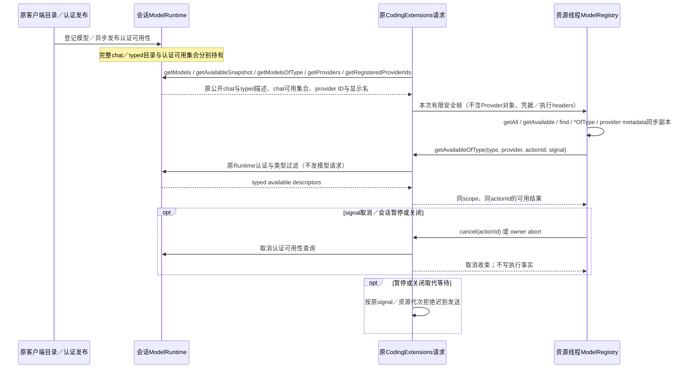

工具内的主动模型消费者仍在原工具scope内，通过公开ToolExecutionApi.createTask创建owned单次任务；Models与signal仅取子TaskRuntime，线程只传有限模型身份／正文／参数，宿主按原canonical对象执行。子任务在请求前保存execute检查点，重开遇到该检查点只报原结果未知，不重新执行；真实结果在原task outcome及非模型投影的请求事实条目中保存，正常原工具结果承担模型可见返回及工具用量。原SDK的unsafe恢复／取消不调用afterTool；已确认费用不能因此丢失。暂停／关闭完全join并关闭旧Harness后，同一目录认领下只用公开createSession重开原存储作有限费用事务，不创建scheduler或执行资源；明确继续前也可在原paused Harness对账。事务核真实model child的owner、原call及全部直接确认响应，正常SDK结果已同事务计账则只记消费回执，否则向唯一UsageDoc.tools加尚未消费的真实费用，并按child ID登记conversation回执。task文档终态会退役，不能靠其accounted标记恢复。内层工具在自身settle事务消费同回执，正式结果仍保完整usage且外层不再累计。取消／unsafe恢复的SDK原工具结果可能没有usage字段，宿主不改旧条目或伪造结果；真实请求事实和官方工具桶保费用。关闭到对账之间意外退出的窗口仍存在，读取不修复，下一次明确继续先完成对账，不声称与旧SDK结果同一事务。没有新Generation、输入队列、会话assistant或另一个存储目录。

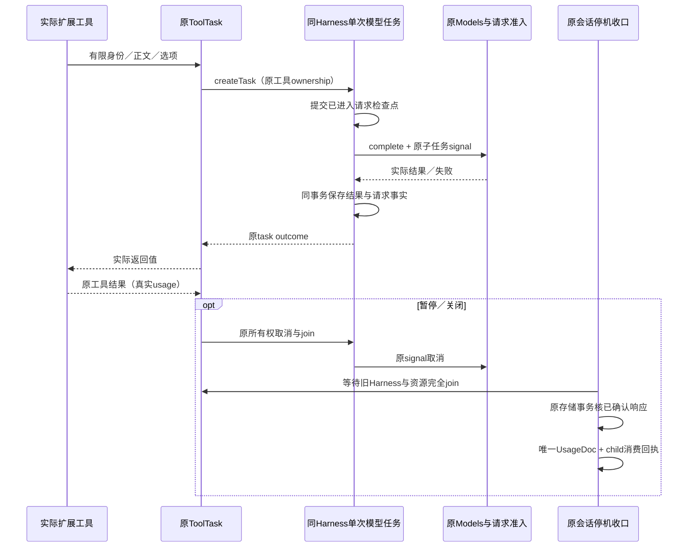

owned streamSimple／原生 stream 的边界仍由同一单次任务持有：Routing 只在核实该 Harness 的 task/conversation/owner、execute 检查点、canonical ref 与活跃 runtime.signal 后认领短命作用域；普通 Generation 的已提交计划分支不变。Host 按原 worker/scope/action/child 身份和递增序号转交真实非终态 SDK 事件，最终 done/error 描述随原 task outcome 保存，等该事务完成后才交 Worker 公共流。提前 break 不另启取消，result-only 仍由同一 host 调用 drain。关闭先使原 scope 失效，再让本地流有限失败、原 host 调用与 execute 收束；旧 worker/旧序号不进入新流。该事件桥不是新 scheduler、消息历史或计量写入者，partial 不进入正式累计用量。

Worker 明确传 stream／streamSimple 模式，Host 校验后沿同一个模型子任务分派。原生流只由可信 Host 在短命认领内附带内部 Symbol 标记，Worker 的 JSON 不能伪造；标记在最终 provider 调用前移除。同一完整准入先裁定模型，再核原生协议与权威思考参数是否一致；当前支持的 openai-completions 选项原样交 SDK stream，不能用 simple 改写。跨 API、不等价思考、任意 samplingParams 覆盖及未接选项明确拒绝。same-API 改选保标记重分派并重新解析最终来源认证。未发出错误复用完整的未发出消息／零 Usage，原工具、费用对账和关闭不因错误消息缺字段失去收束。其余原生API单列未支持状态，按已确认产品消费者及本页能力复用基准选择后续适配，不由上游枚举自动派工。

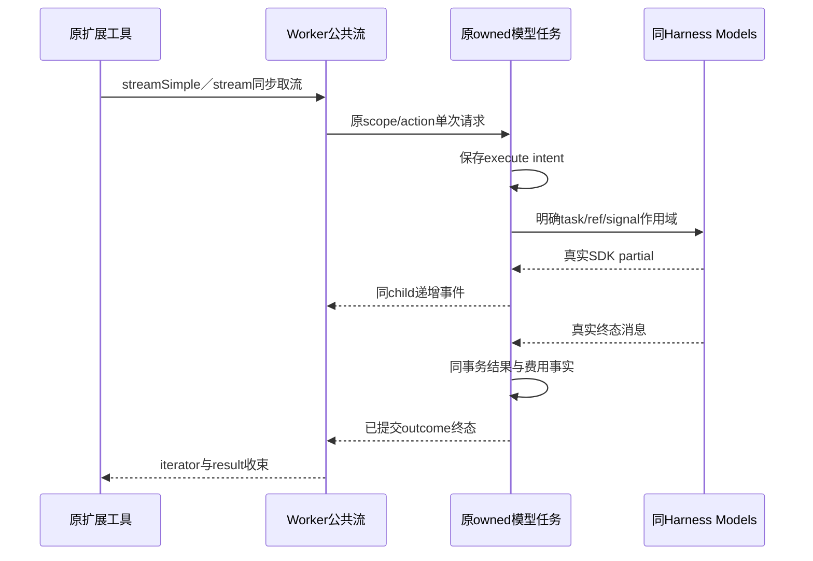

声明式provider headers的有限消费者保持原ModelRuntime和受管provider权威。Runner只把有限config与当前Worker句柄交Host；Host核本会话确有原受管来源，再将公开非凭据头投影到该受管provider的chat Model.headers（这是SDK真实请求消费者，单写Provider.headers不足以生效）。原stream/filter及认证策略、模型身份／协议／端点／能力保留，原auth.resolve／toAuth返回值在SDK合入Model.headers前核与公开声明的大小写无关碰撞，任何动态私有头撞名都明确拒绝，不从合并后的值反猜旧认证头。不把裸config登记替换原请求准入或认证包装。此适配只承接当前headers语义，不宣称SDK config层查询或任意config/native定义均已兼容。

每会话登记消费者捕获原受管provider对象及当前声明认领；撤销／失败／关闭只在当前Runtime仍为本代投影时恢复原对象。real的可信来源刷新在同次同步装配后重新投影当次源，其他会话不共享该覆盖；外部替换使原声明失效，旧清理不碰新值。模型调用在原guard入口复核声明仍归当前登记，失效时明确失败，不绕完整App准入。SDK准入当次改选后，registered仍核受管身份／能力，实际重分派从本会话Runtime的getPhysicalModel读取canonical投影，再由原SDK重新解析最终来源的认证。可信刷新按每个已开client分别尝试，保存失败到全循环之后返回；某会话撞名失效不截断其余会话的真实目录同步。

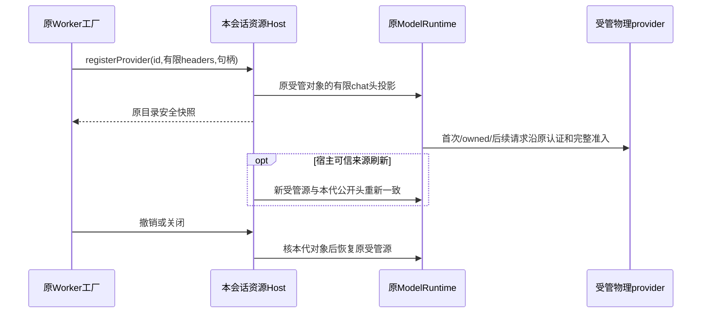

普通扩展virtual direct继续复用原Runner与ModelRuntime：`bindCore`第三参数接收真实定义，函数留在原Worker，只向Host发送有限定义和不透明句柄；Host在原资源事件scope确认登记，再发布公开目录帧。物理登记冲突由原ModelRuntime拒绝，不替换原provider包装。当前资源只持有自己的登记和原canonical对象引用；撤销、失败回滚与close均核本代身份，不能由旧同名清理删除新登记。

原owned模型child先保存execute intent，再经同一Routing短命认领进入ModelRuntime。direct resolve调用Host包装的原Worker回调，RPC只投影本次request（含真实messages、direct与思考档位），原signal映射本地controller；认证材料不进入线程。Host按原model child／signal、当前Worker和登记句柄在await前后核身份，再依provider/id从原Runtime解析physical对象；回调返回的Model端点、headers不参与物理执行。direct返回state不另写文档或推进既有Generation Plan/State。

新增route请求在原signal或资源关闭时发送abort、删除该pending并有限拒绝，迟到reply自然丢弃；它不加入工具execute的join集合。Worker的非协作route函数可被原资源最终关闭淘汰，不使原模型child与关闭互等；这不改变已有任意非协作工具execute的证据边界。没有新增scheduler、输入队列、超时强杀政策或默认模型重试。route的ctx只读目录／cwd／session／signal继续走原Runner公开检查；captured pi facade本片尚未承接，在公开ExtensionRuntimeState.assertActive叠加本scope拒绝且先保留原stale检查。这样setActiveTools和registerTool都在写入前失败，不依赖事后refresh或手工回滚SDK map；正常工具scope不受影响。该接缝不隔离项目JS自行文件／网络作用，也不宣称完整virtual回调API均兼容。

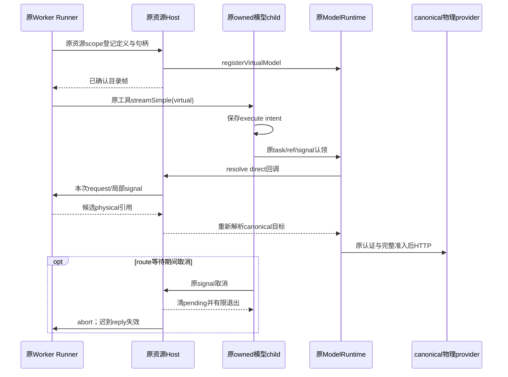

## 预设、自定义与在线目录装配

2026-10-09设计的模型目录切片于 2026-10-10 按已冻结清单逐项接入主目录（`main`），承接[模型规格](../spec/模型选择与自动切换.md)与[SDK核对](Pi-1.0.0-虚拟模型与运行恢复.md#2026-10-09预设供应商与在线模型信息核对)。本节约束当前实现；现已验收的单条custom仍沿前次验证记录，新接入没有因为设计成立而算完成。当前智能体运行入口明确为Durable，模型管理按需复用ModelRuntime；后续组件取舍按[能力复用基准](架构约定.md#pi-coding-agent-能力复用基准)及演进依据处理，不因旧全接口目标改换运行所有者，候选也不因方向确认自行切换。

职责保持现有模块：contracts定义有限请求、目录/认证安全视图与接收校验；renderer读取选择/目录状态并提交明确动作；main装配safeStorage、受限认证浏览器操作及adapter；application管理用户选择、接收/保存/关闭门控；Pi adapter管理SDK模型集合、按供应商的CredentialStore和独立目录缓存。SDK供应商拥有auth与stream协议，Pi Durable继续拥有执行和历史，不再造输入队列或引入另一执行harness。

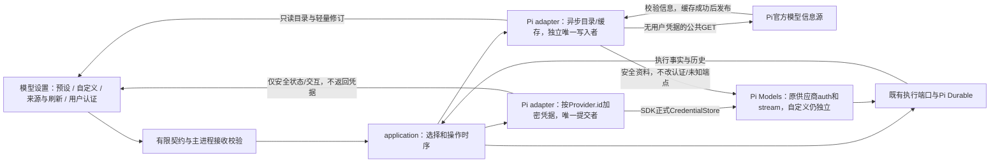

在线接口优先沿Pi已发布的canonical provider目录，不在客户端重写models.dev全量供应商映射或直接import构建生成器。Builtin工厂与原auth/stream不变，目录只更新已验证的模型信息；请求API/目标由本地已接入实现和用户配置约束。不能直接给所有预设复用原single-custom credential reader。旧记录承接必须保留独立custom身份和加密内容；已保存的custom服务定义与当前选择分别维护，应用预设/重开仍可派生原custom安全表单与留用密钥条件。全部定义、凭据/选模的同一物理文件变更在唯一提交通路合并，防异步OAuth刷新丢其他供应商更新。影响执行中供应商的用户认证写入与选模使用相同的真实相位/接收/关闭门控；供应商认证代次必须在实际commit点拒绝旧流程，不仅在UI端忽略结果。未被使用的另一供应商可独立提交，SDK原请求自己的令牌刷新仍沿原有正式通路。

启动先异步恢复缓存并立即提供只读目录，网络检查随后进行；不在工作快照频繁复制全目录。目录来源/请求代次归目录服务持有，旧源的fetch、取消和关闭后结果不写新源缓存或发布。网络/接收/缓存错误保留有效资料及事实来源，不把目录异常映射成工作执行成功/失败。

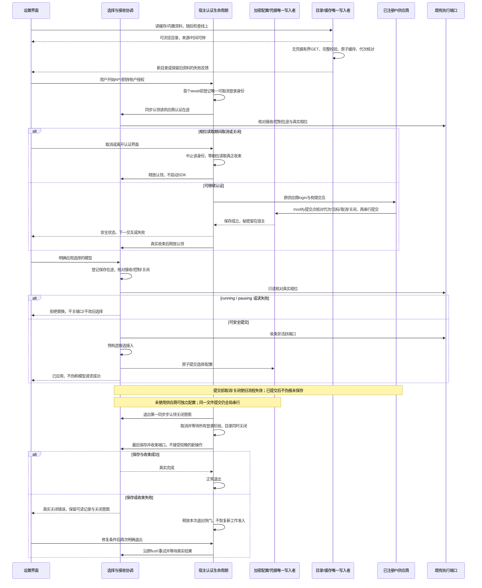

桌面退出与App收束分别持有本次在途结果：并发退出共等原flush，失败后App清掉失败promise，宿主也释放flushStarted，下一次明确退出才重试。关闭意图不回退，既有认证／目录收束不重复启动；修复权限后仍要求实际保存及进程正常出口，不把强杀或关闭错误确认算成功。

宿主 `ProviderLoginController` 只持有认证交互身份、取消和收束，不推进工作输入或选择；应用持有认证 admission 与关闭意图，加密存储持有凭据提交。相位读取、SDK 登录和退出复用同一登录记录，避免调用方分别维护 pending/active 两份身份。

本轮新增依赖/上游代码按实际使用登记；不会为采用在线模型目录默认加入coding-agent的同步store、环境认证扫描或完整CLI依赖。端到端须区分公开目录实时获取、受控HTTP供应商传输、真实SDK、真实账户和用户视觉接受。现状及源身份由本轮验证记录维护。

## 每次 SDK 请求的身份与采用目标

Generation计划与返回状态沿原task／attempt／cutoff由公开接口同事务保存；恢复重读已存计划，不重新resolve或访问内部TaskRuntime。调用信号须归属同一次请求，无法绑定的虚拟请求拒绝，不退成direct。具体公开hook签名随锁定版本及迁移记录核对，不沿旧1.0文字推定现版接口。

返回路由状态与请求计划同一事务提交，恢复同一准备点重读计划、不重复 resolve。工具后继续依据 LiveDoc 的正式输入集合，不因工具结果或扩展追加的 user 角色误认新外部输入。Compaction 的 completeSimple 是独立 direct 消费者，不推进会话路由状态。适配的运行证据与各消费者覆盖在新阶段单列，当前 D1 PASS 不替该接线验收。

每次物理请求按完整待发正文和本次模型已知的上下文／输出上限估算容量，沿 Pi `clampMaxTokensToContext` 收紧输出预算；不把模型最大输出量当作每次必须预留，也不用另一模型的旧 usage 缩小待发正文。容量不足走原 Durable overflow 失败通路，不发送超限探测，未知字段不补值。

请求发出前的虚拟失败不发布为物理来源或物理用量。Deferred 作业同存原调用身份和真正返回的物理句柄；await 期间改选后，poll／cancel 仍消费该次已存计划与实际句柄，不从旧 checkpoint 推断来源。各协议和来源是否支持该消费者，仍以其实际接入与运行证据为准。

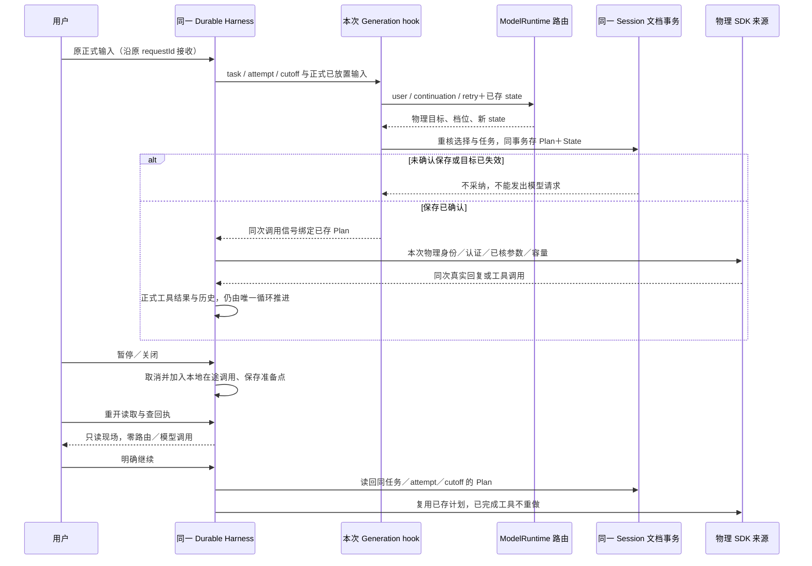

应用层持有能力／认证／额度／暂停的准入裁定；适配器为每条真实端口装配独立模型客户端。后开的S2不改变S1，配置／认证／目录刷新同步已开和后续客户端的同一有效来源集合。

SDK 到达供应商包装时，原模型 A 的认证已解析。裁定采用 B 时，不能只替换模型对象后调用捕获的 A 方法，也不能把 A 的 `apiKey`／认证头／环境覆盖再次传给 SDK。适配器去掉这份已解析认证，保留原上下文、取消信号与一般参数，经同条会话 SDK 客户端重新解析 B 的供应商与认证；B 包装重新核完整准入并记录自己的真实响应。B 未登记、认证失败或条件已变时，本轮明确收束，不能回退 A、重投输入或重复工具。相同采用身份直接消费当前正式供应商请求。

采用目标同时携带该模型逐档核实的 `thinkingLevel`。Auto 重新采用 B 时，只有 B 本次能力资料仍支持的旧档位才保留；缺键或明确 `null` 都清除为来源默认，不把 SDK 的缺键默认或自行降档当产品核实。端口配置与本次 SDK 裁定消费同一值。请求包装覆盖已捕获的旧 `reasoning`，`null/off` 清除旧值，并在普通Generation／simple路径经SDK `streamSimple`的正式逐协议映射；受支持native stream保真正原生分派并另核参数等价；无准入装配时保留 SDK 原调用语义。不存在应用层手拼供应商思考字段或新增探针。

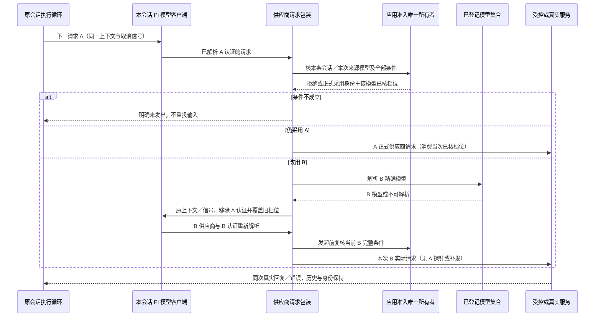

候选范围的“用户已保存过范围”标记与设置同份状态原子保存，清空后重开仍为空范围；保存失败保持旧正式事实。初始旧单模型可保兼容路径，但能力／额度／认证／相位均仍核实。设置和新会话默认值在首个异步校验前分别登记在途认领，真实关闭拒绝新动作并等待已认领的校验及写盘收束，不用较早保存的释放清掉后来者。各次已校验请求在应用层同一队列按顺序保存：前次结果真实收束后，用已成功提交的状态加本次字段生成完整快照。A 失败时，仅改主题的 B 不承接 A 的名单或默认；默认注册表与设置均在同次保存成功后发布。

## 模型选择与自动路由：所有者与事件顺序

本节记录 D 片（会话级模型选择、条件参数、账户额度与自动路由）的内部所有者与事件顺序。用户可见行为在 [模型选择与自动切换](../spec/模型选择与自动切换.md) 与 [页面与交互组件](../spec/页面与交互组件.md#工作输入区)，本节只标明谁拥有什么事实、按什么顺序发生。

四份事实各有唯一所有者，互不重叠：**设置里的新会话默认**与**每条会话自己的选择**是两份（`settings.newSessionModelChoice` 与 `SessionModelRegistry`）；**已核实的能力资料**归 Pi 内置目录（`PiCapabilityPort` 读 `Model.thinkingLevelMap`）；**额度事实**归 `QuotaPort`；**路由判定**是无状态的纯函数（`decideModelRouting`），不碰端口、不发请求、不写状态。`state.sessionModels` 只是持久化与快照的投影，每次使用前从注册表重取。

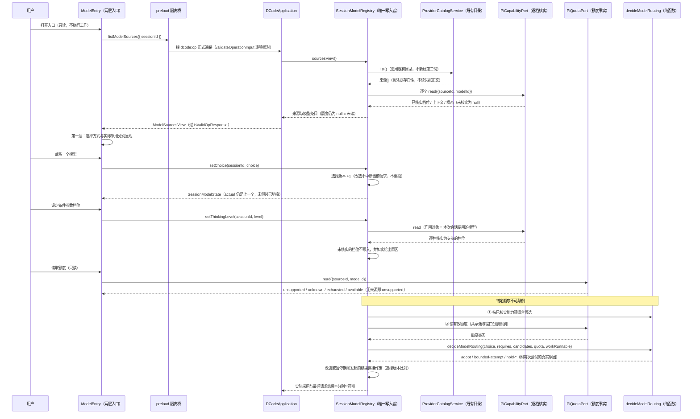

四条不可越界的判定边界：

- **能力筛选先于额度，且只用已核实资料。** 先按 `VerifiedModelCapabilities.supports` 逐项筛，再读额度；反过来会让额度多或便宜的模型挤进不适合当前工作的范围。逐项资料未核实的模型**不进入候选**——把没核实的说成适合，比说「没有适合候选」更坏。
- **「已知全部耗尽」与「额度未知」不是同一件事，且不可互相改标。** 前者保留工作等待明确继续，额度恢复、查询失败或转为未知都**不**自动续跑；后者才允许有界尝试同一原工作请求（不另发探针、不重复输入、不重放已完成工具）。任一适合候选已知耗尽时，存在有效耗尽依据，未知候选不能单独把判定拉回有界尝试。
- **共享池按 `poolId` 判定，窗口单独标识。** 同一池内一个窗口耗尽时，池内另一个窗口的「可用」不采信——否则就是拿另一窗口的剩余冒充本次可调用。`available` 必须带 `updatedAt` 且 `reason` 为 null，接收侧强制「可用」有可核对来源。
- **没有可靠额度来源就如实 `unsupported`。** 旧1.0公开接口审计不作为当前版本全部接口证明；来源尚无已核可靠读取能力时，返回 0 会把「查不到」说成「一定没有额度」，返回可用会让自动路由采信未经核对的来源，用 token 或价格表估算则不是账户事实。
- **条件参数只认逐档核实。** `thinkingLevelMap` 的键值有三义：字符串＝已核实支持，`null`＝已核实不支持，**缺键＝未核实**（用来源默认值）。把缺键当成支持是按名称猜档数；当一档都没核实出来时必须附真实说明，否则界面无从区分「已核实不支持」与「未核实资料」。
- **迟到结果在两处判废。** 能力资料读取后与额度读取后各比对一次选择版本；期间发生的改选、暂停、目标或配置失效优先于旧结果，旧结果不写入任何状态、也不用于发起请求。
- **指定模式不扩大范围。** 候选集合仅含该模型：额度未知时只对该模型有界尝试，不开放其它候选；能力不足或额度耗尽时保留真实原因，不擅自换备用、不悄悄退回自动。
- **配额读取不得成为执行路径。** `readModelQuota` 与 `resolveSessionRouting` 都只读事实：不同步发送、不启用执行、不解除暂停，也不因为读到就推进原工作。

### 真实请求怎么消费每会话选择、事实怎么回来

选择只影响**后续**请求：每次真实提交前按此刻的目标重新应用一次；chat实际采用与chat用量只由执行端观察到的真实chat助手事实发布；分类／图片用量按原child／action事实派生，不造responseId、不改chat actual，判定层永远不写 `actual`。

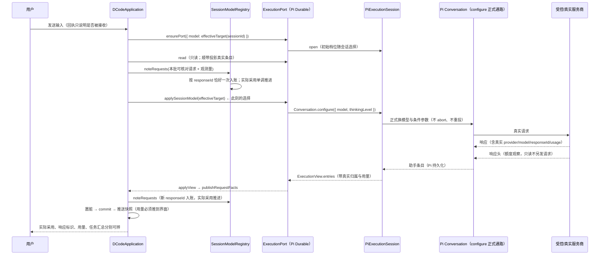

这条链上必须成立的四条边界：

- **提交回执不构成归属证据。** `accepted` 只说明输入被接收；用了哪个模型由助手条目里的 `provider`/`model`/`responseId` 决定。
- **条件参数走 configure 正式通路。** 应用层不拼 provider 原生参数；正在输出的那次请求不被改档，它自己的 `thinkingLevel` 记在该次条目上。
- **实际采用单调推进。** 取「已入账序列的最后一条」，不取「本次观测批次的最后一条」：重开或执行端换实例后视图可能只含更早的条目，按批次取会把归属回退成旧请求。
- **观测发布必须置脏重渲染。** 真实请求事实是界面要显示的事实；不置脏时界面会停在发布前那份快照上（用量已记录、入口仍显示「尚无记录」）。

## 分类与图片消费者

### 扩展分类消费者的所有者与费用

已配置预设来源的原 `getAllModels` 保留 classifier/image；chat 的远端目录、picker 与 Auto 继续只收 chat。原客户端在配置/认证刷新时重建同一已配置来源集合，typed 不另起凭据或通知链。`classify` 只在原活动工具 scope 下创建 `dcode.extension-model` 子任务；Worker 不直连网络或凭据，资源/只读路由回调不能启动它。原输入问题不可由扩展 provider 回调改写。

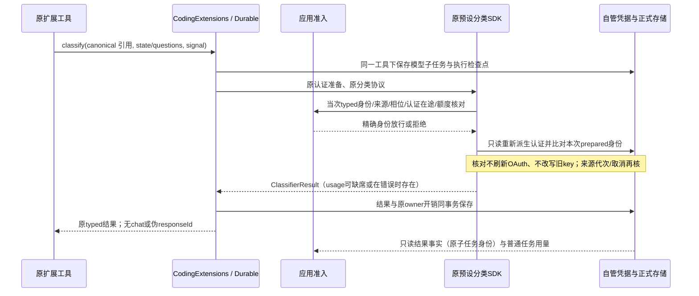

分类结果按原 childTaskId/actionId 标识去重；只发布成功分类或带实际 usage 的错误/取消。子任务存在本身不证明 HTTP 已到服务端，本地拒绝不记成已确认计费请求。真实费用仍进入原 ToolExecutionResult/唯一 UsageDoc；桌面沿既有逐次请求事实派生任务用量，不新建累计台账，也不把分类模型写成聊天 actual。暂停/关闭 join 原 RPC、子任务和 HTTP；重开只读不加载资源或对账，明确继续只收口原结果未知的 execute 检查点而不重发。

认证核验覆盖一次已识别的异步读取窗口；它不是跨外部文件写入与网络dispatch的全局原子锁，不能据此宣称消除任意跨进程换凭据竞态。

### 扩展图片消费者：响应、核验与停机对账

`generateImages`复用分类的typed目录／当次准入／只读认证重核与原Durable模型子任务，不把image变成chat。`images-bridge`核原输入／有限结果与选项；`image-validation`在原调用拥有的固定外层Worker中使用SDK公开`resizeImage`真实解码，MIME容器和尺寸门在解码前成立，原字节／base64不变，SDK同步fallback不在主事件循环。容器检查对动画计画布及累计帧预算；公开helper的可解码结果不声称完整native内存隔离或已验证所有动画帧的像素。资源取消／预算到期只请求terminate，实际exit才兑现Promise；较新abort优先于已排队success。

费用的原child消费回执`ModelSpendAccounted`可选扩充有限`response`，只存原child／owner／conversation／action身份和原SDK metadata／usage，不存未验图。响应一到就在同进程Map认领并通过原Harness的公有Session.commit保存；`publishedToOwner`仅表示结果／usage已进入原工具消费来源，不等于官方累计已消费，`done`仍是唯一去重位。最终运行事务才发布可用图片及原ExtensionModelSpend；停机维护在原Harness和全部资源join后、释放目录认领前，保存旧Session无法提交的同进程回执并按原child一次消费UsageDoc。已记ToolResult只与published部分核和，response-only费用另按done消费；不覆盖旧工具结果或伪造child completed。事务先读完tasks／entries，再统一append，不能写表后读取表。

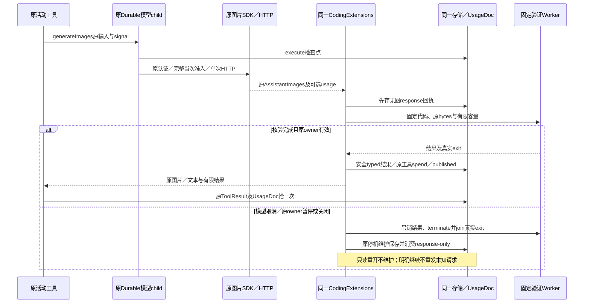

原Session已封住或存储失败时，有限回执在同进程原调用持有；停机维护失败须阻止正常关闭与认领释放。崩溃前尚未持久提交的内存回执不承诺无损。缺usage保持未知，坏图保真实费用；本地拒绝不推导HTTP。模型原responseId只保核对材料，逐次事实仍按operation＋原child/action requestId去重，不写chat actual或另建累计账。

