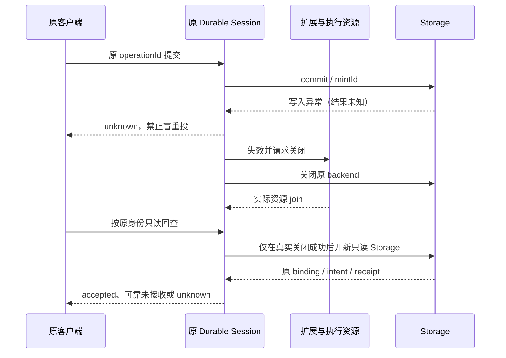

# Pi 版本与升级

本文件维护最近一次统一版本检查、升级取舍和迁移证据入口，不维护第二份工程进度。实际依赖版本唯一以根 `package.json`、`package-lock.json` 为准；安装目录若不同应查清原因，不能把公开 latest 或本文表格当作项目已升级。当前工程状态见 [PROGRESS](../PROGRESS.md)。

## 开工检查

- 每次新会话开始，先读项目 package／lock，核对当前锁定 Pi 依赖组及已记录的最近检查。
- 每天首次开发由协调者按 Asia/Shanghai 日期统一检查 [Pi 官方稳定发布](https://github.com/earendil-works/pi/releases) 与 npm 的 `@earendil-works/pi-coding-agent`、`pi-durable`、`pi-ai`、`chord`、`pi-telemetry` 实际元数据；其他成员复用当天结果，不各自重复查询。未有协调者时，由本次明确承担协调职责的执行者检查。
- 记录检查时间、来源、项目锁定版本、上游稳定版本及结论，在本文件更新“最近检查”，不每天新建文档。预发布、上游 main 或 API 存在不等于稳定发布／可替换本地实现。
- 发现新版先评估全部跨越版本变更、现有消费者、数据与恢复兼容、验证成本，再按实际授权升级；不自动改依赖。查询失败或来源不一致记未知，继续无关工程，不凭空报无更新，不建定时自动化。

## 最近检查

时间：2026-10-19 12:59:48 +08:00（Asia/Shanghai），执行者：协调者 Root。公开 registry 五包查询均成功；当时根 lock、全部已安装同组包（含嵌套副本）均为 1.0.0。Node 实际 `v22.22.3`，满足上游 `>=22.19.0`。直接四包及 telemetry override 当时固定 1.0.0；本表记录升级前事实，不预报升级完成。

| npm 包 | 检查时项目 lock | 上游稳定版本／元数据 |
| --- | --- | --- |
| `@earendil-works/pi-coding-agent` | 1.0.0 | [1.3.0](https://registry.npmjs.org/@earendil-works%2Fpi-coding-agent/latest) |
| `@earendil-works/pi-durable` | 1.0.0 | [1.3.0](https://registry.npmjs.org/@earendil-works%2Fpi-durable/latest) |
| `@earendil-works/pi-ai` | 1.0.0 | [1.3.0](https://registry.npmjs.org/@earendil-works%2Fpi-ai/latest) |
| `@earendil-works/chord` | 1.0.0 | [1.3.0](https://registry.npmjs.org/@earendil-works%2Fchord/latest) |
| `@earendil-works/pi-telemetry` | 1.0.0 | [1.3.0](https://registry.npmjs.org/@earendil-works%2Fpi-telemetry/latest) |

官方 [v1.3.0 发布](https://github.com/earendil-works/pi/releases/tag/v1.3.0)标为最新稳定版，2026-10-15 UTC 发布。原始公开元数据、完整版本路径、安装目录与 hash 保存在 `/Users/diwu/.codex/visualizations/2026/10/03/01a1029e-4403-7333-b95f-7e54a70cb6e1/pi130-migration-20261019/preparation-r1/daily-version-check.json`。首次盘点假设 telemetry 被提升到顶层而未找到；随后按 lock 真实嵌套路径更正读取，不是依赖已损坏。

结论：507 已明确授权在干净 `main` 直接固定升级适配到 **1.3.0**，沿 coding-agent＋Durable 原方案，Root 唯一写入；不引入第二个执行循环、历史或接收队列。升级前 HEAD 为 `813b434017c2970dfb9287be8026412462b45263`，index／工作树干净。完整源码与旧依赖恢复依据保存在 `/Users/diwu/Workspace/Archives/dcode-prototype-implementation-2026-10-10/main-before-pi130-20261019/manifest.json`；后续技术验证未完成前不称 1.3.0 已验收。

## 本次迁移核对范围

跨越版本须包括 1.0.0 之后的修订、1.1、1.2 和 1.3，依据各包固定 v1.3.0 的 CHANGELOG 与实际源码：[Durable](https://github.com/earendil-works/pi/blob/v1.3.0/packages/durable/CHANGELOG.md)、[coding-agent](https://github.com/earendil-works/pi/blob/v1.3.0/packages/coding-agent/CHANGELOG.md)、[pi-ai](https://github.com/earendil-works/pi/blob/v1.3.0/packages/ai/CHANGELOG.md)、[Chord](https://github.com/earendil-works/pi/blob/v1.3.0/packages/chord/CHANGELOG.md)、[telemetry](https://github.com/earendil-works/pi/blob/v1.3.0/packages/telemetry/CHANGELOG.md)。

| 变化 | D Code 接收边界 |
| --- | --- |
| Storage 扫描顺序、context 参数 | 实际存储适配器和直接消费者同步，旧历史分页及同一对话上下文不能反序或错位 |
| StorageRejected 移除，StorageRequestError 与 SessionFailed | StorageRequestError 仅非法读取可豁免；commit／mintId 异常仍使 Session 失败，接收结果保持未知至可靠只读回查。只有接收前无副作用校验拒绝，或可靠回查确认未接收，才能报告未接受，不盲重投 |
| Durable tool result 的 output／structuredOutput、model／nested union、非零命令结果 | 只在 Durable 边界适配；普通 coding-agent 扩展仍用 content，禁止全局替换；保工具失败反馈、原身份、费用与取消 |
| before_agent_start trigger／busy 与 emitBeforeAgentStart | 同步真实事件调用和已接收输入语义，重开读取不执行扩展或模型 |
| Kimi 等模型协议／URL与身份 | 对照固定官方消费者，核下一实际请求，旧模型配置不得静默借新协议绕过准入 |
| 原生 executeTool、嵌套任务与 Durable codemode | 必要兼容先完成，再评估复用；API 存在不自动证明可删当前桥，必须逐项保已验所有权、权限、回执、输出及生命周期 |

阶段验证采用隔离项目、旧受控数据副本与真实 SDK 配受控 HTTP；不访问真实账户、用户项目或重启用户窗口。核旧历史、暂停／明确继续、只读重开／receipt lookup 零请求零工具重放、存储未接受／未知、同任务两轮编码与实际差异、扩展／MCP／虚拟路由和受影响模型协议。集成须有对应 1.3 的架构正反、类型、Lint、构建、runtime、contracts 和后台隐藏界面证据，再独立 `507-review`，通过后按授权及时本地提交。直接在 main 提交即本次整合，不另造 merge；没有 push／tag／release 授权。

## 2026-10-19 迁移记录与接收边界

每日规则已独立核对并单独保存为 `31fba66e158248dd7bd9336766fbf74318302c7b`。升级前完整源码恢复点为 `/Users/diwu/Workspace/Archives/dcode-prototype-implementation-2026-10-10/main-before-pi130-20261019/manifest.json`；其中独立保留旧 1.0 依赖，仅用于生成隔离旧数据，不承接迁移实施。主树四个直接 Pi 包及 telemetry override 已固定 1.3.0，实际依赖树也已核到同组 1.3.0；安装成立不等于迁移验收。

本轮外部原始证据根为 `/Users/diwu/.codex/visualizations/2026/10/03/01a1029e-4403-7333-b95f-7e54a70cb6e1/pi130-migration-20261019`，每次检查分别保存原 argv、cwd、开始／结束、数值或信号出口、完整日志与前后源码身份。初次类型失败、存储错误认领时序反例、夹具前置错误及普通 Worker 初始化失败均保留；后者已取得实际 `MCP public entry unavailable`：旧 `manifest.version===1.0.0` 在空 MCP 配置也会拒绝初始化，不归因于原生流或分档参数。守卫现同步到固定 1.3，原正负例定向通过，尚不替代下方最终门槛。

受影响192项的首次完整组合为189pass／3fail，原出口1保留。实际修复了单份大图因同时发送output／content而重复冲破16MiB封套，以及旧Azure来源适配后SDK原azure目录未清空的泄漏；目录基准断言按固定1.3真实claude-sonnet-4-5的200k更新，仍核在线400k覆盖与模板保真。原三反例修后3/3真0，不据此代替整片。MCP新增send第二参已透明透传；原关闭包装在DELETE已到后仍等待挂在token的发送，其wrapped close和自然Worker退出两反例先红，修复保取消通知原grace后交给真实运输关闭、最终资源线程仍由宿主实际join。新分档采样反例去守卫时真正发出未经准入的modelId，保护时零内层HTTP；早期夹具未分清该坏请求归属的超时仍保留，不拿它冒称目标断言红。

适配仅在真实消费边界进行：Durable 使用 `output`，普通扩展仍使用 `content`；普通 MCP 的 `structuredContent` 保存在 `details.structuredContent`，并在原扩展读回边界还原，诊断、用量与失败语义保持。新版 Durable 原生 `structuredOutput`／`structuredOutputSchema` 尚未接入或验证，不能由上述普通结果兼容声称已支持；新 `executeTool` 仍明确拒绝，不冒称已采用原生工具执行路径。旧自有嵌套工具 task 只迁输入／检查点定义，不借升级重放已执行阶段；旧终态结果仍保读者。Azure 继续使用 D Code 既有 `azure-openai-responses` 来源与凭据键，只有公共目录查询用 SDK 新 `azure` 路径且不借旧路径 ETag；API ID 仍为 `azure-openai-responses`。Kimi 的受管 preset 整体采用新 Completions 协议与 `/coding/v1`，普通 custom 不按同名／地址猜测迁移。合成旧协议上下文进入真实 HTTP 与实际旧盘升级分别取证。

写入失败后的只读回查顺序如下，原目录 claim 一直由当前会话持有；`Session.closed` 不单独证明 backend close 与资源退出均成功。

已实际生成并验证的旧数据包括已完成、暂停模型、unsafe 工具中断、native v1 completing 无 kind 结果，以及普通扩展 v1 已完成嵌套结果和中断的嵌套模型。它们均使用旧 SDK 真实记录，在副本中验证，原日志／副作用保留；上述旧数据只承担对应阶段证据；最终1.3门槛、固定入口、隐藏路径及独立接收分别见本节末。本次不新增前台窗口操作或重启用户窗口；原1.0可见证据不冒称新1.3前台证据，前台视觉和507人工接受单列未验证，不成为技术提交的人工前置。本段历史实施过程不单独构成PASS。

新版custom message的`triggerTurn/nextTurn`独立启动消费者及完整起跑窗口busy／取消等，仍需按完整SDK父目标接续；本迁移只同步现有user启动调用签名，不将保存custom消息说成已启动custom run。现有手工owned桥仍承接原所有权／准入／回执／费用；新native executeTool、codemode或Chord host API存在不自动授权替换，也不以本片迁移通过取消其余已确认范围。

独立源码预读又指出失败组合：backend.close抛错会跳过外部resources.done。Root在原固定候选上补两个可拒绝反例，lookup与close各自先命中真实“资源门未放而动作已结束”断言红；原同时发lookup／close的准备稿受closing门拒绝，未当业务红。修复保原backend错误优先，并不论底层close／closed结果均等资源join。原稳定轮的架构／类型／Lint／构建／旧数据与runtime602均已真实0、同源218/1d0e67，但整套驱动只在当前命令结束边界收束，未启动UI E2E，不能称整套通过。修后相关session／live-read-pause共15项与类型检查已真实0、同源218/e3c335；随后完整轮及限定复核结果在本节末分别登记。原驱动143是协调驱动在真实runtime结束后的停止信号，不是runtime子命令出口。

第二固定候选 `218/e3c33569a8824adedd6b2c045e518094ded283b1ed01be8c47fd5c2086e225d5` 的十三项命令现已全部真实 exit 0：架构正反32、源码检查、全类型、全范围Lint、构建、旧native4／普通扩展2、runtime603、contracts14、完整隐藏E2E156、固定入口只读预检、实际同组依赖树及运行演示。每门完整日志、出口、起止和源码前后map见外部根 `stable-gates-r2/ledger.json`；156项没有fail／skip／cancel。接续独立审查已核其组合资格，另发现首次commit原Error叠并发pause会误报未接收：Root在原r2真实写盘后丢应答、并发暂停，原ID查回accepted且零模型／工具，最后精确命中not-accepted/paused与unknown的断言红。修复按是否进入commit判断不确定接收，不再只识别SessionFailed；事务内明确PreparationPaused与接收前暂停仍可拒绝。直接／prepared两分支和原生命周期边界共17项真0（218/edfd1aea），限定增量门槛及最终独立复核已在下方接收，不以原十三门或新17绿单独替代该结论。最早外部测试.ts因模块格式未启动、后续把只读查询与close元数据收束混算的断言红均保留，不冒称业务红；精确反例是raw-commit-pause-target-red-r3。 新增测试整合后的类型门曾发现assert.equal已窄化true后仍访问never.error的冗余分支；仅删除该不可达分支，原unknown断言不变，原typecheck出口2保留。 其后Lint按prefer-const要求将测试中单次赋值的operationId改成同值const，未改产品判定、门控或断言；原Lint出口1同样保留。

MCP connecting补证另保存于外部根 `mcp-readiness-r1`：原`tool_search`在真实`tools/list`门未放时不返回，放门后同callId装载实际目标并仅一次物理append，真实下一HTTP、当次回复及非空promptGuidelines均成立；擦掉内部`reachesTools`的对照在未放门时早返回，命中目标断言红。正样本命令整体仍exit1，因为最后另验的首个HTTP缺MCP服务摘要。固定1.0与1.3的MCP均写`systemPromptOptions.sections.mcp_servers`，D Code旧桥与本版均只读force，因此这是前存完整SDK消费者缺口，不能归为本次升级新增回归，也不能由等待补证称为摘要已支持。本迁移不扩入该未实现消费者，原失败及父目标继续保留。

修后最终代码 `218/82dc1a65a6a1e515739de470a3ba6bd0f847060091c086c9fa5ebea8870fced9` 已完成十三项增量检查，所有实际子命令出口0、无超时且各门前后同源：架构正反32、源码检查、全类型／Lint／构建、旧native4／普通扩展2、runtime605、contracts14、受影响普通隐藏窗口31、固定入口只读预检、实际依赖树及运行演示。全范围Lint为0 error和一项既有Timeline warning。`stable-gates-r5/ledger.json`保存逐门完整raw／出口／起止／源码map，`r5-combined-qualification.json`核31个场景名属于原156、其余125保持原结果。r2到最终仅session.ts与对应测试变化、其余216个canonical文件逐hash未变；这是必要增量与原完整门槛的组合，不称终hash单次跑156。此前正常可见证据仍只归原1.0，不冒称1.3前台视觉或507人工接受。

最终独立审查已接收：Standards／Spec／CodeQuality三项PASS，无本次迁移剩余阻断；[完整报告](/Users/diwu/.codex/visualizations/2026/10/02/01a0fd5d-2c45-7783-bdeb-42ce2e19d2dd/Pi-1.3.0-迁移独立审查-2026-10-19.md)的SHA256为`4ba492fdc7b75cff8c9d04734af566f6f8f506ff348893f7cc2c024515930135`，绑定r6固定清单（manifest SHA256 `ae86f1eff4057f88eaaa3007dc4d2bedbab87b4522148d45246db377b3dc1b3d`）与最终218/82dc1a65代码。其后仅本段、README、PROGRESS回填实际接收和交付引用，没有产品／测试／配置变化；主会话核对该事实增量，不重跑无变化检查或等待原容量失败的审查会话。

已验完整恢复源见`/Users/diwu/Workspace/Archives/dcode-prototype-implementation-2026-10-10/main-after-pi130-accepted-20261019/manifest.json`。实际本地提交、完整HEAD、35路径范围、工作区clean和提交后安装版本／入口检查，以本轮[交付回执](/Users/diwu/.codex/visualizations/2026/10/03/01a1029e-4403-7333-b95f-7e54a70cb6e1/pi130-migration-20261019/local-delivery/receipt.json)为准；直接main提交即本次整合，不另造merge，不push／tag／release。原1.0基线与所有首次失败保持可恢复，不扩大为整个SDK或产品完成；按后续安排固定当前入口供507试用。

## 历史身份

[Pi 1.0.0：虚拟模型与运行恢复](Pi-1.0.0-虚拟模型与运行恢复.md)及原验证记录维持各自固定源码／运行身份，不把其结果改写成 1.3。上轮 runtime592／contracts14／界面156组合属于原 1.0；原完整界面138pass／18fail／exit1及一次15秒关闭超时未知根因仍保留，不以本次升级追补旧成功。本次升级的实际修复、失败、门槛与独立结论见本文件迁移记录，PROGRESS只登记实质进展。
