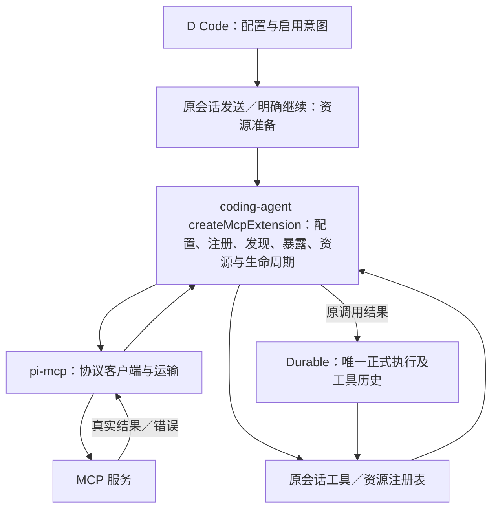

# Pi 能力复用与演进

## 确认与适用范围

2026-10-19，507 在「D Code · 主会话」（`01a0fd5d-2c45-7783-bdeb-42ce2e19d2dd`）确认本页的职责与取舍，由协调者同步正式依据。源码核对基线是已验 Pi 1.3 迁移后的 main `e023a80556d013f550caa398975161a83b35e36b`。该身份只定位本次判断，不是另一份版本台账；实际依赖以根 [package.json](../package.json)／[package-lock.json](../package-lock.json) 为准，每日检查时间、上游版本与升级记录只在 [Pi版本与升级](Pi版本与升级.md) 维护。

首版按现行 spec 的完整用户路径和具体行为验收，不再以 coding-agent 所有非 UI 接口逐项兼容为完成标准，也不以消除 coding-agent 依赖为目标。Durable 是**智能体正式执行、输入接收、历史与任务恢复的唯一底座**；pi-ai 提供底层模型能力。D Code 继续负责产品对象、成员授权和桌面交互。手动终端的进程、输出与历史仍按原终端规格归属，不因本页改交 Durable。

已确认的开发路径、模型与虚拟模型、暂停／关闭／只读重开、成员、手动终端及手机／远端要求继续有效；已接收消费者的具体合同和已有修复不撤销。未适配 SDK 接口须如实登记、调用时明确拒绝；仅因上游有某个接口，或历史曾写“完整 SDK 父范围”，不再自动派成首版任务。仍有明确产品要求的缺口继续待办，未知不标完成。具体行为唯一正文见 [开发任务路径](../spec/开发任务路径.md#真实编码能力与验收)、[暂停与恢复](../spec/任务暂停与恢复.md)、[模型选择](../spec/模型选择与自动切换.md)、[用量与账户额度](../spec/用量与账户额度.md) 和 [工作台信息架构](../spec/工作台信息架构.md)。

本轮只核对固定源码并整理文档；没有替换 read、改接 MCP、修改依赖或执行新的工程／窗口验证。以下“当前实现”“候选”和“已有验证”分别判定。

## 已确认的职责与取舍

| 能力 | 当前实现与确认选择 | 候选及验证边界 |
| --- | --- | --- |
| 正式执行、输入、历史与恢复 | 继续用 Durable 的同一 Harness／会话；不另启普通 AgentSession 循环、接收队列或正式历史。 | 后续适配仍保原输入／任务身份、未知先查回和已完成作用不重放；本页不改变运行底座。 |
| 底层模型与模型管理 | pi-ai 是底层模型 SDK；继续复用 coding-agent `ModelRuntime` 的模型、来源、认证和目录能力，按会话装配客户端并接入 Durable 路由。 | 模型管理复用不连带承诺任意插件模型 API；已支持的请求、参数、费用与虚拟模型合同保留。 |
| 指令、Skills、提示模板 | 保留这些产品能力，继续复用适用的公开加载／解析机制；开启扩展时用同一资源 Loader，避免重复扫描和绕过筛选。 | 可比较更简单的适配，但不因包名或减行数替换；未加载不记生效，已有输入不重复展开。 |
| 扩展事件与注册命令 | 保留现有普通扩展机制、事件和 `/命令` 分派，复用 `ExtensionRunner` 等公开接口，始终接原 Durable 执行所有者（owner）。 | 不承诺所有插件、事件、API、命令 UI 或会话树控制。新适配先有具体用途；已有接收合同不能借此删除。 |
| `write/edit/bash` | 当前直接选用 Durable 公共工具；D Code 补有界实际差异与命令退出码，结果仍属原工具。 | 保现有失败、取消与恢复语义，不另造工具运行或历史所有者。 |
| `read` | 当前仍复用 coding-agent `createReadTool`，经调用 Worker 执行，再由宿主核有限内容、图片形状／MIME／容量及图片接收。 | **优先比较 Durable read 的候选**，尚未替换或验证等价；不把 import 换名当交付。 |
| `grep/find/ls` | 继续复用 coding-agent 成熟工具，包装为 Durable 工具并在有界 Worker 中执行。 | 固定 Durable 1.3 没有这三个对应内置工具；不为删除包依赖自行重写搜索。 |
| MCP | 独立协议客户端是 pi-mcp；当前通过 coding-agent `createMcpExtension` 处理配置、注册、发现／暴露、资源及生命周期，再接入同一 Durable 工具通路。 | pi-mcp 直接适配 Durable 是**待比较候选**，没有决定替换或新增实现；不能把已有间接使用写成“尚未接 pi-mcp”。 |

源码依据是 [coding-tools](../src/adapters/pi/coding-tools.ts)、[search-tools](../src/adapters/pi/search-tools.ts)、[real](../src/adapters/pi/real.ts)、[session](../src/adapters/pi/session.ts)、[durable-routing](../src/adapters/pi/durable-routing.ts)、[coding-resources](../src/adapters/pi/coding-resources.ts) 与 [extension-worker](../src/adapters/pi/extension-worker.ts)。它们分别定位实际工厂、Worker 接收、ModelRuntime、正式会话、模型路由、基础资源和扩展／MCP 装配；源码存在不单独证明完整路径已验。

## read 与搜索的替换条件

Durable 1.3 的 read 已提供文本 offset／limit、截断及图片路径，但默认图片处理只核 header 尺寸并传递合限图片，不等于完整解码。配置公开 ImageProcessor 后才有相应解码、EXIF、转换与缩图。当前 coding-agent read 默认图片缩放加 D Code 宿主图片接收，不能直接视为与 Durable 默认工厂等价。依据见固定版本 [Durable工具入口](https://github.com/earendil-works/pi/blob/v1.3.0/packages/durable/src/tools/index.ts)、[read实现](https://github.com/earendil-works/pi/blob/v1.3.0/packages/durable/src/tools/read.ts) 与 [图片处理说明](https://github.com/earendil-works/pi/blob/v1.3.0/packages/durable/README.md)。

未来若实施替换，须比较真实任务目录／链接范围、文本分段与续读、截断提示、图片格式与处理结果、坏图和超限、错误反馈、取消与实际退出，以及原 callId／正式工具结果／后续模型上下文。显式选择图片处理策略后，才能判断替代是否保持现行合同；不默改已有图片正文、错误或容量规则。取消、暂停、关闭、只读重开和明确继续仍须回到原动作验证。

搜索沿现成 grep/find/ls 保留参数、匹配、无匹配、截断和失败结果。任务根范围、缺少二进制时如实失败、禁隐式下载、等待已认领子进程与 Worker 实际退出继续适用。Durable 负责正式调用与结果，不要求它同时提供每个底层算法。

## MCP 当前通路与候选

当前准备与执行共享同一会话认领；资源线程持有实际客户端／运输，工具与资源通过原会话注册表（registry）接入，Durable 持有正式执行和工具历史。启用设置只保存意图，发送或明确继续才允许装配；只读重开不建立连接。当前项目配置拒绝借用模型 provider 凭据，不能因 pi-mcp 有底层 OAuth 接口就声称普通客户端已全面支持该认证。

待比较的直接适配如下。它是替代方案示意，**没有与当前通路并行运行**，也没有决定跳过普通扩展机制；同一次 MCP 调用只能有一个连接所有者和一个正式执行所有者。

比较的是总适配与维护复杂度：当前扩展已承担的配置、工具注册／暴露策略（exposure）／启用工具集合（loadout）、Tool Search／Codemode、资源发现、就绪等待、结果和关闭职责，改为直接适配后分别由谁持有，能删掉什么、又要补什么。继续保留普通扩展时，绕过这层并不自动更简单。协议客户端与运输分层见固定 [pi-mcp说明](https://github.com/earendil-works/pi/blob/v1.3.0/packages/mcp/README.md)，上层合同见 [扩展说明](https://github.com/earendil-works/pi/blob/v1.3.0/packages/coding-agent/docs/extensions.md)。

两种方案都须保工具和资源发现、connecting 期间的真实就绪状态（readiness）、调用身份与有限参数、正文／结构化结果／错误、取消与实际运输关闭，以及同输入查回和恢复不重放。模型看到的指南／服务摘要另核真实请求消费者；已有 MCP 等待正例不证明所有说明段均已投影。当前服务摘要 `sections` 缺口的原失败和版本归属仍见 [迁移记录](Pi版本与升级.md#2026-10-19-迁移记录与接收边界)，本页没有补成已支持。

## 指令、Skills 与可执行扩展

Markdown `SKILL.md` 是加载给智能体的说明，JS／TS 普通 Pi 扩展是会执行的代码；保留 Skills 不要求兼容全部可执行插件。项目指令不是授权，注册目录不是已执行，设置开启不是已加载或成功。应用／项目授权根、符号链接边界、显式资源错误、同一 Loader 的筛选和资源代次继续沿现行规格。

当前复用事件、注册工具与命令的接缝已有隔离消费者证据；这不证明用户已在真实任务中使用任意业务插件，也不代表 SDK 所有事件／context 操作可用。未支持的会话树控制、UI 或主动请求选项仍明确拒绝。已接入的输入转换、模板展开、命令分派、工具 hook、模型消费者与 MCP 生命周期保留原合同、原输入身份、认证和唯一费用事实；不另建运行入口。版本升级不借扩展兼容之名新增产品权限模式或主会话操作审批。

## 上游变化触发与最低验证

每日版本检查仍只执行 [统一规则](Pi版本与升级.md#开工检查)。下表用于**发现相关变化后**选择需要复核的消费者，不是要求每次文档修改或每个新版都重跑全部场景。本轮没有执行这些替换或验证。

| 范围 | 触发复核的上游变化 | 实施或升级时最低需要的证据 |
| --- | --- | --- |
| read | 工厂／参数、结果通道、截断、图片处理器或取消合同变化；Durable 提供可替代当前读取的能力。 | 同一正式工具完成文本分段／续读、截断、支持图片与坏图／超限、路径／链接边界和错误回传；取消前／在途取消及真实退出；图片结果进入下一模型上下文；暂停／关闭／只读重开无重放。替换须有旧路径与候选的可辨对照。 |
| 搜索 grep/find/ls | coding-agent 搜索工厂、结果／二进制发现、offline 或 spawn／取消变化；Durable 将来新增对应工具。 | 实际匹配／无匹配／截断／失败与正式上下文；真实目录边界；缺二进制不下载；在途取消等子进程／线程退出，重开不再搜索。原成熟行为没有等价证据前不删除。 |
| MCP | pi-mcp 协议、初始化、关联／取消、运输关闭变化，或 coding-agent 配置、发现、exposure／loadout、资源／事件、结果通道变化。 | 受控服务实际工具／资源发现与读取、调用／错误／结构化结果、就绪门控及当次模型消费；取消后无迟发，实际 stdio／HTTP／Worker 收束；暂停、关闭、只读重开零连接及明确继续，同输入不重复执行。说明段须核真实 HTTP，非空元数据（metadata）不替消费者。 |
| ModelRuntime／pi-ai | 模型／typed目录、provider 身份、认证、协议、虚拟模型、能力与思考参数，或请求／结果／用量形状变化。 | 原会话与双会话实际下一 HTTP／当次回复、最终规范模型身份（canonical）与来源认证；完整能力／额度／相位准入，未知语义不变；上下文和已完成工具结果保留、原费用一次；暂停后的改选只影响未来请求，不重放、不隐式继续。具体模型要求以 spec 为准。 |
| 指令／Skills／模板与扩展 | 公开 Loader、路径／筛选、frontmatter／参数、事件／命令签名、默认启用、资源代次或系统说明投影变化。 | 有界应用／项目资源、缺席与声明错误、Skills／模板实际进入原输入、参数不执行 shell、不重复展开；具体已支持事件／命令／工具只处理一次，失败可辨；启用与加载分离、准备中暂停、关闭实际收束、只读重开零代码／连接／模型。只对实际受影响消费者补证，不自动兼容所有插件。 |

Durable 的接收、存储、任务、关闭或恢复合同变化，另须核原数据副本、原 operationId／submission 查回、确定未接收与结果未知、已完成工具／内层请求不重放和实际资源 join。已验的存储原 Error 叠暂停、关闭错误仍等资源退出等修复继续防回归。真实 SDK 配受控模型、真实外部账户、桌面入口、人工接受和发布分别登记；局部测试或单片通过不替整体产品完成。

## 继续复用、候选与验证替换

继续复用的依据是当前产品用途、公开接口和维护成本。上游新增能力、目录改名、依赖数量或文件行数本身不构成替换理由。read 是优先比较对象；MCP 直连是比较对象；成熟搜索与模型管理继续复用。二者都不是本轮新实施工单。

进入具体实现前，先固定所要解决的问题、当前消费者、状态所有者、需要保全的行为和数据，再比较保留／替代的总复杂度。实施沿单树唯一写入者；候选对照不与正式同一调用并行执行，不写用户真实数据或默认探测付费模型。通过相称的架构、全范围类型与 Lint、受影响完整路径及必要集成门槛后，交独立 `507-review` 核 Standards／Spec／CodeQuality，才记录“已验证替换”并切换可恢复基线。工程授权、验证结果和本地／远端交付分开。

当前 read 与 MCP 直连均未走过上述替换流程。既有迁移与普通客户端的验收只承担各自记录中的范围，不能转写成候选已验证，也不能因新取舍覆盖旧失败、版本或证据身份。

## 现有数据与回退

本次文档基线 `e023a80556d013f550caa398975161a83b35e36b` 对应的已验迁移与完整恢复入口见 [版本记录](Pi版本与升级.md#2026-10-19-迁移记录与接收边界)。本轮不写运行数据，不另做整树恢复副本。既有原始数据、旧版本记录、失败与已完成副作用按原身份保留。

未来替换／升级前固定当前源码、匹配的 package／lock、数据格式与可恢复副本；在隔离副本中验证旧记录读取、暂停、明确继续和原身份查回。回退必须核代码／依赖／数据的兼容组合，不只退一个 import 或 package 版本，也不把新 SDK 已写过的数据直接交旧 SDK 盲开。结果未知先查回；不为恢复重输旧输入、重复工具或新增费用。不得整树覆盖未验 main、从旧 HEAD 覆盖用户改动或清空用户状态；提交、推送与发布仍各按授权。
