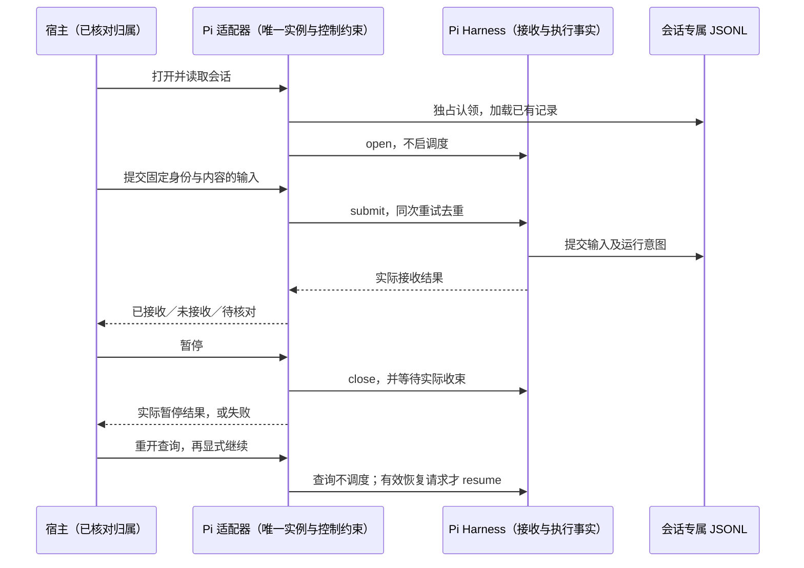
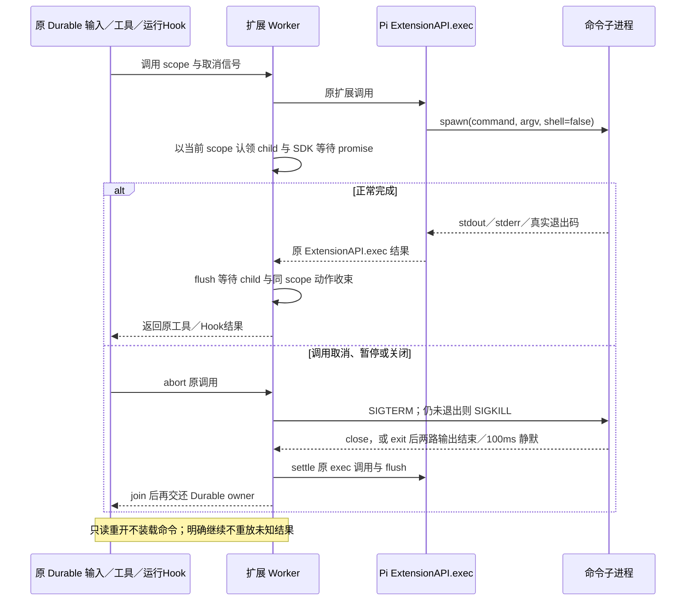
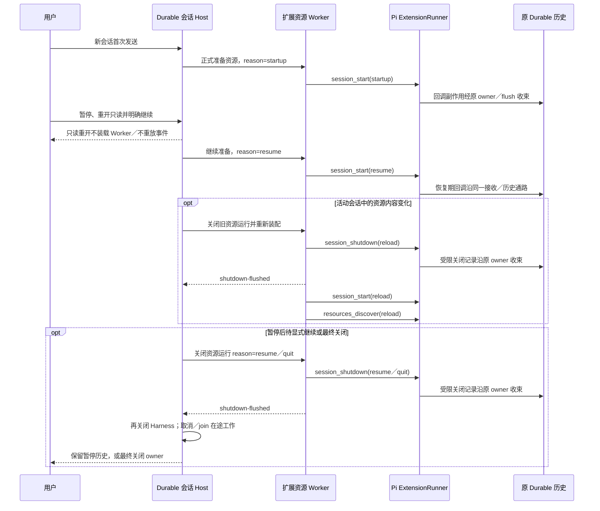
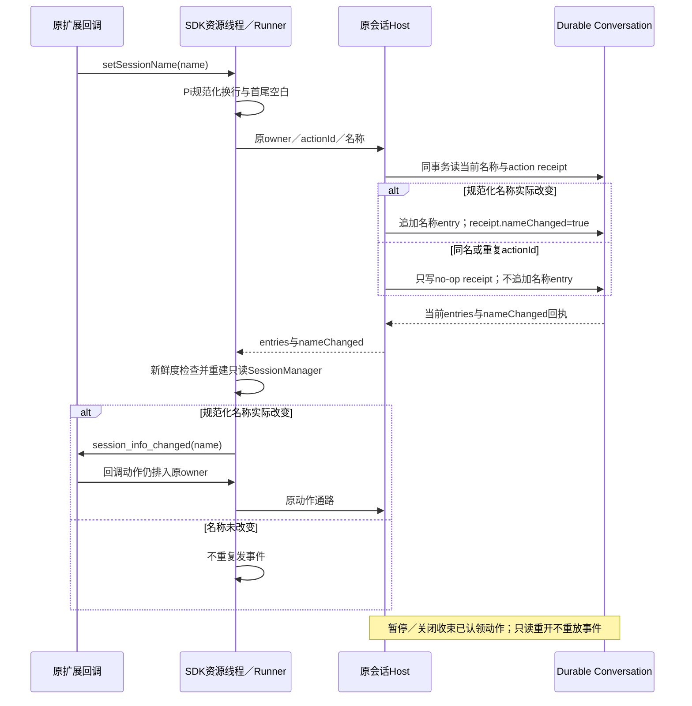
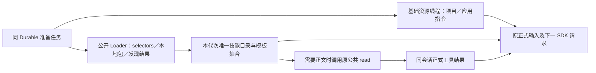
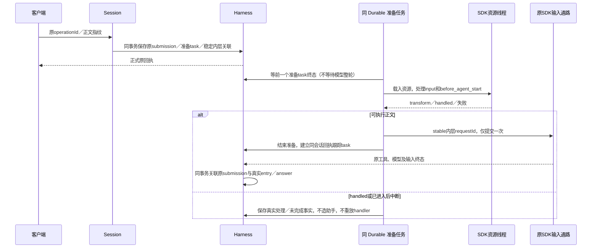
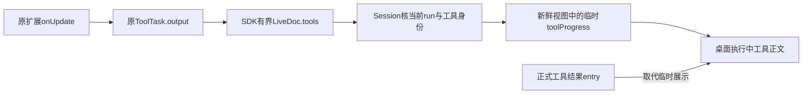
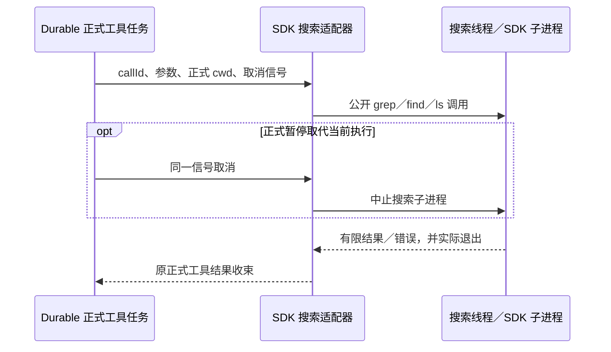
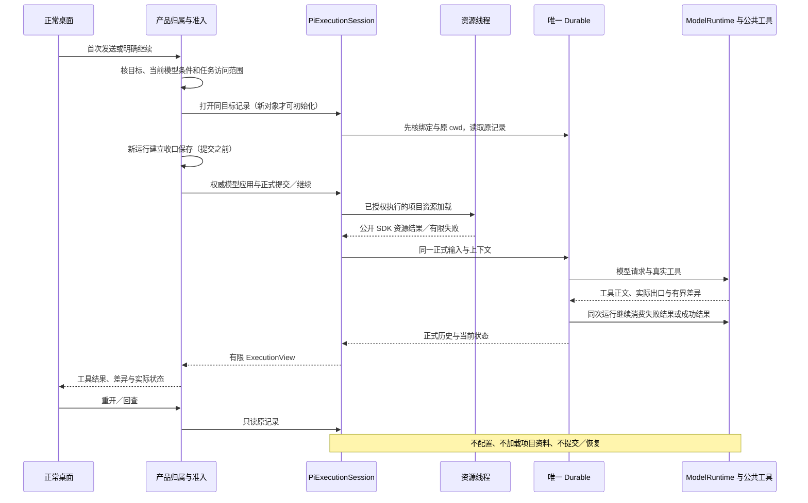
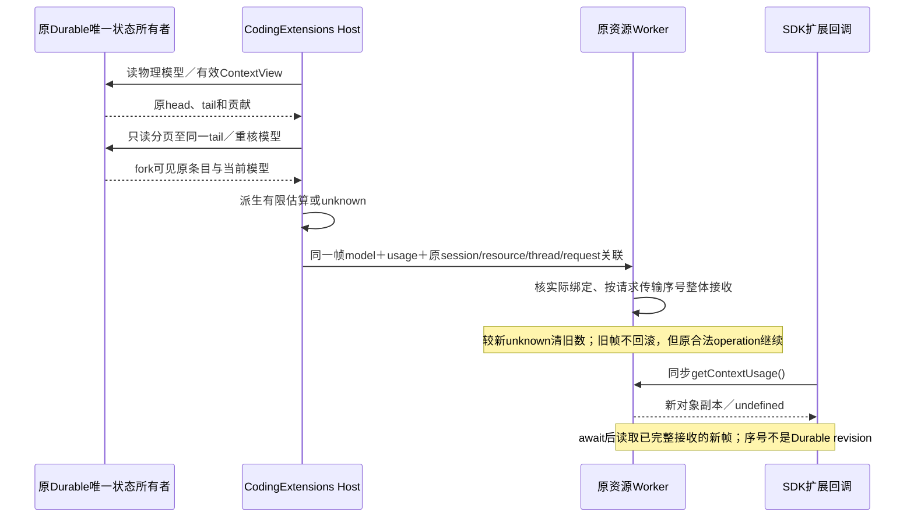

# Pi运行与扩展

本页持有Pi会话、资源Worker与工具生命周期合同；共享产品／消息边界见[架构约定](架构约定.md)，模型准入、内层请求与费用见[模型页](Pi模型接入与路由.md)。本页各消费者共用下列会话所有权、只读及关闭规则，章节只补其具体资源与例外。用户行为以spec为准，版本和历史在[版本记录](Pi版本与升级.md)，当前覆盖见[PROGRESS](../PROGRESS.md)。

## 会话执行、输入与恢复

`src/adapters/pi/`持有正式会话入口，`contracts`提供SDK无关请求／视图，`application`经抽象端口交已核会话、目录、模型和工具。每条会话独立认领存储与Harness，Durable唯一拥有接收、历史及进度；任务主／成员协调及Mac／手机访问归产品层，Pi内部Task／Conversation层级不代产品分工，一处暂停不偷停另一独立会话。

- **存储认领**：同份记录只许一个实例写入，其他实例拒绝。确认旧进程已退出后才回收其确切旧标记，无法核实则停止接入、不覆盖文件。旧实例仍在关闭时，须待真实关闭与资源释放完成后才让新实例接管；取消关闭等待不等于底层清理结束。存储单进程拥有且无跨进程锁不等于“一会话一OS进程”。[存储约束](https://github.com/earendil-works/pi/blob/a13d35a742c6ef8462812a28fbe1d8c8b7431c32/packages/durable/README.md#storage)
- **接收与查回**：open／read／receipt lookup不调度；submit先核目标及内容再沿正式记录接收。同次内容指纹只约束重试，不证明已接收或另建队列；通信／保存失败先保unknown，原身份查回，不盲重投。暂停期能否接收取实际端口结果，不新设必须接收队列；具体存储异常合同见下文[接收失败与只读回查](#接收失败与只读回查)。
- **控制**：pause拒新工作，等待真实关闭并反馈保存／收束失败；resume核当前实例与暂停版本，较新暂停可否决旧恢复。重开不承诺旧网络仍继续，明确继续依检查点，已完成工具及已进入而未知的内层请求不重放。JSONL fsync不是断电无损承诺，正常退出、强制终止与断电分别判定。
- **正文投影**：assistantText从同一历史entry.model的已提交文本块按原序生成、保entry身份，顶层model仍是当前模型。思考、工具块及流式片段不混为正文，不生成可独立写入的历史；API修复与界面消费证据分开。

运行、旧数据及各消费者的实际证据从[运行验证](../test/runtime/README.md)与[文档导航](README.md#验证记录)进入；旧1.0源码比较保在[原研究](Pi-1.0.0-虚拟模型与运行恢复.md)，不推成当前1.3逐API断言或远端／成员已验收。

## 普通编码入口与资源准备

custom／preset每会话持有ModelRuntime，沿[模型页](Pi模型接入与路由.md)登记来源并逐次准入。旧根先核同一binding和AgentDoc.cwd，查询不配置模型、不加载资源、不创建缺根。runtimeCreationPending仅表示新对象建立，端口确认且客户端保存收口后、正式提交之前解除，不当运行相位或接收结果。

主会话的项目访问沿既有任务所有者判定进入有限内部 `projectAccess`；成员范围未装配时不安装编码工具、不加载项目资料。此字段不来自界面请求，也不是产品权限模式。授权后的发送／继续在独立线程只读取项目／应用资源根本层的指令文件，按真实路径、类型、容量和 UTF-8 核对；显式技能先限定具体文件，再交 SDK 公开函数解析与格式化，不调用向祖先遍历的 context loader。符号链接不扩大范围，已声明条目失效不能当可选缺席，准备期间被暂停取代不写成存储故障。提示模板只发现应用 prompts/ 与任务 .pi/prompts/ 的直接 Markdown 文件，复用公开 frontmatter 并按固定 Pi 参数语义展开；同名按应用先定义，具体来源与 MIT 适配见 THIRD_PARTY_NOTICES。未启用扩展时保留既有未接收前转换；启用扩展时按下述同 Durable 接收／准备任务消费。查回及继续不重新展开历史。

## 项目扩展／MCP 与原 Durable 的接缝

扩展与公开read的图像结果在写入前复用共享图片合同，防非法图片污染历史后使读取失败；启动回调CustomMessage的来源／display与模型贡献同事务保留，关联原准备requestId或pi.user EntryId，false不展示但仍作为上下文。

输入启动只认请求cutoff内的原`pi.user`，准备标记用本次内部requestId查正式submission.entry关联，不以正文相同或扩展可见消息的user模型投影认领。generation的context／headers动作以原输入、原assistant轮次与attempt关联，同请求恢复保身份，不同真实请求不会错去重；资源回调另以实际线程代次隔离。线程只收到accept／content-type／user-agent公开头投影，模型认证原头保留在宿主，禁止项目回调覆盖凭据／账户头；允许的新增头合入原请求后再发。

CodingExtensions沿同会话Harness／Conversation／registry／Models协调资源，不另启AgentSession。资源Worker复用锁定Pi组的DefaultResourceLoader、SettingsManager.fromStorage、ExtensionRunner、只读SessionManager及MCP公开运输，不改第三方源码。项目settings／本地包按.pi根解析，过滤与builtin命名保SDK规则；声明缺失、越界、解析／加载失败不能空载继续。同步资源IO在线程内，消息做有限类型及容量校验；读取端口预审Loader范围不是扩展Node代码的OS沙箱。

启用扩展时，基础 `CodingResources` 只提供已绑定项目与应用根的指令正文；技能目录和提示模板只消费本次公开 Loader 的最终集合。项目 selectors、本地包过滤及 `resources_discover` 先限定根、容量、类型与文本，再沿同一 Loader 合并；不从另一目录集合复活被排除项。被 SDK 静默丢弃的声明失败须在准备阶段拒绝，合法空集合仍合法。普通具体 Markdown 技能的声明预审使用同 Settings／授权根的公开 PackageManager `resolve()` 的 enabled 结果与明确文件交集，只判必需描述／解析有效性，不拼接另一目录；自动 README、负筛选与碰撞仍保 SDK 语义，本地包清单保原 BOM 兼容。同名模板保已确认的应用优先：仅使用 SDK 已选中碰撞诊断里的应用文件，不重新扫描或绕过过滤；技能及其余重名沿 SDK 首次定义。

已加载集合的实际根和配置进入资源代次指纹。查回、读取和只读重开不刷新；下一次发送或明确继续才核文件变化并重新装配，原准备期间的开启设置变化拒绝该旧准备。扩展发现的技能和模板在 `session_start`／`resources_discover` 后重读最终集合，描述只进入目录，技能正文仍需原公共 read 的实际调用。该 read 沿原工具任务保存，外层工具结果再把真实正文交给下一模型请求，不生成第二份历史。

setSessionName沿原owner/actionId事务读当前名、规范化并记录nameChanged；真实改变才追加名称entry与投递session_info_changed，同名／重复动作只存no-op回执。Worker据Host回执发事件，不猜本地缓存；事件派生动作仍经原flush。异步状态和写回共用单调entry-id高水位，旧名称回执／普通状态不回滚新值；先收到名称快照不代表尚待到达的名称事件已交付。写后SessionManager只是只读重建，暂停／关闭join认领动作。

资源生命周期原因按实际会话来源，而非单纯“首次创建Worker”判定：

| 事件 | 原因与接收边界 |
| --- | --- |
| session_start | 全新首次准备为startup；已有会话首次装配、暂停后继续或只读重开后明确恢复为resume；活动资源变化替换为reload。不伪造未提供的previousSessionFile。 |
| resources_discover | 仅分startup与真实重载reload，发生后重取Loader最终集合。 |
| session_shutdown | 替换资源为reload，暂停后待同会话继续为resume，最终关闭会话／桌面owner为quit。原Worker／Runner关闭专用scope只许经当前owner存entry／message／name／label，拒新输入、模型、工具及MCP动作。 |

宿主先写暂停事实，等关闭回调shutdown-flushed后再关Harness；运输、活动请求与子进程仍须实际join，可与Harness取消并行，不能把两个完成点合一。只读重开不装配Worker或重放事件，明确继续才准备。真实反例与逐轮身份见[启动](验证记录/扩展启动事件原因-2026-10-16/README.md)及[关闭](验证记录/扩展关闭事件原因-2026-10-16/README.md)记录。

`ExtensionAPI.exec` 的一次性命令仍属于发起它的 Worker 调用，不另建命令任务或历史。Worker 仅在当前 `tool/`、`input/` 或 `event/` Durable scope 内接纳 SDK `shell:false` 且 `stdio` 为 ignore／pipe／pipe 的命令 spawn；资源初始化／resume、纯参数准备、关闭事件和失效调用在 spawn 前拒绝。每个直接进程按 scope 登记；原调用flush保持已验一次性命令的结束边界：进程发出 `close` 时收束；若后代继承 stdout／stderr，则在直接进程退出且两路输出结束或连续 100 毫秒无新输出时收束，避免 Worker 额外等待永久不来的 `close`。调用取消、暂停或关闭先对仍运行的直接子进程发送 SIGTERM，五秒后仍存活才升级 SIGKILL；Node 的 `ChildProcess.error`（包括终止失败）不能代替真实 `close`／SDK 静默边界，也不能提前释放 owner 与 join。这不是操作系统进程树管理。SDK 返回的 stdout、stderr、退出码及 `killed` 结果仍归原扩展调用；MCP transport 的长驻 `stdio` 进程不匹配一次性命令形状，继续由已有 transport close／drain 生命周期处理。只读重开不启动命令，明确继续不重放结果未知的原输入或已结束工具。

对外始终回原Durable submissionId；内层request关联在同事务保存，不靠字符串前缀隐藏任意用户operationId。准备顺序由原Harness任务及session文档持有；动作按task／scope和序号落正式记录，旧线程／资源代次、终态任务和取消后迟到写入拒绝。只读SessionManager从全量entries重建，扩展可见消息有独立来源，不能冒充助手。

## 工具、MCP与正式结果

桌面运行输出只读取原公开 `LiveDoc.tools`：Session核同一conversation/run/活ToolTask与callId后经有限`toolProgress`返回。读取最后一次await之后重新采相位，与返回control同代次；暂停的同步认领不能被较早采下的running覆盖。应用按当前instance／observation／control revision更新独立临时展示集合，已被取代的实例和更低控制版本不能回滚新状态。它不进入`PersistedState`、正式entry或用量；暂停／关闭／终态清空，正式工具条目自然取代临时块，不从资源线程直接写时间线。

直接注册工具沿原 ToolTask。Codemode／工具搜索的内部调用通过同一 registry、前后 tool hook、有限参数校验与调用父 task 所有权的任务执行；内部真实 ToolResultEntry 归属原会话，不伪造模型 assistant。受控 MCP 的 stdio 进程和 HTTP 连接均由资源线程持有。暂停／关闭先失效代次与信号，等待实际取消通知、SDK session_shutdown、连接／进程退出与 Harness/storage 关闭；HTTP公开运输close的局部包装先给同连接真实取消通知一秒收束窗口，再执行原close，不额外等待挂在token上的pending发送；整个资源线程仍由宿主实际join，从真实 transport.start 起持有连接，建立期间尚未发布 client 也纳入关闭；不能因逻辑 onClose 猜实际资源结束。直接关闭存在在途任务时保存暂停事实；只读重开不载入扩展、不连 MCP、不请求模型，明确继续才重新装配，并保原已完成工具身份。

同步prepareArguments在原afterResponse的await中纯计算，首写generation memo，再以同步派生缓存交原ToolTask首轮校验；恢复用原assistant EntryId、owner memo及pending callId补缓存，不改消息、schema、callId。准备错误保工具失败，不改成generation失败。请求／认证钩子的目标与参数权威见[每次SDK请求](Pi模型接入与路由.md#每次-sdk-请求的身份与采用目标)；不新增默认重试，MCP原始stderr／logging出口关闭，默认不落盘原始协议或凭据。未支持API明确拒绝，消费者验收互不替代。

当前write/edit/bash直接复用Durable公共工具；read仍经调用Worker复用coding-agent读取器并由宿主核验图片接收，替换候选见[复用与演进](Pi能力复用与演进.md#read-与搜索的替换条件)。主进程的文件操作继续经异步环境；SDK 资源函数内部同步扫描只在线程内运行。命令从公共 ShellExecResult 取数字出口，同时写入正式工具正文与 details；后者虽能保存，但部分供应商协议不传 details，不能靠它单独让模型知道退出状态。差异取真实前后文本或公共 edit 的实际补丁，不读取 Git HEAD。快照上限为 512 文件、单文件 512 KiB、文本总量 8 MiB，展示差异上限 1 MiB；目录外、依赖、Git、链接、二进制、未读取或超限部分不补成空文件，也不证明并发改动的作者归属。

grep／find／ls 的定义、参数、匹配与截断语义复用 coding-agent 包根的公开工具。Durable 工具调用将正式 cwd、callId 与原取消信号交给调用线程，线程返回有限 JSON 正文／details 后实际退出，宿主才收束正式工具结果。线程显式使用应用自有工具目录并禁用隐式二进制下载，SDK 内部同步探测不占用客户端线程；查询根先核真实任务范围。SDK 在文件信息 await 后的原取消监听有空窗，调用线程在公开 Node spawn 端口再核原信号，自实际创建时认领本次子进程；取消及工具返回都等待已认领进程的 close，宿主等线程自然退出，没有用强制 terminate 代收束。此端口适配只在本次 Worker 内，不改主线程或 SDK。没有第二执行循环、工具历史或输入队列。

工具正文／isError／数字出口／有限差异从正式 `entry.model` 投影到 ExecutionView，再由应用层接入现有时间线与检查器；`entry.data.diagnostics` 只作旧记录诊断回退，不能替代正文。Shared contracts 校验差异结构，条目按正式追加 id 排序并保留稳定投影身份。数字出口由工具实际结果产生，界面只显示它。

## 接收失败与只读回查

用户回执语义见[工作输入的接收回执](../spec/工作台信息架构.md#工作输入的接收回执)。

固定 Pi 1.3 中，`StorageRequestError` 仅能使非法读取不击穿 Session；`commit`／`mintId` 的任意异常仍使 Session 失败并关闭，不能沿用旧1.0的 `StorageRejected` 语义，把提交前抛错直接判为未接收。提交之后的应答丢失或内存接纳失败也保持 `unknown`。只有接收前、无提交作用的业务校验拒绝，或按原身份可靠回查确认未接收，才能报 `not-accepted`，不盲重投。[固定1.3提交实现](https://github.com/earendil-works/pi/blob/71023aec1546d6d677a65669c5665c0927ce0dd0/packages/durable/src/session/session.ts)

失败后的回查保原目录claim：先完成原Harness／backend实际关闭及外部资源join，backend关闭即使抛错也不跳过资源等待，首个backend错误优先保留。两者均可靠收束后，才新开纯只读Storage核原binding、intent和receipt；不另开Harness、不pause／resume、不加载扩展／发模型请求或维护费用。关闭／join未确认则回查仍为 `unknown` 且不释放claim；`Session.closed`通知不能单独代替实际资源收束。当前实现、内部时序与目标反例见[Pi版本与升级](Pi版本与升级.md#2026-10-19-迁移记录与接收边界)，旧1.0研究仅按原版本回查。

## 扩展上下文用量：原正式上下文与完整状态帧

Context模型getter交metadata副本，扩展突变不能写入正式模型帧。同步`ctx.getContextUsage()`读取Worker最新已完整接收的Host帧，不做同步RPC、不请求模型、不触发执行或认证。Host从原Durable捕获不可变有效`ContextView`，只分页读取同一tail以内的全部fork可见条目；前后物理模型身份不一致时返回unknown。`context-usage`使用SDK公开估算函数和有效chat usage锚点，原正式贡献之外的未完成工具协议占位不计入；相同正文若确已存成正式工具结果仍保留。typed模型费用与`UsageDoc`不进入上下文数值，压缩后无有效新chat锚点保留`null`，未知窗口为`undefined`，真实空上下文为0。

context回调的原请求正文独立放入operation value，旧state.messages无消费者后移除，Worker即使丢弃迟到state仍向原Runner传当次正文；同步getter继续读最新完整帧。该正文沿原状态封套64MiB有限上限，不因移出state被误降为16MiB结果封套。context原Action scope仍使用迁移前空对象摘要；输入／轮次／attempt照旧，payload正文迁移不改持久回执身份，避免原checkpoint恢复时同作用换号。原operation的传输序号只解决Host读取完成顺序交错，不称存储revision或跨进程瞬时一致快照。Worker核真实threadId及workerData中的session/resource；使用更高条目快照时，不把较旧context估算贴到该历史上。只读重开不装载扩展，不因查询用量隐式继续；纯计算用例不证明压缩执行及`session_compact`事件／回执已接通，具体接入按已确认产品用途，不从旧全接口目标自动派工。
