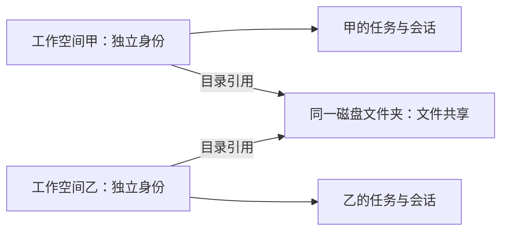
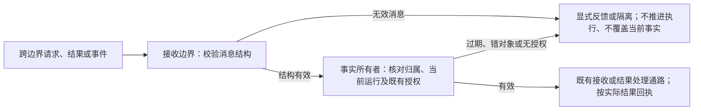
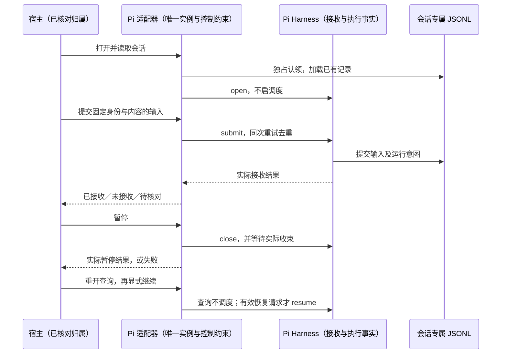
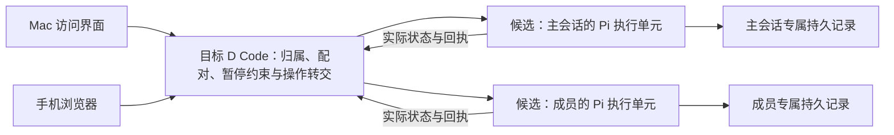
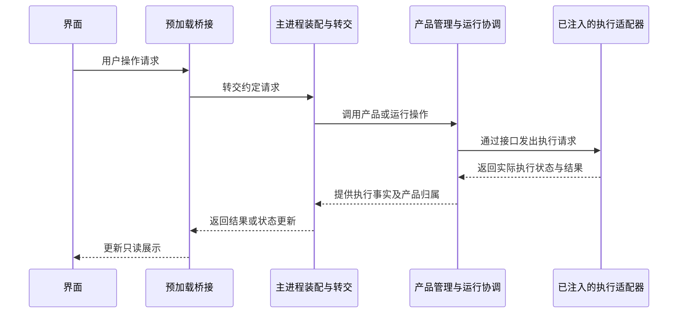
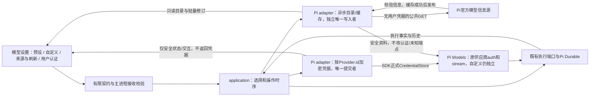
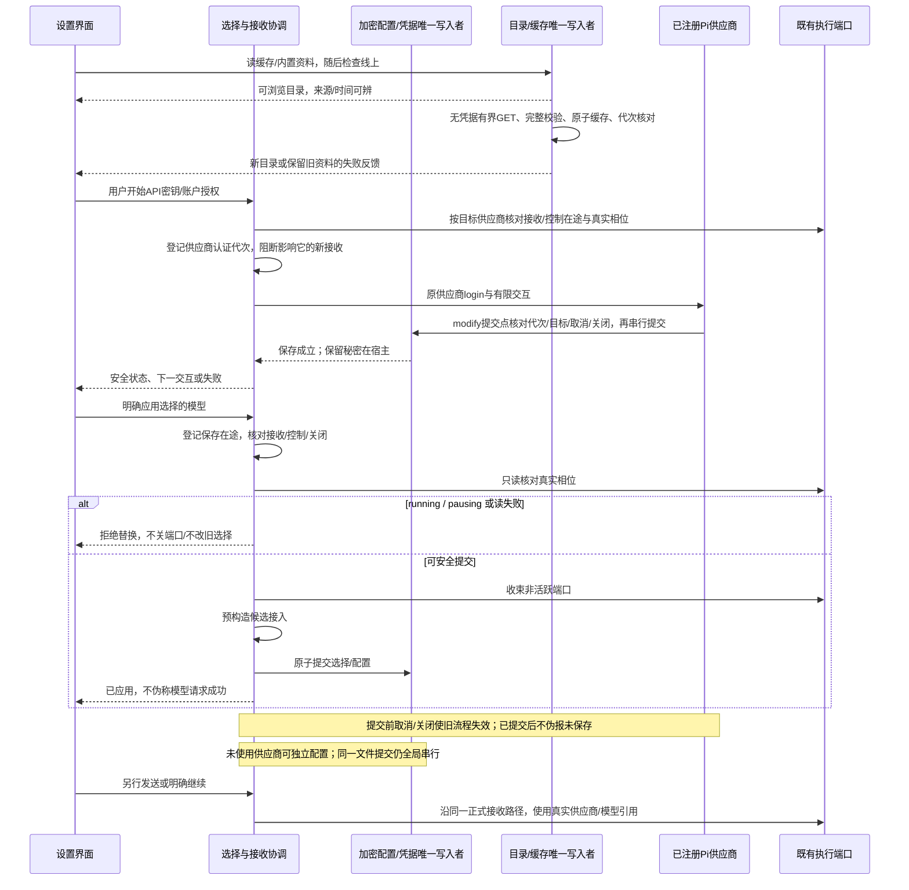
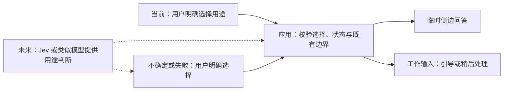

# 客户端起步阶段的架构约定

状态：起于 2026-10-03 工程准备，2026-10-05 新增无 UI 的真实 Pi 运行切片与集成证据。507 已确认 Electron + React + Tailwind v4、Pi SDK 1.0.0，以及先建立自动架构检查再开发首批产品功能。2026-10-06 的客户端集成承接固定 r7，接到主树同一正式执行合同并保留模拟对照；证据与遗留限制见 [集成记录](验证记录/客户端集成-2026-10-06/README.md)。2026-10-09 补入用户服务商配置与普通 Pi HTTP 装配，验证使用本地协议服务器；多端网络、真实外部账户与完整开发任务尚未验收。

## 用户路径与边界

首条路径以 [开发任务规格](../spec/开发任务路径.md) 为准：需求输入、执行反馈、文件差异与追问在同一工作台完成。导航只改变界面位置；重开读取真实状态，已暂停工作等待显式接续，仍由其他有效界面维持的运行不重复启动。界面可以保存草稿和布局，不能自行推进第二套执行状态。

## 客户端集成合同

2026-10-06 将已固定的 r7 界面接入主树既有执行切片，范围限 Mac 客户端、受控模型、隔离数据与既定验证；默认模拟档和显式受控 Pi 档分别标识，不接真实服务商或用户工作目录。

- 执行身份、控制令牌、工作输入、正式回执和执行视图由 contracts 的同一份定义维护。Pi 回执保留 submissionId，视图保留 model 与 execution；mock 使用显式 mock 标识，不伪称 Pi。界面 SendReceipt 是显式去除内部 submissionId 的投影，接收语义不另定义。
- application 的 ExecutionPort 保持公开调用方式；DCodeApplication 管理产品对象、首发关联及读取投影，不能替 Pi 接收或推进历史。ExecutionBackend 工厂复用同一 PiExecutionSession，测试直接打开执行会话仍是同一实现。
- 主树 PiExecutionSession 与 ownership 实现保留，文件移入 pi 模块内部后仍从 index.ts 公开导出。runtime 测试与 UI E2E 并存，不互相替代。
- main 负责 Electron 装配，preload 保留有限操作及接收校验。模型和文件演示仍使用明确的隔离目录；产品对象的目录字段不被静默接为真实工具目录。
- 检查配置统一覆盖执行层和界面层；保留主树 ESLint 10.12，并采用声明兼容该版本的 React hooks 插件 7.1.1；保留主树 Promise 检查与界面 hooks 规则。版本统一不豁免规则，也不缩小待验证范围。

集成后的构建、运行、UI 与视觉证据分别记录；固定源通过不代替新组合通过。

## 模块职责

以下根目录是首批客户端代码的归属约定；尚未有代码的模块不为占位创建空实现。机器可检查的依赖方向、公开入口和外部依赖许可清单统一在 [architecture-policy.json](../architecture-policy.json)，本文件不另维护第二份依赖表。

| 根目录 | 职责 | 对外约定 |
|---|---|---|
| `src/contracts/` | 界面与应用之间共享的操作、结果及只读视图类型；不包含宿主或运行实现 | 从公开入口引用，保持可序列化的边界；具体字段按实现范围设计 |
| `src/renderer/` | React 时间线、侧栏、检查器和设置；管理界面草稿与选择 | 读取视图、发出请求；不引用 Electron、Node 或 Pi 实现 |
| `src/preload/` | 通过 Electron 的隔离桥向界面暴露有限操作 | 只暴露约定方法，不能把原始 IPC 或任意宿主能力交给界面 |
| `src/main/` | 窗口生命周期、IPC 接线与依赖装配 | 连接应用和适配器；不以窗口对象承担任务业务状态 |
| `src/application/` | 工作空间、任务、会话归属及运行操作协调；定义所需适配接口 | 依赖接口，接收注入的适配器；不反向引用具体实现 |
| `src/adapters/mock/` | 原型使用的模拟执行器 | 实现应用定义的执行接口，状态展示始终注明未接 Pi |
| `src/adapters/pi/` | 将相同执行接口接到 Pi 1.0.0 | 不与模拟适配器互相调用；执行事实以选定的 Pi 入口为准 |
| `src/adapters/storage/` | 本地持久化与文件访问实现 | 产品部分通过接口使用，不从界面直接读写 |

模拟适配器与 Pi 适配器承接同一产品操作约定，一次运行只装配其中一个。主树已定义异步接收、只读查询、暂停及恢复的正式执行端口；本地客户端消费者已适配到该通路，旧同步 `void` 加回调形状只代表早期模拟基线。无 UI 切片的 Pi 会话与 JSONL 归属已有验证；本地装配证据见集成记录；多端传输及未覆盖故障路径仍需逐项验收，不从目录结构推断已经完成。公开入口默认使用各模块的 `index.ts`，实际需要变更时连同依赖使用点一起审查。

运行协调负责转交操作和组织结果，执行状态所有者负责确认同一次运行的实际事实，两者不是同一职责。真实 Pi 接入后，已接收输入、回答、工具结果及运行进度以选定 Pi 入口为准；应用层可以保存其只读投影或缓存用于时间线展示，不能借此再次正式接收同一输入或独立推进另一份执行历史。当前模拟原型由应用层汇集并保存模拟时间线，不因此自动构成真实 Pi 的双写，也不据此确定真实 Pi 的所有者边界。审查须追踪实际写入和回执通路，不能仅凭数据副本或回调返回类型判定冲突。

允许引入适用的纯界面依赖时，将实际包名加入 renderer 的外部依赖清单，并保留来源及许可记录；不因此放宽宿主能力或跨模块访问边界。规则、例外及排除路径的修改必须有本轮范围和审查依据。

客户端自有运行代码的文件与网络操作，包括初始化，统一使用异步接口；处理等待与失败，持久化完成后才报告保存成功。该要求不把离线检查和构建脚本强制改为异步，也不授权修改 Pi 等第三方内部实现。现有导入检查不证明所有操作均为异步或不会阻塞，需结合代码审查、静态规则和实际响应验证，不能用“已调用异步接口”代替运行证据。

## 工作空间身份与目录引用

507 已确认多个工作空间可以引用同一文件夹。产品身份因此与目录路径分开：任务归属、空间相关记录和请求关联使用工作空间身份，不以相同路径将不同空间去重为一个对象；实际文件访问、命令工作目录和 Git 操作使用对应的真实目录。目录的规范化与共享写入冲突检测由工程设计处理，不能依靠不同工作空间身份假定磁盘资源已经隔离。远端已纳入需求对齐，身份与路由须按最终场景适配，不直接照搬参考项目的远程身份、跨 Host 路由或路径替代身份的回退格式。

图示为已确认的产品关系，尚非存储或运行验证；创建和引用关系由应用层负责，文件访问由既有适配接口承接，不新增一套工作空间执行器。507 已将首批任务移动限定在同一台 Mac 内，具体规则见 [导航与移动](../spec/工作台信息架构.md#导航与移动)；跨端展示和远端操作不等于跨 Mac 迁移会话存储或执行所有者，后者不在首批移动范围中。

## 协议与运行归属的继续校对

2026-10-04 继续对照 [ZCode AGENTS 的进程、协议与远程控制规则](https://github.com/zai-org/ZCode/blob/29628c9acdb81b703bbd4080c207a0e7ce5e276e/AGENTS.md#进程协议与远程控制)。该组同时包含消息运行时校验、主进程与业务状态分离、输入接收通路及旧运行防护；这些约束须分别核对本地与远端适用性。此前未充分区分规则对照与工程验收；2026-10-05 已确认本组规范及 D Code 取舍都有对应，剩余适配缺口按下列实现范围验证，不将规则对齐写成已经验收。

本轮补齐的规则是：消息经过边界时，接收侧按共享契约检查其结构；正式处理方继续核对对象、当前运行、重复提交及既有授权。结构正确不代表目标有效，更不代表输入已经保存或操作完成。旧运行的合法历史记录可以保留，但不能以迟到顺序覆盖新运行状态。规则正文见 [AGENTS](../AGENTS.md)，本地请求定义和校验已由 Electron 受控 Pi 客户端消费，接收校验与回执场景的证据见集成记录；远端消息接线未完成。

下表记录沿 Pi 1.0.0 入口完成的本地适配和仍待接入的部分；接口字段、进程数和存储布局由工程证据收口，不逐项交给用户选择，也不把局部通过写成整条客户端完成：

| 校对内容 | 已有依据 | 当前适配结果与剩余证据 |
|---|---|---|
| 实际运行的归属与生命周期 | 模块职责已分开；[Pi 状态所有权核对](Pi-1.0.0-虚拟模型与运行恢复.md#状态所有权核对) 已记录同一 Durable 存储的单进程归属约束 | 无 UI 切片已采用每会话独立 Harness／JSONL，验证活进程排他、死亡实例回收及旧恢复失效；本地 Electron 装配复用该会话实现，多端事件投影仍需接入，不据此规定每会话一个进程 |
| 输入接收与恢复通路 | [引导规格](../spec/工作台信息架构.md#运行中用户消息的引导) 已确认统一接收、保存后回执、发送重试关联及显式接续 | 无 UI 切片已将接收、引导、稍后处理、暂停与重开映射到 Pi 正式通路，覆盖去重、回执丢失与保存异常；本地 UI 消费者已适配，已覆盖故障及未归因现象见集成记录；多端有效界面和成员授权协调的完整链路尚未验收 |
| 跨边界的具体消息合同 | 本轮补齐结构校验及业务归属校验规则；现有模块表只声明共享操作与视图类型 | 本地端口已有请求／回执／视图和运行时校验，错目标、旧恢复及保存失败已有行为测试；Electron 本地桥已有请求和快照校验，设备资格校验和远端传输仍未实现 |

上述顺序为运行归属 → 输入接收与恢复映射 → 具体消息合同；已有产品要求保持。2026-10-05 已落实本地执行接口、依赖及运行验证，2026-10-06 本地客户端已接入同一端口，证据见集成记录；远端网络尚未接通。

### 运行归属与输入通路的最小验证候选

2026-10-05，507 要求将本节实际落地。当时实施切片为无 UI 的异步 Pi 执行端口：锁定 `pi-durable`、`pi-ai` 与 `chord` 的 `1.0.0`，每个产品会话拥有独立 JSONL 记录与 Harness；先以真实 SDK、受控模型及隔离文件验证，再登记实际结果。早期 UI 的同步模拟端口不能充当持久接收合同；新端口验证后，当时的独立 UI 消费者开始适配；2026-10-06 的本地受控客户端结果见集成记录。不会为此等待手机布局、终端选择或新增视觉规则。

本切片的正式入口放在 `src/adapters/pi/`，产品请求及只读结果位于 `src/contracts/`，抽象端口位于 `src/application/`。宿主提供已核对的会话归属、工作目录、模型与工具注册；执行适配器持有唯一存储所有权，Pi 持有输入接收、历史与运行进度。输入关联的内容指纹只约束同次重试，不代表输入已经接收，也不构成另一份执行队列。对同一目录的其他运行实例拒绝开放；只有能确认旧进程已退出时才能回收其所有权记录，无法核实时停止接入而不覆盖文件。

2026-10-05 UI 接线发现助手正文读取缺口：Pi 的已提交助手消息位于条目的 `model`，原视图只复制 `data`，导致正式输入已经完成但消费者读不到正文。执行合同的助手条目现增加 SDK 无关的 `assistantText`，由同一 Pi 历史按文本块原顺序投影，保留条目身份；顶层 `model` 仍只表示当前模型身份。该字段只包含已提交正文，不将思考、工具调用块或流式中间片段混为正文，不另建可独立写入的历史。验证入口见 [运行验证](../test/runtime/README.md)；后续客户端已消费该字段并以受控 Pi 端到端验证实际正文，证据见集成记录；此前仅接口修复的记录仍不能代替 UI 证据。

`open`、`read` 与回执查询不启用调度；`submit` 对同一发送先核对目标及内容，再走 Pi 正式接收；`pause` 拒绝新工作并等待真实关闭，保存或收束失败必须反馈；`resume` 只接受当前实例及暂停版本，较新的暂停可使旧恢复失效。关闭后读取及重新打开不承诺原模型网络请求继续，恢复可能重新请求模型。JSONL 的 `fsync` 选项也不被解释成断电无损保证，进程退出、强制终止与电源故障分别报告。

本次不依赖 UI 的端到端路径须验证实际文件工具、输入去重及改文冲突、完成后的回执查询、独立会话暂停、关闭与强制终止后重开、旧恢复与新暂停交错、保存失败和结果未知。这是 2026-10-05 无 UI 切片的验证范围；2026-10-06 的受控本地 UI 已完成接入验证，见集成记录。真实服务商、成员自然语言授权与多端网络仍是后续接入，原型与产品适配测试分开记录，不把任何未执行项标成通过。下文保留采用前的源码候选依据。

以下保留采用前的固定源码候选依据。2026-10-05 无 UI 切片已采用并验证每产品会话独立 Harness 与 JSONL；独立 UI 已有受控 Pi 条件装配，完整客户端交付未验收，多端协议未接通。实际结果见 [运行证据](Pi-1.0.0-虚拟模型与运行恢复.md#2026-10-05-实际运行证据)。2026-10-04 重新核对 Pi `a13d35a742c6ef8462812a28fbe1d8c8b7431c32` 的 Harness、提交、调度、类型及说明文件，本地五份原文摘要与既有清单一致。

本切片采用并验证：每条工作会话分别使用独立 Harness 与专属持久存储，可以独立关闭、读取和接续，暂停一个单元不停止另一个。任务级暂停覆盖主会话及其成员、访问端共用目标 D Code 的正式入口，是宿主协调与远端接入的后续要求，本轮尚未实现；不能为每个 Mac 或手机各开一份执行器。D Code 任务、主会话与成员归属仍由产品层组织，不直接套用 Pi 内部 Task 或原生子智能体的层级和生命周期。

选择该候选的依据是：公开 Harness 的 `resume()` 与 `close()` 作用于整个 Harness，固定入口未提供可直接等同 D Code 成员暂停的公开方法；同一 Harness 容纳多个 conversation 的方案还需证明独立暂停成立，不能先把两种粒度混同。[固定 Harness 实现](https://github.com/earendil-works/pi/blob/a13d35a742c6ef8462812a28fbe1d8c8b7431c32/packages/durable/src/harness/harness.ts)

执行单元不等同于操作系统进程。Pi 的已核约束是同一份 Durable 存储同时由一个进程拥有，且存储层不提供跨进程锁；这不直接决定每条 D Code 会话的进程数，也不允许两个访问端分别打开同一存储写入。旧实例尚未完成关闭和资源释放时，不让新实例并行接管同一存储；关闭等待被取消不当作底层清理已结束。[存储约束](https://github.com/earendil-works/pi/blob/a13d35a742c6ef8462812a28fbe1d8c8b7431c32/packages/durable/README.md#storage)

接收与查询须分开：固定版本的 `submit()` 会先启用调度，再经持久提交创建或查回提交；`Submission.wait()` 也会启用调度，`status()` 则读取已有提交记录。因此，不能用再次提交或等待完成来实现纯重连查询，更不能用它们把普通新输入送入已暂停工作而悄悄恢复执行。当前无可验证的暂停接收路径时，保持未接收反馈及原文；本候选不新增“暂停期间所有输入都必须接收”的产品要求。[提交与查询实现](https://github.com/earendil-works/pi/blob/a13d35a742c6ef8462812a28fbe1d8c8b7431c32/packages/durable/src/harness/submissions.ts)

正常工作输入复用 Pi 选定入口的正式接收记录；D Code 只管理产品归属、请求转交、暂停许可及其展示，不另建一份已接收执行队列。发送或保存出错时，接收结果可能仍需核对；查询和重试沿用同一次发送关联，不能把通信失败一律当作从未接收。原始输入及未知状态保持可回查，具体错误分类与查询合同须结合所选持久化入口验证。

输入回执的现行语义与首发联动统一见 [工作输入的接收回执](../spec/工作台信息架构.md#工作输入的接收回执)。固定 Pi 提交实现进一步说明：进入存储提交阶段后，`StorageRejected` 才明确保证该批次未生效；其他存储错误，以及存储已成功但随后内存状态接纳失败，不能一律映射为未接收。此处错误类判断有阶段前提，提交回调中的校验拒绝应分别处理，不把所有非该类异常都机械归为同一种结果。[固定提交实现](https://github.com/earendil-works/pi/blob/a13d35a742c6ef8462812a28fbe1d8c8b7431c32/packages/durable/src/session/session.ts#L404)

最小验证范围为：两端访问同一会话时正式接收与执行不重复；暂停一个成员而独立工作继续；暂停／重开后查询记录不启动调度；最后有效界面离开与重连交错不绕过暂停；旧实例未完全退出时不能产生同存储双写；接收回执丢失及保存异常不导致盲目重投。其中独立暂停、重开只读、活进程独占、死亡进程回收、发送去重、存储故障与工具中断已通过无 UI 集成测试；多端网络和最后有效界面失效／重连交错仍未验证，真实服务商及完整能力包装配继续保留缺口。

### 消息归属与过期结果

在 [统一运行归属规则](../AGENTS.md) 下，跨端消息除结构正确，还须能核对目标、操作来源及实际运行。下面规定合同必须表达的含义，不提前固定字段名、编码或通信库：

| 需要核对的内容 | 处理约束 |
|---|---|
| 目标 D Code 与工作对象 | 请求关联明确的目标端及其工作空间、任务和会话；不能仅凭显示名称或目录路径路由，也不能因访问端后来选中了别的任务而改变原请求目标 |
| 本次发送及原始内容 | 同次重试和自动补送保持原发送关联及内容；相同文字的独立发送不合并。同一关联携带不同目标或内容时不得静默作为正常重试接受 |
| 持久工作与当前执行实例 | 稳定会话归属与这次实际运行实例分别核对；实例重开不等于新会话，但旧实例消息也不能因会话名称相同就覆盖当前执行状态。原操作失效时不能自动改投另一轮工作 |
| 访问来源及当前资格 | 目标端核验来源设备及当前有效接入资格；显示为已配对、曾有资格或访问端自行报告成功不能替代实际核验 |

过期控制请求与合法历史事实分别处理。旧恢复请求不能解除后来生效的暂停；较早运行的合法结果仍可按真实归属回查，但不得把当前运行状态覆盖成旧的完成、失败或运行中。无法核实归属时反馈错误或未知，不按到达先后、显示名称或访问端当前页面猜测归属。已有正式事实不能由未经验证的迟到消息改写。

结构校验和运行归属校验沿本节已有职责图进入同一事实所有者；[输入回执](../spec/工作台信息架构.md#工作输入的接收回执) 与自动补送继续使用这条通路，不以增加接入端建立另一份已接收队列。验证须覆盖同名目录分属不同目标端、发送后切换页面、同次操作的多端重试、旧运行结果迟到、较新暂停与旧恢复交错以及资格撤销。本地执行端口已实现并验证；上述设备资格、跨端路由和事件投影仍待接入，不把本地状态测试扩大为远端通过。

### 远端讨论范围

507 于 2026-10-04 要求把远端加入本轮 grill，并明确采用 D Code 连接目标电脑上 D Code 的统一产品方向。现行方向正文见 [远端连接方向](../spec/工作台信息架构.md#远端连接方向)；首批由 Mac 承载执行和文件，访问入口为 Mac 桌面端与手机浏览器。产品方向与首批范围已对齐，完整运行合同与具体实施安排尚未形成。

507 已进一步确认多台已获准连接的设备可以直接操作同一任务，不设唯一操作端接管步骤；设备采用首次配对、记住后重连、可随时撤销的方式，不依赖统一 D Code 账号。方向与验收统一见上述规格。ZCode 固定版本的 [远程开发说明](https://github.com/zai-org/ZCode/blob/29628c9acdb81b703bbd4080c207a0e7ce5e276e/README.md) 与 AGENTS 的手机远控规则提供不同链路的参考；D Code 在已确认的统一连接方向下核对适用机制，不从上游的技术分层反推两套产品。

507 已选择 B，生命周期改为 [任一有效工作界面维持运行](../spec/任务暂停与恢复.md)：单端离开不必暂停，最后有效界面离开后暂停保存；退出承载执行的 D Code 仍停止。已暂停工作须显式接续，仍在运行的工作重连只读取当前状态。有效界面与连接的判定由目标端统一协调，不能用配对缓存或访问端猜测代替真实状态。具体有效性检测、交错事件与暂停回执需要接入验证，不因此定案进程或存储拓扑。

507 于 2026-10-05 对 G2 确认由产品承担[配对后的外网接入](../spec/工作台信息架构.md#外网接入的使用门槛)，不要求普通使用者先搭私人网络或转发。此决定约束上手流程与接入责任，未选定具体服务、托管方式、传输协议或费用；目标 Mac 继续拥有执行与正式工作记录，网络设施不成为第二个业务所有者或有效工作界面的替身。

2026-10-06 新确认的正文保护边界见同一规格：中转服务不持正文解密钥匙。接入评估须核对实际解密点、密钥签发与保管、访问界面交付以及与目标设备身份的绑定；供应商提供 HTTPS 或承诺不保存正文，不能单独证明满足要求。可评估设备端终止加密连接或由两端保护工作载荷的机制，暂不锁定协议、算法或厂商。必要连接元数据须列清，不能宣称中转完全无信息可见；保护失败不得回退到中转可读正文的通路。实现和验证继续沿现有单一接收与状态所有权边界，不另建业务历史。

本轮网络取证边界：已读取 [Tailscale 连接说明](https://tailscale.com/docs/how-to/connect-to-devices)，其常规路径先让设备加入可互通网络，目标仍需运行应用服务；这可作网络层与业务服务分离的对照，不成为首版默认要求用户自建网络的方案。已读取 [Cloudflare Tunnel 说明](https://developers.cloudflare.com/tunnel/)与[路由说明](https://developers.cloudflare.com/tunnel/concepts/routing/)，其出站连接与公网域名映射提供一类候选机制，但不据此锁定厂商、认证方案、费用或生产适用性。ZCode 的 SSH 工作空间、CLI Web 访问及手机控制相关入口须分开核源码，不能以文件名或 AGENTS 的描述推定已有可直接复用的公网配对服务。

后续先形成满足产品目标的候选接入方案，核对移动浏览器使用步骤、实际认证与传输保护、配对与撤销、服务不可用、数据与日志处理、部署维护责任和成本，再做隔离数据的最小验证。涉及真实服务部署、凭据或费用时按具体范围处理，不因本次产品选择自动使用用户账号、开放端口或建立收费资源。

## 请求与结果的职责时序

下图描述 Mac 桌面入口的逻辑职责，不决定 IPC 消息格式、具体进程数或 Pi API。主进程负责装配与转交，应用部分拥有产品组织状态，执行事实由一次运行中选定的执行适配器所连接的执行端提供；界面保有自己的草稿和展示状态。本地客户端保留模拟适配器，并以真实 Pi 配受控模型验证了本图的单机通路；实际范围和剩余问题见集成记录，不宣称多端或完整产品验收。已确认的手机浏览器入口不能直接使用 Electron 预加载桥；其接入设计须进入相同产品接口与正式接收通路，不能另建执行历史，本图不作为浏览器链路已设计完成的证据。

这是一次执行操作的通路，纯导航不进入执行操作路径。暂停、恢复、成员授权等待与失败处理的具体状态和分支需在对应方案中补图，准确覆盖时可以复用；绘图要求以 [AGENTS](../AGENTS.md) 为准，不用本图冒充这些行为已验证。

## 预设、自定义与在线目录装配

2026-10-09的新设计承接[模型规格](../spec/模型选择与自动切换.md)与[SDK核对](Pi-1.0.0-虚拟模型与运行恢复.md#2026-10-09预设供应商与在线模型信息核对)。本节约束本轮实现；现已验收的单条custom仍沿前次验证记录，新接入没有因为设计成立而算完成。

职责保持现有模块：contracts定义有限请求、目录/认证安全视图与接收校验；renderer读取选择/目录状态并提交明确动作；main装配safeStorage、受限认证浏览器操作及adapter；application管理用户选择、接收/保存/关闭门控；Pi adapter管理SDK模型集合、按供应商的CredentialStore和独立目录缓存。SDK供应商拥有auth与stream协议，Pi Durable继续拥有执行和历史，不再造输入队列或引入另一执行harness。

在线接口优先沿Pi已发布的canonical provider目录，不在客户端重写models.dev全量供应商映射或直接import构建生成器。Builtin工厂与原auth/stream不变，目录只更新已验证的模型信息；请求API/目标由本地已接入实现和用户配置约束。不能直接给所有预设复用原single-custom credential reader。旧记录承接必须保留独立custom身份和加密内容；已保存的custom服务定义与当前选择分别维护，应用预设/重开仍可派生原custom安全表单与留用密钥条件。全部定义、凭据/选模的同一物理文件变更在唯一提交通路合并，防异步OAuth刷新丢其他供应商更新。影响执行中供应商的用户认证写入与选模使用相同的真实相位/接收/关闭门控；供应商认证代次必须在实际commit点拒绝旧流程，不仅在UI端忽略结果。未被使用的另一供应商可独立提交，SDK原请求自己的令牌刷新仍沿原有正式通路。

启动先异步恢复缓存并立即提供只读目录，网络检查随后进行；不在工作快照频繁复制全目录。目录来源/请求代次归目录服务持有，旧源的fetch、取消和关闭后结果不写新源缓存或发布。网络/接收/缓存错误保留有效资料及事实来源，不把目录异常映射成工作执行成功/失败。

本轮新增依赖/上游代码按实际使用登记；不会为采用在线模型目录默认加入coding-agent的同步store、环境认证扫描或完整CLI依赖。端到端须区分公开目录实时获取、受控HTTP供应商传输、真实SDK、真实账户和用户视觉接受。现状及源身份由本轮验证记录维护。

## 自动检查的合同

检查只读执行，解析 JS／TS 源码，依据真实解析到的依赖检查：

- 产品源码必须属于声明的模块，不能把未纳入的源码当成通过。
- 跨模块引用只走允许的方向与目标模块公开入口。
- 外部包与 Node 内置模块必须在该模块的许可清单内；界面不能直接引用宿主或 Pi 包。
- 模块引用不能形成文件循环；本轮将类型导入也纳入依赖图。
- 支持静态导入、重新导出、类型导入、字面量动态导入及 CommonJS 引用；无法静态确定的动态引用报告失败。
- 解析失败、内部引用无法定位、通过别名或符号链接逃出范围等情况明确报告，不静默略过。

配置文件、检查工具、测试、构建输出及根级 `.delta/` 工具快照属于明确排除范围；产品源码不得引用被排除的本地实现。`.delta` 排除只作用于根级工具目录，普通文档脚本、其他越界源码及 `src/**/.delta/` 中的源码仍须检查。外部包内部代码、样式表中的引用、运行时拼装、Worker／资源 URL、eval、IPC 调用语义、Electron 安全配置和 Pi 状态时序不由本检查证明，需另做相应验证。符号链接形式的产品源码暂不支持，发现时直接报告。检查语法和依赖边界不等于类型检查或应用构建；类型导入所指向的声明可能与最终运行文件不同，交付时仍需类型、构建和实际行为验证。

检查器的验证应覆盖合规依赖、禁止方向、绕过公开入口、宿主引用、路径别名、重导出、动态引用、类型导入、循环、无法解析和未纳入模块等场景。合规场景必须通过，故意违规场景必须失败；命令必须返回对应的成功或失败状态。

## 如何使用与判断完成

检查入口与证据覆盖统一见 [README](../README.md#检查覆盖与证据)；运行代码异步 IO、消息校验语义及真实界面可用性不因依赖检查通过而自动成立。对可复现的问题，断言须能区分原用户目标成立与失败，不以元素存在或类型正确替代行为结果。

根 README 登记真实命令。完整门槛由“检查器自身的正反样例”与“当前产品源码检查”组成；无产品源码时明确显示数量为 0，只能证明检查入口可用，不能宣布客户端架构或功能已验收。

Kimi 在独立工作树编写客户端后，每次交付运行该门槛，并通过全量类型检查与 Lint，完成构建及 [AGENTS](../AGENTS.md) 要求的自动化端到端行为验证；场景组织、并行隔离和失败处理也以该规则为准，结构检查不能替代交互验证。缺少入口时先建立真实检查命令，已有失败不能作为通过。主目录与独立工作树集成时重新运行。不能通过删除规则、扩大排除范围或更改测试期望让新增违规消失。

## 依据与尚未验证内容

模块职责依据本项目状态唯一所有者规则及已确认的桌面技术栈设计。Electron 的隔离桥、进程职责和安全设置应在实际壳层实现时对照官方文档及实际配置核验。检查工具使用 TypeScript 官方解析与模块解析 API；不移植 ZCode 检查器或预设其分层。

普通入口已支持按用户配置发起真实 Pi HTTP 请求；当前不包含用户数据迁移、发布配置、自动后台执行或窗口重开后的自动续跑。真实账户验证、工具装配与用户工作目录接入仍须分别完成。

## 产品运行层与外部 Harness 参考

2026-10-03 收到 D Code／DeepSeek Harness 的只读调查交接后，继续保留 Pi SDK 1.0.0 底座。这里的 D Code 产品运行层（harness）指现有产品管理、运行协调与适配职责：工作空间／任务／会话归属、成员协调、输入与回执、成员授权、界面生命周期及只读视图。它不表示新增一个与 Pi 并行推进同一次运行的执行器，也不指定新目录、数据库或框架。

| 处理 | 结论及归宿 |
|---|---|
| 吸收为当前职责说明 | Pi 选定执行入口拥有同一次运行的执行事实；D Code 负责产品归属和运行协调，界面消费真实状态。沿用本文件模块表与已有唯一写入者规则 |
| 研究候选 | 普通 Pi Extensions、Codemode 与能力包治理分别研究，不能把整个产品管理塞进扩展，或让工具组合脚本成为第二个调度器。普通 SDK 与 Durable 的兼容未知统一见 [Pi 能力核对](Pi-1.0.0-虚拟模型与运行恢复.md#能力包与扩展兼容的接入检查点) |
| 研究候选 | 参考 DeepSeek Harness 的服务依赖、资源生命周期及事实派生视图，检查依赖未就绪、失效、清理与状态回执；按 D Code 实际边界适配，不预先将全部功能插件化 |
| 本轮不采用 | 替换 Pi 为 DeepSeek 运行时、引入 Cordis 或 DSH sessionlog；参考项目不改变 Pi 底座。既有无界面持续执行的排除仍有效，除非后续对齐明确修改 |
| 远端产品范围已确认 | 统一连接、多端操作、设备配对及任一有效界面维持运行；首批 Mac 执行端，Mac 桌面与手机浏览器访问。运行映射、网络接入、消息合同与实施安排仍需形成，不由上游实现直接替代 |

原交接的 DeepSeek 引用未固定版本；整合侧本轮实际查询远端 `master`，取得提交 `5badb15009ae1756c3afe0ae0cef1faafc290ccc`，并成功读取该提交原文。固定 [架构说明](https://github.com/deepseek-ai/deepseek-harness/blob/5badb15009ae1756c3afe0ae0cef1faafc290ccc/docs/architecture.md) 描述 Cordis 的可替换服务、持久事件与派生历史；固定 [TypeScript SDK 说明](https://github.com/deepseek-ai/deepseek-harness/blob/5badb15009ae1756c3afe0ae0cef1faafc290ccc/packages/sdk/client/README.md) 列有无 mid-turn cancel 的限制。不据此宣称该 SDK 能直接替代 D Code 的独立暂停与引导合同。

ZCode 第四轮所声称读取的另一固定版本链接，经整合侧实际请求得到 HTTP 404，相关“已核实”摘要未被采用。已将 16 份固定版本 Pi／DeepSeek 原文下载为只读研究副本，并逐文件保存 URL、提交与 SHA-256；ZCode 改读这些原文复核。临时来源清单为 `/var/folders/61/fc0gr9wd52sc59sl32dvqj5c0000gn/T/dcode-reference-review-y14yk3k5/manifest.json`，源码未执行；耐久引用以上述固定 GitHub 链接为准。

交接提供研究依据，不自动增加首版包管理或插件市场需求；实现、运行实验、依赖安装和用户数据变更不由这份文字材料扩权。核心恢复与侧边问答等已确认规则继续以 spec 为准。

## 补充参考的评审边界

507 于 2026-10-04 补充 Raven、Motion Panels、CC-Usage-Band 与多家用量来源的研究交接，并要求对照最新状态评审。执行底座、三层对象、单一执行事实所有者与当前界面生命周期均继续有效；产品运行层是已有产品管理与协调职责，不新增执行循环。参考里的事实声明先核对固定原文和实际接口，不能用候选资料反推已实现能力。

可直接沿用的设计约束：模块声明资源与监听的归属、清理和停机责任；启用意图与实际加载成功分别记录；成员间接调用工具不绕过主会话授权。507 已确认产品不设权限模式，主会话不加产品操作审批；原交接关于审批的参考适配为主会话按分工范围授权成员、成员超出范围时申请及其状态展示，不能重新引入主会话审批卡。具体对象、环境、动作、影响范围与可执行下一步须有真实依据，授权及恢复规则统一见 [主会话与成员授权](../spec/工作台信息架构.md#主会话与成员授权)。并行运行、隔离写入、历史恢复与执行恢复分别验证。

| 评审问题 | 所需证据与最小范围 | 当前处理 |
|---|---|---|
| Pi 组合接入及能力包装配 | 复用已固定源码，核对普通 SDK／Durable 的入口、扩展与工具权限通路；列隔离假数据实验及判据，未经执行不报告通过 | 沿用 [Pi 能力核对](Pi-1.0.0-虚拟模型与运行恢复.md)，不并置执行器，不新建包格式；完整包治理尚非首版要求 |
| Raven 的对象与展示 | 已核指定提交的工作节点类型、依赖与状态字段、图节点选择及画布交互；其余审批、失败和运行尝试按实际源码继续核验 | 507 已确认首版列表／只读协作图切换，并认可会话内示意的阅读方式；正式产品与真实数据未验收。成员授权状态与重试呈现按 D Code 规则适配，不移植主会话操作审批或流程编辑器，不新增顶层工作对象 |
| Motion Panels 是否值得替换现有布局 | 先读当前原型布局找明确缺口，再固定候选版本、核许可及公开接口；确有缺口后才提出隔离验证计划，覆盖拖宽、窄屏、长文本、键盘与布局恢复 | 不安装、不替换、不打断当前原型；React 版本范围符合不等于 Electron 实际兼容 |
| 统一用量的数据与展示 | 核对各官方接口／源码的认证适用范围、区域、窗口、单位、更新时间与字段稳定性；本轮只读主源，不访问用户账户 | 507 已确认首版同时覆盖任务用量及可可靠读取的账户信息，三类指标分别呈现；各服务支持清单、接口选择与实际接入待验证 |

用量展示的现行产品合同见 [用量与账户额度](../spec/用量与账户额度.md)：缺失字段未知、失败不补零，任务 token 不反推账户余额，估算有价格依据且不当作实际账单。已确认范围不代表已经具备用量读取能力。交接所列 MiniMax、Codex、Kimi、Z.ai 的具体端点、认证适用范围、区域、字段与稳定性由调度会话核验；各来源独立适配，不跨区域试发凭据，未核实内容不写成稳定接口合同。

本轮 Raven 图视图证据固定于 `3632e6040c7038a60ec418ce39ccae185c72c19f`：[编排说明](https://github.com/EverMind-AI/Raven/blob/3632e6040c7038a60ec418ce39ccae185c72c19f/docs-site/docs/orchestration.zh.md) 描述工作节点的依赖与并行；[节点类型](https://github.com/EverMind-AI/Raven/blob/3632e6040c7038a60ec418ce39ccae185c72c19f/ui-web/src/features/dag/types.ts) 分别记录节点、负责 Agent、可选实例、依赖和状态；[DagGraph](https://github.com/EverMind-AI/Raven/blob/3632e6040c7038a60ec418ce39ccae185c72c19f/ui-web/src/features/dag/DagGraph.tsx) 提供连线与节点点击／键盘选择；[Board](https://github.com/EverMind-AI/Raven/blob/3632e6040c7038a60ec418ce39ccae185c72c19f/ui-web/src/features/dag/Board.tsx) 负责平移、缩放和视图保持。这些是静态源码证据，不是本轮运行验收。

D Code 采用“看清分工、关系与真实状态”的交互思路；示意中的节点、成员和等待状态为模拟内容。图读取已有分工与运行事实，不成为第二个调度器，也不要求 D Code 所有协作必须按 Raven 的固定 DAG 执行。节点不与进程或会话强制一一对应，实际接入仍以 Pi 1.0.0 和现有单一事实所有者规则为准。

## 后续方向：模型辅助输入分流

507 于 2026-10-03 确认当前显式选择输入用途，未来演进为模型辅助自动分流。产品现行行为见 [输入入口与后续演进](../spec/工作台信息架构.md#输入入口与后续演进)。未来方向已确认，具体模型、版本、接入方式与上线时间未定；不纳入当前原型的依赖和交付范围。

Jev 或类似模型可作为意图判断候选。TypeSafe 官方提供意图分流模式，Choice 能返回所选项、各选项概率和置信指标；这支持研究“临时提问／调整工作”等用途判断，但不能直接证明在 D Code 的中英文工作对话中足够可靠。[意图分流说明](https://docs.typesafe.ai/patterns/intent-routing)、[Choice 定义](https://docs.typesafe.ai/primitives/choice)

当前实现保持输入用途与其实际行为的职责清楚，未来分类结果接到同一行为入口。模型只提供用途判断，应用继续拥有用户选择、当前状态和权限校验，不能由模型直接改派工作、解除暂停或绕过既有操作边界。用户明确选择优先；判断不确定或服务失败时退回可用的手动入口，不阻塞基本交流。无需为此提前增加空适配器或厂商依赖。

上述图仅说明当前路径与未来候选的职责关系，尚非接入实现。启用自动分流前，使用代表性中英文输入验证：纯查询、明确纠正、混合意图、依赖上文的短句及运行状态变化。重点核对把查询误作执行要求的情况，并实测整体延迟、成本、用户改选和失败回退。置信指标概括选项概率的分布，不是正确性或行动授权的证明；阈值由本项目样例验证，不照搬文档示例数值。[置信度说明](https://docs.typesafe.ai/confidence)

本次仅核对公开资料，未安装 TypeSafe SDK、配置凭据、调用模型或验证分类效果。
