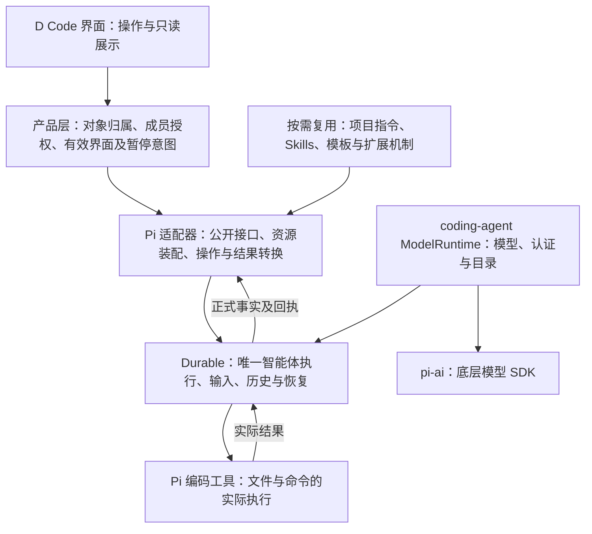
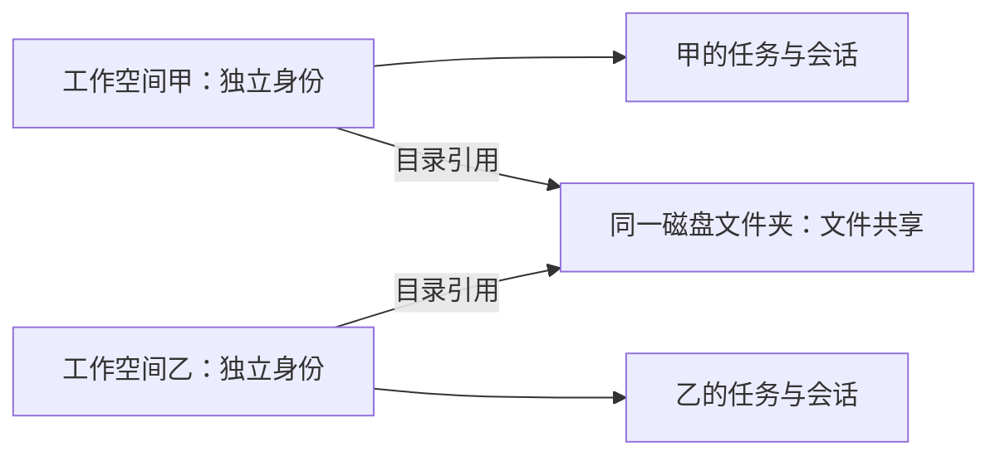
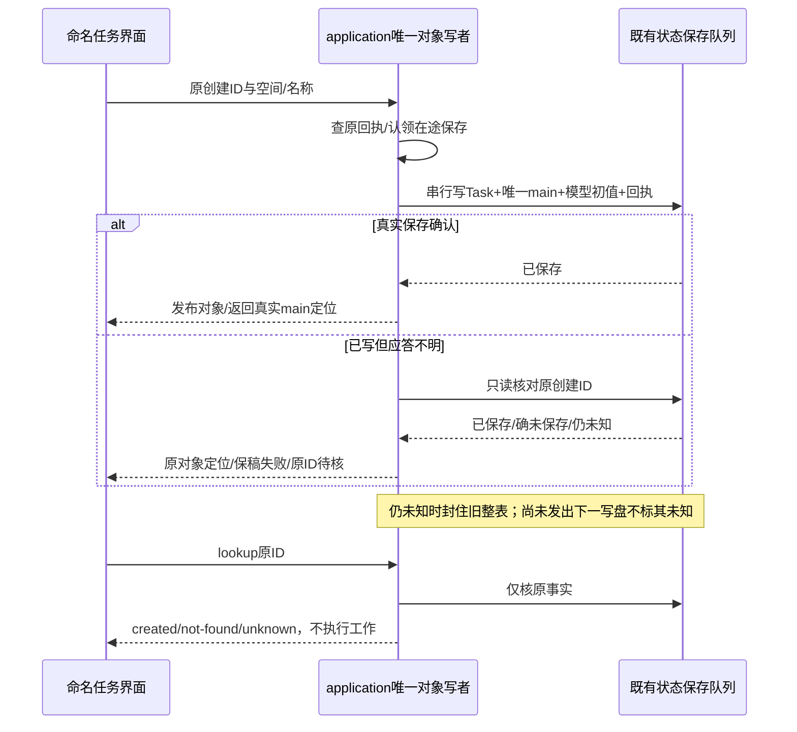
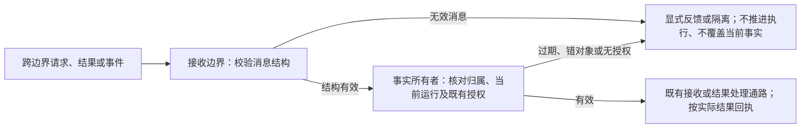
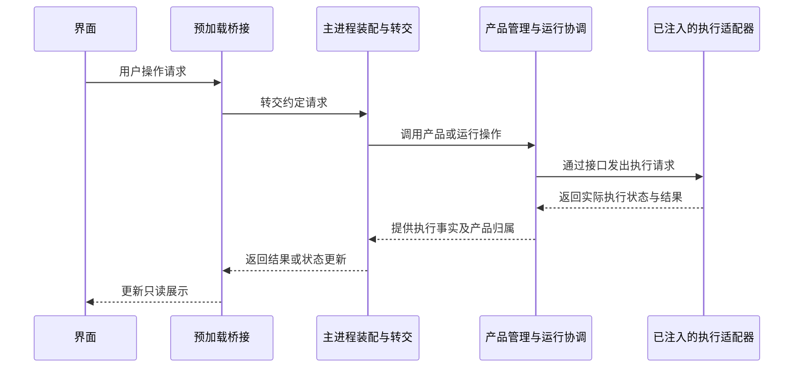
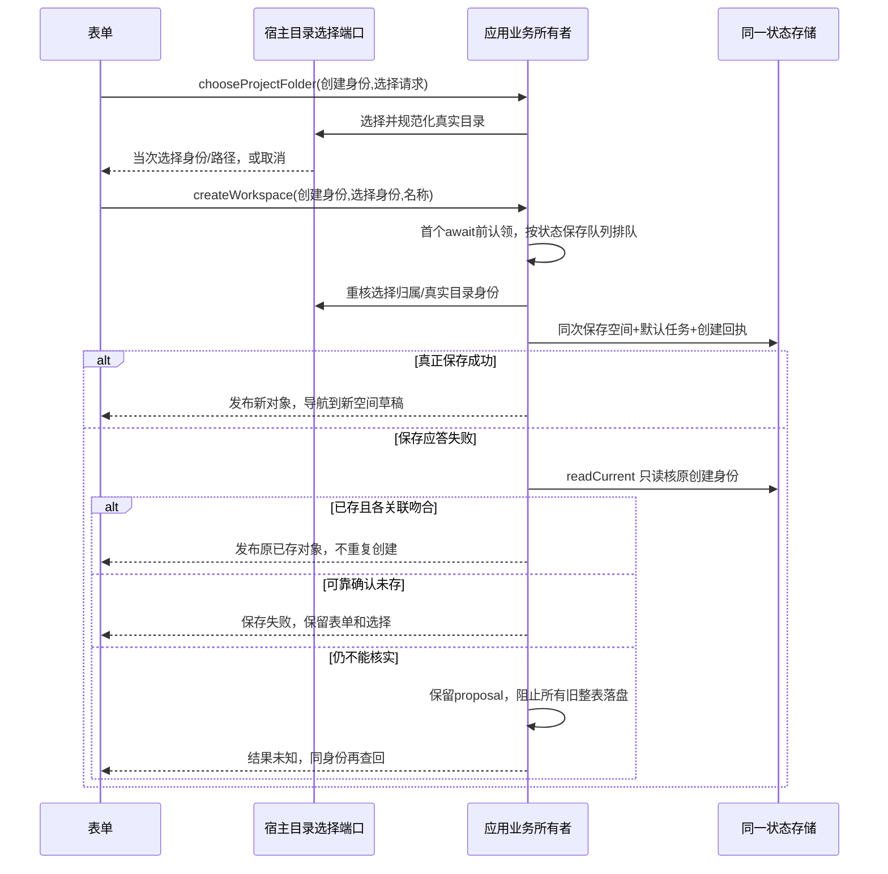
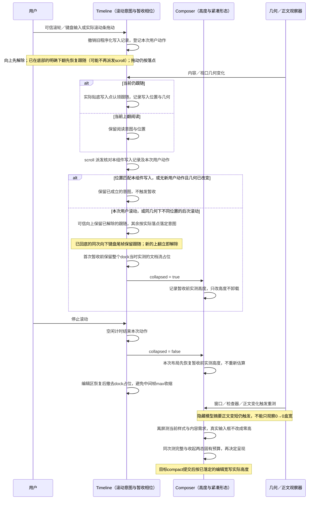
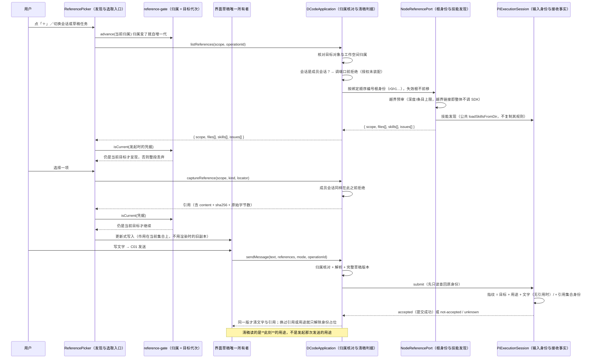

# 架构约定

本页持有客户端模块、产品对象和边界；Pi执行／资源职责见[Pi运行与扩展](Pi运行与扩展.md)，模型装配／准入／费用见[Pi模型接入与路由](Pi模型接入与路由.md)。实际版本与迁移证据只在[Pi版本与升级](Pi版本与升级.md)，当前实现与缺口只在[PROGRESS](../PROGRESS.md)。旧r7／1.0集成身份保在相应验证记录，不充当当前状态。

## 用户路径与边界

首条路径以 [开发任务规格](../spec/开发任务路径.md) 为准：需求输入、执行反馈、文件差异与追问在同一工作台完成。导航只改变界面位置；重开读取真实状态，已暂停工作等待显式接续，仍由其他有效界面维持的运行不重复启动。界面可以保存草稿和布局，不能自行推进第二套执行状态。

## Pi coding-agent 能力复用基准

Durable持有唯一智能体正式执行、输入、历史与恢复，pi-ai提供底层模型能力；coding-agent按实际用途复用。已确认产品要求不撤销，全非UI接口兼容和零依赖不是标准。现行取舍与候选唯一见[Pi能力复用与演进](Pi能力复用与演进.md)。

D Code 负责界面、工作空间／任务／会话归属、成员授权与产品生命周期；不移植 Pi CLI／TUI，保留真实编码命令与已确认的手动终端。手动终端的进程／输出所有者仍按终端规格，不改交 Durable。用户路径及验收唯一正文见 [真实编码能力](../spec/开发任务路径.md#真实编码能力与验收)。下图明确当前职责，不表示所有接口已装配或所有产品要求已验收；不会另启普通 `AgentSession` 循环、正式接收队列或会话历史。

资源发现、事件／命令和扩展生命周期按已确认消费者及公开接口装配；未支持调用明确拒绝，不因 CLI 默认启用或上游 API 存在而自动增加首版任务。D Code 自有异步 IO、公开接口及凭据范围规则继续适用；第三方内部同步 IO 不自动构成排除整个 SDK 的理由，须核实宿主响应性和可配置边界。现有数据、虚拟模型、有状态路由及暂停／重开合同继续由实际组合证据判断。read 与 MCP 直接适配仅是待比较候选，不因本次定案覆盖已验实现；旧 [Pi组合研究](Pi-1.0.0-虚拟模型与运行恢复.md#完整-coding-agent-接入方向与组合验证) 保留原版本和历史身份，不作为当前运行入口待选或全接口派工依据。

## 客户端集成合同

contracts唯一维护请求、结果与只读视图；接收侧同时核结构和业务归属。Pi回执保原submissionId，界面SendReceipt只是去除内部字段的投影，不重定义接收；mock始终标识模拟。

application经有限ExecutionPort协调产品对象，不能替Durable接收或推进历史；main装配平台与窗口，preload不暴露原始IPC。PiExecutionSession／ownership保同一公开入口；运行集成与UI证据互不替代。检查覆盖执行与界面，不因依赖版本统一降低门槛；原r7接线和旧版本证据见[客户端集成记录](验证记录/客户端集成-2026-10-06/README.md)。

## 模块职责

以下根目录是首批客户端代码的归属约定；尚未有代码的模块不为占位创建空实现。机器可检查的依赖方向、公开入口和外部依赖许可清单统一在 [architecture-policy.json](../architecture-policy.json)，本文件不另维护第二份依赖表。

| 根目录 | 职责 | 对外约定 |
|---|---|---|
| `src/contracts/` | 界面与应用之间共享的操作、结果及只读视图类型；不包含宿主或运行实现 | 从公开入口引用，保持可序列化的边界；具体字段按实现范围设计 |
| `src/renderer/` | React 时间线、侧栏、检查器和设置；管理界面草稿与选择 | 读取视图、发出请求；不引用 Electron、Node 或 Pi 实现 |
| `src/preload/` | 通过 Electron 的隔离桥向界面暴露有限操作 | 只暴露约定方法，不能把原始 IPC 或任意宿主能力交给界面 |
| `src/main/` | 窗口生命周期、IPC 接线与依赖装配 | 连接应用和适配器；不以窗口对象承担任务业务状态 |
| `src/application/` | 工作空间、任务、会话归属及运行操作协调；定义所需适配接口 | 依赖接口，接收注入的适配器；不反向引用具体实现 |
| `src/adapters/mock/` | 原型使用的模拟执行器 | 实现应用定义的执行接口，状态展示始终注明未接 Pi |
| `src/adapters/pi/` | 将相同执行接口接到锁定 Pi SDK；迁移验收见[版本记录](Pi版本与升级.md)，复用取舍见[演进依据](Pi能力复用与演进.md) | 不与模拟适配器互相调用；智能体执行事实归同一 Durable |
| `src/adapters/storage/` | 本地持久化与文件访问实现 | 产品部分通过接口使用，不从界面直接读写 |

模拟适配器与 Pi 适配器承接同一产品操作约定，一次运行只装配其中一个。主树已定义异步接收、只读查询、暂停及恢复的正式执行端口；本地客户端消费者已适配到该通路，旧同步 `void` 加回调形状只代表早期模拟基线。无 UI 切片的 Pi 会话与 JSONL 归属已有验证；本地装配证据见集成记录；多端传输及未覆盖故障路径仍需逐项验收，不从目录结构推断已经完成。公开入口默认使用各模块的 `index.ts`，实际需要变更时连同依赖使用点一起审查。

运行协调负责转交操作和组织结果，执行状态所有者负责确认同一次运行的实际事实，两者不是同一职责。真实 Pi 接入后，已接收输入、回答、工具结果及运行进度以同一 Durable 为准；应用层可以保存其只读投影或缓存用于时间线展示，不能借此再次正式接收同一输入或独立推进另一份执行历史。当前模拟原型由应用层汇集并保存模拟时间线，不因此自动构成真实 Pi 的双写，也不据此确定真实 Pi 的所有者边界。审查须追踪实际写入和回执通路，不能仅凭数据副本或回调返回类型判定冲突。

允许引入适用的纯界面依赖时，将实际包名加入 renderer 的外部依赖清单，并保留来源及许可记录；不因此放宽宿主能力或跨模块访问边界。规则、例外及排除路径的修改必须有本轮范围和审查依据。

客户端自有运行代码的文件与网络操作，包括初始化，统一使用异步接口；处理等待与失败，持久化完成后才报告保存成功。该要求不把离线检查和构建脚本强制改为异步，也不授权修改 Pi 等第三方内部实现。现有导入检查不证明所有操作均为异步或不会阻塞，需结合代码审查、静态规则和实际响应验证，不能用“已调用异步接口”代替运行证据。

## 工作空间身份与目录引用

507 已确认多个工作空间可以引用同一文件夹。产品身份因此与目录路径分开：任务归属、空间相关记录和请求关联使用工作空间身份，不以相同路径将不同空间去重为一个对象；实际文件访问、命令工作目录和 Git 操作使用对应的真实目录。目录的规范化与共享写入冲突检测由工程设计处理，不能依靠不同工作空间身份假定磁盘资源已经隔离。远端已纳入需求对齐，身份与路由须按最终场景适配，不直接照搬参考项目的远程身份、跨 Host 路由或路径替代身份的回退格式。

图示为已确认的产品关系，尚非存储或运行验证；创建和引用关系由应用层负责，文件访问由既有适配接口承接，不新增一套工作空间执行器。507 已将首批任务移动限定在同一台 Mac 内，具体规则见 [导航与移动](../spec/工作台信息架构.md#导航与移动)；跨端展示和远端操作不等于跨 Mac 迁移会话存储或执行所有者，后者不在首批移动范围中。

## 命名任务保存与草稿归属

本节持有既定F02／F04／N06接线合同；本地开发路径的限定接收与未覆盖见PROGRESS及对应验证记录。产品对象仍只有application写入，正式输入仍只有原Durable接收通路；不另建执行或补发队列。

命名长期任务的`createTask`携本次`operationId`、空间、`parentId:null`和名称。应用把任务、唯一主会话、空历史／ready运行视图、固定模型初值和`taskCreationReceipts`一起写入既有状态文件，确认成功后才发布并返回`CreatedTask`（原Task字段＋原操作ID＋真实mainSessionId）。模型初值由注册表准备有限草案，保存确认后才登记，不先留下孤立模型状态。后来的合法移动／改名不改创建输入指纹；原ID重试依原回执找同一对象，不按名称合并。

保存前同步认领并复用同一完整状态保存队列，关闭等待所有已开始的保存。排队期间若前次创建变未知，在本次构造proposal或发出写盘之前拒绝为`task-create-blocked`；不能给尚未尝试的保存伪造第二个unknown。只有本次真实保存应答未能核实时才保进程内proposal，封住旧完整状态覆盖。`lookupTaskCreation`只读原身份：确认已保存则合入该Task／Session事实，确认未保存返回not-found，仍不可读返回unknown；不写盘、打开端口、发模型输入或恢复运行。启动时不可读／损坏后种子只是展示，不能据其确认原创建不存在。

`pendingTaskCreation`仅投影当前进程持有的未知保存意图；正常关闭在它未核实时拒绝退出。原正式回执已落盘且启动可靠读取、调用方保有原operationId时可冷重开查同一对象；这不证明创建表单意图在强制终止或无法落盘时能恢复。界面若保留原用户稿，它是输入草稿，不另行认领任务创建事实。

工作草稿与命名创建分开：空间草稿仍以该空间默认任务作`taskId`锚点，首次发送才建空间根短期任务；父任务短期草稿以真正父任务作锚点，必须`parentTaskId===taskId`且没有sessionId，父任务须为long（含默认任务）。两种草稿在途关联不能共用槽；父草稿首次发送只建一个保parentId的short及其main。已命名正式任务的输入用真实mainSessionId；旧调用仅传该taskId时也不能再造根任务。全部输入沿原operationId／接收回执保存与查回，已完成工具和历史不因导航或查询重放。

## 协议与运行归属的继续校对

跨边界先按共享契约校验结构，再由事实所有者核对象、运行、重复提交与既有授权。结构正确不代表目标有效或已接收；合法旧历史不能以迟到顺序覆盖新运行。该规则同时适用于本地与远端，远端设备资格和完整通路仍按spec另验。

### 消息归属与过期结果

在 [统一运行归属规则](../AGENTS.md) 下，跨端消息除结构正确，还须能核对目标、操作来源及实际运行。下面规定合同必须表达的含义，不提前固定字段名、编码或通信库：

| 需要核对的内容 | 处理约束 |
|---|---|
| 目标 D Code 与工作对象 | 请求关联明确的目标端及其工作空间、任务和会话；不能仅凭显示名称或目录路径路由，也不能因访问端后来选中了别的任务而改变原请求目标 |
| 本次发送及原始内容 | 同次重试和自动补送保持原发送关联及内容；相同文字的独立发送不合并。同一关联携带不同目标或内容时不得静默作为正常重试接受 |
| 持久工作与当前执行实例 | 稳定会话归属与这次实际运行实例分别核对；实例重开不等于新会话，但旧实例消息也不能因会话名称相同就覆盖当前执行状态。原操作失效时不能自动改投另一轮工作 |
| 访问来源及当前资格 | 目标端核验来源设备及当前有效接入资格；显示为已配对、曾有资格或访问端自行报告成功不能替代实际核验 |

过期控制请求与合法历史事实分别处理。旧恢复请求不能解除后来生效的暂停；较早运行的合法结果仍可按真实归属回查，但不得把当前运行状态覆盖成旧的完成、失败或运行中。无法核实归属时反馈错误或未知，不按到达先后、显示名称或访问端当前页面猜测归属。已有正式事实不能由未经验证的迟到消息改写。

结构校验和运行归属校验沿本节已有职责图进入同一事实所有者；[输入回执](../spec/工作台信息架构.md#工作输入的接收回执) 与自动补送继续使用这条通路，不以增加接入端建立另一份已接收队列。验证须覆盖同名目录分属不同目标端、发送后切换页面、同次操作的多端重试、旧运行结果迟到、较新暂停与旧恢复交错以及资格撤销。本地执行端口已实现并验证；上述设备资格、跨端路由和事件投影仍待接入，不把本地状态测试扩大为远端通过。

### 远端讨论范围

507 于 2026-10-04 要求把远端加入本轮 grill，并明确采用 D Code 连接目标电脑上 D Code 的统一产品方向。现行方向正文见 [远端连接方向](../spec/工作台信息架构.md#远端连接方向)；首批由 Mac 承载执行和文件，访问入口为 Mac 桌面端与手机浏览器。产品方向与首批范围已对齐，完整运行合同与具体实施安排尚未形成。

507 已进一步确认多台已获准连接的设备可以直接操作同一任务，不设唯一操作端接管步骤；设备采用首次配对、记住后重连、可随时撤销的方式，不依赖统一 D Code 账号。方向与验收统一见上述规格。ZCode 固定版本的 [远程开发说明](https://github.com/zai-org/ZCode/blob/29628c9acdb81b703bbd4080c207a0e7ce5e276e/README.md) 与 AGENTS 的手机远控规则提供不同链路的参考；D Code 在已确认的统一连接方向下核对适用机制，不从上游的技术分层反推两套产品。

507 已选择 B，生命周期改为 [任一有效工作界面维持运行](../spec/任务暂停与恢复.md)：单端离开不必暂停，最后有效界面离开后暂停保存；退出承载执行的 D Code 仍停止。已暂停工作须显式接续，仍在运行的工作重连只读取当前状态。有效界面与连接的判定由目标端统一协调，不能用配对缓存或访问端猜测代替真实状态。具体有效性检测、交错事件与暂停回执需要接入验证，不因此定案进程或存储拓扑。

507 于 2026-10-05 对 G2 确认由产品承担[配对后的外网接入](../spec/工作台信息架构.md#外网接入的使用门槛)，不要求普通使用者先搭私人网络或转发。此决定约束上手流程与接入责任，未选定具体服务、托管方式、传输协议或费用；目标 Mac 继续拥有执行与正式工作记录，网络设施不成为第二个业务所有者或有效工作界面的替身。

2026-10-06 新确认的正文保护边界见同一规格：中转服务不持正文解密钥匙。接入评估须核对实际解密点、密钥签发与保管、访问界面交付以及与目标设备身份的绑定；供应商提供 HTTPS 或承诺不保存正文，不能单独证明满足要求。可评估设备端终止加密连接或由两端保护工作载荷的机制，暂不锁定协议、算法或厂商。必要连接元数据须列清，不能宣称中转完全无信息可见；保护失败不得回退到中转可读正文的通路。实现和验证继续沿现有单一接收与状态所有权边界，不另建业务历史。

本轮网络取证边界：已读取 [Tailscale 连接说明](https://tailscale.com/docs/how-to/connect-to-devices)，其常规路径先让设备加入可互通网络，目标仍需运行应用服务；这可作网络层与业务服务分离的对照，不成为首版默认要求用户自建网络的方案。已读取 [Cloudflare Tunnel 说明](https://developers.cloudflare.com/tunnel/)与[路由说明](https://developers.cloudflare.com/tunnel/concepts/routing/)，其出站连接与公网域名映射提供一类候选机制，但不据此锁定厂商、认证方案、费用或生产适用性。ZCode 的 SSH 工作空间、CLI Web 访问及手机控制相关入口须分开核源码，不能以文件名或 AGENTS 的描述推定已有可直接复用的公网配对服务。

后续先形成满足产品目标的候选接入方案，核对移动浏览器使用步骤、实际认证与传输保护、配对与撤销、服务不可用、数据与日志处理、部署维护责任和成本，再做隔离数据的最小验证。涉及真实服务部署、凭据或费用时按具体范围处理，不因本次产品选择自动使用用户账号、开放端口或建立收费资源。

## 请求与结果的职责时序

下图描述 Mac 桌面入口的逻辑职责，不决定 IPC 消息格式、具体进程数或 Pi API。主进程负责装配与转交，应用部分拥有产品组织状态，执行事实由一次运行中选定的执行适配器所连接的执行端提供；界面保有自己的草稿和展示状态。本地客户端保留模拟适配器，并以真实 Pi 配受控模型验证了本图的单机通路；实际范围和剩余问题见集成记录，不宣称多端或完整产品验收。已确认的手机浏览器入口不能直接使用 Electron 预加载桥；其接入设计须进入相同产品接口与正式接收通路，不能另建执行历史，本图不作为浏览器链路已设计完成的证据。

这是一次执行操作的通路，纯导航不进入执行操作路径。暂停、恢复、成员授权等待与失败处理的具体状态和分支需在对应方案中补图，准确覆盖时可以复用；绘图要求以 [AGENTS](../AGENTS.md) 为准，不用本图冒充这些行为已验证。

## 首次工作文件夹绑定：选择事实、保存与运行目录

用户行为见 [工作空间规格](../spec/工作台信息架构.md#普通客户端首次绑定工作文件夹)。`WorkspaceDialog` 只持有名称草稿、operationId与当次选择请求；`NativeProjectFolders` 持有有限的临时目录选择能力，规范化路径并在创建前重核目录身份。`DCodeApplication` 独占空间、默认任务与持久创建回执；preload／main沿有限共享契约同时校验请求和返回，不向renderer暴露Electron或文件系统。

设置与新绑定共享保存／发布队列；各次排到真实保存前重取最新其他事实。定时保存、首发立即保存与关闭均等待全部认领，并在实际保存点核未决绑定。未知proposal保留原对象ID与选择／名称，并通过快照的有限待核投影支持表单关闭后的侧栏查回；这个投影不持久化第二份队列。查回不能重新造对象或用磁盘旧整表覆盖已推进的运行。`readCurrent` 无改名、清理和启动保护变化；启动期 `load` 的损坏保全与拒写保护继续独立成立。失败关闭在结果查回后可由下一次明确关闭重核，不能缓存旧失败冒称新结果。

新运行仍由 `ensurePort` 从任务绑定或空间首个目录解析；普通Pi后端使用同一Durable。旧运行的正式Binding与Agent.cwd仍是恢复依据，另一空间的目录选择／新建／导航不重建该端口。创建后的异步导航使用当前用户导航代次，迟到快照不能盖回新的选择。

## 会话输入区的几何与暂收：所有者与事件顺序

本节记录桌面会话输入区的内部所有者与事件顺序（模块与时序图，绘图要求见 [AGENTS](../AGENTS.md)）。用户可见的几何规则在 [DESIGN](../DESIGN.md#会话输入几何与暂收) 与 [开发任务路径](../spec/开发任务路径.md#桌面会话输入区)，本节不重复产品规则，只标明谁拥有几何事实、事件按什么顺序发生。

两个所有者互不重叠：滚动意图、暂收相位及暂收期间dock的文档流占位由 `Timeline` 持有；输入区的高度、紧凑形态与暂收前实测高度由 `Composer` 持有。两者之间只有一个接口——`collapsed` 布尔量，从 `Timeline` 到 `Composer`，`Composer` 不反向读滚动状态。

Timeline在真实阅读滚动触发输入卡片暂收前保存当时整个dock的实测占位。卡片可视觉收起，文档流高度不能同时减少而将用户上翻位置钳到新底部；停止后由Composer先恢复原高度再撤占位。可信向上动作已解除following，随后的暂收／重排scroll不把它改回跟随；下翻到末尾仍可恢复跟随，草稿和运行事实不变。

两条不可越界的判定边界：

- **意图落定与暂收触发是两件事。** 进入会话与跟随重钉复用同一个实际贴底写入点，在那里认领跟随并记录写入位置／几何；迟到的本组件 `scroll` 派发不能按那一刻的位置重判，也不能覆盖较新的可信上翻意图。向上滚轮／键盘在浏览器实际位移之前解除跟随；明确向下输入已在底部时立即恢复跟随，不依赖并不存在的下一次scroll。真实拖动保中性方向，仍按落点判定。重排锚定／钳制与本组件位移均保留意图；同几何下实际位置已不同于自己的写入，说明后次滚动覆盖了它，不能仅因没有可信输入标记而吞掉。 比较起点取上一次实际 scroll 派发，不由先到的 ResizeObserver 更新；重排后两次相同落点的通知没有新增位移，不进入暂收。测试侧的同次派发位置对照只证明该归属机制，真实滚轮／键盘／经典滚动条另有完整动作证据。把派发时刻误当写入时刻会丢失初始化跟随，或让「展开 → 跟随 → scroll → 暂收 → 恢复」成环。
- **紧凑判定不得被自身改变的量逆转。** 同次测量摘掉当前隐藏呈现，并保持操作行 `max-content` 到完整／收起两态固有宽度都读取完。判定使用卡片全宽下是否单行、两态操作行固有预算与组件拥有的最小编辑宽；草稿单行宽度不参与标签隐藏预算，装不下的草稿折行而非隐藏模型名。内容需求在仅同步接入的离屏、不可交互测量节点读取，真实输入框不为测量压到零高，避免浏览器钳制生成迟到滚动。形态由同一 compact 状态提交后，再按真实目标编辑宽写高度，宁可长高也不裁内容。隐藏摘要正文改变由独立正文观察触发重测，不能依赖轮询对象或可见盒宽变化。

## 引用入口：所有者与事件顺序

本节记录 C05 引用入口的内部所有者与事件顺序（模块与时序图）。用户可见行为在 [页面与交互组件](../spec/页面与交互组件.md#c05-引用入口载荷归属与竞态)，本节只标明谁拥有什么事实、按什么顺序发生。

三个所有者互不重叠：**读取事实**（目录内容、技能正文、快照哈希）归主进程的引用适配器；**草稿里有哪些引用**归界面状态（`referencesOfDraft`，键是草稿键）；**哪一次发送带了哪些引用**归应用层与执行端（时间线用户块携带 `ReferenceSummary`，执行端提交时逐条验哈希）。界面不直连文件系统、Node、Electron 或 Pi。

三条不可越界的判定边界：

- **迟到判据比对的是"此刻的目标"，不是发起时的标量。** 在同一 async 闭包里比较 `startedFor !== scopeKey` 恒为假：两者都取自发起那次 render，目标换了也看不出来。门禁因此持有当前归属与单调代次：换目标自增一代、卸载也自增一代，**A→B→A 回到同一对象仍是新一代**；同一归属内的重复 advance 是空操作，不误伤在途结果。
- **写入用更新式，不传渲染时的旧副本。** 捕获在途期间用户可能已经增删过引用；传旧数组会把 B 的改动覆盖回 A 的状态。
- **清稿判据三路共用一个函数。** 直接应答、自然快照与显式查回／重试各自拿到的"这次发送的版本"来源不同（界面持有的版本／历史消息块复原的版本），但判定必须是同一个：文字 + 用途 + 引用集合逐项相等。任何一路另写一份"只比文字"的近似实现，都会在同文字换引用时清掉用户的新稿。
- **清稿读的是"此刻"的用途。** 三条通路都在 `await` 之后才清稿，那时组件可能已重渲染过好几次；用 await 所在那次 render 闭包里的用途，会在"steer 发起 → 用户改成 follow-up → 旧回执到达"时按 steer 清掉新稿。用途经 ref 每渲染同步，三路统一读它。
- **成员授权在调端口前生效。** 授权装配未成立时，读取端口根本不被调用；先读后判会让越界读取已经发生。授权如何装配属成员授权片，本片只保证"未装配就不读"。
- **越界防线在遍历之前。** 技能发现库会跟随内部目录链接与 `SKILL.md` 链接并读取正文，越界在它遍历之内就已发生；事后过滤只能挡住呈现。预审 fail-closed（审不完也拒），事后 realpath 复核只作第二层。
- **"没审完"必须 fail-closed，且按真实成因报告。** 目录读不到／无权限／超预算／层级超限都不是"审过且干净"：SDK 会照着走进去。条目预算**跨递归累计**——每层各自重新给满额度，深层目录就能把总量顶穿。
- **重入要有防护，成因不能靠撞上限得出。** 根内链接环会让递归反复进入同一目录；如果只是撞上深度上限就报"层级超限"，等于把一个安全的结构误报成审不完，并把合法技能全丢掉。递归携带已审过的真实路径。
- **判不出类型不等于安全，也不等于「当作目录」。** 链接目标的元数据读不到就是没审完：ENOENT 沿既定断链策略跳过，其余（权限、环路、句柄耗尽等）按真实成因给出 `permission-denied` 或 `unreadable`，整体不进 SDK。把错误吞成 `true`（当作目录继续审）或吞成「不是目录」都是含糊放行。
- **文件链接与目录链接分判。** 指向根内的**文件**链接，边界已由 realpath 核过即可收尾；只有**目录**链接才继续审里面的条目。
- **根身份绑定列表位置，不绑定解析成功的个数。** 按成功数编号会让"前面的根失效"变成"后面的根顶替它的身份"，旧定位于是读到另一个根的同名文件。

## 自动检查的合同

检查只读执行，解析 JS／TS 源码，依据真实解析到的依赖检查：

- 产品源码必须属于声明的模块，不能把未纳入的源码当成通过。
- 跨模块引用只走允许的方向与目标模块公开入口。
- 外部包与 Node 内置模块必须在该模块的许可清单内；界面不能直接引用宿主或 Pi 包。
- 模块引用不能形成文件循环；本轮将类型导入也纳入依赖图。
- 支持静态导入、重新导出、类型导入、字面量动态导入及 CommonJS 引用；无法静态确定的动态引用报告失败。
- 解析失败、内部引用无法定位、通过别名或符号链接逃出范围等情况明确报告，不静默略过。

配置文件、检查工具、测试、构建输出及根级 `.delta/` 工具快照属于明确排除范围；产品源码不得引用被排除的本地实现。`.delta` 排除只作用于根级工具目录，普通文档脚本、其他越界源码及 `src/**/.delta/` 中的源码仍须检查。外部包内部代码、样式表中的引用、运行时拼装、Worker／资源 URL、eval、IPC 调用语义、Electron 安全配置和 Pi 状态时序不由本检查证明，需另做相应验证。符号链接形式的产品源码暂不支持，发现时直接报告。检查语法和依赖边界不等于类型检查或应用构建；类型导入所指向的声明可能与最终运行文件不同，交付时仍需类型、构建和实际行为验证。

检查器的验证应覆盖合规依赖、禁止方向、绕过公开入口、宿主引用、路径别名、重导出、动态引用、类型导入、循环、无法解析和未纳入模块等场景。合规场景必须通过，故意违规场景必须失败；命令必须返回对应的成功或失败状态。

## 如何使用与判断完成

检查入口与证据覆盖统一见 [README](../README.md#检查覆盖与证据)；运行代码异步 IO、消息校验语义及真实界面可用性不因依赖检查通过而自动成立。对可复现的问题，断言须能区分原用户目标成立与失败，不以元素存在或类型正确替代行为结果。

根 README 登记真实命令。完整门槛由“检查器自身的正反样例”与“当前产品源码检查”组成；无产品源码时明确显示数量为 0，只能证明检查入口可用，不能宣布客户端架构或功能已验收。

当前实施／集成责任方须运行架构门槛、全范围类型和Lint，以及相称构建／原动作验证；独立树合入后核组合。不能通过删除规则、扩大排除或更改期望消除新增违规；结构检查不替行为。

## 依据与尚未验证内容

模块职责依据本项目状态唯一所有者规则及已确认的桌面技术栈设计。Electron 的隔离桥、进程职责和安全设置应在实际壳层实现时对照官方文档及实际配置核验。检查工具使用 TypeScript 官方解析与模块解析 API；不移植 ZCode 检查器或预设其分层。

普通编码及工具／资源已有受控SDK与隔离项目的限定证据；真实账户、用户项目与人工接受仍分别未验，不能把未做人用验收改写为尚无工具实现。

## 产品运行层与外部 Harness 参考

D Code产品运行层只管理对象、成员协调、输入／回执、授权与界面生命周期，不与Durable并行推进执行。不采用DeepSeek运行时、Cordis或DSH sessionlog；普通扩展／Codemode等当前复用取舍见[演进依据](Pi能力复用与演进.md)，不从参考增加包市场或能力包治理。
历史参考固定DeepSeek `5badb15009ae1756c3afe0ae0cef1faafc290ccc`：[架构](https://github.com/deepseek-ai/deepseek-harness/blob/5badb15009ae1756c3afe0ae0cef1faafc290ccc/docs/architecture.md)与[SDK](https://github.com/deepseek-ai/deepseek-harness/blob/5badb15009ae1756c3afe0ae0cef1faafc290ccc/packages/sdk/client/README.md)。另一个声称已读的引用实返404，摘要未采用；16份固定原文研究清单在`/var/folders/61/fc0gr9wd52sc59sl32dvqj5c0000gn/T/dcode-reference-review-y14yk3k5/manifest.json`，源码未执行。不能由该SDK无mid-turn cancel的切片直接替代D Code暂停／引导合同。

## 补充参考的评审边界

资源／监听声明归属、启用与加载分开，成员间接调用不绕过主会话授权；并行、写入隔离、历史恢复与执行恢复分别验证。产品不设权限模式或主会话操作审批，参考审批只适配为成员分工及越界申请，唯一行为见[主会话与成员授权](../spec/工作台信息架构.md#主会话与成员授权)。

- Raven只借只读分工／关系／状态图；不引入流程编辑器、第二调度器、固定DAG或顶层工作对象，节点与进程／会话不强绑。固定`3632e6040c7038a60ec418ce39ccae185c72c19f`的[编排](https://github.com/EverMind-AI/Raven/blob/3632e6040c7038a60ec418ce39ccae185c72c19f/docs-site/docs/orchestration.zh.md)、[节点](https://github.com/EverMind-AI/Raven/blob/3632e6040c7038a60ec418ce39ccae185c72c19f/ui-web/src/features/dag/types.ts)、[图](https://github.com/EverMind-AI/Raven/blob/3632e6040c7038a60ec418ce39ccae185c72c19f/ui-web/src/features/dag/DagGraph.tsx)与[画布](https://github.com/EverMind-AI/Raven/blob/3632e6040c7038a60ec418ce39ccae185c72c19f/ui-web/src/features/dag/Board.tsx)只承担静态来源，不是运行验收；示意状态不冒充真实任务。
- Motion Panels未安装或替换；只有现有布局有具体缺口，才固定版本／许可／接口并验证拖宽、窄屏、长文本、键盘与恢复，React范围符合不等于Electron兼容。
- 用量按[规格](../spec/用量与账户额度.md)区分任务统计、账户信息与估算；字段缺失未知、失败不补零、token不反推余额，价格估算不冒充账单。各来源认证／区域／窗口／单位／时效分别核实，不跨区试凭据，不把研究端点写成稳定接口。

## 后续方向：模型辅助输入分流

507 于 2026-10-03 确认当前显式选择输入用途，未来演进为模型辅助自动分流。产品现行行为见 [输入入口与后续演进](../spec/工作台信息架构.md#输入入口与后续演进)。未来方向已确认，具体模型、版本、接入方式与上线时间未定；不纳入当前原型的依赖和交付范围。

Jev 或类似模型可作为意图判断候选。TypeSafe 官方提供意图分流模式，Choice 能返回所选项、各选项概率和置信指标；这支持研究“临时提问／调整工作”等用途判断，但不能直接证明在 D Code 的中英文工作对话中足够可靠。[意图分流说明](https://docs.typesafe.ai/patterns/intent-routing)、[Choice 定义](https://docs.typesafe.ai/primitives/choice)

当前实现保持输入用途与其实际行为的职责清楚，未来分类结果接到同一行为入口。模型只提供用途判断，应用继续拥有用户选择、当前状态和权限校验，不能由模型直接改派工作、解除暂停或绕过既有操作边界。用户明确选择优先；判断不确定或服务失败时退回可用的手动入口，不阻塞基本交流。无需为此提前增加空适配器或厂商依赖。

输入用途的行为关系图由[唯一产品规格](../spec/工作台信息架构.md#输入入口与后续演进)承接，旧研究概览图退出本架构正文。

该方向尚非接入实现。启用自动分流前，使用代表性中英文输入验证：纯查询、明确纠正、混合意图、依赖上文的短句及运行状态变化。重点核对把查询误作执行要求的情况，并实测整体延迟、成本、用户改选和失败回退。置信指标概括选项概率的分布，不是正确性或行动授权的证明；阈值由本项目样例验证，不照搬文档示例数值。[置信度说明](https://docs.typesafe.ai/confidence)

2026-10-03输入分流研究曾使用TypeSafeClassifierTool和系统提示；这是历史候选的取证，不代表界面输入分流已实现，也不代表有限工具classify未接（见[模型职责页](Pi模型接入与路由.md)）。现行取舍与实际消费者以职责页和spec为准。

## Pi职责文档入口与原锚点

以下旧锚点只保一跳导航，正文已按职责归并，不形成另一份合同。

### 运行归属与输入通路的最小验证候选

见[运行归属与输入通路的最小验证候选](Pi运行与扩展.md#会话执行输入与恢复)。

### 普通编码入口的装配与边界（2026-10-13 接线，验收中）

见[普通编码入口与资源准备](Pi运行与扩展.md#普通编码入口与资源准备)。

### 项目扩展／MCP 与原 Durable 的接缝

见[项目扩展／MCP 与原 Durable 的接缝](Pi运行与扩展.md#项目扩展mcp-与原-durable-的接缝)。

## 预设、自定义与在线目录装配

见[预设、自定义与在线目录装配](Pi模型接入与路由.md#预设自定义与在线目录装配)。

## 每次 SDK 请求的身份与采用目标

见[每次 SDK 请求的身份与采用目标](Pi模型接入与路由.md#每次-sdk-请求的身份与采用目标)。

## 模型选择与自动路由：所有者与事件顺序

见[模型选择与自动路由：所有者与事件顺序](Pi模型接入与路由.md#模型选择与自动路由所有者与事件顺序)。

### 真实请求怎么消费每会话选择、事实怎么回来

见[真实请求怎么消费每会话选择、事实怎么回来](Pi模型接入与路由.md#真实请求怎么消费每会话选择事实怎么回来)。

### 扩展分类消费者的所有者与费用

见[扩展分类消费者的所有者与费用](Pi模型接入与路由.md#扩展分类消费者的所有者与费用)。

### 扩展图片消费者：响应、核验与停机对账

见[扩展图片消费者：响应、核验与停机对账](Pi模型接入与路由.md#扩展图片消费者响应核验与停机对账)。

### 扩展上下文用量：原正式上下文与完整状态帧

见[扩展上下文用量：原正式上下文与完整状态帧](Pi运行与扩展.md#扩展上下文用量原正式上下文与完整状态帧)。
