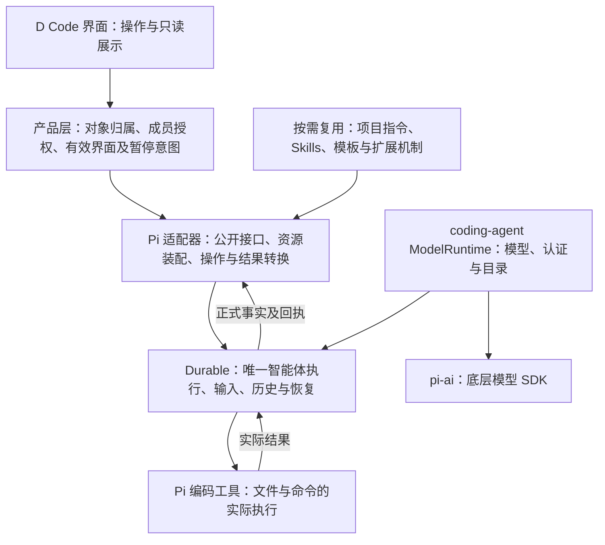
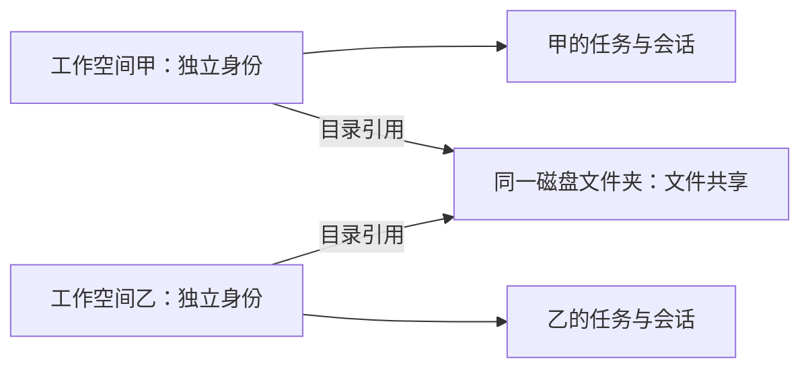
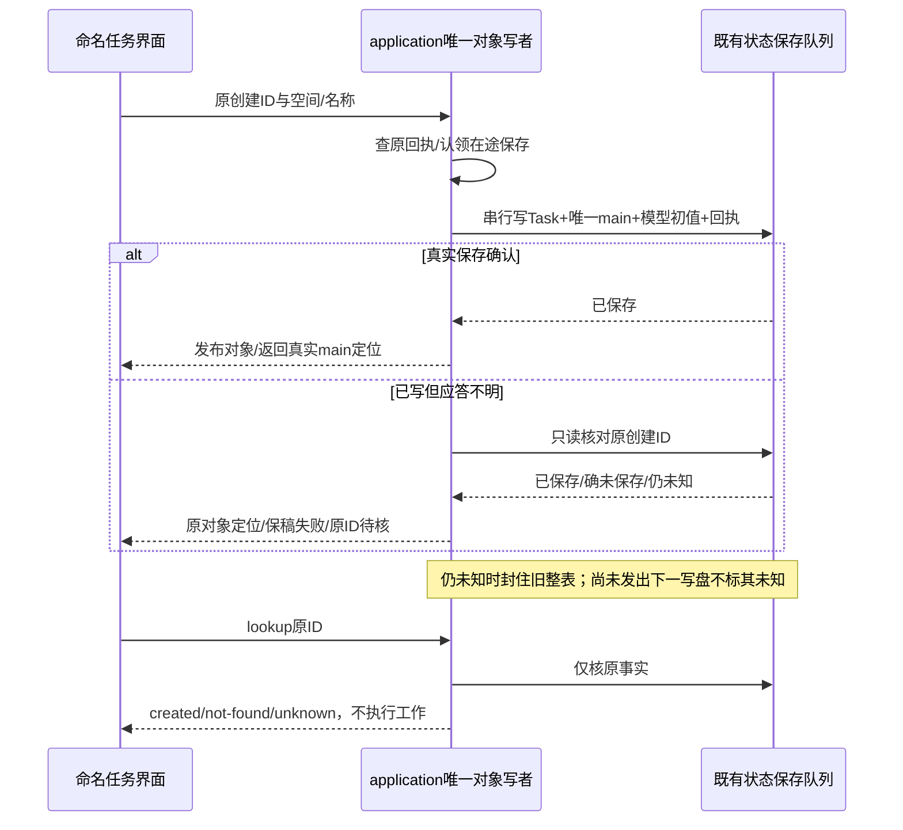
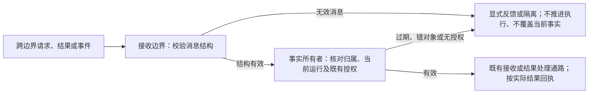
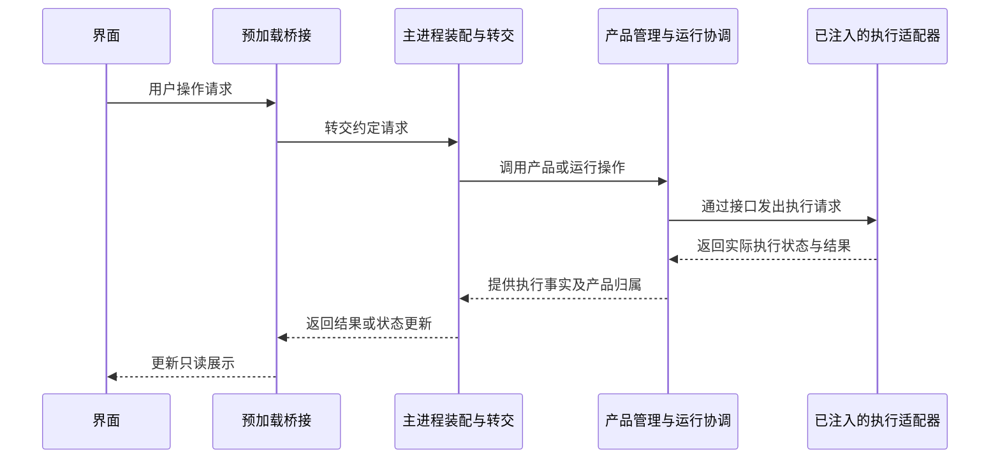
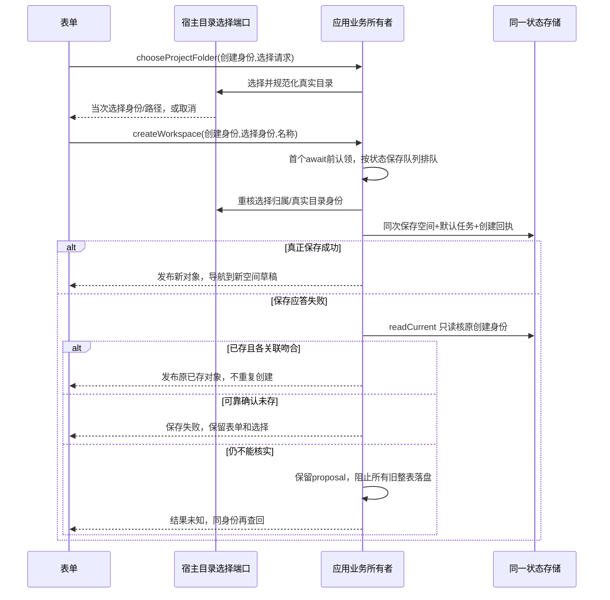
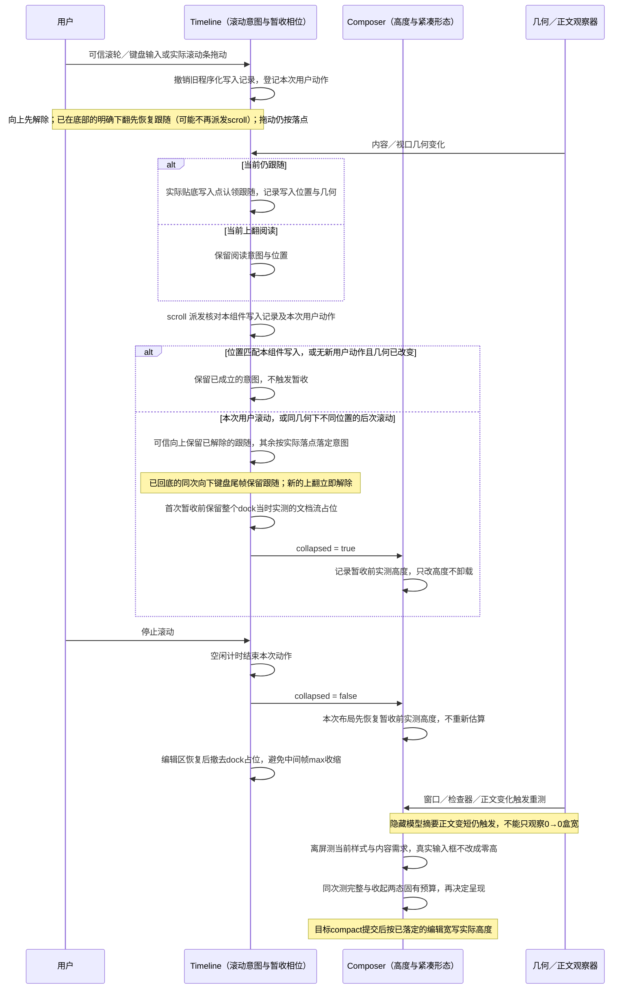
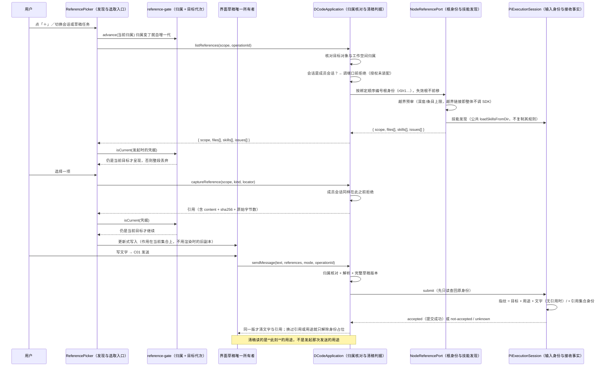

# 架构约定

本页持有模块、产品对象、共享接收及跨端／界面状态合同；Pi执行与资源见[运行与扩展](Pi运行与扩展.md)，模型装配、准入和费用见[模型接入与路由](Pi模型接入与路由.md)。用户行为以[spec](../spec/README.md)为准，版本／历史证据见[版本与升级](Pi版本与升级.md)，动态结果及未覆盖只读[PROGRESS](../PROGRESS.md)。

## 用户路径与边界

首条路径以 [开发任务规格](../spec/开发任务路径.md) 为准：需求输入、执行反馈、文件差异与追问在同一工作台完成。导航只改变界面位置；重开读取真实状态，已暂停工作等待显式接续，仍由其他有效界面维持的运行不重复启动。界面可以保存草稿和布局，不能自行推进第二套执行状态。

## Pi coding-agent 能力复用基准

Durable唯一持有智能体执行、输入、历史与恢复，pi-ai提供底层模型，coding-agent按用途复用；不另建AgentSession循环、正式接收队列或历史。D Code管理对象归属、成员授权和界面生命周期，不采用Pi CLI／TUI；已确认编码命令及手动终端保留，终端进程／输出不改交Durable。取舍与候选见[演进依据](Pi能力复用与演进.md)，具体行为见[真实编码规格](../spec/开发任务路径.md#真实编码能力与验收)。图示职责不代表全部接口已接通或产品已验收。

资源、事件与命令只按已确认消费者及公开入口装配，未支持调用明确拒绝；不因上游存在API或CLI默认启用而加任务。D Code自有异步IO、凭据与公开接口边界不变；第三方内部同步IO须核宿主响应性及可配置边界，不据此排除整个SDK。read／MCP替换仍是候选，不能覆盖现有数据、虚拟模型、路由及暂停恢复合同。

## 客户端集成合同

contracts唯一维护有限请求、结果和只读视图，接收侧核结构及业务归属。Pi回执保原submissionId，界面SendReceipt只去内部字段；mock明确标模拟。application经ExecutionPort协调产品对象，不代Durable接收或写历史；main装配平台，preload不暴露原始IPC，PiExecutionSession／ownership共用同一公开入口。

## 模块职责

以下根目录是首批客户端代码的归属约定；尚未有代码的模块不为占位创建空实现。机器可检查的依赖方向、公开入口和外部依赖许可清单统一在 [architecture-policy.json](../architecture-policy.json)，本文件不另维护第二份依赖表。

| 根目录 | 职责 | 对外约定 |
|---|---|---|
| `src/contracts/` | 界面与应用之间共享的操作、结果及只读视图类型；不包含宿主或运行实现 | 从公开入口引用，保持可序列化的边界；具体字段按实现范围设计 |
| `src/renderer/` | React 时间线、侧栏、检查器和设置；管理界面草稿与选择 | 读取视图、发出请求；不引用 Electron、Node 或 Pi 实现 |
| `src/preload/` | 通过 Electron 的隔离桥向界面暴露有限操作 | 只暴露约定方法，不能把原始 IPC 或任意宿主能力交给界面 |
| `src/main/` | 窗口生命周期、IPC 接线与依赖装配 | 连接应用和适配器；不以窗口对象承担任务业务状态 |
| `src/application/` | 工作空间、任务、会话归属及运行操作协调；定义所需适配接口 | 依赖接口，接收注入的适配器；不反向引用具体实现 |
| `src/adapters/mock/` | 原型使用的模拟执行器 | 实现应用定义的执行接口，状态展示始终注明未接 Pi |
| `src/adapters/pi/` | 将相同执行接口接到锁定 Pi SDK；迁移验收见[版本记录](Pi版本与升级.md)，复用取舍见[演进依据](Pi能力复用与演进.md) | 不与模拟适配器互相调用；智能体执行事实归同一 Durable |
| `src/adapters/storage/` | 本地持久化与文件访问实现 | 产品部分通过接口使用，不从界面直接读写 |

一次运行只装配mock或Pi之一，共用异步接收、只读查询、暂停与恢复端口；公开引用默认走模块index.ts，入口变更同步消费者。application拥有产品组织状态，可缓存执行事实的只读投影，不能借副本再次正式接收或推进历史；模拟时间线不冒充真实Pi。所有权审查追实际写入／回执，不能仅凭副本或返回类型判断双写。

纯界面依赖须加入renderer实际包许可清单、保来源与许可，不放宽宿主或跨模块边界；规则、例外及排除变化须有具体范围和审查依据。客户端自有文件／网络IO含初始化统一异步，真实完成后才报保存成功；离线脚本与第三方内部实现不因此强制改写。依赖检查不证明IO非阻塞，仍需源码、静态规则及响应验证。

## 工作空间身份与目录引用

工作空间身份与目录分离：多个空间可引用同一文件夹，任务归属、空间记录和请求关联用空间身份，文件／命令／Git用真实目录；不按路径合并对象。规范化与共享写冲突另核，不把不同空间身份当磁盘隔离。远端身份／路由按产品场景设计，不照搬参考项目的跨Host或路径回退身份。

应用层创建空间与目录引用，文件访问沿既有适配器，不新增空间执行器。首批任务移动只在同一Mac，见[导航与移动](../spec/工作台信息架构.md#导航与移动)；跨端展示／操作不等于跨Mac迁移存储或执行所有者。

## 命名任务保存与草稿归属

产品对象由application写入，正式输入沿原Durable接收；本节保命名任务及草稿的实现合同，行为见[开发任务路径](../spec/开发任务路径.md)。

命名长期任务的`createTask`携本次`operationId`、空间、`parentId:null`和名称。应用把任务、唯一主会话、空历史／ready运行视图、固定模型初值和`taskCreationReceipts`一起写入既有状态文件，确认成功后才发布并返回`CreatedTask`（原Task字段＋原操作ID＋真实mainSessionId）。模型初值由注册表准备有限草案，保存确认后才登记，不先留下孤立模型状态。后来的合法移动／改名不改创建输入指纹；原ID重试依原回执找同一对象，不按名称合并。

保存前同步认领并复用同一完整状态保存队列，关闭等待所有已开始的保存。排队期间若前次创建变未知，在本次构造proposal或发出写盘之前拒绝为`task-create-blocked`；不能给尚未尝试的保存伪造第二个unknown。只有本次真实保存应答未能核实时才保进程内proposal，封住旧完整状态覆盖。`lookupTaskCreation`只读原身份：确认已保存则合入该Task／Session事实，确认未保存返回not-found，仍不可读返回unknown；不写盘、打开端口、发模型输入或恢复运行。启动时不可读／损坏后种子只是展示，不能据其确认原创建不存在。

`pendingTaskCreation`仅投影当前进程持有的未知保存意图；正常关闭在它未核实时拒绝退出。原正式回执已落盘且启动可靠读取、调用方保有原operationId时可冷重开查同一对象；这不证明创建表单意图在强制终止或无法落盘时能恢复。界面若保留原用户稿，它是输入草稿，不另行认领任务创建事实。

工作草稿与命名创建分开：空间草稿仍以该空间默认任务作`taskId`锚点，首次发送才建空间根短期任务；父任务短期草稿以真正父任务作锚点，必须`parentTaskId===taskId`且没有sessionId，父任务须为long（含默认任务）。两种草稿在途关联不能共用槽；父草稿首次发送只建一个保parentId的short及其main。已命名正式任务的输入用真实mainSessionId；旧调用仅传该taskId时也不能再造根任务。全部输入沿原operationId／接收回执保存与查回，已完成工具和历史不因导航或查询重放。

## 协议与运行归属

跨边界由共享契约核结构，再由事实所有者核对象、当前运行、重复提交与既有授权。结构正确不代表有效或已接收；旧历史不能覆盖新运行。本地与远端共用该接收边界。

### 消息归属与过期结果

在 [统一运行归属规则](../AGENTS.md) 下，跨端消息除结构正确，还须能核对目标、操作来源及实际运行。下面规定合同必须表达的含义，不提前固定字段名、编码或通信库：

| 需要核对的内容 | 处理约束 |
|---|---|
| 目标 D Code 与工作对象 | 请求关联明确的目标端及其工作空间、任务和会话；不能仅凭显示名称或目录路径路由，也不能因访问端后来选中了别的任务而改变原请求目标 |
| 本次发送及原始内容 | 同次重试和自动补送保持原发送关联及内容；相同文字的独立发送不合并。同一关联携带不同目标或内容时不得静默作为正常重试接受 |
| 持久工作与当前执行实例 | 稳定会话归属与这次实际运行实例分别核对；实例重开不等于新会话，但旧实例消息也不能因会话名称相同就覆盖当前执行状态。原操作失效时不能自动改投另一轮工作 |
| 访问来源及当前资格 | 目标端核验来源设备及当前有效接入资格；显示为已配对、曾有资格或访问端自行报告成功不能替代实际核验 |

过期控制请求与合法历史事实分别处理。旧恢复请求不能解除后来生效的暂停；较早运行的合法结果仍可按真实归属回查，但不得把当前运行状态覆盖成旧的完成、失败或运行中。无法核实归属时反馈错误或未知，不按到达先后、显示名称或访问端当前页面猜测归属。已有正式事实不能由未经验证的迟到消息改写。

输入回执及自动补送沿同一事实所有者，不另建已接收队列。验收须含同目录分属不同目标端、发送后换页面、多端同次重试、旧结果迟到、新暂停与旧恢复交错及资格撤销；本地端口证据不替远端资格、路由或投影验收。

### 远端接入约束

远端统一为D Code连接目标电脑上的D Code，首批Mac持执行、文件及正式记录，Mac桌面和手机浏览器访问同一产品接口。多台获准设备可直接操作同一任务，不设唯一操作端接管；首次配对、记住后重连、随时撤销，不依赖统一账号。完整行为见[远端方向](../spec/工作台信息架构.md#远端连接方向)，协议、服务、费用及具体拓扑仍须方案与验证，参考项目的SSH／Web／手机入口不能推成两套产品或现成配对服务。

目标端统一核有效界面与连接：单端离开不必暂停，最后有效界面离开才暂停保存；退出执行端D Code仍停止，已暂停须明确继续，仍运行的重连只读。配对缓存不能代真实有效性，也不预定进程／存储拓扑。产品承担[配对后的外网接入](../spec/工作台信息架构.md#外网接入的使用门槛)，不要求普通用户先搭私人网络或转发；网络设施不成为业务所有者或有效界面替身。

中转服务不持正文解密钥匙。接入方案必须核实际解密点、密钥签发／保管、访问界面交付及目标身份绑定；HTTPS或“不保存”承诺不足以证明满足。可比较设备端终止连接与两端保护工作载荷，不预选协议、算法或厂商；必要元数据须列清，不宣称中转全盲，保护失败不得降级为中转可读正文，也不另建业务历史。

候选机制的网络／服务分离对照见[Tailscale](https://tailscale.com/docs/how-to/connect-to-devices)、[Tunnel](https://developers.cloudflare.com/tunnel/)及[路由](https://developers.cloudflare.com/tunnel/concepts/routing/)，不构成首版要求用户自建网络或锁定厂商。实施前用隔离数据核移动浏览器步骤、认证／传输保护、配对撤销、服务失败、数据日志、维护责任和成本；真实部署、凭据、开放端口或收费资源须另核具体授权。

## 请求与结果的职责时序

Mac入口职责如下，不固定IPC格式、进程数或Pi API。导航只改界面位置；手机浏览器不能直用Electron预加载桥，须接同一产品接口与正式输入通路。本图不替浏览器链路、远端或完整产品验收。

暂停、恢复、成员授权等待和失败分支须由相应方案补足时序图，准确者可复用；绘图责任见[AGENTS](../AGENTS.md)，图不替运行证据。

## 首次工作文件夹绑定：选择事实、保存与运行目录

用户行为见 [工作空间规格](../spec/工作台信息架构.md#普通客户端首次绑定工作文件夹)。`WorkspaceDialog` 只持有名称草稿、operationId与当次选择请求；`NativeProjectFolders` 持有有限的临时目录选择能力，规范化路径并在创建前重核目录身份。`DCodeApplication` 独占空间、默认任务与持久创建回执；preload／main沿有限共享契约同时校验请求和返回，不向renderer暴露Electron或文件系统。

设置与新绑定共享保存／发布队列；各次排到真实保存前重取最新其他事实。定时保存、首发立即保存与关闭均等待全部认领，并在实际保存点核未决绑定。未知proposal保留原对象ID与选择／名称，并通过快照的有限待核投影支持表单关闭后的侧栏查回；这个投影不持久化第二份队列。查回不能重新造对象或用磁盘旧整表覆盖已推进的运行。`readCurrent` 无改名、清理和启动保护变化；启动期 `load` 的损坏保全与拒写保护继续独立成立。失败关闭在结果查回后可由下一次明确关闭重核，不能缓存旧失败冒称新结果。

新运行仍由 `ensurePort` 从任务绑定或空间首个目录解析；普通Pi后端使用同一Durable。旧运行的正式Binding与Agent.cwd仍是恢复依据，另一空间的目录选择／新建／导航不重建该端口。创建后的异步导航使用当前用户导航代次，迟到快照不能盖回新的选择。

## 会话输入区的几何与暂收：所有者与事件顺序

用户几何规则见[DESIGN](../DESIGN.md#会话输入几何与暂收)和[开发任务路径](../spec/开发任务路径.md#桌面会话输入区)，下列持有实现所有者与事件顺序。

两个所有者互不重叠：滚动意图、暂收相位及暂收期间dock的文档流占位由 `Timeline` 持有；输入区的高度、紧凑形态与暂收前实测高度由 `Composer` 持有。两者之间只有一个接口——`collapsed` 布尔量，从 `Timeline` 到 `Composer`，`Composer` 不反向读滚动状态。

暂收保整个dock原实测文档流占位，恢复顺序是Composer先还原高度、Timeline再撤占位，不能把上翻位置钳到新底。草稿及运行事实不变。

判定边界：

- **意图落定与暂收触发是两件事。** 进入会话与跟随重钉复用同一个实际贴底写入点，在那里认领跟随并记录写入位置／几何；迟到的本组件 `scroll` 派发不能按那一刻的位置重判，也不能覆盖较新的可信上翻意图。向上滚轮／键盘在浏览器实际位移之前解除跟随；明确向下输入已在底部时立即恢复跟随，不依赖并不存在的下一次scroll。真实拖动保中性方向，仍按落点判定。重排锚定／钳制与本组件位移均保留意图；同几何下实际位置已不同于自己的写入，说明后次滚动覆盖了它，不能仅因没有可信输入标记而吞掉。 比较起点取上一次实际 scroll 派发，不由先到的 ResizeObserver 更新；重排后两次相同落点的通知没有新增位移，不进入暂收。测试侧的同次派发位置对照只证明该归属机制，真实滚轮／键盘／经典滚动条另有完整动作证据。把派发时刻误当写入时刻会丢失初始化跟随，或让「展开 → 跟随 → scroll → 暂收 → 恢复」成环。
- **紧凑判定不得被自身改变的量逆转。** 同次测量摘掉当前隐藏呈现，并保持操作行 `max-content` 到完整／收起两态固有宽度都读取完。判定使用卡片全宽下是否单行、两态操作行固有预算与组件拥有的最小编辑宽；草稿单行宽度不参与标签隐藏预算，装不下的草稿折行而非隐藏模型名。内容需求在仅同步接入的离屏、不可交互测量节点读取，真实输入框不为测量压到零高，避免浏览器钳制生成迟到滚动。形态由同一 compact 状态提交后，再按真实目标编辑宽写高度，宁可长高也不裁内容。隐藏摘要正文改变由独立正文观察触发重测，不能依赖轮询对象或可见盒宽变化。

## 引用入口：所有者与事件顺序

C05用户行为见[页面与交互组件](../spec/页面与交互组件.md#c05-引用入口载荷归属与竞态)，以下持有读取、草稿和发送事实的实现归属。

三个所有者互不重叠：**读取事实**（目录内容、技能正文、快照哈希）归主进程的引用适配器；**草稿里有哪些引用**归界面状态（`referencesOfDraft`，键是草稿键）；**哪一次发送带了哪些引用**归应用层与执行端（时间线用户块携带 `ReferenceSummary`，执行端提交时逐条验哈希）。界面不直连文件系统、Node、Electron 或 Pi。

判定边界：

- **目标与代次**：门禁持当前归属及单调代次，换目标／卸载自增，A→B→A仍是新代；同归属重复advance为空操作。不能在旧async闭包比较两个发起时标量来判断“此刻”目标。捕获完成用更新式写当前引用集合，不用旧render数组覆盖在途增删。
- **清稿**：直接应答、自然快照、显式查回／重试共用一个判据，逐项比较文字、用途、引用集合；各路径从其真实来源恢复发送版本。await后用途必须读每次render同步的当前ref，不能以旧steer闭包清掉已改成follow-up的新稿。
- **授权与预审顺序**：成员授权未装配时在调端口前拒绝；技能库会跟随目录／SKILL.md链接读取正文，须在SDK遍历前fail-closed预审，事后realpath过滤只是第二层。审不完不算安全，不先读后判。
- **遍历与错误**：保深度限制及跨递归累计的条目预算，读不到、无权限或超限按真实成因拒绝；用已审真实路径防重入，不将根内安全环误报成深度超限。目标元数据未知不能吞成安全或目录；ENOENT按断链策略跳过，其余权限／环路／句柄耗尽按真实成因报permission-denied或unreadable、整体不进SDK。根内文件链接验realpath即可，目录链接继续审条目。
- **根身份**：r0/r1按原绑定列表位置编号，不按成功解析的数量前移，防失效前根让后根顶替旧定位。

## 自动检查的合同

检查只读执行，解析 JS／TS 源码，依据真实解析到的依赖检查：

- 产品源码必须属于声明的模块，不能把未纳入的源码当成通过。
- 跨模块引用只走允许的方向与目标模块公开入口。
- 外部包与 Node 内置模块必须在该模块的许可清单内；界面不能直接引用宿主或 Pi 包。
- 模块引用不能形成文件循环；类型导入也纳入依赖图。
- 支持静态导入、重新导出、类型导入、字面量动态导入及 CommonJS 引用；无法静态确定的动态引用报告失败。
- 解析失败、内部引用无法定位、通过别名或符号链接逃出范围等情况明确报告，不静默略过。

配置文件、检查工具、测试、构建输出及根级 `.delta/` 工具快照属于明确排除范围；产品源码不得引用被排除的本地实现。`.delta` 排除只作用于根级工具目录，普通文档脚本、其他越界源码及 `src/**/.delta/` 中的源码仍须检查。外部包内部代码、样式表中的引用、运行时拼装、Worker／资源 URL、eval、IPC 调用语义、Electron 安全配置和 Pi 状态时序不由本检查证明，需另做相应验证。符号链接形式的产品源码暂不支持，发现时直接报告。检查语法和依赖边界不等于类型检查或应用构建；类型导入所指向的声明可能与最终运行文件不同，交付时仍需类型、构建和实际行为验证。

检查器的验证应覆盖合规依赖、禁止方向、绕过公开入口、宿主引用、路径别名、重导出、动态引用、类型导入、循环、无法解析和未纳入模块等场景。合规场景必须通过，故意违规场景必须失败；命令必须返回对应的成功或失败状态。

检查入口及覆盖见[README](../README.md#检查覆盖与证据)。结构、类型与Promise结果不证明消息语义、所有IO非阻塞或界面可用；零产品源码只能证明检查入口，不是客户端架构验收。交付方按范围完成架构、全类型／Lint和构建／原动作验证，独立树集成再核组合；不删规则、扩大排除或改期望消除违规。依据为本项目所有者及桌面技术栈，TypeScript官方解析API负责检查；Electron隔离／安全配置须另核实际壳层，不移植参考检查器来预定分层。

## 补充参考的评审边界

参考不得增加第二运行层、调度器或授权路径。资源／监听归属、启用与加载分开，成员间接调用不绕过[主会话授权](../spec/工作台信息架构.md#主会话与成员授权)；不设产品权限模式或主会话操作审批，参考审批仅可适配为成员分工／越界申请。并行、写入隔离、历史恢复和执行恢复分别验证。

| 参考 | 保留的适配与排除 |
| --- | --- |
| DeepSeek固定`5badb150`的[架构](https://github.com/deepseek-ai/deepseek-harness/blob/5badb15009ae1756c3afe0ae0cef1faafc290ccc/docs/architecture.md)／[SDK](https://github.com/deepseek-ai/deepseek-harness/blob/5badb15009ae1756c3afe0ae0cef1faafc290ccc/packages/sdk/client/README.md) | 不采用其运行时、Cordis或DSH sessionlog；无mid-turn cancel的切片不能替D Code暂停／引导。资源复用见[演进依据](Pi能力复用与演进.md)，不衍生包市场／能力包治理。 |
| Raven固定`3632e604`的[编排](https://github.com/EverMind-AI/Raven/blob/3632e6040c7038a60ec418ce39ccae185c72c19f/docs-site/docs/orchestration.zh.md)／[节点](https://github.com/EverMind-AI/Raven/blob/3632e6040c7038a60ec418ce39ccae185c72c19f/ui-web/src/features/dag/types.ts)／[图](https://github.com/EverMind-AI/Raven/blob/3632e6040c7038a60ec418ce39ccae185c72c19f/ui-web/src/features/dag/DagGraph.tsx)／[画布](https://github.com/EverMind-AI/Raven/blob/3632e6040c7038a60ec418ce39ccae185c72c19f/ui-web/src/features/dag/Board.tsx) | 只借只读分工、关系与真实状态展示；不引入流程编辑器、第二调度器、固定DAG或顶层对象，节点不强绑进程／会话；静态来源不等于运行验收。 |
| Motion Panels | 仅具体布局缺口出现时核固定版本／许可／接口及拖宽、窄屏、长文本、键盘、恢复；React范围相符不证明Electron兼容，当前未安装或替换。 |
| 用量资料 | [模型路由合同](Pi模型接入与路由.md#模型选择与自动路由所有者与事件顺序)区分任务统计、账户事实和估算；研究来源不冒充已接账户接口。 |

## 后续方向：模型辅助输入分流

当前显式选择用途，已确认未来可用模型辅助分流，用户行为只在[输入入口与后续演进](../spec/工作台信息架构.md#输入入口与后续演进)。模型／版本／接入／上线尚未定案，不列首版依赖或空适配器。判断结果仍进入相同应用入口，由应用核用户选择、当前状态和权限；不能直接改派、解除暂停或绕过边界。用户明确选择优先，不确定／服务失败退回手动、不阻塞交流。

Jev等是候选：[意图分流](https://docs.typesafe.ai/patterns/intent-routing)、[Choice](https://docs.typesafe.ai/primitives/choice)可给选项／概率／置信，但[置信分布](https://docs.typesafe.ai/confidence)不是正确性或行动授权。启用前用代表性中英文的纯查询、纠正、混合意图、依赖上文短句与运行状态变化核误执行、延迟、成本、改选及回退，阈值取本项目样例，不照搬示例。历史输入分流研究不等于该功能已接通，也不否定[已有有限classify消费者](Pi模型接入与路由.md#扩展分类消费者的所有者与费用)。
