# 客户端起步阶段的架构约定

状态：起于 2026-10-03 工程准备，2026-10-05 新增无 UI 的真实 Pi 运行切片与集成证据。507 已确认 Electron + React + Tailwind v4、Pi SDK 1.0.0，以及先建立自动架构检查再开发首批产品功能。2026-10-06 的客户端集成承接固定 r7，接到主树同一正式执行合同并保留模拟对照；证据与遗留限制见 [集成记录](验证记录/客户端集成-2026-10-06/README.md)。2026-10-09 补入用户服务商配置与普通 Pi HTTP 装配，验证使用本地协议服务器；多端网络、真实外部账户与完整开发任务尚未验收。

## 用户路径与边界

首条路径以 [开发任务规格](../spec/开发任务路径.md) 为准：需求输入、执行反馈、文件差异与追问在同一工作台完成。导航只改变界面位置；重开读取真实状态，已暂停工作等待显式接续，仍由其他有效界面维持的运行不重复启动。界面可以保存草稿和布局，不能自行推进第二套执行状态。

## Pi coding-agent 能力复用基准

2026-10-09，507 确认：以 Pi `1.0.0` coding-agent 的完整非界面能力为接入基准，通过 SDK 复用执行循环、编码工具、模型、会话与资源能力；D Code 负责界面及工作空间／任务／会话归属、成员授权与产品生命周期。无需移植 Pi CLI／TUI；`bash` 等编码工具仍属于所需执行能力。不得将当前文字 HTTP 切片的范围当作完整编码智能体的交付范围；用户路径及验收唯一正文见 [真实编码能力](../spec/开发任务路径.md#真实编码能力与验收)。

下图表达已确认的职责，不表示全部能力已经装配或已选定最终运行入口。Pi 适配器的组合验证在普通 `AgentSession` 和 Durable 路径之间核定一个执行事实所有者；不同时运行两套循环、正式接收队列或会话历史。当前 main 的 Durable 实现作为已验基线保留，候选通过后才替换相关装配并复验。

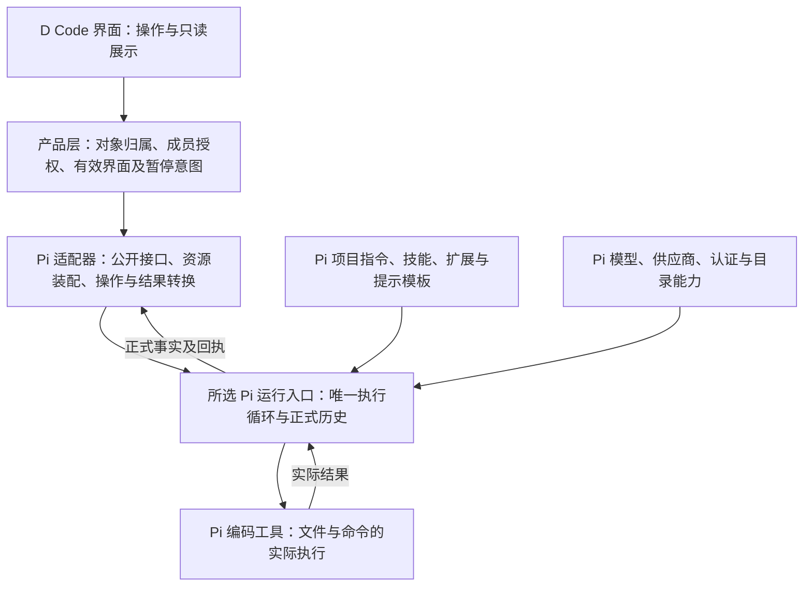

普通 SDK 的资源发现、扩展生命周期及 CLI 默认启用能力须按官方接口逐项装配。D Code 自有异步 IO、公开接口及凭据范围规则继续适用；第三方内部同步 IO 不自动构成排除整个 SDK 的理由，须核实宿主响应性和可配置边界，不能因此默认重写其上层能力。虚拟模型、有状态路由、暂停／重开、扩展兼容及现有数据承接均由实际组合证据判断，详见 [Pi 组合验证范围](Pi-1.0.0-虚拟模型与运行恢复.md#完整-coding-agent-接入方向与组合验证)。具体运行入口仍待验证，本次确认没有授权直接覆盖已验主线。

## 客户端集成合同

2026-10-06 将已固定的 r7 界面接入主树既有执行切片，范围限 Mac 客户端、受控模型、隔离数据与既定验证；默认模拟档和显式受控 Pi 档分别标识，不接真实服务商或用户工作目录。

- 执行身份、控制令牌、工作输入、正式回执和执行视图由 contracts 的同一份定义维护。Pi 回执保留 submissionId，视图保留 model 与 execution；mock 使用显式 mock 标识，不伪称 Pi。界面 SendReceipt 是显式去除内部 submissionId 的投影，接收语义不另定义。
- application 的 ExecutionPort 保持公开调用方式；DCodeApplication 管理产品对象、首发关联及读取投影，不能替 Pi 接收或推进历史。ExecutionBackend 工厂复用同一 PiExecutionSession，测试直接打开执行会话仍是同一实现。
- 主树 PiExecutionSession 与 ownership 实现保留，文件移入 pi 模块内部后仍从 index.ts 公开导出。runtime 测试与 UI E2E 并存，不互相替代。
- main 负责 Electron 装配，preload 保留有限操作及接收校验。模型和文件演示仍使用明确的隔离目录；产品对象的目录字段不被静默接为真实工具目录。
- 检查配置统一覆盖执行层和界面层；保留主树 ESLint 10.12，并采用声明兼容该版本的 React hooks 插件 7.1.1；保留主树 Promise 检查与界面 hooks 规则。版本统一不豁免规则，也不缩小待验证范围。

集成后的构建、运行、UI 与视觉证据分别记录；固定源通过不代替新组合通过。

## 模块职责

以下根目录是首批客户端代码的归属约定；尚未有代码的模块不为占位创建空实现。机器可检查的依赖方向、公开入口和外部依赖许可清单统一在 [architecture-policy.json](../architecture-policy.json)，本文件不另维护第二份依赖表。

| 根目录 | 职责 | 对外约定 |
|---|---|---|
| `src/contracts/` | 界面与应用之间共享的操作、结果及只读视图类型；不包含宿主或运行实现 | 从公开入口引用，保持可序列化的边界；具体字段按实现范围设计 |
| `src/renderer/` | React 时间线、侧栏、检查器和设置；管理界面草稿与选择 | 读取视图、发出请求；不引用 Electron、Node 或 Pi 实现 |
| `src/preload/` | 通过 Electron 的隔离桥向界面暴露有限操作 | 只暴露约定方法，不能把原始 IPC 或任意宿主能力交给界面 |
| `src/main/` | 窗口生命周期、IPC 接线与依赖装配 | 连接应用和适配器；不以窗口对象承担任务业务状态 |
| `src/application/` | 工作空间、任务、会话归属及运行操作协调；定义所需适配接口 | 依赖接口，接收注入的适配器；不反向引用具体实现 |
| `src/adapters/mock/` | 原型使用的模拟执行器 | 实现应用定义的执行接口，状态展示始终注明未接 Pi |
| `src/adapters/pi/` | 将相同执行接口接到 Pi 1.0.0 | 不与模拟适配器互相调用；执行事实以选定的 Pi 入口为准 |
| `src/adapters/storage/` | 本地持久化与文件访问实现 | 产品部分通过接口使用，不从界面直接读写 |

模拟适配器与 Pi 适配器承接同一产品操作约定，一次运行只装配其中一个。主树已定义异步接收、只读查询、暂停及恢复的正式执行端口；本地客户端消费者已适配到该通路，旧同步 `void` 加回调形状只代表早期模拟基线。无 UI 切片的 Pi 会话与 JSONL 归属已有验证；本地装配证据见集成记录；多端传输及未覆盖故障路径仍需逐项验收，不从目录结构推断已经完成。公开入口默认使用各模块的 `index.ts`，实际需要变更时连同依赖使用点一起审查。

运行协调负责转交操作和组织结果，执行状态所有者负责确认同一次运行的实际事实，两者不是同一职责。真实 Pi 接入后，已接收输入、回答、工具结果及运行进度以选定 Pi 入口为准；应用层可以保存其只读投影或缓存用于时间线展示，不能借此再次正式接收同一输入或独立推进另一份执行历史。当前模拟原型由应用层汇集并保存模拟时间线，不因此自动构成真实 Pi 的双写，也不据此确定真实 Pi 的所有者边界。审查须追踪实际写入和回执通路，不能仅凭数据副本或回调返回类型判定冲突。

允许引入适用的纯界面依赖时，将实际包名加入 renderer 的外部依赖清单，并保留来源及许可记录；不因此放宽宿主能力或跨模块访问边界。规则、例外及排除路径的修改必须有本轮范围和审查依据。

客户端自有运行代码的文件与网络操作，包括初始化，统一使用异步接口；处理等待与失败，持久化完成后才报告保存成功。该要求不把离线检查和构建脚本强制改为异步，也不授权修改 Pi 等第三方内部实现。现有导入检查不证明所有操作均为异步或不会阻塞，需结合代码审查、静态规则和实际响应验证，不能用“已调用异步接口”代替运行证据。

## 工作空间身份与目录引用

507 已确认多个工作空间可以引用同一文件夹。产品身份因此与目录路径分开：任务归属、空间相关记录和请求关联使用工作空间身份，不以相同路径将不同空间去重为一个对象；实际文件访问、命令工作目录和 Git 操作使用对应的真实目录。目录的规范化与共享写入冲突检测由工程设计处理，不能依靠不同工作空间身份假定磁盘资源已经隔离。远端已纳入需求对齐，身份与路由须按最终场景适配，不直接照搬参考项目的远程身份、跨 Host 路由或路径替代身份的回退格式。

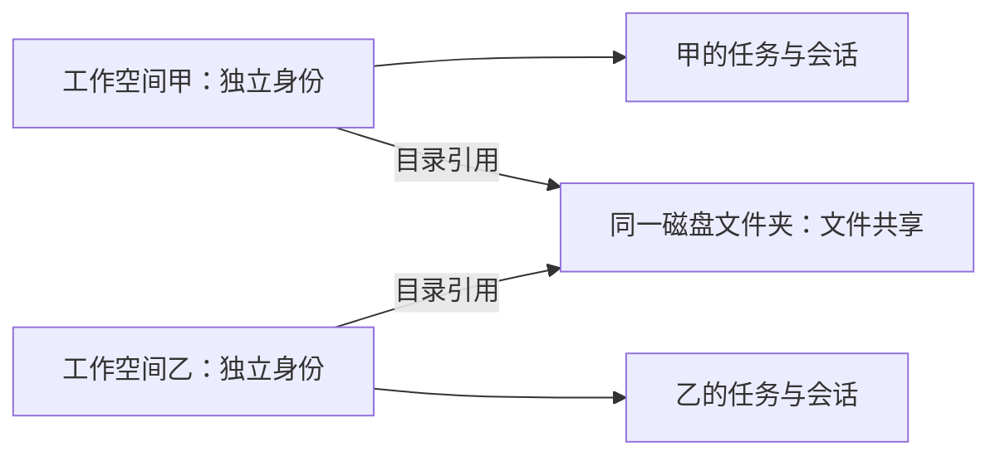

图示为已确认的产品关系，尚非存储或运行验证；创建和引用关系由应用层负责，文件访问由既有适配接口承接，不新增一套工作空间执行器。507 已将首批任务移动限定在同一台 Mac 内，具体规则见 [导航与移动](../spec/工作台信息架构.md#导航与移动)；跨端展示和远端操作不等于跨 Mac 迁移会话存储或执行所有者，后者不在首批移动范围中。

## 协议与运行归属的继续校对

2026-10-04 继续对照 [ZCode AGENTS 的进程、协议与远程控制规则](https://github.com/zai-org/ZCode/blob/29628c9acdb81b703bbd4080c207a0e7ce5e276e/AGENTS.md#进程协议与远程控制)。该组同时包含消息运行时校验、主进程与业务状态分离、输入接收通路及旧运行防护；这些约束须分别核对本地与远端适用性。此前未充分区分规则对照与工程验收；2026-10-05 已确认本组规范及 D Code 取舍都有对应，剩余适配缺口按下列实现范围验证，不将规则对齐写成已经验收。

本轮补齐的规则是：消息经过边界时，接收侧按共享契约检查其结构；正式处理方继续核对对象、当前运行、重复提交及既有授权。结构正确不代表目标有效，更不代表输入已经保存或操作完成。旧运行的合法历史记录可以保留，但不能以迟到顺序覆盖新运行状态。规则正文见 [AGENTS](../AGENTS.md)，本地请求定义和校验已由 Electron 受控 Pi 客户端消费，接收校验与回执场景的证据见集成记录；远端消息接线未完成。

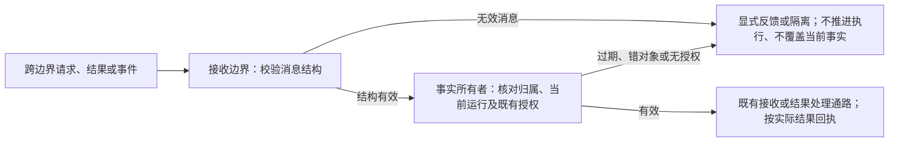

下表记录沿 Pi 1.0.0 入口完成的本地适配和仍待接入的部分；接口字段、进程数和存储布局由工程证据收口，不逐项交给用户选择，也不把局部通过写成整条客户端完成：

| 校对内容 | 已有依据 | 当前适配结果与剩余证据 |
|---|---|---|
| 实际运行的归属与生命周期 | 模块职责已分开；[Pi 状态所有权核对](Pi-1.0.0-虚拟模型与运行恢复.md#状态所有权核对) 已记录同一 Durable 存储的单进程归属约束 | 无 UI 切片已采用每会话独立 Harness／JSONL，验证活进程排他、死亡实例回收及旧恢复失效；本地 Electron 装配复用该会话实现，多端事件投影仍需接入，不据此规定每会话一个进程 |
| 输入接收与恢复通路 | [引导规格](../spec/工作台信息架构.md#运行中用户消息的引导) 已确认统一接收、保存后回执、发送重试关联及显式接续 | 无 UI 切片已将接收、引导、稍后处理、暂停与重开映射到 Pi 正式通路，覆盖去重、回执丢失与保存异常；本地 UI 消费者已适配，已覆盖故障及未归因现象见集成记录；多端有效界面和成员授权协调的完整链路尚未验收 |
| 跨边界的具体消息合同 | 本轮补齐结构校验及业务归属校验规则；现有模块表只声明共享操作与视图类型 | 本地端口已有请求／回执／视图和运行时校验，错目标、旧恢复及保存失败已有行为测试；Electron 本地桥已有请求和快照校验，设备资格校验和远端传输仍未实现 |

上述顺序为运行归属 → 输入接收与恢复映射 → 具体消息合同；已有产品要求保持。2026-10-05 已落实本地执行接口、依赖及运行验证，2026-10-06 本地客户端已接入同一端口，证据见集成记录；远端网络尚未接通。

### 运行归属与输入通路的最小验证候选

2026-10-05，507 要求将本节实际落地。当时实施切片为无 UI 的异步 Pi 执行端口：锁定 `pi-durable`、`pi-ai` 与 `chord` 的 `1.0.0`，每个产品会话拥有独立 JSONL 记录与 Harness；先以真实 SDK、受控模型及隔离文件验证，再登记实际结果。早期 UI 的同步模拟端口不能充当持久接收合同；新端口验证后，当时的独立 UI 消费者开始适配；2026-10-06 的本地受控客户端结果见集成记录。不会为此等待手机布局、终端选择或新增视觉规则。

本切片的正式入口放在 `src/adapters/pi/`，产品请求及只读结果位于 `src/contracts/`，抽象端口位于 `src/application/`。宿主提供已核对的会话归属、工作目录、模型与工具注册；执行适配器持有唯一存储所有权，Pi 持有输入接收、历史与运行进度。输入关联的内容指纹只约束同次重试，不代表输入已经接收，也不构成另一份执行队列。对同一目录的其他运行实例拒绝开放；只有能确认旧进程已退出时才能回收其所有权记录，无法核实时停止接入而不覆盖文件。

2026-10-05 UI 接线发现助手正文读取缺口：Pi 的已提交助手消息位于条目的 `model`，原视图只复制 `data`，导致正式输入已经完成但消费者读不到正文。执行合同的助手条目现增加 SDK 无关的 `assistantText`，由同一 Pi 历史按文本块原顺序投影，保留条目身份；顶层 `model` 仍只表示当前模型身份。该字段只包含已提交正文，不将思考、工具调用块或流式中间片段混为正文，不另建可独立写入的历史。验证入口见 [运行验证](../test/runtime/README.md)；后续客户端已消费该字段并以受控 Pi 端到端验证实际正文，证据见集成记录；此前仅接口修复的记录仍不能代替 UI 证据。

`open`、`read` 与回执查询不启用调度；`submit` 对同一发送先核对目标及内容，再走 Pi 正式接收；`pause` 拒绝新工作并等待真实关闭，保存或收束失败必须反馈；`resume` 只接受当前实例及暂停版本，较新的暂停可使旧恢复失效。关闭后读取及重新打开不承诺原模型网络请求继续，恢复可能重新请求模型。JSONL 的 `fsync` 选项也不被解释成断电无损保证，进程退出、强制终止与电源故障分别报告。

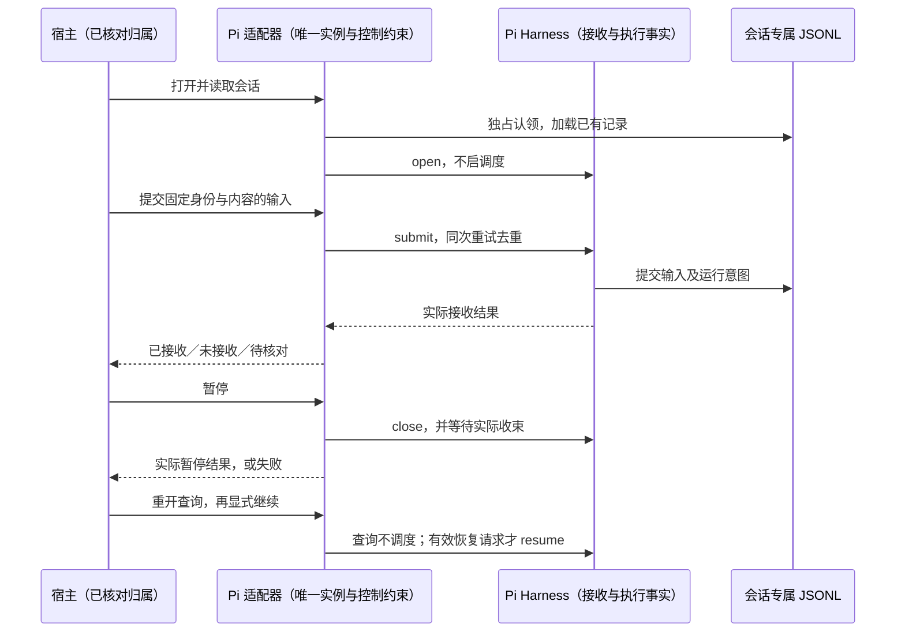

本次不依赖 UI 的端到端路径须验证实际文件工具、输入去重及改文冲突、完成后的回执查询、独立会话暂停、关闭与强制终止后重开、旧恢复与新暂停交错、保存失败和结果未知。这是 2026-10-05 无 UI 切片的验证范围；2026-10-06 的受控本地 UI 已完成接入验证，见集成记录。真实服务商、成员自然语言授权与多端网络仍是后续接入，原型与产品适配测试分开记录，不把任何未执行项标成通过。下文保留采用前的源码候选依据。

以下保留采用前的固定源码候选依据。2026-10-05 无 UI 切片已采用并验证每产品会话独立 Harness 与 JSONL；独立 UI 已有受控 Pi 条件装配，完整客户端交付未验收，多端协议未接通。实际结果见 [运行证据](Pi-1.0.0-虚拟模型与运行恢复.md#2026-10-05-实际运行证据)。2026-10-04 重新核对 Pi `a13d35a742c6ef8462812a28fbe1d8c8b7431c32` 的 Harness、提交、调度、类型及说明文件，本地五份原文摘要与既有清单一致。

本切片采用并验证：每条工作会话分别使用独立 Harness 与专属持久存储，可以独立关闭、读取和接续，暂停一个单元不停止另一个。任务级暂停覆盖主会话及其成员、访问端共用目标 D Code 的正式入口，是宿主协调与远端接入的后续要求，本轮尚未实现；不能为每个 Mac 或手机各开一份执行器。D Code 任务、主会话与成员归属仍由产品层组织，不直接套用 Pi 内部 Task 或原生子智能体的层级和生命周期。

选择该候选的依据是：公开 Harness 的 `resume()` 与 `close()` 作用于整个 Harness，固定入口未提供可直接等同 D Code 成员暂停的公开方法；同一 Harness 容纳多个 conversation 的方案还需证明独立暂停成立，不能先把两种粒度混同。[固定 Harness 实现](https://github.com/earendil-works/pi/blob/a13d35a742c6ef8462812a28fbe1d8c8b7431c32/packages/durable/src/harness/harness.ts)

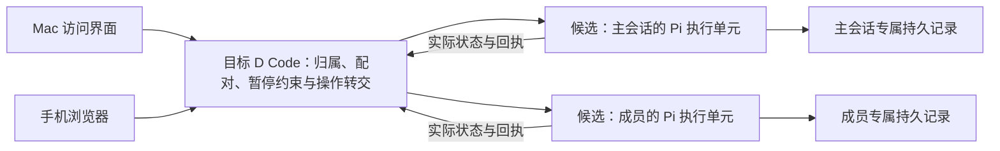

执行单元不等同于操作系统进程。Pi 的已核约束是同一份 Durable 存储同时由一个进程拥有，且存储层不提供跨进程锁；这不直接决定每条 D Code 会话的进程数，也不允许两个访问端分别打开同一存储写入。旧实例尚未完成关闭和资源释放时，不让新实例并行接管同一存储；关闭等待被取消不当作底层清理已结束。[存储约束](https://github.com/earendil-works/pi/blob/a13d35a742c6ef8462812a28fbe1d8c8b7431c32/packages/durable/README.md#storage)

接收与查询须分开：固定版本的 `submit()` 会先启用调度，再经持久提交创建或查回提交；`Submission.wait()` 也会启用调度，`status()` 则读取已有提交记录。因此，不能用再次提交或等待完成来实现纯重连查询，更不能用它们把普通新输入送入已暂停工作而悄悄恢复执行。当前无可验证的暂停接收路径时，保持未接收反馈及原文；本候选不新增“暂停期间所有输入都必须接收”的产品要求。[提交与查询实现](https://github.com/earendil-works/pi/blob/a13d35a742c6ef8462812a28fbe1d8c8b7431c32/packages/durable/src/harness/submissions.ts)

正常工作输入复用 Pi 选定入口的正式接收记录；D Code 只管理产品归属、请求转交、暂停许可及其展示，不另建一份已接收执行队列。发送或保存出错时，接收结果可能仍需核对；查询和重试沿用同一次发送关联，不能把通信失败一律当作从未接收。原始输入及未知状态保持可回查，具体错误分类与查询合同须结合所选持久化入口验证。

### 普通编码入口的装配与边界（2026-10-13 接线，验收中）

普通 custom/preset 客户端每会话持有 ModelRuntime，保留既有凭据隔离、动态模型登记与每次 SDK 准入。PiExecutionSession 仍只持有同一个 Durable Harness：没有第二个 AgentSession、循环、历史或输入队列。读取旧根先核同一绑定与 AgentDoc.cwd；查询不配置模型、不加载项目资源，也不创建缺失根。首次初始化关联 `runtimeCreationPending` 只描述客户端的新对象建立过程，在端口已确认记录且客户端保存收口后、任何正式输入提交之前解除；它不描述运行相位或接收结果。

主会话的项目访问沿既有任务所有者判定进入有限内部 `projectAccess`；成员范围未装配时不安装编码工具、不加载项目资料。此字段不来自界面请求，也不是产品权限模式。授权后的发送／继续在独立线程只读取项目／应用资源根本层的指令文件，按真实路径、类型、容量和 UTF-8 核对；显式技能先限定具体文件，再交 SDK 公开函数解析与格式化，不调用向祖先遍历的 context loader。符号链接不扩大范围，已声明条目失效不能当可选缺席，准备期间被暂停取代不写成存储故障。提示模板只发现应用 prompts/ 与任务 .pi/prompts/ 的直接 Markdown 文件，复用公开 frontmatter 并按固定 Pi 参数语义展开；同名按应用先定义，具体来源与 MIT 适配见 THIRD_PARTY_NOTICES。未启用扩展时保留既有未接收前转换；启用扩展时按下述同 Durable 接收／准备任务消费。查回及继续不重新展开历史。

### 项目扩展／MCP 与原 Durable 的接缝

扩展与公开read的图像结果在写入前复用共享图片合同，防非法图片污染历史后使读取失败；启动回调CustomMessage的来源／display与模型贡献同事务保留，关联原准备requestId或pi.user EntryId，false不展示但仍作为上下文。

输入启动只认请求cutoff内的原`pi.user`，准备标记用本次内部requestId查正式submission.entry关联，不以正文相同或扩展可见消息的user模型投影认领。generation的context／headers动作以原输入、原assistant轮次与attempt关联，同请求恢复保身份，不同真实请求不会错去重；资源回调另以实际线程代次隔离。线程只收到accept／content-type／user-agent公开头投影，模型认证原头保留在宿主，禁止项目回调覆盖凭据／账户头；允许的新增头合入原请求后再发。

`CodingExtensions` 只持有现有会话的 Harness、Conversation、registry 与 Models；资源线程复用固定 Pi 1.0.0 的公开 DefaultResourceLoader、SettingsManager.fromStorage、ExtensionRunner、SessionManager 只读派生视图及 MCP 运输入口。不创建 AgentSession 或另一模型循环，不修改第三方源码。项目 settings 与本地能力包路径按 `.pi` 根解析，过滤和 builtin 命名沿 SDK 原规则；包缺失、越界、解析／加载失败不空载继续。同步资源 IO 留在资源线程，宿主消息边界有容量与有限类型检查。线程读取端口预审 Loader 的项目范围，不构成扩展 Node 代码的操作系统沙箱。

启用扩展时，基础 `CodingResources` 只提供已绑定项目与应用根的指令正文；技能目录和提示模板只消费本次公开 Loader 的最终集合。项目 selectors、本地包过滤及 `resources_discover` 先限定根、容量、类型与文本，再沿同一 Loader 合并；不从另一目录集合复活被排除项。被 SDK 静默丢弃的声明失败须在准备阶段拒绝，合法空集合仍合法。普通具体 Markdown 技能的声明预审使用同 Settings／授权根的公开 PackageManager `resolve()` 的 enabled 结果与明确文件交集，只判必需描述／解析有效性，不拼接另一目录；自动 README、负筛选与碰撞仍保 SDK 语义，本地包清单保原 BOM 兼容。同名模板保已确认的应用优先：仅使用 SDK 已选中碰撞诊断里的应用文件，不重新扫描或绕过过滤；技能及其余重名沿 SDK 首次定义。

已加载集合的实际根和配置进入资源代次指纹。查回、读取和只读重开不刷新；下一次发送或明确继续才核文件变化并重新装配，原准备期间的开启设置变化拒绝该旧准备。扩展发现的技能和模板在 `session_start`／`resources_discover` 后重读最终集合，描述只进入目录，技能正文仍需原公共 read 的实际调用。该 read 沿原工具任务保存，外层工具结果再把真实正文交给下一模型请求，不生成第二份历史。

扩展的 `setSessionName` 先沿当前 owner/actionId 在 Durable 事务内读取当前名称、规范化并判断是否改变；变化才追加名称 entry，action receipt 原子记录该判断。同一 owner 连续设置规范化后相同的名称只有首个动作追加 entry、投递事件，后续动作仅保存 no-op 回执。Worker 以 Host 回执决定是否发 Pi `session_info_changed`，不根据可能落后的本地视图猜测是否已变化；写后快照刷新只读 SessionManager。事件回调提交的后续动作仍由原 flush 收束。Host 的异步状态快照与写回使用同一单调 entry-id 高水位；较旧的名称回执或普通请求状态不能回滚新名称。快照刷新与事件交付是两个事实：普通请求即使先带回已经写入的新名称，也不能把尚未到达的名称回执视为事件已送达。暂停／关闭 join 本次动作，读取与只读重开不会重新发事件。

资源 Worker 启动时按 Durable 会话事实传递 Pi 1.0.0 `session_start.reason`：全新会话首次准备为 `startup`；已有会话的首次资源装配、暂停后的明确继续及只读重开后的明确恢复为 `resume`；活动 Worker 检测到已允许的资源配置变化并重新装载时为 `reload`。对应的 `resources_discover.reason` 只区分 `startup` 与实际资源重载 `reload`。只读重开不会加载 Worker 或发出事件；D Code 未提供的 Pi 会话文件路径不伪造为可选 `previousSessionFile`。实现与受控反例见[扩展启动事件原因记录](验证记录/扩展启动事件原因-2026-10-16/README.md)。

扩展 Worker teardown 同样传递 Pi 1.0.0 `session_shutdown.reason`：资源变化替换旧 Worker 为 `reload`，暂停后关闭旧 Worker 以待同一 Durable 会话显式继续为 `resume`，最终关闭会话／桌面 owner 为 `quit`。关闭回调沿原 Worker／Runner 发出，只能在关闭专用作用域经当前会话 owner 保存 entry、message、name 或 label；正式输入、模型、工具及 MCP 动作在该阶段拒绝。宿主先写入暂停事实，等关闭回调的 `shutdown-flushed` 确认，再关闭 Harness；Worker 的运输、活动调用和子进程收束仍继续与 Harness 的取消／join 并行，避免关闭事件写入越过 Durable owner 的关闭边界。只读重开不会执行关闭事件；明确继续才重新装配 Worker。实现与完整暂停／重载／关闭反例见[扩展关闭事件原因记录](验证记录/扩展关闭事件原因-2026-10-16/README.md)。

Pi 1.0.0 `ExtensionAPI.exec` 的一次性命令仍属于发起它的 Worker 调用，不另建命令任务或历史。Worker 仅在当前 `tool/`、`input/` 或 `event/` Durable scope 内接纳 SDK `shell:false` 且 `stdio` 为 ignore／pipe／pipe 的命令 spawn；资源初始化／resume、纯参数准备、关闭事件和失效调用在 spawn 前拒绝。每个直接进程按 scope 登记；原调用 flush 对齐 Pi 1.0.0 `waitForChildProcess` 的结束边界：进程发出 `close` 时收束；若后代继承 stdout／stderr，则在直接进程退出且两路输出结束或连续 100 毫秒无新输出时收束，避免 Worker 额外等待永久不来的 `close`。调用取消、暂停或关闭先对仍运行的直接子进程发送 SIGTERM，五秒后仍存活才升级 SIGKILL；Node 的 `ChildProcess.error`（包括终止失败）不能代替真实 `close`／SDK 静默边界，也不能提前释放 owner 与 join。这不是操作系统进程树管理。SDK 返回的 stdout、stderr、退出码及 `killed` 结果仍归原扩展调用；MCP transport 的长驻 `stdio` 进程不匹配一次性命令形状，继续由已有 transport close／drain 生命周期处理。只读重开不启动命令，明确继续不重放结果未知的原输入或已结束工具。

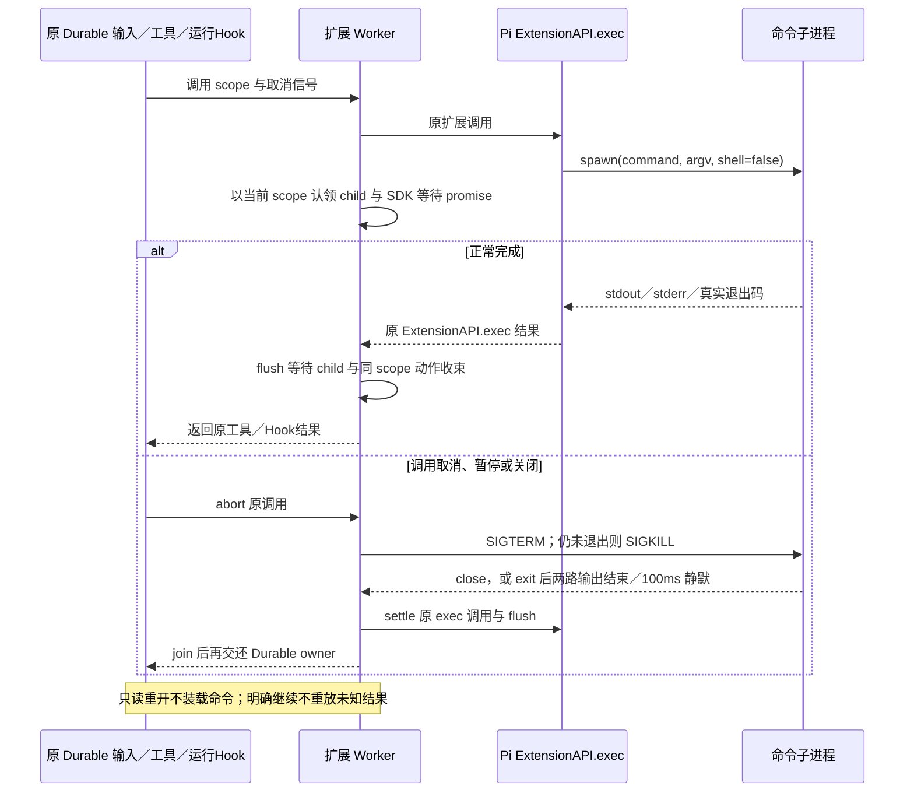

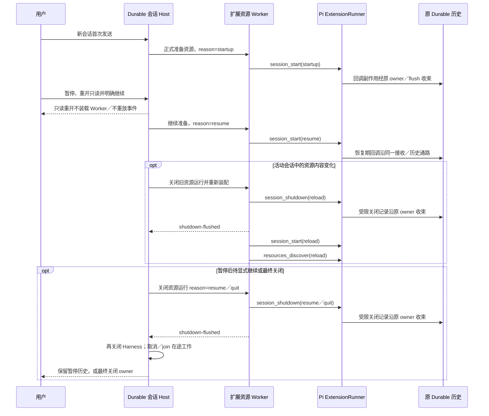

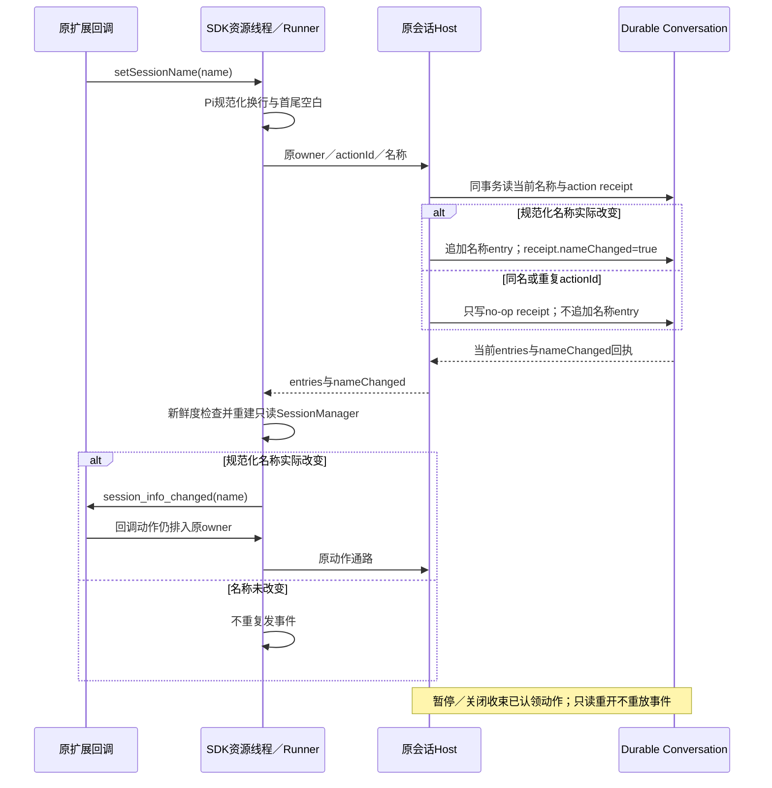

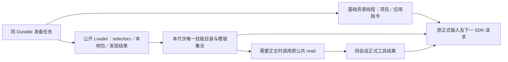

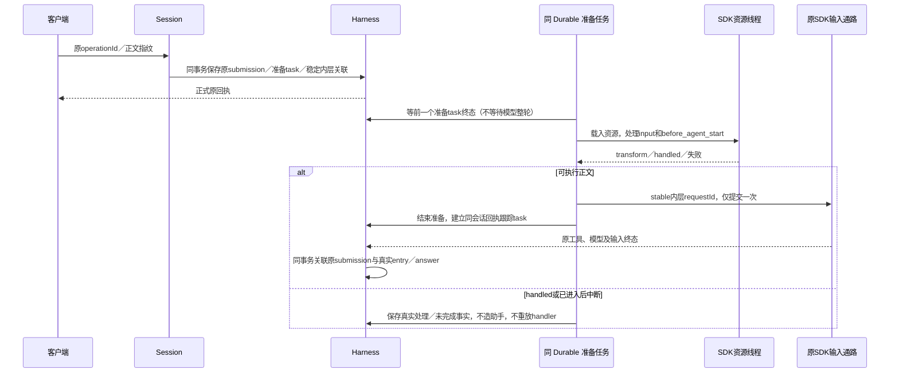

外部回执始终是原 Durable submission ID；内层身份是同事务保存的关联，不以字符串前缀隐藏任意用户 operationId。输入准备顺序由同一 Harness 的任务身份与 session 文档持有；没有应用输入队列、私有调度器或额外循环。扩展动作按当前 task／scope 和动作序号写入原正式记录；旧线程、失效代次、终态任务及取消信号的迟到写入拒绝。会话只读派生视图从原全量 entries 重建；可见扩展消息另有来源，不作为助手回复。

模型目录帧由同一会话 `ModelRuntime` 提供；`CodingExtensions` 在原请求快照里发布安全的公开 chat 与 typed（chat/image/classifier）描述、provider ID 与显示名，Worker 的 `getAll/getAvailable/find`、`getModelsOfType/getModelOfType/findOfType` 及 `getProviderDisplayName/getRegisteredProviderIds` 读取该帧并返回独立副本。provider 元数据只投影字符串 ID／名称，不传 `Provider` 实例、认证状态、配置或凭据；尚未接入宿主的 Provider 与认证操作及本地 `ModelRegistry.refresh` 必须显式拒绝，不能读 Worker 的默认 `ModelRuntime`。typed `getAvailableOfType` 是单独的异步宿主查询：沿当前原事件／工具 scope 调用 `ModelRuntime.getAvailableOfType`，认证检查的 AbortSignal 与该查询关联；取消或 owner 关闭会中止查询。此查询只做原 Runtime 的认证可用性过滤，不发送模型请求、不创建 Durable 任务或写入。宿主 canonical 模型（含执行头）继续供原 SDK 准入与请求使用，线程投影不回写它；`classify` 与 `generateImages` 仍是独立的未接消费者。下一次原事件／工具调用重取快照，暂停／关闭期间的快照等待仍受原 signal 与资源代次拒绝。

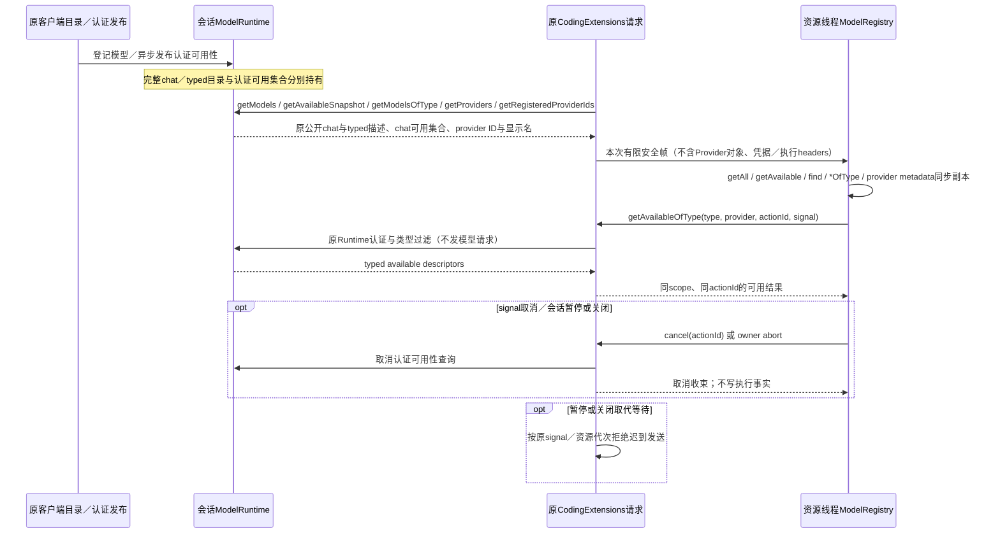

工具内的主动模型消费者仍在原工具scope内，通过公开ToolExecutionApi.createTask创建owned单次任务；Models与signal仅取子TaskRuntime，线程只传有限模型身份／正文／参数，宿主按原canonical对象执行。子任务在请求前保存execute检查点，重开遇到该检查点只报原结果未知，不重新执行；真实结果在原task outcome及非模型投影的请求事实条目中保存，正常原工具结果承担模型可见返回及工具用量。原SDK的unsafe恢复／取消不调用afterTool；已确认费用不能因此丢失。暂停／关闭完全join并关闭旧Harness后，同一目录认领下只用公开createSession重开原存储作有限费用事务，不创建scheduler或执行资源；明确继续前也可在原paused Harness对账。事务核真实model child的owner、原call及全部直接确认响应，正常SDK结果已同事务计账则只记消费回执，否则向唯一UsageDoc.tools加尚未消费的真实费用，并按child ID登记conversation回执。task文档终态会退役，不能靠其accounted标记恢复。内层工具在自身settle事务消费同回执，正式结果仍保完整usage且外层不再累计。取消／unsafe恢复的SDK原工具结果可能没有usage字段，宿主不改旧条目或伪造结果；真实请求事实和官方工具桶保费用。关闭到对账之间意外退出的窗口仍存在，读取不修复，下一次明确继续先完成对账，不声称与旧SDK结果同一事务。没有新Generation、输入队列、会话assistant或另一个存储目录。

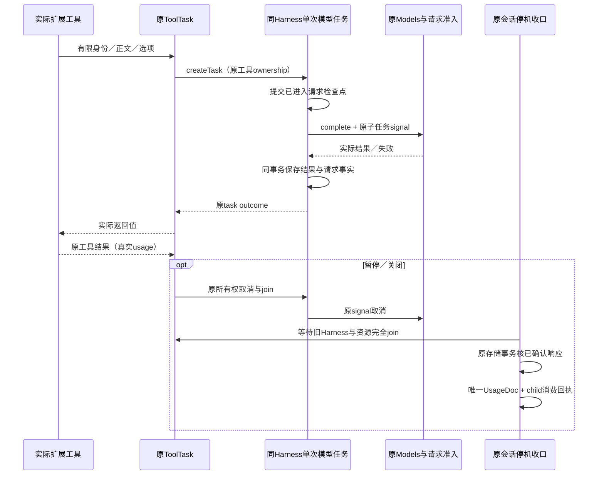

owned streamSimple／原生 stream 的边界仍由同一单次任务持有：Routing 只在核实该 Harness 的 task/conversation/owner、execute 检查点、canonical ref 与活跃 runtime.signal 后认领短命作用域；普通 Generation 的已提交计划分支不变。Host 按原 worker/scope/action/child 身份和递增序号转交真实非终态 SDK 事件，最终 done/error 描述随原 task outcome 保存，等该事务完成后才交 Worker 公共流。提前 break 不另启取消，result-only 仍由同一 host 调用 drain。关闭先使原 scope 失效，再让本地流有限失败、原 host 调用与 execute 收束；旧 worker/旧序号不进入新流。该事件桥不是新 scheduler、消息历史或计量写入者，partial 不进入正式累计用量。

Worker 明确传 stream／streamSimple 模式，Host 校验后沿同一个模型子任务分派。原生流只由可信 Host 在短命认领内附带内部 Symbol 标记，Worker 的 JSON 不能伪造；标记在最终 provider 调用前移除。同一完整准入先裁定模型，再核原生协议与权威思考参数是否一致；当前支持的 openai-completions 选项原样交 SDK stream，不能用 simple 改写。跨 API、不等价思考、任意 samplingParams 覆盖及未接选项明确拒绝。same-API 改选保标记重分派并重新解析最终来源认证。未发出错误复用完整的未发出消息／零 Usage，原工具、费用对账和关闭不因错误消息缺字段失去收束。其余原生 API 的消费者保持父范围待办。

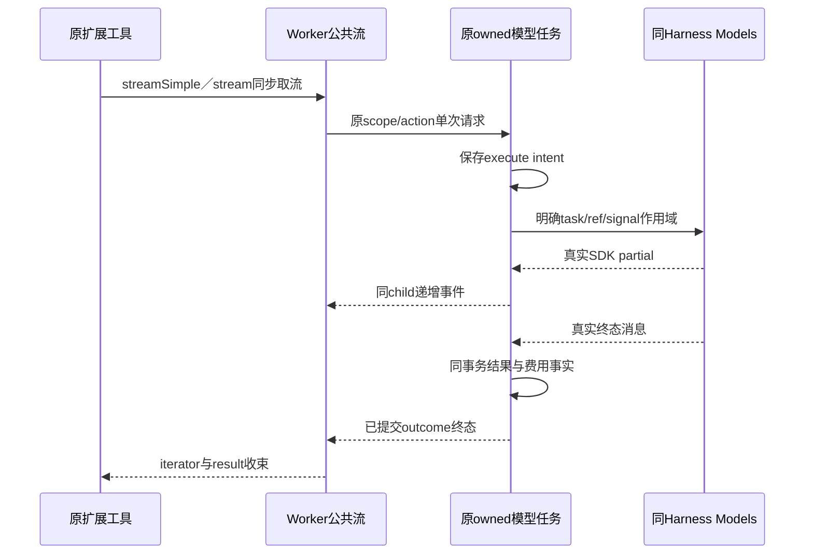

声明式provider headers的有限消费者保持原ModelRuntime和受管provider权威。Runner只把有限config与当前Worker句柄交Host；Host核本会话确有原受管来源，再将公开非凭据头投影到该受管provider的chat Model.headers（这是SDK真实请求消费者，单写Provider.headers不足以生效）。原stream/filter及认证策略、模型身份／协议／端点／能力保留，原auth.resolve／toAuth返回值在SDK合入Model.headers前核与公开声明的大小写无关碰撞，任何动态私有头撞名都明确拒绝，不从合并后的值反猜旧认证头。不把裸config登记替换原请求准入或认证包装。此适配只承接当前headers语义，不宣称SDK config层查询或任意config/native定义均已兼容。

每会话登记消费者捕获原受管provider对象及当前声明认领；撤销／失败／关闭只在当前Runtime仍为本代投影时恢复原对象。real的可信来源刷新在同次同步装配后重新投影当次源，其他会话不共享该覆盖；外部替换使原声明失效，旧清理不碰新值。模型调用在原guard入口复核声明仍归当前登记，失效时明确失败，不绕完整App准入。SDK准入当次改选后，registered仍核受管身份／能力，实际重分派从本会话Runtime的getPhysicalModel读取canonical投影，再由原SDK重新解析最终来源的认证。可信刷新按每个已开client分别尝试，保存失败到全循环之后返回；某会话撞名失效不截断其余会话的真实目录同步。

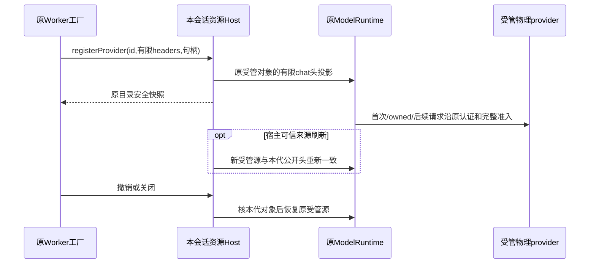

普通扩展virtual direct继续复用原Runner与ModelRuntime：`bindCore`第三参数接收真实定义，函数留在原Worker，只向Host发送有限定义和不透明句柄；Host在原资源事件scope确认登记，再发布公开目录帧。物理登记冲突由原ModelRuntime拒绝，不替换原provider包装。当前资源只持有自己的登记和原canonical对象引用；撤销、失败回滚与close均核本代身份，不能由旧同名清理删除新登记。

原owned模型child先保存execute intent，再经同一Routing短命认领进入ModelRuntime。direct resolve调用Host包装的原Worker回调，RPC只投影本次request（含真实messages、direct与思考档位），原signal映射本地controller；认证材料不进入线程。Host按原model child／signal、当前Worker和登记句柄在await前后核身份，再依provider/id从原Runtime解析physical对象；回调返回的Model端点、headers不参与物理执行。direct返回state不另写文档或推进既有Generation Plan/State。

新增route请求在原signal或资源关闭时发送abort、删除该pending并有限拒绝，迟到reply自然丢弃；它不加入工具execute的join集合。Worker的非协作route函数可被原资源最终关闭淘汰，不使原模型child与关闭互等；这不改变已有任意非协作工具execute的证据边界。没有新增scheduler、输入队列、超时强杀政策或默认模型重试。route的ctx只读目录／cwd／session／signal继续走原Runner公开检查；captured pi facade本片尚未承接，在公开ExtensionRuntimeState.assertActive叠加本scope拒绝且先保留原stale检查。这样setActiveTools和registerTool都在写入前失败，不依赖事后refresh或手工回滚SDK map；正常工具scope不受影响。该接缝不隔离项目JS自行文件／网络作用，也不宣称完整virtual回调API均兼容。

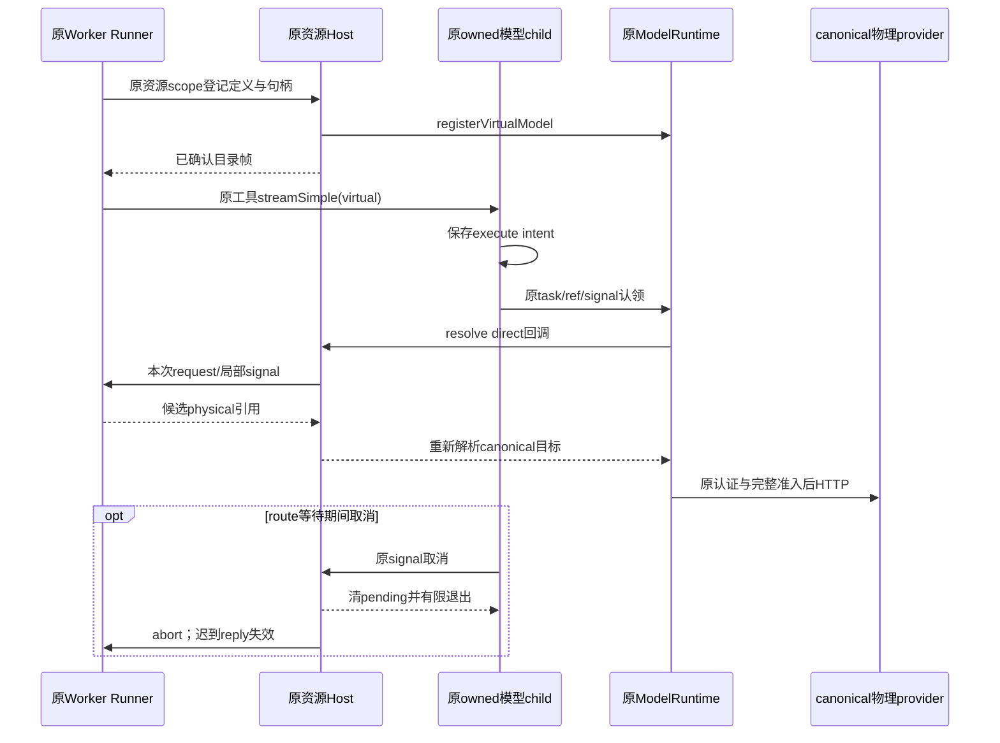

桌面运行输出只读取原公开 `LiveDoc.tools`：Session核同一conversation/run/活ToolTask与callId后经有限`toolProgress`返回。读取最后一次await之后重新采相位，与返回control同代次；暂停的同步认领不能被较早采下的running覆盖。应用按当前instance／observation／control revision更新独立临时展示集合，已被取代的实例和更低控制版本不能回滚新状态。它不进入`PersistedState`、正式entry或用量；暂停／关闭／终态清空，正式工具条目自然取代临时块，不从资源线程直接写时间线。

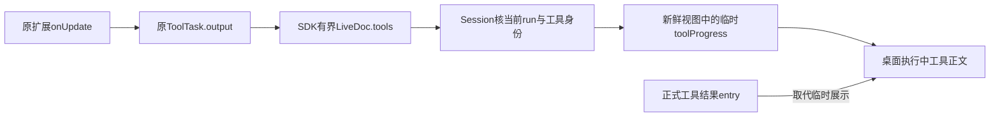

直接注册工具沿原 ToolTask。Codemode／工具搜索的内部调用通过同一 registry、前后 tool hook、有限参数校验与调用父 task 所有权的任务执行；内部真实 ToolResultEntry 归属原会话，不伪造模型 assistant。受控 MCP 的 stdio 进程和 HTTP 连接均由资源线程持有。暂停／关闭先失效代次与信号，等待实际取消通知、SDK session_shutdown、连接／进程退出与 Harness/storage 关闭；HTTP 公开运输 close 的局部包装先给同连接真实取消通知一秒收束窗口，再执行原 close 并 join 通知及实际运输结束，从真实 transport.start 起持有连接，建立期间尚未发布 client 也纳入关闭；不能因逻辑 onClose 猜实际资源结束。直接关闭存在在途任务时保存暂停事实；只读重开不载入扩展、不连 MCP、不请求模型，明确继续才重新装配，并保原已完成工具身份。

本片不是完整 SDK 兼容声明。同步 `prepareArguments` 的纯函数在原 afterResponse 的 await 中计算，原 generation memo 首写保存，同步派生缓存交原 ToolTask 首轮校验；恢复以原 assistant EntryId、owner memo 与 pending callId 补缓存，不改原消息、schema 或 callId。准备失败保该工具失败，不改成 generation 失败。其余扩展模型请求／provider 与虚拟模型登记、完整压缩事件、SDK 命令及渲染定制等仍须逐项接线与验收，不能由普通注册工具、MCP 或本片局部绿项替代。请求／认证钩子不得改换本次已准入模型、输入历史、工具、思考参数或模型凭据；默认重试次数没有增加。MCP 原始 stderr／logging 通知的自有日志出口关闭，客户端不默认落盘原始协议或凭据。

四个工具复用 Durable 的公共 read/write/edit/bash。主进程的文件操作继续经异步环境；SDK 资源函数内部同步扫描只在线程内运行。命令从公共 ShellExecResult 取数字出口，同时写入正式工具正文与 details；后者虽能保存，但部分供应商协议不传 details，不能靠它单独让模型知道退出状态。差异取真实前后文本或公共 edit 的实际补丁，不读取 Git HEAD。快照上限为 512 文件、单文件 512 KiB、文本总量 8 MiB，展示差异上限 1 MiB；目录外、依赖、Git、链接、二进制、未读取或超限部分不补成空文件，也不证明并发改动的作者归属。

grep／find／ls 的定义、参数、匹配与截断语义复用 coding-agent 包根的公开工具。Durable 工具调用将正式 cwd、callId 与原取消信号交给调用线程，线程返回有限 JSON 正文／details 后实际退出，宿主才收束正式工具结果。线程显式使用应用自有工具目录并禁用隐式二进制下载，SDK 内部同步探测不占用客户端线程；查询根先核真实任务范围。SDK 在文件信息 await 后的原取消监听有空窗，调用线程在公开 Node spawn 端口再核原信号，自实际创建时认领本次子进程；取消及工具返回都等待已认领进程的 close，宿主等线程自然退出，没有用强制 terminate 代收束。此端口适配只在本次 Worker 内，不改主线程或 SDK。没有第二执行循环、工具历史或输入队列。

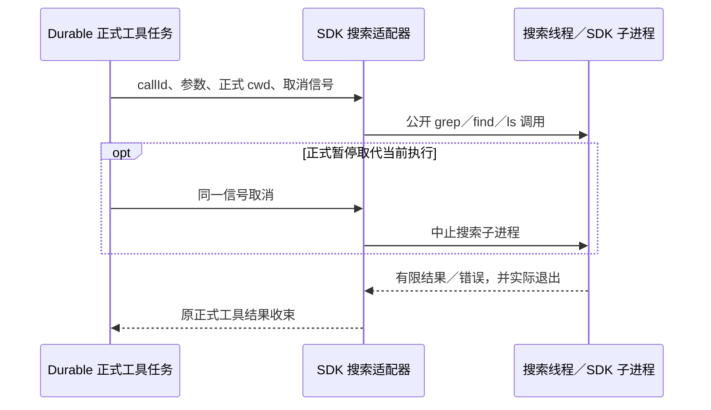

工具正文／isError／数字出口／有限差异从正式 `entry.model` 投影到 ExecutionView，再由应用层接入现有时间线与检查器；`entry.data.diagnostics` 只作旧记录诊断回退，不能替代正文。Shared contracts 校验差异结构，条目按正式追加 id 排序并保留稳定投影身份。数字出口由工具实际结果产生，界面只显示它。

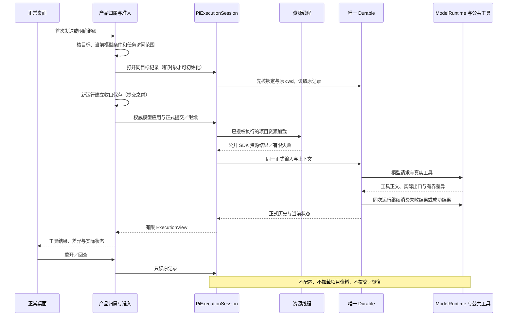

输入回执的现行语义与首发联动统一见 [工作输入的接收回执](../spec/工作台信息架构.md#工作输入的接收回执)。固定 Pi 提交实现进一步说明：进入存储提交阶段后，`StorageRejected` 才明确保证该批次未生效；其他存储错误，以及存储已成功但随后内存状态接纳失败，不能一律映射为未接收。此处错误类判断有阶段前提，提交回调中的校验拒绝应分别处理，不把所有非该类异常都机械归为同一种结果。[固定提交实现](https://github.com/earendil-works/pi/blob/a13d35a742c6ef8462812a28fbe1d8c8b7431c32/packages/durable/src/session/session.ts#L404)

最小验证范围为：两端访问同一会话时正式接收与执行不重复；暂停一个成员而独立工作继续；暂停／重开后查询记录不启动调度；最后有效界面离开与重连交错不绕过暂停；旧实例未完全退出时不能产生同存储双写；接收回执丢失及保存异常不导致盲目重投。其中独立暂停、重开只读、活进程独占、死亡进程回收、发送去重、存储故障与工具中断已通过无 UI 集成测试；多端网络和最后有效界面失效／重连交错仍未验证，真实服务商及完整能力包装配继续保留缺口。

### 消息归属与过期结果

在 [统一运行归属规则](../AGENTS.md) 下，跨端消息除结构正确，还须能核对目标、操作来源及实际运行。下面规定合同必须表达的含义，不提前固定字段名、编码或通信库：

| 需要核对的内容 | 处理约束 |
|---|---|
| 目标 D Code 与工作对象 | 请求关联明确的目标端及其工作空间、任务和会话；不能仅凭显示名称或目录路径路由，也不能因访问端后来选中了别的任务而改变原请求目标 |
| 本次发送及原始内容 | 同次重试和自动补送保持原发送关联及内容；相同文字的独立发送不合并。同一关联携带不同目标或内容时不得静默作为正常重试接受 |
| 持久工作与当前执行实例 | 稳定会话归属与这次实际运行实例分别核对；实例重开不等于新会话，但旧实例消息也不能因会话名称相同就覆盖当前执行状态。原操作失效时不能自动改投另一轮工作 |
| 访问来源及当前资格 | 目标端核验来源设备及当前有效接入资格；显示为已配对、曾有资格或访问端自行报告成功不能替代实际核验 |

过期控制请求与合法历史事实分别处理。旧恢复请求不能解除后来生效的暂停；较早运行的合法结果仍可按真实归属回查，但不得把当前运行状态覆盖成旧的完成、失败或运行中。无法核实归属时反馈错误或未知，不按到达先后、显示名称或访问端当前页面猜测归属。已有正式事实不能由未经验证的迟到消息改写。

结构校验和运行归属校验沿本节已有职责图进入同一事实所有者；[输入回执](../spec/工作台信息架构.md#工作输入的接收回执) 与自动补送继续使用这条通路，不以增加接入端建立另一份已接收队列。验证须覆盖同名目录分属不同目标端、发送后切换页面、同次操作的多端重试、旧运行结果迟到、较新暂停与旧恢复交错以及资格撤销。本地执行端口已实现并验证；上述设备资格、跨端路由和事件投影仍待接入，不把本地状态测试扩大为远端通过。

### 远端讨论范围

507 于 2026-10-04 要求把远端加入本轮 grill，并明确采用 D Code 连接目标电脑上 D Code 的统一产品方向。现行方向正文见 [远端连接方向](../spec/工作台信息架构.md#远端连接方向)；首批由 Mac 承载执行和文件，访问入口为 Mac 桌面端与手机浏览器。产品方向与首批范围已对齐，完整运行合同与具体实施安排尚未形成。

507 已进一步确认多台已获准连接的设备可以直接操作同一任务，不设唯一操作端接管步骤；设备采用首次配对、记住后重连、可随时撤销的方式，不依赖统一 D Code 账号。方向与验收统一见上述规格。ZCode 固定版本的 [远程开发说明](https://github.com/zai-org/ZCode/blob/29628c9acdb81b703bbd4080c207a0e7ce5e276e/README.md) 与 AGENTS 的手机远控规则提供不同链路的参考；D Code 在已确认的统一连接方向下核对适用机制，不从上游的技术分层反推两套产品。

507 已选择 B，生命周期改为 [任一有效工作界面维持运行](../spec/任务暂停与恢复.md)：单端离开不必暂停，最后有效界面离开后暂停保存；退出承载执行的 D Code 仍停止。已暂停工作须显式接续，仍在运行的工作重连只读取当前状态。有效界面与连接的判定由目标端统一协调，不能用配对缓存或访问端猜测代替真实状态。具体有效性检测、交错事件与暂停回执需要接入验证，不因此定案进程或存储拓扑。

507 于 2026-10-05 对 G2 确认由产品承担[配对后的外网接入](../spec/工作台信息架构.md#外网接入的使用门槛)，不要求普通使用者先搭私人网络或转发。此决定约束上手流程与接入责任，未选定具体服务、托管方式、传输协议或费用；目标 Mac 继续拥有执行与正式工作记录，网络设施不成为第二个业务所有者或有效工作界面的替身。

2026-10-06 新确认的正文保护边界见同一规格：中转服务不持正文解密钥匙。接入评估须核对实际解密点、密钥签发与保管、访问界面交付以及与目标设备身份的绑定；供应商提供 HTTPS 或承诺不保存正文，不能单独证明满足要求。可评估设备端终止加密连接或由两端保护工作载荷的机制，暂不锁定协议、算法或厂商。必要连接元数据须列清，不能宣称中转完全无信息可见；保护失败不得回退到中转可读正文的通路。实现和验证继续沿现有单一接收与状态所有权边界，不另建业务历史。

本轮网络取证边界：已读取 [Tailscale 连接说明](https://tailscale.com/docs/how-to/connect-to-devices)，其常规路径先让设备加入可互通网络，目标仍需运行应用服务；这可作网络层与业务服务分离的对照，不成为首版默认要求用户自建网络的方案。已读取 [Cloudflare Tunnel 说明](https://developers.cloudflare.com/tunnel/)与[路由说明](https://developers.cloudflare.com/tunnel/concepts/routing/)，其出站连接与公网域名映射提供一类候选机制，但不据此锁定厂商、认证方案、费用或生产适用性。ZCode 的 SSH 工作空间、CLI Web 访问及手机控制相关入口须分开核源码，不能以文件名或 AGENTS 的描述推定已有可直接复用的公网配对服务。

后续先形成满足产品目标的候选接入方案，核对移动浏览器使用步骤、实际认证与传输保护、配对与撤销、服务不可用、数据与日志处理、部署维护责任和成本，再做隔离数据的最小验证。涉及真实服务部署、凭据或费用时按具体范围处理，不因本次产品选择自动使用用户账号、开放端口或建立收费资源。

## 请求与结果的职责时序

下图描述 Mac 桌面入口的逻辑职责，不决定 IPC 消息格式、具体进程数或 Pi API。主进程负责装配与转交，应用部分拥有产品组织状态，执行事实由一次运行中选定的执行适配器所连接的执行端提供；界面保有自己的草稿和展示状态。本地客户端保留模拟适配器，并以真实 Pi 配受控模型验证了本图的单机通路；实际范围和剩余问题见集成记录，不宣称多端或完整产品验收。已确认的手机浏览器入口不能直接使用 Electron 预加载桥；其接入设计须进入相同产品接口与正式接收通路，不能另建执行历史，本图不作为浏览器链路已设计完成的证据。

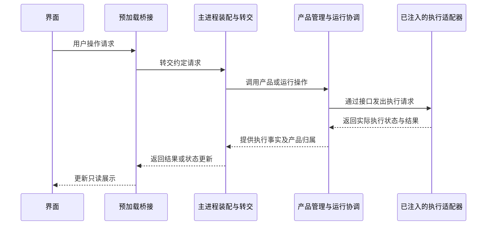

这是一次执行操作的通路，纯导航不进入执行操作路径。暂停、恢复、成员授权等待与失败处理的具体状态和分支需在对应方案中补图，准确覆盖时可以复用；绘图要求以 [AGENTS](../AGENTS.md) 为准，不用本图冒充这些行为已验证。

## 预设、自定义与在线目录装配

2026-10-09设计的模型目录切片于 2026-10-10 按已冻结清单逐项接入主目录（`main`），承接[模型规格](../spec/模型选择与自动切换.md)与[SDK核对](Pi-1.0.0-虚拟模型与运行恢复.md#2026-10-09预设供应商与在线模型信息核对)。本节约束当前实现；现已验收的单条custom仍沿前次验证记录，新接入没有因为设计成立而算完成。本节继续沿现有 Durable 的范围不构成后续完整 coding-agent 接入的长期限制；后续运行入口按[能力复用基准](#pi-coding-agent-能力复用基准)验证，当前候选不因方向确认自行切换。

职责保持现有模块：contracts定义有限请求、目录/认证安全视图与接收校验；renderer读取选择/目录状态并提交明确动作；main装配safeStorage、受限认证浏览器操作及adapter；application管理用户选择、接收/保存/关闭门控；Pi adapter管理SDK模型集合、按供应商的CredentialStore和独立目录缓存。SDK供应商拥有auth与stream协议，Pi Durable继续拥有执行和历史，不再造输入队列或引入另一执行harness。

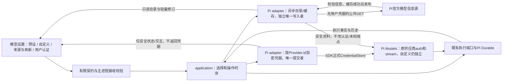

在线接口优先沿Pi已发布的canonical provider目录，不在客户端重写models.dev全量供应商映射或直接import构建生成器。Builtin工厂与原auth/stream不变，目录只更新已验证的模型信息；请求API/目标由本地已接入实现和用户配置约束。不能直接给所有预设复用原single-custom credential reader。旧记录承接必须保留独立custom身份和加密内容；已保存的custom服务定义与当前选择分别维护，应用预设/重开仍可派生原custom安全表单与留用密钥条件。全部定义、凭据/选模的同一物理文件变更在唯一提交通路合并，防异步OAuth刷新丢其他供应商更新。影响执行中供应商的用户认证写入与选模使用相同的真实相位/接收/关闭门控；供应商认证代次必须在实际commit点拒绝旧流程，不仅在UI端忽略结果。未被使用的另一供应商可独立提交，SDK原请求自己的令牌刷新仍沿原有正式通路。

启动先异步恢复缓存并立即提供只读目录，网络检查随后进行；不在工作快照频繁复制全目录。目录来源/请求代次归目录服务持有，旧源的fetch、取消和关闭后结果不写新源缓存或发布。网络/接收/缓存错误保留有效资料及事实来源，不把目录异常映射成工作执行成功/失败。

```mermaid
sequenceDiagram
    participant UI as 设置界面
    participant App as 选择与接收协调
    participant Host as 宿主认证生命周期
    participant Cred as 加密配置/凭据唯一写入者
    participant Cat as 目录/缓存唯一写入者
    participant SDK as 已注册Pi供应商
    participant Port as 既有执行端口
    UI->>Cat: 读缓存/内置资料，随后检查线上
    Cat-->>UI: 可浏览目录，来源/时间可辨
    Cat->>Cat: 无凭据有界GET、完整校验、原子缓存、代次核对
    Cat-->>UI: 新目录或保留旧资料的失败反馈
    UI->>Host: 用户开始API密钥/账户授权
    Host->>Host: 首个await前登记唯一可取消登录身份
    Host->>App: 同步认领该供应商认证在途
    App->>Port: 核对接收/控制在途与真实相位
    alt 相位读取期间取消或关闭
        UI->>Host: 取消或离开认证界面
        Host->>Host: 中止该身份，等相位读取真正收束
        Host->>App: 释放认领，不启动SDK
    else 可继续认证
        Host->>SDK: 原供应商login与有限交互
        SDK->>Cred: modify提交点核对代次/目标/取消/关闭，再串行提交
        Cred-->>Host: 保存成立，秘密留在宿主
        Host-->>UI: 安全状态、下一交互或失败
        Host->>App: 真实收束后释放认领
    end
    UI->>App: 明确应用选择的模型
    App->>App: 登记保存在途，核对接收/控制/关闭
    App->>Port: 只读核对真实相位
    alt running / pausing 或读失败
        App-->>UI: 拒绝替换，不关端口/不改旧选择
    else 可安全提交
        App->>Port: 收束非活跃端口
        App->>App: 预构造候选接入
        App->>Cred: 原子提交选择/配置
        App-->>UI: 已应用，不伪称模型请求成功
    end
    Note over App,SDK: 提交前取消/关闭使旧流程失效；已提交后不伪报未保存
    Note over App,Cred: 未使用供应商可独立配置；同一文件提交仍全局串行
    Host->>App: 退出第一同步步认领关闭意图
    Host->>Host: 取消并等待所有登录阶段，目录同时关闭
    Host->>App: 最后保存并收束端口，不接受较晚的新操作
    alt 保存与收束成功
        App-->>Host: 真实完成
        Host->>Host: 正常退出
    else 保存或收束失败
        App-->>UI: 真实关闭错误，保留可读记录与关闭意图
        Host->>Host: 释放本次退出快门，不恢复新工作准入
        UI->>Host: 修复条件后再次明确退出
        Host->>App: 沿原flush重试并等待真实结果
    end
```

桌面退出与App收束分别持有本次在途结果：并发退出共等原flush，失败后App清掉失败promise，宿主也释放flushStarted，下一次明确退出才重试。关闭意图不回退，既有认证／目录收束不重复启动；修复权限后仍要求实际保存及进程正常出口，不把强杀或关闭错误确认算成功。

宿主 `ProviderLoginController` 只持有认证交互身份、取消和收束，不推进工作输入或选择；应用持有认证 admission 与关闭意图，加密存储持有凭据提交。相位读取、SDK 登录和退出复用同一登录记录，避免调用方分别维护 pending/active 两份身份。

本轮新增依赖/上游代码按实际使用登记；不会为采用在线模型目录默认加入coding-agent的同步store、环境认证扫描或完整CLI依赖。端到端须区分公开目录实时获取、受控HTTP供应商传输、真实SDK、真实账户和用户视觉接受。现状及源身份由本轮验证记录维护。

## 每次 SDK 请求的身份与采用目标

2026-10-13 必要 D1 故障组合已完成完整门槛与限定独立三项；后续按 507 已确认顺序接有状态路由、重开只读和普通完整编码路径。状态路由扩展必须使用公开 Generation hook、Harness／Conversation commit 与文档、ModelRuntime.resolveModel 及同 Harness 专属 Models 接口。Generation hook 的公开接口没有 commit/signal，不访问内部 TaskRuntime；钩子只形成有正式 task／attempt／cutoff 归属的请求绑定，调用方通过持有的公开 Harness 完成同次事务。当前宿主 Harness 使用 BACKGROUND_CONTEXT，任务调用信号由 Harness 管理并随真实 close 取消／加入；没有父取消合成信号时才可按同次 AbortSignal 绑定调用，未绑定的虚拟请求必须拒绝，不退成 direct。

返回路由状态与请求计划同一事务提交，恢复同一准备点重读计划、不重复 resolve。工具后继续依据 LiveDoc 的正式输入集合，不因工具结果或扩展追加的 user 角色误认新外部输入。Compaction 的 completeSimple 是独立 direct 消费者，不推进会话路由状态；deferred 句柄须由同次物理请求的已存计划解析，poll/cancel 不猜虚拟身份。适配的运行证据与各消费者覆盖在新阶段单列，当前 D1 PASS 不替该接线验收。

```mermaid
sequenceDiagram
    participant User as 用户
    participant Durable as 同一 Durable Harness
    participant Hook as 本次 Generation hook
    participant Router as ModelRuntime 路由
    participant Store as 同一 Session 文档事务
    participant SDK as 物理 SDK 来源
    User->>Durable: 原正式输入（沿原 requestId 接收）
    Durable->>Hook: task / attempt / cutoff 与正式已放置输入
    Hook->>Router: user / continuation / retry＋已存 state
    Router-->>Hook: 物理目标、档位、新 state
    Hook->>Store: 重核选择与任务，同事务存 Plan＋State
    alt 未确认保存或目标已失效
        Store-->>Hook: 不采纳，不能发出模型请求
    else 保存已确认
        Hook-->>Durable: 同次调用信号绑定已存 Plan
        Durable->>SDK: 本次物理身份／认证／已核参数／容量
        SDK-->>Durable: 同次真实回复或工具调用
        Durable->>Durable: 正式工具结果与历史，仍由唯一循环推进
    end
    User->>Durable: 暂停／关闭
    Durable->>Durable: 取消并加入本地在途调用、保存准备点
    User->>Durable: 重开读取与查回执
    Durable-->>User: 只读现场，零路由／模型调用
    User->>Durable: 明确继续
    Durable->>Store: 读回同任务／attempt／cutoff 的 Plan
    Durable->>SDK: 复用已存计划，已完成工具不重做
```

条件接缝的已验依据来自显式注入 ModelRuntime 的 Harness；普通后端在本轮基本编码片中另行装配并验收。校验使用 coding-agent 公开 token 估算与本次物理模型的已知上下文／输出上限；输出上限沿 Pi `clampMaxTokensToContext` 正式规则收紧，不能将模型最大输出量当作每次必须预留。跨模型容量核对仍读取完整正文，不沿另一模型的旧 usage 缩小待发上下文；不足时给原 Durable overflow 通路真实失败，不发送超限探测，未知字段不补值。请求在发出前的虚拟失败不发布为物理来源或用量。Deferred 作业的原调用身份与真正返回的物理句柄一起保存；await 改选后不能用旧 checkpoint 推断 poll/cancel 的来源。当前隔离 Provider 覆盖真实 HTTP 作业、暂停／重开／明确继续与公开 Durable abort，不代表 builtin 或真实服务商支持 deferred。普通后端、项目资源、真实工具成果 UI 按普通入口单独验收，不能由条件接缝样例概括完成。

2026-10-13 的 D 修复继续使用已锁定 Pi 1.0.0。应用层拥有能力／认证／额度／暂停的准入裁定；适配器拥有本条真实端口的模型客户端，裁定身份须由已登记模型集合解析。每条会话在 `open()` 创建自己的客户端与准入身份，后开的 S2 不改变 S1；认证／目录刷新同步已打开客户端与后续新客户端的有效集合。

SDK 到达供应商包装时，原模型 A 的认证已解析。裁定采用 B 时，不能只替换模型对象后调用捕获的 A 方法，也不能把 A 的 `apiKey`／认证头／环境覆盖再次传给 SDK。适配器去掉这份已解析认证，保留原上下文、取消信号与一般参数，经同条会话 SDK 客户端重新解析 B 的供应商与认证；B 包装重新核完整准入并记录自己的真实响应。B 未登记、认证失败或条件已变时，本轮明确收束，不能回退 A、重投输入或重复工具。相同采用身份直接消费当前正式供应商请求。

采用目标同时携带该模型逐档核实的 `thinkingLevel`。Auto 重新采用 B 时，只有 B 本次能力资料仍支持的旧档位才保留；缺键或明确 `null` 都清除为来源默认，不把 SDK 的缺键默认或自行降档当产品核实。端口配置与本次 SDK 裁定消费同一值。请求包装覆盖已捕获的旧 `reasoning`，`null/off` 清除旧值，并经 SDK `streamSimple` 的正式逐协议映射；无准入装配时保留 SDK 原调用语义。不存在应用层手拼供应商思考字段或新增探针。

```mermaid
sequenceDiagram
    participant Run as 原会话执行循环
    participant SDK as 本会话 Pi 模型客户端
    participant Wrap as 供应商请求包装
    participant App as 应用准入唯一所有者
    participant Reg as 已登记模型集合
    participant Service as 受控或真实服务
    Run->>SDK: 下一请求 A（同一上下文与取消信号）
    SDK->>Wrap: 已解析 A 认证的请求
    Wrap->>App: 核本条会话／本次来源模型及全部条件
    App-->>Wrap: 拒绝或正式采用身份＋该模型已核档位
    alt 条件不成立
        Wrap-->>Run: 明确未发出，不重投输入
    else 仍采用 A
        Wrap->>Service: A 正式供应商请求（消费当次已核档位）
    else 改用 B
        Wrap->>Reg: 解析 B 精确模型
        Reg-->>Wrap: B 模型或不可解析
        Wrap->>SDK: 原上下文／信号，移除 A 认证并覆盖旧档位
        SDK->>Wrap: B 供应商与 B 认证重新解析
        Wrap->>App: 发起前复核当前 B 完整条件
        Wrap->>Service: 本次 B 实际请求（无 A 探针或补发）
    end
    Service-->>Run: 同次真实回复／错误，历史与身份保持
```

候选范围的“用户已保存过范围”标记与设置同份状态原子保存，清空后重开仍为空范围；保存失败保持旧正式事实。初始旧单模型可保兼容路径，但能力／额度／认证／相位均仍核实。设置和新会话默认值在首个异步校验前分别登记在途认领，真实关闭拒绝新动作并等待已认领的校验及写盘收束，不用较早保存的释放清掉后来者。各次已校验请求在应用层同一队列按顺序保存：前次结果真实收束后，用已成功提交的状态加本次字段生成完整快照。A 失败时，仅改主题的 B 不承接 A 的名单或默认；默认注册表与设置均在同次保存成功后发布。

## 首次工作文件夹绑定：选择事实、保存与运行目录

用户行为见 [工作空间规格](../spec/工作台信息架构.md#普通客户端首次绑定工作文件夹)。`WorkspaceDialog` 只持有名称草稿、operationId与当次选择请求；`NativeProjectFolders` 持有有限的临时目录选择能力，规范化路径并在创建前重核目录身份。`DCodeApplication` 独占空间、默认任务与持久创建回执；preload／main沿有限共享契约同时校验请求和返回，不向renderer暴露Electron或文件系统。

```mermaid
sequenceDiagram
    participant UI as 表单
    participant Native as 宿主目录选择端口
    participant App as 应用业务所有者
    participant Store as 同一状态存储
    UI->>App: chooseProjectFolder(创建身份,选择请求)
    App->>Native: 选择并规范化真实目录
    Native-->>UI: 当次选择身份/路径，或取消
    UI->>App: createWorkspace(创建身份,选择身份,名称)
    App->>App: 首个await前认领，按状态保存队列排队
    App->>Native: 重核选择归属/真实目录身份
    App->>Store: 同次保存空间+默认任务+创建回执
    alt 真正保存成功
        App-->>UI: 发布新对象，导航到新空间草稿
    else 保存应答失败
        App->>Store: readCurrent 只读核原创建身份
        alt 已存且各关联吻合
            App-->>UI: 发布原已存对象，不重复创建
        else 可靠确认未存
            App-->>UI: 保存失败，保留表单和选择
        else 仍不能核实
            App->>App: 保留proposal，阻止所有旧整表落盘
            App-->>UI: 结果未知，同身份再查回
        end
    end
```

设置与新绑定共享保存／发布队列；各次排到真实保存前重取最新其他事实。定时保存、首发立即保存与关闭均等待全部认领，并在实际保存点核未决绑定。未知proposal保留原对象ID与选择／名称，并通过快照的有限待核投影支持表单关闭后的侧栏查回；这个投影不持久化第二份队列。查回不能重新造对象或用磁盘旧整表覆盖已推进的运行。`readCurrent` 无改名、清理和启动保护变化；启动期 `load` 的损坏保全与拒写保护继续独立成立。失败关闭在结果查回后可由下一次明确关闭重核，不能缓存旧失败冒称新结果。

新运行仍由 `ensurePort` 从任务绑定或空间首个目录解析；普通Pi后端使用同一Durable。旧运行的正式Binding与Agent.cwd仍是恢复依据，另一空间的目录选择／新建／导航不重建该端口。创建后的异步导航使用当前用户导航代次，迟到快照不能盖回新的选择。

## 会话输入区的几何与暂收：所有者与事件顺序

本节记录桌面会话输入区的内部所有者与事件顺序（模块与时序图，绘图要求见 [AGENTS](../AGENTS.md)）。用户可见的几何规则在 [DESIGN](../DESIGN.md#会话输入几何与暂收) 与 [开发任务路径](../spec/开发任务路径.md#桌面会话输入区)，本节不重复产品规则，只标明谁拥有几何事实、事件按什么顺序发生。

两个所有者互不重叠：滚动意图、暂收相位及暂收期间dock的文档流占位由 `Timeline` 持有；输入区的高度、紧凑形态与暂收前实测高度由 `Composer` 持有。两者之间只有一个接口——`collapsed` 布尔量，从 `Timeline` 到 `Composer`，`Composer` 不反向读滚动状态。

```mermaid
sequenceDiagram
    participant 用户
    participant 时间线 as Timeline（滚动意图与暂收相位）
    participant 编辑区 as Composer（高度与紧凑形态）
    participant 观察器 as 几何／正文观察器

    用户->>时间线: 可信滚轮／键盘输入或实际滚动条拖动
    时间线->>时间线: 撤销旧程序化写入记录，登记本次用户动作
    Note over 用户,时间线: 向上先解除；已在底部的明确下翻先恢复跟随（可能不再派发scroll）；拖动仍按落点
    观察器->>时间线: 内容／视口几何变化
    alt 当前仍跟随
        时间线->>时间线: 实际贴底写入点认领跟随，记录写入位置与几何
    else 当前上翻阅读
        时间线->>时间线: 保留阅读意图与位置
    end
    时间线->>时间线: scroll 派发核对本组件写入记录及本次用户动作
    alt 位置匹配本组件写入，或无新用户动作且几何已改变
        时间线->>时间线: 保留已成立的意图，不触发暂收
    else 本次用户滚动，或同几何下不同位置的后次滚动
        时间线->>时间线: 可信向上保留已解除的跟随，其余按实际落点落定意图
        Note over 时间线: 已回底的同次向下键盘尾帧保留跟随；新的上翻立即解除
        时间线->>时间线: 首次暂收前保留整个dock当时实测的文档流占位
        时间线->>编辑区: collapsed = true
        编辑区->>编辑区: 记录暂收前实测高度，只改高度不卸载
    end
    用户->>时间线: 停止滚动
    时间线->>时间线: 空闲计时结束本次动作
    时间线->>编辑区: collapsed = false
    编辑区->>编辑区: 本次布局先恢复暂收前实测高度，不重新估算
    时间线->>时间线: 编辑区恢复后撤去dock占位，避免中间帧max收缩
    观察器->>编辑区: 窗口／检查器／正文变化触发重测
    Note over 观察器,编辑区: 隐藏模型摘要正文变短仍触发，不能只观察0→0盒宽
    编辑区->>编辑区: 离屏测当前样式与内容需求，真实输入框不改成零高
    编辑区->>编辑区: 同次测完整与收起两态固有预算，再决定呈现
    Note over 编辑区: 目标compact提交后按已落定的编辑宽写实际高度
```

Timeline在真实阅读滚动触发输入卡片暂收前保存当时整个dock的实测占位。卡片可视觉收起，文档流高度不能同时减少而将用户上翻位置钳到新底部；停止后由Composer先恢复原高度再撤占位。可信向上动作已解除following，随后的暂收／重排scroll不把它改回跟随；下翻到末尾仍可恢复跟随，草稿和运行事实不变。

两条不可越界的判定边界：

- **意图落定与暂收触发是两件事。** 进入会话与跟随重钉复用同一个实际贴底写入点，在那里认领跟随并记录写入位置／几何；迟到的本组件 `scroll` 派发不能按那一刻的位置重判，也不能覆盖较新的可信上翻意图。向上滚轮／键盘在浏览器实际位移之前解除跟随；明确向下输入已在底部时立即恢复跟随，不依赖并不存在的下一次scroll。真实拖动保中性方向，仍按落点判定。重排锚定／钳制与本组件位移均保留意图；同几何下实际位置已不同于自己的写入，说明后次滚动覆盖了它，不能仅因没有可信输入标记而吞掉。 比较起点取上一次实际 scroll 派发，不由先到的 ResizeObserver 更新；重排后两次相同落点的通知没有新增位移，不进入暂收。测试侧的同次派发位置对照只证明该归属机制，真实滚轮／键盘／经典滚动条另有完整动作证据。把派发时刻误当写入时刻会丢失初始化跟随，或让「展开 → 跟随 → scroll → 暂收 → 恢复」成环。
- **紧凑判定不得被自身改变的量逆转。** 同次测量摘掉当前隐藏呈现，并保持操作行 `max-content` 到完整／收起两态固有宽度都读取完。判定使用卡片全宽下是否单行、两态操作行固有预算与组件拥有的最小编辑宽；草稿单行宽度不参与标签隐藏预算，装不下的草稿折行而非隐藏模型名。内容需求在仅同步接入的离屏、不可交互测量节点读取，真实输入框不为测量压到零高，避免浏览器钳制生成迟到滚动。形态由同一 compact 状态提交后，再按真实目标编辑宽写高度，宁可长高也不裁内容。隐藏摘要正文改变由独立正文观察触发重测，不能依赖轮询对象或可见盒宽变化。

## 引用入口：所有者与事件顺序

本节记录 C05 引用入口的内部所有者与事件顺序（模块与时序图）。用户可见行为在 [页面与交互组件](../spec/页面与交互组件.md#c05-引用入口载荷归属与竞态)，本节只标明谁拥有什么事实、按什么顺序发生。

三个所有者互不重叠：**读取事实**（目录内容、技能正文、快照哈希）归主进程的引用适配器；**草稿里有哪些引用**归界面状态（`referencesOfDraft`，键是草稿键）；**哪一次发送带了哪些引用**归应用层与执行端（时间线用户块携带 `ReferenceSummary`，执行端提交时逐条验哈希）。界面不直连文件系统、Node、Electron 或 Pi。

```mermaid
sequenceDiagram
    participant 用户
    participant 浮层 as ReferencePicker（发现与选取入口）
    participant 门禁 as reference-gate（归属 + 目标代次）
    participant 草稿 as 界面草稿唯一所有者
    participant 应用 as DCodeApplication（归属核对与清稿判据）
    participant 适配器 as NodeReferencePort（根身份与技能发现）
    participant 执行端 as PiExecutionSession（输入身份与接收事实）

    用户->>浮层: 点「＋」／切换会话或草稿任务
    浮层->>门禁: advance(当前归属) 归属变了就自增一代
    浮层->>应用: listReferences(scope, operationId)
    应用->>应用: 核对目标对象与工作空间归属
    应用->>应用: 会话是成员会话？→ 调端口前拒绝（授权未装配）
    应用->>适配器: 按绑定顺序编号根身份（r0/r1…），失效根不前移
    适配器->>适配器: 越界预审（深度/条目上限，越界链接即整体不调 SDK）
    适配器->>执行端: 技能发现（公共 loadSkillsFromDir，不复制其规则）
    适配器-->>应用: { scope, files[], skills[], issues[] }
    应用-->>浮层: { scope, files[], skills[], issues[] }
    浮层->>门禁: isCurrent(发起时的凭据)
    门禁-->>浮层: 仍是当前目标才呈现，否则整段丢弃
    用户->>浮层: 选择一项
    浮层->>应用: captureReference(scope, kind, locator)
    应用->>应用: 成员会话同样在此之前拒绝
    应用-->>浮层: 引用（含 content + sha256 + 原始字节数）
    浮层->>门禁: isCurrent(凭据)
    门禁-->>浮层: 仍是当前目标才继续
    浮层->>草稿: 更新式写入（作用在当前集合上，不用渲染时的旧副本）
    用户->>草稿: 写文字 → C01 发送
    草稿->>应用: sendMessage(text, references, mode, operationId)
    应用->>应用: 归属核对 + 解析 + 完整草稿版本
    应用->>执行端: submit（先只读查回原身份）
    执行端->>执行端: 指纹 = 目标 + 用途 + 文字（无引用时）/ + 引用集合身份
    执行端-->>应用: accepted（提交成功）或 not-accepted / unknown
    应用-->>草稿: 同一版才清文字与引用；换过引用或用途就只解除身份占位
    Note over 草稿,应用: 清稿读的是**此刻**的用途，不是发起那次发送的用途
```

三条不可越界的判定边界：

- **迟到判据比对的是"此刻的目标"，不是发起时的标量。** 在同一 async 闭包里比较 `startedFor !== scopeKey` 恒为假：两者都取自发起那次 render，目标换了也看不出来。门禁因此持有当前归属与单调代次：换目标自增一代、卸载也自增一代，**A→B→A 回到同一对象仍是新一代**；同一归属内的重复 advance 是空操作，不误伤在途结果。
- **写入用更新式，不传渲染时的旧副本。** 捕获在途期间用户可能已经增删过引用；传旧数组会把 B 的改动覆盖回 A 的状态。
- **清稿判据三路共用一个函数。** 直接应答、自然快照与显式查回／重试各自拿到的"这次发送的版本"来源不同（界面持有的版本／历史消息块复原的版本），但判定必须是同一个：文字 + 用途 + 引用集合逐项相等。任何一路另写一份"只比文字"的近似实现，都会在同文字换引用时清掉用户的新稿。
- **清稿读的是"此刻"的用途。** 三条通路都在 `await` 之后才清稿，那时组件可能已重渲染过好几次；用 await 所在那次 render 闭包里的用途，会在"steer 发起 → 用户改成 follow-up → 旧回执到达"时按 steer 清掉新稿。用途经 ref 每渲染同步，三路统一读它。
- **成员授权在调端口前生效。** 授权装配未成立时，读取端口根本不被调用；先读后判会让越界读取已经发生。授权如何装配属成员授权片，本片只保证"未装配就不读"。
- **越界防线在遍历之前。** 技能发现库会跟随内部目录链接与 `SKILL.md` 链接并读取正文，越界在它遍历之内就已发生；事后过滤只能挡住呈现。预审 fail-closed（审不完也拒），事后 realpath 复核只作第二层。
- **"没审完"必须 fail-closed，且按真实成因报告。** 目录读不到／无权限／超预算／层级超限都不是"审过且干净"：SDK 会照着走进去。条目预算**跨递归累计**——每层各自重新给满额度，深层目录就能把总量顶穿。
- **重入要有防护，成因不能靠撞上限得出。** 根内链接环会让递归反复进入同一目录；如果只是撞上深度上限就报"层级超限"，等于把一个安全的结构误报成审不完，并把合法技能全丢掉。递归携带已审过的真实路径。
- **判不出类型不等于安全，也不等于「当作目录」。** 链接目标的元数据读不到就是没审完：ENOENT 沿既定断链策略跳过，其余（权限、环路、句柄耗尽等）按真实成因给出 `permission-denied` 或 `unreadable`，整体不进 SDK。把错误吞成 `true`（当作目录继续审）或吞成「不是目录」都是含糊放行。
- **文件链接与目录链接分判。** 指向根内的**文件**链接，边界已由 realpath 核过即可收尾；只有**目录**链接才继续审里面的条目。
- **根身份绑定列表位置，不绑定解析成功的个数。** 按成功数编号会让"前面的根失效"变成"后面的根顶替它的身份"，旧定位于是读到另一个根的同名文件。

## 模型选择与自动路由：所有者与事件顺序

本节记录 D 片（会话级模型选择、条件参数、账户额度与自动路由）的内部所有者与事件顺序。用户可见行为在 [模型选择与自动切换](../spec/模型选择与自动切换.md) 与 [页面与交互组件](../spec/页面与交互组件.md#c07-来源与模型入口)，本节只标明谁拥有什么事实、按什么顺序发生。

四份事实各有唯一所有者，互不重叠：**设置里的新会话默认**与**每条会话自己的选择**是两份（`settings.newSessionModelChoice` 与 `SessionModelRegistry`）；**已核实的能力资料**归 Pi 内置目录（`PiCapabilityPort` 读 `Model.thinkingLevelMap`）；**额度事实**归 `QuotaPort`；**路由判定**是无状态的纯函数（`decideModelRouting`），不碰端口、不发请求、不写状态。`state.sessionModels` 只是持久化与快照的投影，每次使用前从注册表重取。

```mermaid
sequenceDiagram
    participant 用户
    participant 入口 as ModelEntry（两层入口）
    participant 桥 as preload 隔离桥
    participant 应用 as DCodeApplication
    participant 注册表 as SessionModelRegistry（唯一写入者）
    participant 目录 as ProviderCatalogService（既有目录）
    participant 能力 as PiCapabilityPort（逐档核实）
    participant 额度 as PiQuotaPort（额度事实）
    participant 判定 as decideModelRouting（纯函数）

    用户->>入口: 打开入口（只读，不执行工作）
    入口->>桥: listModelSources({ sessionId })
    桥->>应用: 经 dcode:op 正式通路（validateOperationInput 逐项核对）
    应用->>注册表: sourcesView()
    注册表->>目录: list()（复用既有目录，不新建第二份）
    目录-->>注册表: 来源[]（含凭据存在性，不读凭据正文）
    注册表->>能力: 逐个 read({sourceId, modelId})
    能力-->>注册表: 已核实档位 / 上下文 / 模态（未核实为 null）
    注册表-->>应用: 来源与模型条目（额度仍为 null = 未读）
    应用-->>入口: ModelSourcesView（过 isValidOpResponse）
    入口->>入口: 第一层：选择方式与实际采用分别呈现

    用户->>入口: 点名一个模型
    入口->>注册表: setChoice(sessionId, choice)
    注册表->>注册表: 选择版本 +1（改选不中断当前请求、不重投）
    注册表-->>入口: SessionModelState（actual 仍是上一个，未假装已切换）

    用户->>入口: 设定条件参数档位
    入口->>注册表: setThinkingLevel(sessionId, level)
    注册表->>能力: read（作用对象 = 本次会话要用的模型）
    能力-->>注册表: 逐档核实为支持的档位
    注册表->>注册表: 未核实的档位不写入，并如实给出原因

    用户->>入口: 读取额度（只读）
    入口->>额度: read({sourceId, modelId})
    额度-->>入口: unsupported / unknown / exhausted / available（无来源即 unsupported）

    Note over 注册表,判定: 判定顺序不可颠倒
    注册表->>判定: ① 按已核实能力筛适合候选
    注册表->>额度: ② 读有效额度（共享池与窗口分别识别）
    额度-->>注册表: 额度事实
    注册表->>判定: decideModelRouting(choice, requires, candidates, quota, workRunnable)
    判定-->>注册表: adopt / bounded-attempt / hold-*（附每次尝试的真实原因）
    注册表->>注册表: 改选或暂停期间发起的结果直接作废（选择版本比对）
    注册表-->>应用: 实际采用与最后请求结果**分别**可辨
```

四条不可越界的判定边界：

- **能力筛选先于额度，且只用已核实资料。** 先按 `VerifiedModelCapabilities.supports` 逐项筛，再读额度；反过来会让额度多或便宜的模型挤进不适合当前工作的范围。逐项资料未核实的模型**不进入候选**——把没核实的说成适合，比说「没有适合候选」更坏。
- **「已知全部耗尽」与「额度未知」不是同一件事，且不可互相改标。** 前者保留工作等待明确继续，额度恢复、查询失败或转为未知都**不**自动续跑；后者才允许有界尝试同一原工作请求（不另发探针、不重复输入、不重放已完成工具）。任一适合候选已知耗尽时，存在有效耗尽依据，未知候选不能单独把判定拉回有界尝试。
- **共享池按 `poolId` 判定，窗口单独标识。** 同一池内一个窗口耗尽时，池内另一个窗口的「可用」不采信——否则就是拿另一窗口的剩余冒充本次可调用。`available` 必须带 `updatedAt` 且 `reason` 为 null，接收侧强制「可用」有可核对来源。
- **没有可靠额度来源就如实 `unsupported`。** Pi 1.0.0 公开接口没有配额/余额查询（已按 `dist/types.d.ts` 全量核对）；返回 0 会把「查不到」说成「一定没有额度」，返回可用会让自动路由采信未经核对的来源，用 token 或价格表估算则不是账户事实。
- **条件参数只认逐档核实。** `thinkingLevelMap` 的键值有三义：字符串＝已核实支持，`null`＝已核实不支持，**缺键＝未核实**（用来源默认值）。把缺键当成支持是按名称猜档数；当一档都没核实出来时必须附真实说明，否则界面无从区分「已核实不支持」与「未核实资料」。
- **迟到结果在两处判废。** 能力资料读取后与额度读取后各比对一次选择版本；期间发生的改选、暂停、目标或配置失效优先于旧结果，旧结果不写入任何状态、也不用于发起请求。
- **指定模式不扩大范围。** 候选集合仅含该模型：额度未知时只对该模型有界尝试，不开放其它候选；能力不足或额度耗尽时保留真实原因，不擅自换备用、不悄悄退回自动。
- **配额读取不得成为执行路径。** `readModelQuota` 与 `resolveSessionRouting` 都只读事实：不同步发送、不启用执行、不解除暂停，也不因为读到就推进原工作。

### 真实请求怎么消费每会话选择、事实怎么回来

选择只影响**后续**请求：每次真实提交前按此刻的目标重新应用一次；实际采用与用量只由执行端观察到的助手条目发布，判定层永远不写 `actual`。

```mermaid
sequenceDiagram
    participant 用户
    participant 应用 as DCodeApplication
    participant 注册表 as SessionModelRegistry
    participant 端口 as ExecutionPort（Pi Durable）
    participant 会话 as PiExecutionSession
    participant 模型 as Pi Conversation（configure 正式通路）
    participant 提供方 as 受控/真实服务商

    用户->>应用: 发送输入（回执只说明是否被接收）
    应用->>端口: ensurePort({ model: effectiveTarget(sessionId) })
    端口->>会话: open（初始档位随会话选择）
    应用->>端口: read（只读；顺带投影真实条目）
    应用->>注册表: noteRequests(本批可核对请求 + 观测量)
    注册表->>注册表: 按 responseId 恰好一次入账；实际采用单调推进
    应用->>端口: applySessionModel(effectiveTarget) ← 此刻的选择
    端口->>会话: Conversation.configure({ model, thinkingLevel })
    会话->>模型: 正式换模型与条件参数（不 abort、不重投）
    模型->>提供方: 真实请求
    提供方-->>模型: 响应（含真实 provider/model/responseId/usage）
    提供方-->>模型: 响应头（额度观察，只读不另发请求）
    模型-->>会话: 助手条目（Pi 持久化）
    会话-->>端口: ExecutionView.entries（带真实归属与用量）
    端口-->>应用: applyView → publishRequestFacts
    应用->>注册表: noteRequests（新 responseId 入账，实际采用推进）
    应用->>应用: 置脏 → commit → 推送快照（用量必须推到界面）
    应用-->>用户: 实际采用、响应标识、用量、任务汇总分别可辨
```

这条链上必须成立的四条边界：

- **提交回执不构成归属证据。** `accepted` 只说明输入被接收；用了哪个模型由助手条目里的 `provider`/`model`/`responseId` 决定。
- **条件参数走 configure 正式通路。** 应用层不拼 provider 原生参数；正在输出的那次请求不被改档，它自己的 `thinkingLevel` 记在该次条目上。
- **实际采用单调推进。** 取「已入账序列的最后一条」，不取「本次观测批次的最后一条」：重开或执行端换实例后视图可能只含更早的条目，按批次取会把归属回退成旧请求。
- **观测发布必须置脏重渲染。** 真实请求事实是界面要显示的事实；不置脏时界面会停在发布前那份快照上（用量已记录、入口仍显示「尚无记录」）。

## 自动检查的合同

检查只读执行，解析 JS／TS 源码，依据真实解析到的依赖检查：

- 产品源码必须属于声明的模块，不能把未纳入的源码当成通过。
- 跨模块引用只走允许的方向与目标模块公开入口。
- 外部包与 Node 内置模块必须在该模块的许可清单内；界面不能直接引用宿主或 Pi 包。
- 模块引用不能形成文件循环；本轮将类型导入也纳入依赖图。
- 支持静态导入、重新导出、类型导入、字面量动态导入及 CommonJS 引用；无法静态确定的动态引用报告失败。
- 解析失败、内部引用无法定位、通过别名或符号链接逃出范围等情况明确报告，不静默略过。

配置文件、检查工具、测试、构建输出及根级 `.delta/` 工具快照属于明确排除范围；产品源码不得引用被排除的本地实现。`.delta` 排除只作用于根级工具目录，普通文档脚本、其他越界源码及 `src/**/.delta/` 中的源码仍须检查。外部包内部代码、样式表中的引用、运行时拼装、Worker／资源 URL、eval、IPC 调用语义、Electron 安全配置和 Pi 状态时序不由本检查证明，需另做相应验证。符号链接形式的产品源码暂不支持，发现时直接报告。检查语法和依赖边界不等于类型检查或应用构建；类型导入所指向的声明可能与最终运行文件不同，交付时仍需类型、构建和实际行为验证。

检查器的验证应覆盖合规依赖、禁止方向、绕过公开入口、宿主引用、路径别名、重导出、动态引用、类型导入、循环、无法解析和未纳入模块等场景。合规场景必须通过，故意违规场景必须失败；命令必须返回对应的成功或失败状态。

## 如何使用与判断完成

检查入口与证据覆盖统一见 [README](../README.md#检查覆盖与证据)；运行代码异步 IO、消息校验语义及真实界面可用性不因依赖检查通过而自动成立。对可复现的问题，断言须能区分原用户目标成立与失败，不以元素存在或类型正确替代行为结果。

根 README 登记真实命令。完整门槛由“检查器自身的正反样例”与“当前产品源码检查”组成；无产品源码时明确显示数量为 0，只能证明检查入口可用，不能宣布客户端架构或功能已验收。

Kimi 在独立工作树编写客户端后，每次交付运行该门槛，并通过全量类型检查与 Lint，完成构建及 [AGENTS](../AGENTS.md) 要求的自动化端到端行为验证；场景组织、并行隔离和失败处理也以该规则为准，结构检查不能替代交互验证。缺少入口时先建立真实检查命令，已有失败不能作为通过。主目录与独立工作树集成时重新运行。不能通过删除规则、扩大排除范围或更改测试期望让新增违规消失。

## 依据与尚未验证内容

模块职责依据本项目状态唯一所有者规则及已确认的桌面技术栈设计。Electron 的隔离桥、进程职责和安全设置应在实际壳层实现时对照官方文档及实际配置核验。检查工具使用 TypeScript 官方解析与模块解析 API；不移植 ZCode 检查器或预设其分层。

普通入口已支持按用户配置发起真实 Pi HTTP 请求；当前不包含用户数据迁移、发布配置、自动后台执行或窗口重开后的自动续跑。真实账户验证、工具装配与用户工作目录接入仍须分别完成。

## 产品运行层与外部 Harness 参考

2026-10-03 收到 D Code／DeepSeek Harness 的只读调查交接后，继续保留 Pi SDK 1.0.0 底座。这里的 D Code 产品运行层（harness）指现有产品管理、运行协调与适配职责：工作空间／任务／会话归属、成员协调、输入与回执、成员授权、界面生命周期及只读视图。它不表示新增一个与 Pi 并行推进同一次运行的执行器，也不指定新目录、数据库或框架。

| 处理 | 结论及归宿 |
|---|---|
| 吸收为当前职责说明 | Pi 选定执行入口拥有同一次运行的执行事实；D Code 负责产品归属和运行协调，界面消费真实状态。沿用本文件模块表与已有唯一写入者规则 |
| 研究候选 | 普通 Pi Extensions、Codemode 与能力包治理分别研究，不能把整个产品管理塞进扩展，或让工具组合脚本成为第二个调度器。普通 SDK 与 Durable 的兼容未知统一见 [Pi 能力核对](Pi-1.0.0-虚拟模型与运行恢复.md#能力包与扩展兼容的接入检查点) |
| 研究候选 | 参考 DeepSeek Harness 的服务依赖、资源生命周期及事实派生视图，检查依赖未就绪、失效、清理与状态回执；按 D Code 实际边界适配，不预先将全部功能插件化 |
| 本轮不采用 | 替换 Pi 为 DeepSeek 运行时、引入 Cordis 或 DSH sessionlog；参考项目不改变 Pi 底座。既有无界面持续执行的排除仍有效，除非后续对齐明确修改 |
| 远端产品范围已确认 | 统一连接、多端操作、设备配对及任一有效界面维持运行；首批 Mac 执行端，Mac 桌面与手机浏览器访问。运行映射、网络接入、消息合同与实施安排仍需形成，不由上游实现直接替代 |

原交接的 DeepSeek 引用未固定版本；整合侧本轮实际查询远端 `master`，取得提交 `5badb15009ae1756c3afe0ae0cef1faafc290ccc`，并成功读取该提交原文。固定 [架构说明](https://github.com/deepseek-ai/deepseek-harness/blob/5badb15009ae1756c3afe0ae0cef1faafc290ccc/docs/architecture.md) 描述 Cordis 的可替换服务、持久事件与派生历史；固定 [TypeScript SDK 说明](https://github.com/deepseek-ai/deepseek-harness/blob/5badb15009ae1756c3afe0ae0cef1faafc290ccc/packages/sdk/client/README.md) 列有无 mid-turn cancel 的限制。不据此宣称该 SDK 能直接替代 D Code 的独立暂停与引导合同。

ZCode 第四轮所声称读取的另一固定版本链接，经整合侧实际请求得到 HTTP 404，相关“已核实”摘要未被采用。已将 16 份固定版本 Pi／DeepSeek 原文下载为只读研究副本，并逐文件保存 URL、提交与 SHA-256；ZCode 改读这些原文复核。临时来源清单为 `/var/folders/61/fc0gr9wd52sc59sl32dvqj5c0000gn/T/dcode-reference-review-y14yk3k5/manifest.json`，源码未执行；耐久引用以上述固定 GitHub 链接为准。

交接提供研究依据，不自动增加首版包管理或插件市场需求；实现、运行实验、依赖安装和用户数据变更不由这份文字材料扩权。核心恢复与侧边问答等已确认规则继续以 spec 为准。

## 补充参考的评审边界

507 于 2026-10-04 补充 Raven、Motion Panels、CC-Usage-Band 与多家用量来源的研究交接，并要求对照最新状态评审。执行底座、三层对象、单一执行事实所有者与当前界面生命周期均继续有效；产品运行层是已有产品管理与协调职责，不新增执行循环。参考里的事实声明先核对固定原文和实际接口，不能用候选资料反推已实现能力。

可直接沿用的设计约束：模块声明资源与监听的归属、清理和停机责任；启用意图与实际加载成功分别记录；成员间接调用工具不绕过主会话授权。507 已确认产品不设权限模式，主会话不加产品操作审批；原交接关于审批的参考适配为主会话按分工范围授权成员、成员超出范围时申请及其状态展示，不能重新引入主会话审批卡。具体对象、环境、动作、影响范围与可执行下一步须有真实依据，授权及恢复规则统一见 [主会话与成员授权](../spec/工作台信息架构.md#主会话与成员授权)。并行运行、隔离写入、历史恢复与执行恢复分别验证。

| 评审问题 | 所需证据与最小范围 | 当前处理 |
|---|---|---|
| Pi 组合接入及能力包装配 | 复用已固定源码，核对普通 SDK／Durable 的入口、扩展与工具权限通路；列隔离假数据实验及判据，未经执行不报告通过 | 沿用 [Pi 能力核对](Pi-1.0.0-虚拟模型与运行恢复.md)，不并置执行器，不新建包格式；完整包治理尚非首版要求 |
| Raven 的对象与展示 | 已核指定提交的工作节点类型、依赖与状态字段、图节点选择及画布交互；其余审批、失败和运行尝试按实际源码继续核验 | 507 已确认首版列表／只读协作图切换，并认可会话内示意的阅读方式；正式产品与真实数据未验收。成员授权状态与重试呈现按 D Code 规则适配，不移植主会话操作审批或流程编辑器，不新增顶层工作对象 |
| Motion Panels 是否值得替换现有布局 | 先读当前原型布局找明确缺口，再固定候选版本、核许可及公开接口；确有缺口后才提出隔离验证计划，覆盖拖宽、窄屏、长文本、键盘与布局恢复 | 不安装、不替换、不打断当前原型；React 版本范围符合不等于 Electron 实际兼容 |
| 统一用量的数据与展示 | 核对各官方接口／源码的认证适用范围、区域、窗口、单位、更新时间与字段稳定性；本轮只读主源，不访问用户账户 | 507 已确认首版同时覆盖任务用量及可可靠读取的账户信息，三类指标分别呈现；各服务支持清单、接口选择与实际接入待验证 |

用量展示的现行产品合同见 [用量与账户额度](../spec/用量与账户额度.md)：缺失字段未知、失败不补零，任务 token 不反推账户余额，估算有价格依据且不当作实际账单。已确认范围不代表已经具备用量读取能力。交接所列 MiniMax、Codex、Kimi、Z.ai 的具体端点、认证适用范围、区域、字段与稳定性由调度会话核验；各来源独立适配，不跨区域试发凭据，未核实内容不写成稳定接口合同。

本轮 Raven 图视图证据固定于 `3632e6040c7038a60ec418ce39ccae185c72c19f`：[编排说明](https://github.com/EverMind-AI/Raven/blob/3632e6040c7038a60ec418ce39ccae185c72c19f/docs-site/docs/orchestration.zh.md) 描述工作节点的依赖与并行；[节点类型](https://github.com/EverMind-AI/Raven/blob/3632e6040c7038a60ec418ce39ccae185c72c19f/ui-web/src/features/dag/types.ts) 分别记录节点、负责 Agent、可选实例、依赖和状态；[DagGraph](https://github.com/EverMind-AI/Raven/blob/3632e6040c7038a60ec418ce39ccae185c72c19f/ui-web/src/features/dag/DagGraph.tsx) 提供连线与节点点击／键盘选择；[Board](https://github.com/EverMind-AI/Raven/blob/3632e6040c7038a60ec418ce39ccae185c72c19f/ui-web/src/features/dag/Board.tsx) 负责平移、缩放和视图保持。这些是静态源码证据，不是本轮运行验收。

D Code 采用“看清分工、关系与真实状态”的交互思路；示意中的节点、成员和等待状态为模拟内容。图读取已有分工与运行事实，不成为第二个调度器，也不要求 D Code 所有协作必须按 Raven 的固定 DAG 执行。节点不与进程或会话强制一一对应，实际接入仍以 Pi 1.0.0 和现有单一事实所有者规则为准。

## 后续方向：模型辅助输入分流

507 于 2026-10-03 确认当前显式选择输入用途，未来演进为模型辅助自动分流。产品现行行为见 [输入入口与后续演进](../spec/工作台信息架构.md#输入入口与后续演进)。未来方向已确认，具体模型、版本、接入方式与上线时间未定；不纳入当前原型的依赖和交付范围。

Jev 或类似模型可作为意图判断候选。TypeSafe 官方提供意图分流模式，Choice 能返回所选项、各选项概率和置信指标；这支持研究“临时提问／调整工作”等用途判断，但不能直接证明在 D Code 的中英文工作对话中足够可靠。[意图分流说明](https://docs.typesafe.ai/patterns/intent-routing)、[Choice 定义](https://docs.typesafe.ai/primitives/choice)

当前实现保持输入用途与其实际行为的职责清楚，未来分类结果接到同一行为入口。模型只提供用途判断，应用继续拥有用户选择、当前状态和权限校验，不能由模型直接改派工作、解除暂停或绕过既有操作边界。用户明确选择优先；判断不确定或服务失败时退回可用的手动入口，不阻塞基本交流。无需为此提前增加空适配器或厂商依赖。

```mermaid
flowchart LR
    Manual["当前：用户明确选择用途"] --> App["应用：校验选择、状态与既有边界"]
    Future["未来：Jev 或类似模型提供用途判断"] -.-> App
    App --> Side["临时侧边问答"]
    App --> Work["工作输入：引导或稍后处理"]
    Future -.-> Uncertain["不确定或失败：用户明确选择"]
    Uncertain --> App
```

上述图仅说明当前路径与未来候选的职责关系，尚非接入实现。启用自动分流前，使用代表性中英文输入验证：纯查询、明确纠正、混合意图、依赖上文的短句及运行状态变化。重点核对把查询误作执行要求的情况，并实测整体延迟、成本、用户改选和失败回退。置信指标概括选项概率的分布，不是正确性或行动授权的证明；阈值由本项目样例验证，不照搬文档示例数值。[置信度说明](https://docs.typesafe.ai/confidence)

本次仅核对公开资料，未安装 TypeSafe SDK、配置凭据、调用模型或验证分类效果。


### 扩展分类消费者的所有者与费用

已配置预设来源的原 `getAllModels` 保留 classifier/image；chat 的远端目录、picker 与 Auto 继续只收 chat。原客户端在配置/认证刷新时重建同一已配置来源集合，typed 不另起凭据或通知链。`classify` 只在原活动工具 scope 下创建 `dcode.extension-model` 子任务；Worker 不直连网络或凭据，资源/只读路由回调不能启动它。原输入问题不可由扩展 provider 回调改写。

```mermaid
sequenceDiagram
  participant Tool as 原扩展工具
  participant Host as CodingExtensions / Durable
  participant App as 应用准入
  participant SDK as 原预设分类SDK
  participant Store as 自管凭据与正式存储
  Tool->>Host: classify(canonical 引用, state/questions, signal)
  Host->>Store: 同一工具下保存模型子任务与执行检查点
  Host->>SDK: 原认证准备、原分类协议
  SDK->>App: 当次typed身份/来源/相位/认证在途/额度核对
  App-->>SDK: 精确身份放行或拒绝
  SDK->>Store: 只读重新派生认证并比对本次prepared身份
  Note over SDK,Store: 核对不刷新OAuth、不改写旧key；来源代次/取消再核
  SDK-->>Host: ClassifierResult（usage可缺席或在错误时存在）
  Host->>Store: 结果与原owner开销同事务保存
  Host-->>Tool: 原typed结果；无chat或伪responseId
  Store-->>App: 只读结果事实（原子任务身份）与普通任务用量
```

分类结果按原 childTaskId/actionId 标识去重；只发布成功分类或带实际 usage 的错误/取消。子任务存在本身不证明 HTTP 已到服务端，本地拒绝不记成已确认计费请求。真实费用仍进入原 ToolExecutionResult/唯一 UsageDoc；桌面沿既有逐次请求事实派生任务用量，不新建累计台账，也不把分类模型写成聊天 actual。暂停/关闭 join 原 RPC、子任务和 HTTP；重开只读不加载资源或对账，明确继续只收口原结果未知的 execute 检查点而不重发。

认证核验覆盖一次已识别的异步读取窗口；它不是跨外部文件写入与网络dispatch的全局原子锁，不能据此宣称消除任意跨进程换凭据竞态。


### 扩展图片消费者：响应、核验与停机对账

`generateImages`复用分类的typed目录／当次准入／只读认证重核与原Durable模型子任务，不把image变成chat。`images-bridge`核原输入／有限结果与选项；`image-validation`在原调用拥有的固定外层Worker中使用SDK公开`resizeImage`真实解码，MIME容器和尺寸门在解码前成立，原字节／base64不变，SDK同步fallback不在主事件循环。容器检查对动画计画布及累计帧预算；公开helper的可解码结果不声称完整native内存隔离或已验证所有动画帧的像素。资源取消／预算到期只请求terminate，实际exit才兑现Promise；较新abort优先于已排队success。

费用的原child消费回执`ModelSpendAccounted`可选扩充有限`response`，只存原child／owner／conversation／action身份和原SDK metadata／usage，不存未验图。响应一到就在同进程Map认领并通过原Harness的公有Session.commit保存；`publishedToOwner`仅表示结果／usage已进入原工具消费来源，不等于官方累计已消费，`done`仍是唯一去重位。最终运行事务才发布可用图片及原ExtensionModelSpend；停机维护在原Harness和全部资源join后、释放目录认领前，保存旧Session无法提交的同进程回执并按原child一次消费UsageDoc。已记ToolResult只与published部分核和，response-only费用另按done消费；不覆盖旧工具结果或伪造child completed。事务先读完tasks／entries，再统一append，不能写表后读取表。

```mermaid
sequenceDiagram
  participant Tool as 原活动工具
  participant Child as 原Durable模型child
  participant SDK as 原图片SDK／HTTP
  participant Host as 同一CodingExtensions
  participant Store as 同一存储／UsageDoc
  participant Decode as 固定验证Worker
  Tool->>Child: generateImages原输入与signal
  Child->>Store: execute检查点
  Child->>SDK: 原认证／完整当次准入／单次HTTP
  SDK-->>Host: 原AssistantImages及可选usage
  Host->>Store: 先存无图response回执
  Host->>Decode: 固定代码、原bytes与有限容量
  alt 核验完成且原owner有效
    Decode-->>Host: 结果及真实exit
    Host->>Store: 安全typed结果／原工具spend／published
    Host-->>Tool: 原图片／文本与有限结果
    Tool->>Store: 原ToolResult及UsageDoc恰一次
  else 模型取消／原owner暂停或关闭
    Host->>Decode: 吊销结果、terminate并join真实exit
    Host->>Store: 原停机维护保存并消费response-only
    Note over Host,Store: 只读重开不维护；明确继续不重发未知请求
  end
```

原Session已封住或存储失败时，有限回执在同进程原调用持有；停机维护失败须阻止正常关闭与认领释放。崩溃前尚未持久提交的内存回执不承诺无损。缺usage保持未知，坏图保真实费用；本地拒绝不推导HTTP。模型原responseId只保核对材料，逐次事实仍按operation＋原child/action requestId去重，不写chat actual或另建累计账。


### 扩展上下文用量：原正式上下文与完整状态帧

Context模型getter交metadata副本，扩展突变不能写入正式模型帧。同步`ctx.getContextUsage()`读取Worker最新已完整接收的Host帧，不做同步RPC、不请求模型、不触发执行或认证。Host从原Durable捕获不可变有效`ContextView`，只分页读取同一tail以内的全部fork可见条目；前后物理模型身份不一致时返回unknown。`context-usage`使用SDK公开估算函数和有效chat usage锚点，原正式贡献之外的未完成工具协议占位不计入；相同正文若确已存成正式工具结果仍保留。typed模型费用与`UsageDoc`不进入上下文数值，压缩后无有效新chat锚点保留`null`，未知窗口为`undefined`，真实空上下文为0。

```mermaid
sequenceDiagram
  participant D as 原Durable唯一状态所有者
  participant H as CodingExtensions Host
  participant W as 原资源Worker
  participant E as SDK扩展回调
  H->>D: 读物理模型／有效ContextView
  D-->>H: 原head、tail和贡献
  H->>D: 只读分页至同一tail／重核模型
  D-->>H: fork可见原条目与当前模型
  H->>H: 派生有限估算或unknown
  H->>W: 同一帧model＋usage＋原session/resource/thread/request关联
  W->>W: 核实际绑定、按请求传输序号整体接收
  Note over W: 较新unknown清旧数；旧帧不回滚，但原合法operation继续
  E->>W: 同步getContextUsage()
  W-->>E: 新对象副本／undefined
  Note over E,W: await后读取已完整接收的新帧；序号不是Durable revision
```

context回调的原请求正文独立放入operation value，旧state.messages无消费者后移除，Worker即使丢弃迟到state仍向原Runner传当次正文；同步getter继续读最新完整帧。该正文沿原状态封套64MiB有限上限，不因移出state被误降为16MiB结果封套。context原Action scope仍使用迁移前空对象摘要；输入／轮次／attempt照旧，payload正文迁移不改持久回执身份，避免原checkpoint恢复时同作用换号。原operation的传输序号只解决Host读取完成顺序交错，不称存储revision或跨进程瞬时一致快照。Worker核真实threadId及workerData中的session/resource；使用更高条目快照时，不把较旧context估算贴到该历史上。只读重开不装载扩展，不因查询用量隐式继续；压缩执行和`session_compact`事件／回执属于父范围后续消费者，纯计算用例不证明它们已接通。
