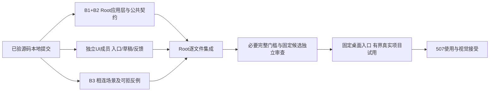

# 单人本地开发首条路径核对

2026-10-19。沿现行[开发任务路径](../../../spec/开发任务路径.md)只读核对正常入口，不改产品或缩减完整Pi／工作台要求。507已认可先做到单人本地开发可用，Root负责应用层／公共契约／集成，UI成员在独立工作树实施，审查方只读固定候选；下一步不再以补完全部SDK作为试用前置。

## 已有实现和证据

正常模型设置／会话选择、工作文件夹绑定、真实read／write／edit／bash与搜索、测试失败回到原运行再修正、正式工具结果与实际diff、同会话文字追问、暂停／关闭／只读重开／明确继续均已有正式接线和相称的受控桌面证据。不得统称未实现，也不将各自绿灯拼成整产品通过。

最新已验完整九门归canonical211／`12f1ee1412d39ebd82c7e7dfb1157ad3521a954fd376a3061f97699e1fbb0bc9`：运行581、契约14、隐藏E2E149，真实子出口均0、无fail／skip／cancel，最终三项独立PASS。普通文字／模板／搜索完整编码三条都实际通过UI配置／绑定、真实磁盘读改、测试exit1→0、实际diff、暂停退出、只读重开与明确继续。模型对端给出受控脚本，项目／规则／测试为隔离fixture，原生选择器返回被替代；工具和测试本身实际执行。

正常可见桌面另已验证固定入口、Home、缺模型禁发、设置往返及原生CmdQ重开；当时没有更改凭据或发模型输入，不能代替517终态上的真实项目编码或507人工接受。引用见[普通编码](../普通编码路径-2026-10-13/README.md)、[绑定](../工作文件夹绑定-2026-10-14/README.md)、[可见入口](../扩展原生流-2026-10-18/README.md#桌面可见入口)、[最新上下文用量门槛](../扩展上下文用量-2026-10-18/README.md#最终门槛与独立收口)。交付仅额外归整一个测试夹具末尾空行，具体新旧字节和检查复用资格见[本地提交](../扩展上下文用量-2026-10-18/本地提交-2026-10-19.md)。

## 唯一阻断与依赖清单

| 项目／性质 | 当前实际差距及依据 | 下一步责任与验收 | 是否为有界首条开发的前置 |
|---|---|---|---|
| **B1 任务对象／入口，缺实现** | [冷启动](../../../spec/冷启动与草稿态.md#草稿态)及F02／F04／N06已区分空间新工作草稿、命名长期任务及父任务短期草稿。当前`Sidebar.tsx:297`共用立即创建表单，`App.tsx:391`创建后选草稿；`application/app.ts:989`只建任务没有唯一主会话，`:1264`首发又建parentId=null的根短期任务。因此命名长期任务和父任务短期入口均未保正确对象／归属。`:154`还隐藏默认长期任务的短期入口。 | Root应用层建立正确任务／唯一主会话及首发归属；UI独立实施三入口和草稿范围。核真实对象数量、父／空间／会话ID、cwd与输入、尚未提交创建时取消零对象及重开不重复；已提交的在途关闭不冒称取消成功。保当前有效空间根短期路径。 | **是：当前已确认正常任务入口的产品缺口。** 不阻止已有默认空间草稿的有限编码路径成立。 |
| **B2 任务保存回执，缺实现** | F02要求保存确认后进入、失败保名称、未知同身份回查。当前contract的createTask无operationId；表单发出即关闭；app的`push→commit→return`先发布、150ms后写盘。不能用已验空间绑定保存覆盖任务创建。 | Root复用实际存储和保存队列，按同次身份保存任务＋主会话，防重、保存后发布、可靠未保存／未知分开、关闭等待；UI保名称与可见结果，只在确认成功后导航。补真实存储写失败与已写应答丢失的可拒反例。 | **是：与B1同一应用对象切片。** UI按有限共享契约消费，不能在界面另立任务事实。 |
| **B3 看diff后追问修订，整串证据缺口** | 普通编码场景结束于第一次最终回答，并断言user消息仍只有1条；同会话后续输入另在preset-catalog真实场景通过。Timeline和App已有原sessionId追问通路，但尚未同场验证“看该diff→追问修正→第二轮工具／测试／新diff→恢复”。旧mock全链还接受B1的另建根任务行为，149绿不能拒绝最新任务缺陷。 | Root补普通SDK／受控HTTP完整场景；UI验证对应操作。核各轮真实输入身份、同一任务／主会话、实际文件／测试出口、新旧diff和当次答复，再跑必要组合检查、独立审查。 | **是：首条完整路径收口证据。** 这是覆盖缺口，不是追问入口未实现。 |
| **B4 真实环境／人工接受，待验证** | 普通绑定只替换原生选择结果，尚无真实用户目录／真实服务商账户的同路径；可见桌面只核入口／设置／退出。受控真实SDK／HTTP、机器截图与507接受分别判定，当前尚无507人工接受。 | 核实有界试用项目及正常设置／认证前置，按实际授权完成真实模型＋项目路径；507负责必要登录和最后使用／视觉接受。凭据／付费调用不由只读审计自动扩权。 | **真实试用交付的最后一层。** 不阻止B1／B2实现和B3隔离验证。 |
| **C1 压缩及其它SDK，条件性工程缺口** | 原Durable压缩接缝已存在，但完整before／success／failure事件、placement／关闭消费窗口和threshold／overflow等尚未完成实施与验收；有限native／classifier／images已各片接收，尚未支持的provider字段／消费者及命令会话控制仍明确拒绝，已验有限headers继续保留。七项外部原语实验不等于产品消费者。 | 按实际长任务／所选资源需求继续原coding-agent＋Durable，不造第二运行层；触发相关能力时必须补完整消费者、回执、恢复和独立审查，不能静默降级。 | **有条件：长上下文或特定扩展触发时为前置；不是所有短程编码的统一阻断。** 完整Pi目标继续保留。 |
| **C2 其余工作台，已确认未完成** | 任务信息／侧问／手动终端、完整成员与归档恢复、远端Mac／手机等不由本地单主会话绿涵盖。AI的bash工具不等于手动终端。 | 后续按现行spec分片验收，不删要求、不添灰按钮或未授权权限模式。基础侧栏、输入焦点与同位按钮、模型入口／设置返回由本轮UI线按既定要求核实际差距。 | **不全部前置于有界单人本地首条路径。** 基础交互是否可用须本轮完整场景和人工接受；尚不声明其它UI缺陷已成立或已修。 |

## 应用层与UI并行边界

Root独占main及共享契约、存储／应用行为和集成；UI只在其独立树写renderer与必要UI测试，不直接写执行／存储。任务创建契约应只承接明确创建意图、同次创建身份、保存确认／失败／未知与只读查回；工作草稿须携明确空间或父任务归属，首发和后续输入继续沿原send／回执通路，不新增第二接收队列。具体API以Root后续落地的公共类型为准，本记录不把计划接口写成已实现。

独立来源为项目外两份只读报告：`local-developer-path-audit-20261019.md`与`local-developer-path-evidence-audit-20261019.md`，位于`/Users/diwu/.codex/visualizations/2026/10/03/01a1029e-4403-7333-b95f-7e54a70cb6e1/`。第一份逐通路读活主树，未自行宣称517全hash；第二份只核固定副本相关19文件和真实raw。Root另核当前与已验副本差异和交付字节。本文只统一事实与依赖，不表示这些缺口已经修复，不替未来固定候选的507-review，不发整SDK／整产品PASS。
