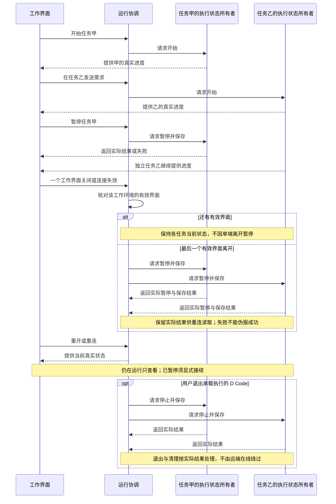
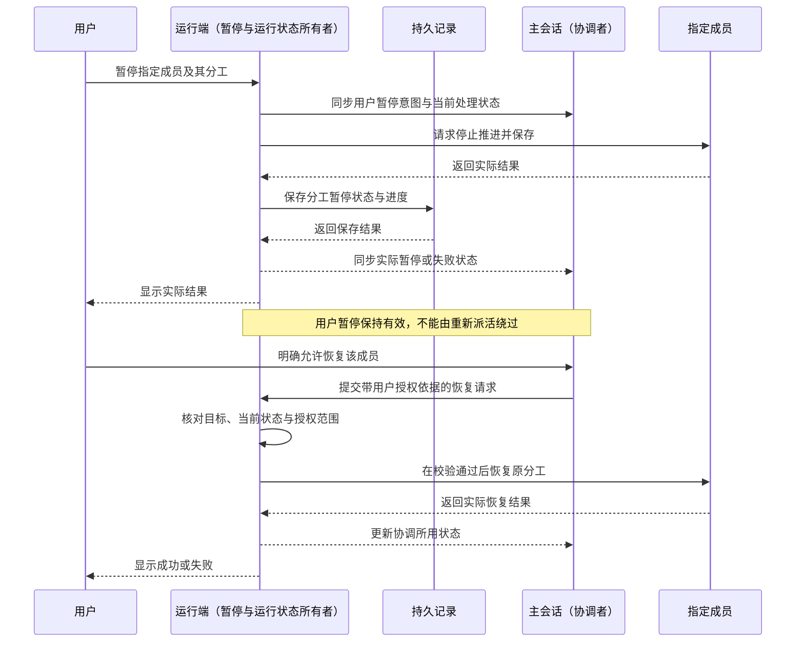

# 任务暂停与恢复

状态：产品边界已确认，交互和接入未完成。507 于 2026-10-04 在远端对齐中选择 B：本地或远端至少有一个有效工作界面时可以推进，最后一个有效界面关闭或断开后暂停并保存；退出承载执行的 D Code 同样停止并保存。主动暂停、重开后显式接续、不同任务并行及成员分工暂停规则继续有效。独立工作树已有部分旧场景的模拟记录，未覆盖本次多端生命周期修订；2026-10-05 无 UI 的真实 Pi 切片已验证独立暂停、关闭／强制终止后读取及显式继续、保存失败和工具中断，见 [运行证据](../doc/Pi-1.0.0-虚拟模型与运行恢复.md#2026-10-05-实际运行证据)；UI、成员授权和多端生命周期仍未经完整验收。

## 已确认行为

普通客户端重开或查询回执只读取原运行，不能顺带改写该运行的模型、项目指令或工作目录。已有运行继续使用正式记录中保存的目录；当前任务目录选择不迁移尚未完成的相对路径工具。记录归属冲突或记录缺失时保留现状并说明不可读取，不创建一份空运行代替既有接收事实。首次发送的全新运行才以任务绑定目录初始化；发送和明确继续前再沿正式通路应用本次模型及执行资源。

首次建立期间须区分“对象保存明确失败、尚未调用正式提交”和“原运行记录已经存在但现在缺失”。前者能沿原对象与同 operationId 重试初始化；后者不能重建空根来冒称可靠未接收。客户端的首次初始化关联须在任何正式提交之前保存收口；它不保存另一份输入队列，也不代替 Durable 的运行、历史或接收事实。

界面入口采用 [唯一主运行按钮](页面与交互组件.md#工作输入区)：发送、暂停、继续在同一位置按实际状态切换；运行中编辑新文字时主按钮用于发送，暂停仍可从输入选项菜单发起。入口合并不改变任务级与成员级暂停范围，也不允许按钮切换或普通输入解除暂停。

507 于 2026-10-05 对运行控制选择 A：首版只提供“暂停／继续”，不提供单独的“结束本轮”快捷入口，也不以“停止”等其他名称加入同义入口。暂停保留可接续的分工、输入与已存进度，不取消成另一种不可继续的结束操作；继续仍需明确用户意图。原型中旧有的停止按钮及对应桥接操作应随当前接线移除，不把旧演示能力恢复为产品要求。

此选择限定用户可见的运行控制入口，不取消应用退出、资源关闭和必要的内部取消机制；这些内部动作仍须按真实结果收束，不能据此伪报任务完成、删除会话或回滚已经产生的文件。成员分工的结束仍由主会话依照既有协作规则处理，不因本条增加直接管理按钮。

| 用户动作或状态 | 预期结果 |
|---|---|
| 至少一个有效工作界面存在，并已开始或明确恢复工作 | 任务可以推进，用户能够观察执行状态；界面存在本身不构成开始或恢复指令 |
| 暂停任务 | 任务停止推进，保存能够接续的运行状态 |
| 关闭其中一个界面或断开一个访问端，仍有其他有效界面，且运行端没有退出 | 保持任务实际执行状态；仅离开一个访问端不触发任务暂停 |
| 最后一个有效工作界面关闭或其连接被确认失效 | 触发暂停并保存，反馈按实际处理结果；没有有效界面时不持续推进工作 |
| 退出承载执行的 D Code | 停止其承载的运行并保存，即使还有远端界面连接；访问端据实显示连接和执行状态 |
| 重开或重连，任务一直由其他有效界面维持且仍在运行 | 读取并呈现当前实际状态，不重复发送开始或恢复请求 |
| 重开或重连，任务已暂停或正在暂停 | 显示实际状态；已经暂停的任务由用户显式接续，不要求重新交代全部任务，不因连接恢复自动续跑 |

有效工作界面指承载该工作环境的本地 D Code 界面，或已经获准、仍有效连接到目标 D Code 的远端工作界面。仅保存配对记录不算当前有界面；其他电脑上与这份工作无关的界面也不算。目标 D Code 负责确认相关界面与连接的当前有效性，不能由某个访问端单方面宣告任务已暂停或已恢复。此规则不表示系统级多窗口已纳入产品范围。

没有任何有效工作界面后的持续后台执行仍被排除，适用于主会话及其关联成员；任务已被用户暂停时，其他界面仍然在线也不能解除暂停。关闭访问设备上的应用按该访问端离开处理；退出真正承载这份执行的 D Code 则停止它承载的工作，不能将这两种退出混同。

断连检测与在途工作收束不被描述成网络中断瞬间即可完成。目标端按当前有效连接判断并触发暂停，具体检测机制和处理界限由接入验证确定；访问端无法核实最新状态时显示断连或未知，不伪报已暂停或已保存。一旦最后界面失效已触发暂停流程，重连不自动撤销这次暂停；迟到的离线事件也不得抹掉后来已经建立的有效连接。

“界面存在”不在本规格中扩写为“必须始终处于前台或选中当前会话”。第二轮已确认侧栏折叠、切换会话、开闭检查器、进出设置均为纯导航，不能改变执行状态。重新显示仍在运行的工作与恢复已暂停工作是不同动作，只有后者需要显式接续。最小化等尚未单独定义的窗口动作仍按有效界面与连接规则验证，不从选中状态推断运行状态。

## 不同任务并行推进

507 已确认：任务甲执行时，用户可以到任务乙发送需求，让两项任务同时推进；不将整个应用设计为一次只能推进一项任务的全局串行队列。用户能够分别查看执行状态，暂停或恢复任务甲不连带改变独立任务乙的执行状态。并行不表示无上限，资源与共享文件冲突的处理仍需工程设计和验证。

同一工作环境下关闭一个界面时，仍有其他有效界面则保持原执行；最后一个有效界面离开时，暂停其维持范围内的运行并保存。退出承载执行的 D Code 仍停止其范围内运行。重开读取当前真实状态，已暂停的工作等待显式接续；并行能力不改变这一边界。任务级暂停覆盖该任务的主会话与关联成员执行；独立任务不受连带影响。用户单独暂停成员时按下节处理，不能将两种暂停范围混同。

下图是用户操作与状态所有者的职责约定，非已实现证据；任务甲、乙的执行端各自提供实际运行结果，运行协调只转交操作，界面不自行宣告执行完成。

## 用户暂停成员分工与授权恢复

507 已确认：用户单独暂停某个成员时，该成员及其承担的这份分工一起暂停。保留分工、上下文和已保存进度，等待用户恢复或明确调整；其他独立分工可以继续。主会话不得因认为这份工作仍需完成，就自行换成员、另开会话或重新派发相同分工来绕过用户暂停。

暂停是需要主会话获知的协调事件。运行端记录用户暂停的目标与当前真实结果，向主会话同步“用户主动暂停了哪位成员、哪份分工，当前是暂停处理中、已暂停还是失败”。主会话后续协调必须读取并遵守该状态，不把用户暂停误作成员失败或可自动恢复的等待。通知尚未送达或主会话尚未处理时，界面如实显示；通知失败或重试结束也不解除用户暂停约束，不能仅靠一条自然语言通知维持该约束。

普通派工、引导和“稍后处理”都不能绕过用户暂停继续执行。暂停期间新输入是否接收，须以实际接收结果为准；当前不把“不能唤醒”扩写为所有新输入都必须进入持久队列。无论是否接收，已有暂停约束持续有效；输入未接收时保留原文及失败反馈。

用户随后可以在主会话的工作输入中明确允许恢复该成员。恢复意图与对象在当前上下文中明确时，主会话可发出恢复请求，无需强制用户返回成员页面重复操作。此处“重启”指接着原分工和已保存状态继续；是否需要重新发起在途模型请求，仍遵守本规格的能力边界。

运行端核对当前暂停状态与用户授权的对象和范围，再执行恢复；只有取得实际结果才更新为已恢复。目标仍暂停且恢复失败时，保留暂停及可回查记录；目标已不存在或已恢复时返回真实结果，不虚构暂停，也不因重复请求再次启动同一工作。普通进度询问、侧边问答、成员求助或主会话自行判断不能代替用户恢复授权；用户再次暂停后，先前的恢复请求不能解除新的暂停。整个任务仍处于暂停时，单成员恢复也不能绕过任务级暂停。

以下是职责和先后约定，不是已实现的接口或 Pi 运行证据。

## 能力边界与失败处理

- 保存和接续指任务运行状态的恢复，不承诺冻结并原样续接任何模型供应商的同一次推理。普通模型请求中断后的重新发起、已保存部分回答及工具调用恢复需要分别处理，依据见 [Pi 1.0.0 能力核对](../doc/Pi-1.0.0-虚拟模型与运行恢复.md)。
- 已完成的结果、在途调用和未开始的工作必须能够区分；不能把未知结果当成成功，或为接续任务盲目重复有副作用的动作。
- 保存失败时不能显示为已安全保存；恢复失败时保留可恢复记录，并说明当前状态与可继续的操作。具体交互随页面设计补齐。

## 后续验收场景

以下为完整产品路径的验收要求。2026-10-05 已执行其中无 UI 运行边界对应的集成用例，具体覆盖见上述运行证据；客户端和多端完整路径仍未验收：

1. 正在运行时暂停，确认任务停止推进、已完成结果保留，并能继续。
2. 正常关闭最后一个有效工作界面，或退出承载执行的 D Code，确认暂停／停止与保存结果；重开后展示实际状态，已暂停工作只有显式接续才恢复执行。正常关闭与强制终止后的恢复分别记录验证结果。
3. 分别在模型请求、工具执行及等待后续步骤时暂停和恢复，核对中断状态、请求重发与工具副作用，不用同一“恢复成功”掩盖不同结果。
4. 模拟保存或恢复失败，确认没有虚假的“已保存／已恢复”状态，且已有记录仍可回查。
5. 任务甲运行时进入任务乙并发送需求，确认两项任务均能推进；来回导航不暂停任何一项，分别展示正确归属的进度与结果。
6. 两项独立任务运行时暂停甲，确认甲停止并保存、乙继续；恢复甲不重复启动乙。关闭该工作环境的最后一个有效界面后，两项均停止推进；重开已暂停任务均不自动续跑。
7. 暂停一个成员，确认其分工停止推进、主会话获知用户暂停及实际状态；其他独立分工继续，主会话没有另行派人执行被暂停的同一份工作。
8. 在主会话明确允许恢复被暂停的成员，确认目标成员接着原分工继续，主会话与界面反映真实恢复结果；不要求用户重复进入成员页面操作。
9. 分别模拟通知延迟或失败、保存失败、恢复失败以及暂停后收到普通侧问，确认没有虚假通知完成、成功保存或自动恢复；通知失败不解除暂停约束，原始授权和工作记录可回查。
10. 恢复请求尚在处理时用户再次暂停，确认过期请求没有解除新暂停；存在任务级暂停时，成员级恢复没有绕过整体边界。
11. 对被暂停的分工发送普通派工、引导或稍后处理，确认都未绕过暂停；分别按实际结果显示接收或未接收。重复恢复请求或目标已不存在时，返回真实状态，不重复启动、不制造虚假的暂停状态。
12. 本地窗口关闭但远端界面仍有效时，任务继续；一个远端离线但本地或另一远端仍有效时，同样保持原执行。已主动暂停的任务不因其他端在线而恢复。
13. 最后一个远端连接失效且没有本地有效界面时，目标端确认失效后触发暂停并保存；断连端不伪报已暂停或已保存。重连后按实际结果呈现，已暂停工作须显式接续。
14. 任务一直由另一界面维持时，关闭并重新打开访问端，确认只读取正在运行的状态，没有重复开始、恢复或重放工作。
15. 覆盖迟到离线事件与新连接交错、最后界面离开后的暂停流程与重连交错；当前连接归属准确，已触发的暂停没有被重连悄悄撤销。
16. 退出承载执行的 D Code 时，即使访问端仍然在线，所承载工作仍停止并按实际结果保存；原型、正常退出与异常终止分别记录，不承诺任意崩溃无损恢复。
17. 首版运行控制仅有暂停与显式继续；界面、快捷键和直接操作入口均不提供独立“结束本轮”或同义停止操作。暂停后未完成工作仍可接续，旧原型停止按钮没有残留为取消本轮的产品入口；正常退出与内部资源收束仍可执行并反馈真实结果。

## 实施前需完善

UI／UX 已确认恢复条、显式接续及任一有效工作界面的运行前提；后续细化暂停与关闭反馈，并验证有效界面与连接的归属、失效检测及交错时序。工程设计负责暂停粒度、在途工作收束、状态写入唯一所有者、持久化时序及 Pi 接入验证。应用异常退出的恢复保证另行核实，不把正常关闭可保存推断为任意崩溃都能无损恢复。客户端技术栈已确定为 Electron + React + Tailwind v4；具体执行进程、持久化时序和接入仍需验证，不引入没有有效工作界面的持续后台执行。旧模拟原型的保存与重开记录既不覆盖本次多端修订，也不能作为 Pi 已接入的证据。
