# 工作台信息架构

状态：已确认范围与验收草案，尚未完成集成验收；协作权限与界面映射为后续新增确认，未实现。依据：507 于 2026-10-03 同步的 Kimi 四分支最终交接及随后关于内部会话团队的确认；文件夹绑定细节已回查同一会话中 507 对“其一”的确认。本文件统一承接工作台导航与对象树，不另建平行规格；词义见 [GLOSSARY](../GLOSSARY.md)。

## 目标与验收路径

让 507 能在清楚的工作位置开始和继续任务，并在多项工作之间切换而不丢失归属。按 [开发任务路径](开发任务路径.md) 验证：新建任务、进入会话、观察执行、检查文件差异、继续追问；同时覆盖默认环境和跨空间移动。

## 对象与归属

- 主干为工作空间 → 任务 → 会话，不保留独立的“项目”层级。
- 工作空间支持多个工作文件夹，每个空间内置不可删除的默认长期任务，承接杂事和临时沟通，并可在其中新建短期任务。文件夹提供工作范围与默认目录；具体工具授权和访问边界需由工程设计核实，不能仅凭目录绑定宣称安全隔离已经成立。
- 507 于 2026-10-04 确认同一个文件夹可被多个工作空间引用。各空间保持独立身份、任务和会话归属，不因路径相同而自动合并，也不复制磁盘文件；对共享文件的实际修改在其他引用该文件的空间中同样可见。共享引用不提供写入隔离或额外权限，并行修改仍须协调。
- 同一工作环境内按任务组织不同目标。例如，以 D Code 为工作空间时，“产品开发”和“技术研究”应作为其下的任务，不因工作类型不同就默认拆成两个工作空间。允许多个空间引用同一文件夹是能力边界，不作为引导用户重复建空间的默认组织方式。
- 任务最多两级：长期任务 → 短期任务；短期任务不再嵌套任务。任务直接归属于工作空间，或作为同一空间内长期任务的子任务；不存在无空间归属的任务。
- 每个会话必须属于一个任务。任务内有一条主会话及按需建立的成员会话，会话语义对齐 Pi session（会话）；这不等于已核实 Pi 的子智能体机制与 D Code 成员会话一一对应。
- Home 工作空间以用户主文件夹为根目录，是实际默认空间。“未另选空间”的工作仍归属 Home，不产生游离任务或会话。
- 新任务草稿首次发送时，在当前工作空间建立新的短期任务及主会话；默认任务保留为可主动进入的杂事与持续交流入口。创建时机、草稿保存及失败重试规则以 [冷启动与草稿态](冷启动与草稿态.md#草稿态) 为准。
- 任务可选绑定所属空间内一个文件夹，作为默认工作目录；不绑定时使用空间默认目录，绑定关系可修改。空间默认目录的选择方式及任务嵌套后的目录解析在实现设计中明确，不从旧版恢复隐含规则。

## 普通客户端首次绑定工作文件夹

正常客户端从侧栏“新建工作空间”进入：用户选择本机文件夹，确认空间名称，再明确创建。Home及其主文件夹保持；新空间绑定所选文件夹并建立自己的默认长期任务，不增加独立“项目”层级。首个文件夹是该空间默认目录；当前这一入口不改变已有空间、任务或运行的目录。

选择文件夹使用系统目录选择器，只产生本次选择回执；选择阶段取消或关闭表单不创建对象、不开始工作。返回带本次操作、选择请求与选择身份，迟到选择不能覆盖后来选定的目录或新打开表单。界面只提交选择身份和名称，不能借该入口任意指定宿主路径；接收侧核对当次选择归属、真实目录和保存结果。

创建期间显示保存状态。空间、默认任务及同次创建关联一起保存成功后，才发布快照并进入该空间草稿；失败保留表单、原有对象和错误，不显示成功。结果未知时重试沿同一创建身份查回已保存对象，不按名称或同路径合并其他空间。关闭表单后从侧栏“核对保存结果”恢复原待核意图；查询不能重新生成空间或默认任务。保存已发出后关闭表单不声称已取消保存，结果沿同次创建身份读回；关闭收束等待已经认领的保存。目录绑定只改变组织与默认工作位置，不启动模型／工具或提供操作系统隔离保证。

已有会话沿正式运行绑定保留原cwd；选择或创建另一空间不能重建旧端口、迁移文件、改写历史或自动继续旧工作。新空间草稿首次发送仍沿既有正式接收通路建立短期任务和主会话；会话、任务、空间及目录须能读回到同一归属。

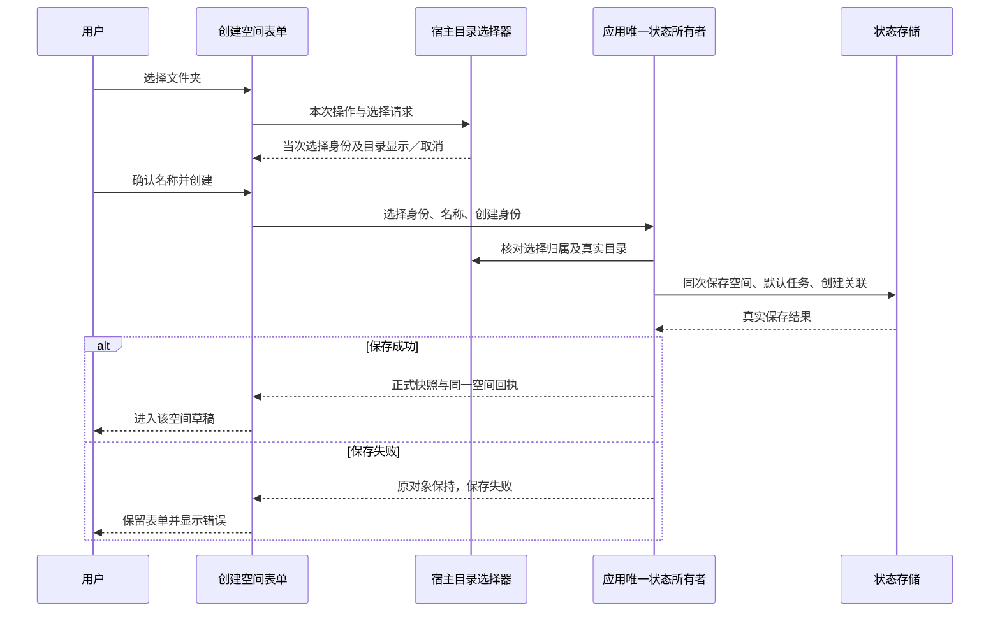

验收从普通未预置项目绑定的客户端开始：配置模型→真实选择并绑定隔离项目→核空间／默认任务／目录及持久读回→读取规则和文件→修改代码→真实测试失败后修复并复验→正式结果与实际diff→暂停／关闭→重开只读零新请求或工具→明确继续原提交且完成副作用不重放。另覆盖选择取消、保存失败、绑定落错对象、迟到选择、同创建身份查回和旧运行原cwd；原已绑定项目的基本编码证据保留，不概括为首次绑定入口已通过。

## 导航与移动

任务行、展开控件、行内操作及创建对话框的具体交互见 [页面与交互组件](页面与交互组件.md#工作台与导航)。选择对象、展开列表与运行控制分别有明确目标；成员创建仍由主会话调度，不保留原型中用户直接增加成员会话的管理按钮。

- 侧栏采用树形导航。各工作空间是始终可见的根节点，不提供隐藏该层的模式；长列表仍可滚动。不采用工作空间标签页制或系统级多窗口。
- 507 选择 A：Mac 桌面端将本机与已连接 Mac 所提供的工作空间并列呈现在同一侧栏，并标明所属电脑；用户可直接进入相应任务，不先切换整套电脑环境。仍以工作空间为根，不新增“设备 → 工作空间”的树层级，不因并列展示合并同名空间、任务或会话。手机浏览器呈现其实际获准并已连接的目标端工作空间，不虚构手机本地执行空间。
- 侧栏可拖宽；新建任务与跨空间移动的入口位于对应树行。
- 展开工作空间查看任务；点击任务行直接进入其主会话，展开任务查看成员会话，成员所在的会话层不再重复列出该主会话。同一时刻最多一个任务展开成员会话列表，切换展开目标时收起前一个列表。长期／短期任务仍遵守既有两级组织关系。
- 507 所说“主会话就是可见的任务层级、成员会话就是会话层级”落实为上述界面映射；任务继续承担组织、目录绑定与移动职责，主会话承担连续交流和协调职责。冷启动恢复与近期任务“继续”入口仍按 [冷启动与草稿态](冷启动与草稿态.md) 定位，不将任务行的默认入口扩大为覆盖所有恢复行为。
- 任务是用户主要浏览层级；导航的折叠和展开不自行定义任务的执行或暂停状态。
- 507 选择首批移动范围 A：支持同一台 Mac 所承载的 D Code 内跨工作空间移动任务，会话记录随任务保留，用户能够在新空间接续原工作。移动后按目标空间解析工作目录；失效的历史文件路径引用降级为纯文本，不继续呈现为有效文件入口。本机与远端空间同栏展示不扩大移动范围；首批不移交任务、会话或后续执行到另一台 Mac，也不自动搬迁工作文件。
- 移动的生效时机见下节。子任务关联和目录绑定的具体处理须遵守已确认的任务层级、归属和目标空间解析规则，进入实现前形成一致方案；不把“无感”扩大为自动迁移工作文件或改变磁盘文件内容。

### 任务移动的生效时机

507 选择 B：在首批同一台 Mac 的移动范围内，任务当前仍在执行且移动会改变其工作目录时，先记录移动请求，等待受影响的当前一轮工作结束后再完成移动。这里指当前正在执行的一轮，不是整个长期任务的完成；移动请求本身不打断当前执行，也不通过暂停／恢复来加速生效。

等待期间显示“等待本轮结束后移动”及目标空间，任务仍属于原空间并使用原工作环境，不提前显示为已移动。当前轮收束后，产品对象管理重新核对原操作、目标空间及关联，实际保存新归属与目录结果后才完成移动；后续工作按目标空间的目录规则开始。同一任务及会话记录延续，不因等待或重试创建副本。仅整理归类且不改变执行环境时，无需等待当前轮结束；当前没有尚未结束的一轮工作时按正常移动路径处理，暂停不能被当作当前轮已经结束。

等待期间用户暂停工作，移动请求不得自行解除暂停；目标失效、操作被取消／替换或结果无法核实时，保留真实状态和可继续处理的依据，不改投其他目标、不伪报移动完成。保存失败与结果未知分别反馈。具体等待记录、事件顺序及目录解析由工程设计处理，当前未实现或验证。

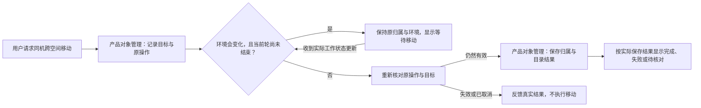

## 统一快捷入口

507 于 2026-10-05 选择 B：首版增加统一快捷入口，通过可见控件或键盘呼出，输入名称查找常用操作或定位任务。侧栏及现有菜单继续保留；本次范围不含会话全文、文件名称或文件内容搜索，也不是向智能体发送自然语言任务的另一个输入框。参考 ZCode `29628c9` 的键盘工作流与命令中心，按 D Code 的任务层级适配。该入口尚未实现或验收。

- 操作结果复用既有操作名称、可用条件和正式调用通路，例如打开设置或进入新任务草稿；同一个操作不因从快捷入口触发而获得另一套规则。检索文本不作为工作输入提交，不调用模型来执行搜索词。
- 任务按名称查找，结果保留任务身份与当前归属；同名任务显示足够的工作空间、父任务及来源电脑信息以便区分。确认任务结果时与点击任务行一致，定位其主会话，不新建或复制任务，也不恢复已暂停执行。
- 任务来源复用当前入口可访问的对象，不因搜索取得额外远端接入资格。读取失败、连接不可用与没有匹配结果分别反馈；保留的旧结果须可辨识为旧状态。选择时重新核对对象当前归属及可访问性，已移动则定位真实位置，已删除或失效则说明原因，不误开同名对象。
- 打开、输入筛选、移动候选焦点和关闭入口只改变展示。只有用户确认具体结果后才执行相应导航或既有操作；涉及执行状态的既有操作仍沿原正式通路核对目标、运行及授权，不因出现在结果中自动执行。
- 操作目录与任务结果来自其既有事实所有者，搜索结果是只读派生视图，不建立另一份可修改的任务列表或执行队列。查询返回与用户当前检索条件关联，迟到结果不得覆盖较新的查询或使已关闭入口重新弹出。
- 入口支持键盘完整操作及可见焦点，输入中英文时不会因输入法确认候选而顺带触发结果。未选结果而关闭时返回原操作位置，已有草稿保留；确认结果后焦点进入对应目标。中英标签、长任务名、13／14px、紧凑窗口及触控入口遵守现行共用设计，具体快捷键和容器由 UI 设计验证。

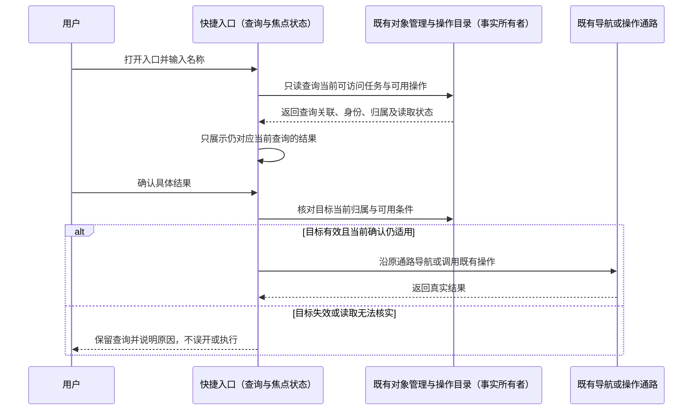

验收覆盖：从可见入口和键盘呼出；查找操作并打开设置后保留原草稿；同名任务按实际归属区分并进入其主会话；搜索与导航不发送工作输入、不改变执行；目标移动、删除或远端不可用时处理真实结果；快速改词与关闭后迟到结果不覆盖现场；键盘焦点返回、中英文输入法及长标签在不同字号和窗口中可用。上述为产品与后续端到端验收要求，当前没有本功能的运行证据。

## 验收场景

以下是设计与后续实现必须覆盖的场景，当前均未验证：

| 用户操作或条件 | 要核对的结果 |
|---|---|
| 主动进入 Home 默认任务发起临时沟通 | 继续该默认任务的主会话，不产生游离会话 |
| 从 Home 新任务草稿发出首条需求 | 新短期任务及主会话归属 Home，不将输入混入默认任务 |
| 查看或操作默认任务 | 默认任务保持存在，不提供删除入口；其中仍可新建短期任务 |
| 在长期任务内新建短期任务 | 两级归属清楚，不产生第三级任务 |
| 点击任务行，再展开并选择成员会话 | 任务行打开主会话，展开后可进入成员；列表不重复主会话，成员仍归属原任务 |
| 给任务绑定文件夹，或使用未绑定任务 | 分别使用绑定目录或空间默认目录；界面中的工作位置与执行位置一致 |
| 两个工作空间引用同一文件夹 | 两个空间及其任务、会话保持独立归属，磁盘文件未复制；共享文件的实际改动一致可见，不误报已经隔离并行写入 |
| 在 D Code 工作空间分别建立产品开发与技术研究任务 | 任务在同一空间中组织，不自动另建工作空间或复制文件夹 |
| 展开另一个任务的会话列表 | 前一个列表收起，工作空间根节点仍可见；不把折叠误报为暂停 |
| 在 Mac 桌面查看本机与已连接 Mac 的工作空间，并来回选择任务 | 同一侧栏可达，来源电脑可辨，原有空间／任务／会话层级保持；选择只导航，不改变执行或连接资格，也不迁移工作 |
| 在同一台 Mac 的已确认范围内，将任务移动到另一个空间 | 会话记录保留，目标归属和工作目录正确；同栏可见的另一台 Mac 不被当作首批可用移动目标 |
| 运行中请求移动，且工作目录将改变 | 显示等待本轮结束；当前执行与原归属保持，实际收束并保存移动结果后才更新位置，后续工作使用目标空间的目录 |
| 移动只涉及归类而不改变当前执行环境 | 无需等待当前轮结束，按实际保存结果完成归属变化，不打断原工作 |
| 待移动时任务被暂停、目标失效或保存结果不明 | 不为移动自行恢复工作，不改投其他空间、不伪报成功；原操作可回查，重试不复制任务或会话 |
| 移动后原文件引用失效 | 保留引用文字，移除有效文件入口的表现；不丢弃相关会话内容 |

证据应来自实际界面操作及读回的对象归属、工作目录和会话内容；原型可以验证导航与反馈，不能证明真实 Pi 会话或磁盘路径迁移正确。

## 排除与保留项

不提供“任务毕业／转为项目”，不产生独立项目对象，不支持第三级任务。任务归档按下节的可恢复规则处理，首版不提供永久删除；置顶呈现仍另行设计。

## 任务归档与恢复

507 于 2026-10-07 选择 A：归档用于将任务移出日常列表，保留历史并允许恢复；首版不提供永久删除任务或清空归档记录的入口。该选择替代原型的直接删除按钮，不表示归档已经实现。

- 归档保留任务身份、原工作空间与父任务关系、会话、已保存输入和结果，以及成果／来源关联；不删除或搬迁工作文件，不把会话历史压缩成摘要后丢弃原记录。
- 内置默认任务保持可见可用，不提供归档。归档长期任务时，操作范围包括其子任务，进入操作前说明这一范围；归档某个短期任务不连带归档父任务或其他独立任务。
- 归档是任务组织操作，不隐含暂停、结束分工或回滚文件。首版仅对实际已收束或已暂停、且没有尚待确认的在途发送／控制操作的范围执行归档；仍在运行或状态无法确认时保留原列表与原因，用户可先按既有入口暂停或等待实际收束。不能因归档隐藏仍未处理清楚的工作，也不为归档另造自动停止机制。
- 已归档任务可从所属空间的“已归档任务”入口查找和阅读，显示原归属与归档状态。默认日常列表及近期任务区不列入；一般任务查找不把归档记录混成活动任务，查归档记录走明确入口。查看历史不发送输入或恢复执行。
- 归档状态成立后，该任务及成员的所有执行入口均须核对这一正式事实：新的工作输入、继续请求、成员通知、跨任务协调及迟到结果都不能使归档工作重新推进；只读历史与状态查询仍可进行。拒绝或待处理的真实结果可回查，不能因入口不在当前页面就绕过此约束，也不重派同一工作绕过归档。
- 恢复先核原空间和父任务是否仍有效，再把同一任务恢复到可见列表，不创建副本；原位置失效时保持归档并说明原因，不悄悄改放 Home 或另一台电脑。父任务仍归档时，先通过它所属归档范围恢复，不能产生藏在归档父任务下的活动子任务；恢复长期任务不自动取消此前独立归档的子任务状态。恢复只改变归档状态，原先暂停的工作仍须通过既有继续入口明确接续；查看归档记录时不直接发送或启动工作。
- 恢复归档本身不重放归档期间的工作输入或协调消息，不使旧继续请求重新有效；后续推进重新沿正式入口核对当时有效的目标、运行与授权，已有暂停约束继续有效。归档前的输入、文件效果和失败记录仍保留，不因资格变化伪报此前执行已经回滚。
- 归档／恢复由产品对象管理保存正式状态，界面据实际结果更新；失败或结果未知时保留对象与原操作关联，先回查，不伪报成功、丢记录或重复恢复。跨端读取相同归属与状态，不把一次列表过滤视为已保存。

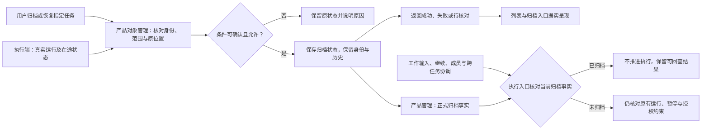

验收覆盖：归档普通任务后从日常列表消失，但可在归档入口读回同一任务及原会话；长期任务含子任务范围可辨，默认任务不可归档；运行中或状态未知时未暗中暂停／删除；归档后到达的新／迟到协调消息与旧继续请求均未推进执行；恢复同一身份、归属与历史，不自动继续或重放旧消息；原位置失效、保存失败、结果未知和同次重复操作不丢记录、不复制对象。具体入口见 [任务生命周期控件](页面与交互组件.md#任务生命周期入口)。当前未实现或验收。

## 远端连接方向

507 于 2026-10-04 明确远端采用统一连接模型：当前设备通过 D Code 连接另一台电脑上运行的 D Code，并使用目标端提供的工作。发起连接和承载工作是同一产品在这次连接中的不同职责，不将它们拆成两个互斥的产品目标。

连接访问目标 D Code 所提供的工作空间、任务、会话及实际结果，Pi 执行与相关工作文件仍在承载该工作的电脑上。单纯建立连接不自动搬迁文件、复制任务历史或在访问端再启动同一份执行；不同入口应呈现目标端的同一份工作事实。以下仅表达已确认的使用方向，不规定进程、协议或客户端形态：

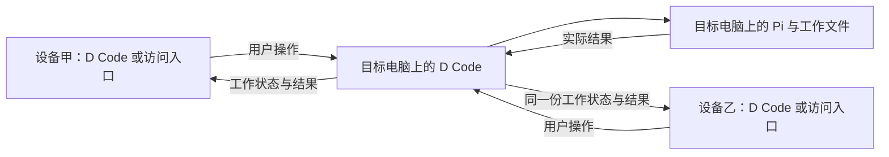

507 随后选择 A：多台已经获准连接的设备可以直接操作同一个任务，包括发送需求、引导和暂停；不要求先接管唯一操作端，其他端也不因已有一端操作而被统一降为只读。

- 各端操作进入目标 D Code 的同一条正式接收通路，共用同一份执行与工作记录。多端输入不建立多份会自行推进的执行历史；目标端按实际接收与处理结果返回状态，不以某个界面的乐观显示作为正式结果。
- 用户能辨认操作来自哪台设备，已接收输入及实际状态变化同步呈现于其他端。另一端的发送、引导或暂停不能被静默丢弃，也不能只留在发起设备的界面上。
- 输入重试、目标与运行校验继续遵守 [运行中用户消息的引导](#运行中用户消息的引导)；来自不同设备的独立发送不因文本相同而被误作同次重试。较旧的恢复请求不能绕过另一端后来生效的暂停指令，结果仍以实际运行端记录为准。

验收补充：两台已获准设备打开同一任务，均能直接发送操作；双方能看到实际接收结果及来源，执行记录保持同源；一端暂停后另一端看到真实结果；重试不重复执行，旧运行结果或过期恢复请求不覆盖当前状态。以上为要求，尚无产品运行证据。

### 外网接入的使用门槛

507 于 2026-10-05 对 G2 选择 B：首版由 D Code 提供设备配对后的外网接入。用户在常规联网环境下，通过产品入口连接目标 Mac，不以先自行搭建私人网络、配置转发或管理中继为默认使用前提。产品需要承担相应接入设施、运维和验证；具体供应商、托管方式及费用尚未定案，本次没有部署或接通公网链路。

507 于 2026-10-06 对正文可见范围选择 A：访问设备与目标 Mac 之间的远程工作正文须保持加密，中转服务不持有解密正文的钥匙，不能读取聊天、文件或差异正文。此约束同时适用于第三方及 D Code 自运营的接入服务；连接所需的最小路由和状态信息另行界定，不承诺隐藏全部连接元数据。它只约束远程访问链路，不改变目标 Mac 的正式记录归属，也不改变所选模型处理工作内容的方式。

- 沿用 Mac 执行端、Mac 桌面端与手机浏览器访问的首批范围。目标 Mac 上的 D Code 必须实际可用，网络接入不迁移 Pi 执行、工作文件或正式会话记录；本地仍无登录墙，远端设备资格继续由下节的配对机制建立。
- 接入方案须说明正文在哪里解密、解密钥匙由谁保管，并核对实际浏览器与桌面路径。仅两段连接分别加密、却在中转端暴露正文，不满足本条；中转不得为诊断记录可读正文。无法维持该保护时反馈连接失败，不自动降级为中转可读的通路；既有草稿、接收回查及暂停规则保持。
- 网络可达、设备配对资格与工作输入已接收是不同事实。公网入口可访问不授予工作访问权，接入服务收到请求也不代表目标端已经保存输入；目标 D Code 仍核对当前设备资格、目标与运行，沿同一正式接收通路返回结果。
- 接入设施只承接连接与转发所需职责，不另建可独立推进的任务队列、执行器或业务历史。路由与连接状态不替代目标端的工作事实，不能因接入设施在线就把它当作一个有效工作界面。
- 连接失败时区分能够确认的原因，例如目标离线、接入设施不可用、资格已撤销；无法确认时显示未知，不伪报配对成功、已暂停、已保存或任务完成。接入服务故障不改投另一台电脑，也不自行改写本地工作已有状态。
- 重连、设备撤销、暂停和最后有效界面离开的规则保持。恢复网络只读取当前事实，已暂停工作仍需明确继续；已接收或结果未知的输入不因公网重试再次提交，确认未接收时才按既有补送规则处理。

下图表示接入职责与工作事实的归属，不固定直连、中继或隧道拓扑，也不表示所有业务流量必须经过某个第三方服务。

```mermaid
sequenceDiagram
    participant Access as Mac 或手机浏览器（访问界面）
    participant Link as 产品提供的连接通路（接入与转发）
    participant Target as 目标 Mac 的 D Code（资格与工作归属）
    participant Pi as 目标端 Pi（执行事实）
    Access->>Link: 经产品入口请求连接目标 Mac
    Link->>Target: 转交连接与设备资格信息
    Target->>Target: 核对配对资格及实际可访问范围
    Target-->>Access: 返回连接／资格结果或真实失败
    Note over Access,Target: 远程工作正文由两端加密与解密，中转不持正文解密钥匙
    opt 设备获准且用户发出有效工作操作
        Access->>Link: 提交加密的工作请求
        Link->>Target: 转交密文，不自行确认工作已接收
        Target->>Target: 解密并核对原操作身份、目标及资格
        Target->>Pi: 沿正式接收通路校验、保存并处理
        Pi-->>Target: 返回真实接收结果与工作状态
        Target-->>Link: 加密结果正文
        Link-->>Access: 转发密文，由访问端解密呈现
    end
    Note over Link,Target: 接入设施在线不等于访问界面有效，不替代暂停与接续规则
```

后续验收以异地 Mac 或手机使用移动网络访问目标 Mac 为代表场景：使用者无需另行配置私人网络或转发；配对后能查看同一份工作并发出已确认范围内的操作；未配对／已撤销设备无法取得工作数据；目标离线、接入服务故障、重连及回执丢失均有真实反馈；接入设施保持在线但所有有效访问界面离开时，不维持任务持续推进。支持的网络条件与失败边界须通过实际设备和受控数据验证，不把外部方案说明当作 D Code 已可用的证据。

正文保护另须以合成聊天及文件差异验证：两端正确读写内容，中转配置、密钥保管及实际数据通路均不能解密正文，中转诊断记录不含可读正文；明确所暴露的必要连接元数据。无法建立受保护连接时不降级、不把未知输入重新发送，也不伪报已接收或已暂停。抓包中暂未看到明文不能单独证明中转没有解密能力；此项尚未实现或验收。

### 设备配对与撤销

507 选择 A：通过设备配对建立远端接入资格，首次配对后记住设备，后续可直接重连，并能随时撤销。目标电脑提供配对入口，按设备使用条件采用连接码或扫码；远端连接不以建立统一 D Code 账号为前提，本地仍不设登录墙。

目标 D Code 维护已配对设备的有效资格。配对完成后才允许该设备接入工作；重连时核对资格仍然有效，不能仅凭访问设备显示“已记住”就跳过目标端核验。用户能够查看已配对设备并撤销；撤销生效后，该设备不能继续发送新的工作操作或接收后续工作数据，再次接入须重新配对。撤销不代表已经执行的操作或文件副作用被自动回滚，当前任务是否暂停按生命周期规则判断。

配对、记住和撤销均按实际保存与生效结果反馈；失败或状态未知不得显示为成功。下图只标明职责与顺序，未确定身份凭据格式、传输或网络部署方式：

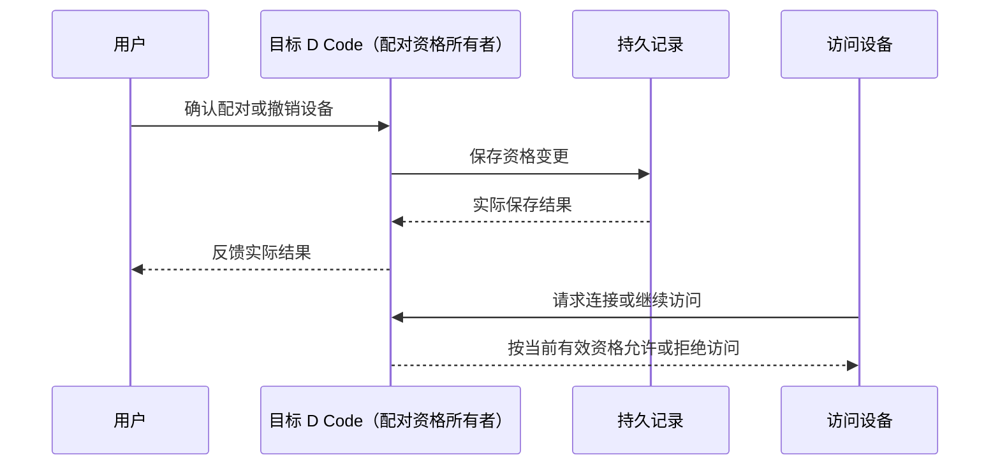

验收补充：首次配对成功后可访问同一份工作，重连无需重复配对；配对失败不会建立有效资格；目标端撤销后，已有连接和后续重连均不能继续以旧资格操作或取得新数据；重新配对后按实际结果恢复接入。配对成功不等于任务已经恢复执行。当前未实现或验证。

507 已选择任一有效工作界面维持运行：仍有本地或远端有效界面时，关闭单个界面不暂停工作；最后一个有效界面离开后暂停并保存。重连只读取实际状态，已暂停工作仍需显式接续；退出承载执行的 D Code 仍停止其运行。现行生命周期正文统一见 [任务暂停与恢复](任务暂停与恢复.md)，配对记录本身不算有效工作界面。

### 首批支持范围

507 对首批范围的两项选择均为 A：承载 Pi 执行与工作文件的目标电脑先支持 Mac；远端访问入口为 Mac 的 D Code 桌面端与手机浏览器。手机通过浏览器配对并连接目标 D Code，不要求安装独立手机客户端。Linux／Windows 执行端及独立手机客户端不在这一批范围中，后续是否纳入另行对齐。

两类访问入口沿用同一连接、配对、多端操作与生命周期语义。手机入口也支持已确认的需求输入、引导、暂停及查看实际工作状态，不因采用浏览器而改为统一只读；中文与英文共同验证。507 于 2026-10-05 确认手机使用时间线与底部抽屉，导航、文件查看、悬浮侧问与键盘的行为统一见 [手机布局](开发任务路径.md#手机布局时间线与抽屉)；具体几何仍需验证，不把会话内结构示意或桌面紧凑窗口的旧截图当作手机产品验收。

本轮远端产品范围已完成方向对齐，连接、多端操作、配对、生命周期与首批入口均未实现或验收；实际运行映射、协议、网络接入及连接失效检测仍需工程设计和验证。本次没有修改当前 UI 原型，也不将它原先的模拟记录扩大为远端能力证明。

## 会话协作方向

507 于 2026-10-03 确认不同任务可以同时推进，并以当前 Codex 与用户沟通、协调 Kimi 和 ZCode 的工作方式说明期望：主会话负责与用户沟通和整合，其他会话可以分工推进；参与者能够互相发消息，了解对方状态并协调修改范围。这一协作方向属于既有会话对象的行为，不据此增加第四层产品对象。

507 随后确认首版采用 D Code 内部的会话团队：成员均为 D Code 内部会话，统一依托 Pi SDK 1.0.0 管理执行与恢复，可以采用不同模型和分工，互相发消息、查询状态并交接结果。首版不包含对外部 Codex、Kimi Code、ZCode 客户端的任务派发与状态接入；这些客户端是协作方式的参考。

### 成员调度与问题上报

507 已确认由主会话统一调配：主会话在用户授权的任务目标内按需创建成员、分派工作、协调支援并整合结果。成员可以彼此沟通既定工作，但不自行创建更多成员或向新成员继续委派。成员发现无法处理时，向主会话报告问题、已完成或尝试的工作，以及需要的支援；主会话判断调整分工、安排其他成员或向用户说明真正需要其决定的问题。

507 对成员管理入口选择 B：用户通过与主会话沟通提出添加成员或结束成员分工的要求，由主会话安排；界面不新增用户直接添加或结束成员分工的管理入口。已经确认的查看、直接沟通与暂停成员分工继续保留。结束分工保留会话记录，不等同删除历史；相关处理仍遵守主会话协调、成员授权、输入回执及暂停规则。

上报与协调过程保留真实状态；请求尚未收到或尚未处理时，不能显示为主会话已接手、支援已到位或问题已解决。主会话的协调权限不自动扩大用户授权的目标、权限或修改范围。

用户暂停成员时，主会话须获知该成员及其分工被用户暂停，遵守该约束；用户之后明确允许恢复时，主会话可协调恢复该成员。具体范围、状态、失败与验收统一见 [用户暂停成员分工与授权恢复](任务暂停与恢复.md#用户暂停成员分工与授权恢复)，不将一般的成员调配权限扩大为自行解除用户暂停。

首版跨任务协作由主会话对接主会话。成员需要其他任务的资料或支援时，先向本任务主会话提出，由它与目标任务主会话协调；同一任务内的成员仍可直接交流。对接不改变会话归属，也不自动扩大任何成员的修改范围。

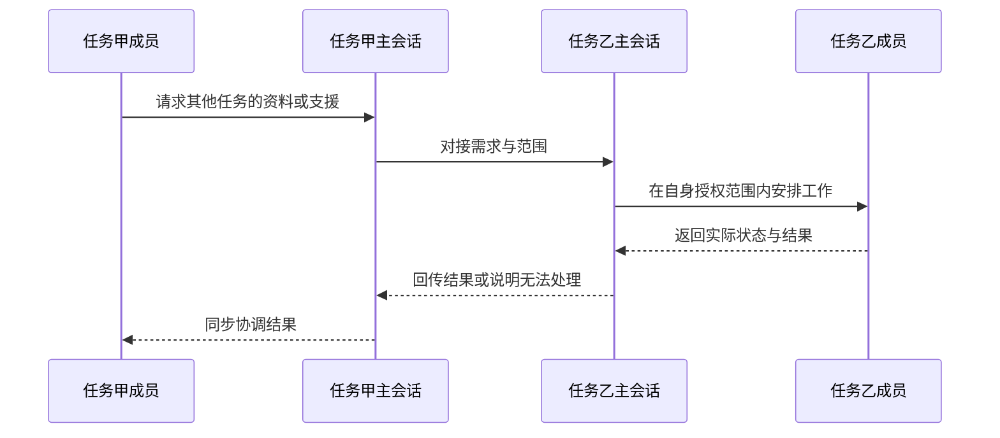

下图为已确认的职责与先后关系，不规定消息存储、接口或具体执行进程，当前未运行验证。

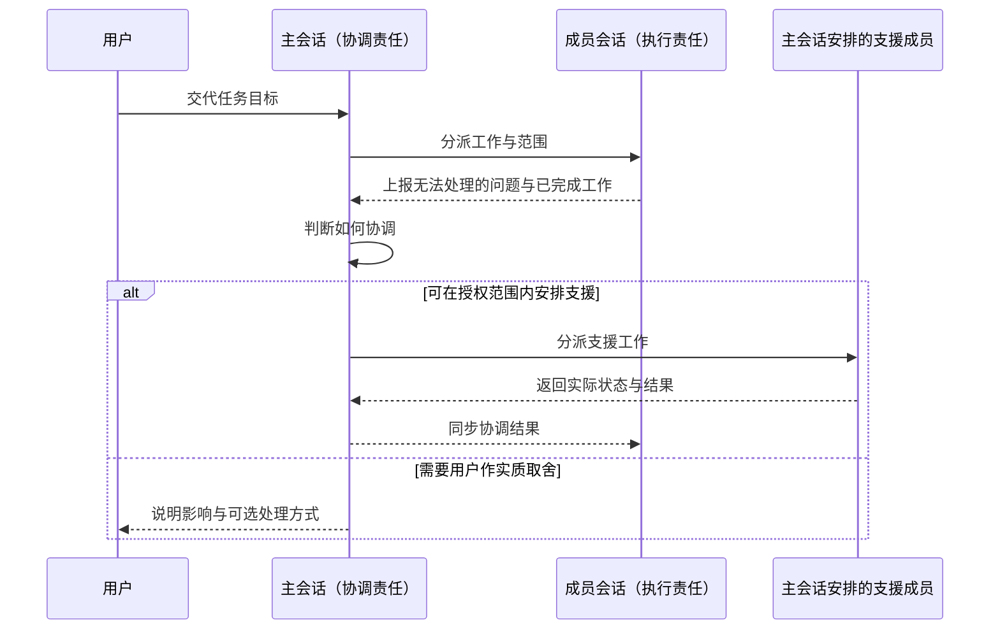

后续验收须覆盖成员正常完成、上报求助、协调请求未处理或失败三个分支，并核对成员没有自行扩充团队；上报记录、实际协调状态和用户看到的结果须一致。主会话等待用户决定时如何安排其他独立工作，随运行与消息规则进一步明确。

### 按风险安排独立审查

507 于 2026-10-05 选择 A：主会话依据计划复杂度、重复失败的证据及交付风险，按需安排独立审查，并记录介入理由。较大计划、反复失败和交付前是需要判断的时机，不是每个长期任务都自动再调用一遍审查成员的固定关卡。常规步骤不额外启动审查；任务已有的明确审查要求继续执行，不能以“按风险”为由跳过必须的独立审查或失败恢复要求。此处定义 D Code 产品运行策略，不替换本仓库 AGENTS 的开发与交付规定；当前尚未实现或验收。

- 独立审查沿已有成员调度与授权机制，由主会话安排适合的成员，独立于被审工作的执行者。审查是一项分工，不新增第四层对象、常驻固定角色或另一位拥有调度权的主会话；模型沿各会话的既有选择，不固定由某一家模型承担。
- 每次派审查明确需要核对的问题、介入理由、对象及版本或快照、可回查证据和允许范围。计划复杂度、重复失败与交付风险必须有当前工作依据；没有实际派工或接收结果时，不能只在界面显示“审查已开始”。
- 审查成员回交发现、依据与未验证边界，不直接修改被审对象；需要实验时在获授范围内使用隔离验证。结果沿既有成员消息通路交回主会话，主会话负责核对、决定采纳或说明不采纳原因，并将需要落实的工作交回相应执行者。审查结论不替代真实修正、复验或用户验收，也不新增用户逐项批准操作的流程。
- 介入理由、审查对象、回交依据及主会话的实际处理结果可从既有成员详情／协作记录回查。具体标签和布局由 UI 设计，图与列表继续读取同一正式记录；收到回交不等于建议已经落实，尚未处理时保留待协调状态。
- 审查期间对象或版本发生变化，原结论仍只对应原范围，主会话核对差异后决定需要补充核验的部分；迟到回交不得直接覆盖新版本或显示为新版本已经通过。不能用不断派出相同审查代替落实已有发现。
- 主会话、任务或审查分工被用户暂停时，派工与回交处理遵守现行暂停／恢复规则。按风险审查不授权另开同样分工绕过暂停，也不增加无有效工作界面的后台执行；对其他独立工作的安排仍限于其原目标、授权及运行约束。

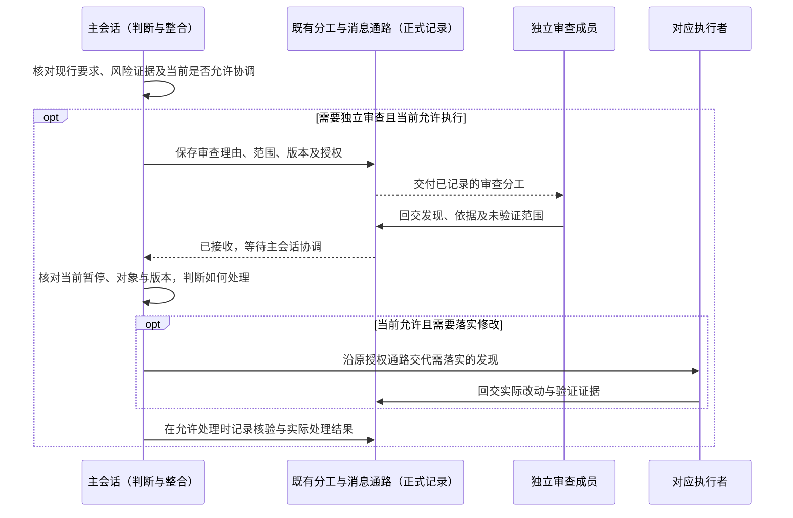

后续验收覆盖：常规步骤未因固定节点而额外派审查；有风险证据时能回查介入理由及确切范围；已有明确独立审查要求仍被执行；同类失败不通过无信息重复审查冒充进展；结果已回交但主会话尚未处理时状态真实；采纳后的修正与复验、说明理由后不采纳分别可回查；对象版本变化及暂停期间的回交不覆盖新事实或启动工作。上述是产品要求，尚无自动审查调度或协作图的运行验收证据。

### 主会话与成员授权

507 于 2026-10-04 确认 D Code 不提供权限模式，不设置只读、自动或完全访问等模式切换。主会话直接承接用户目标并执行，不另设产品层的操作权限或逐项审批门槛。成员必须从所属任务的主会话获得执行授权，不能自行授予或扩大自己的授权；原先讨论的“用户逐次批准或给任务持续授权”不作为本产品的权限方案。

507 随后确认按分工范围授权：主会话派工时明确成员负责的目标、允许的操作与工作范围，授权记录成立后，成员在范围内自行推进，无需每次读文件、写文件或执行检查都向主会话重新申请。授权随具体分工记录，不自动扩展到其他任务、成员或新的工作范围。

成员需要未获授权的操作或范围时，向主会话提出请求，由主会话决定并给出可回查结果；相关操作在获得授权前不执行，不把每次申请转成要求用户点击的审批弹窗。授权请求按需要协调的成员消息处理，区分请求已接收、主会话待处理、已授予和未授予。成员之间的交流不自行授予新范围。

依照已确认的保存分工与显式接续规则，已授予的范围随分工保存；重开并显式接续同一分工时，读取其当前有效记录，不仅因窗口重开要求重复授权。范围已有变更或授权记录无法确认时，由主会话协调核实，不沿用过期记录；授权记录存在不代表执行已经恢复。

主会话不设产品权限门槛，仍须遵守用户目标、明确排除项、暂停与停止指令。用户暂停的成员及其分工不能因主会话授予操作范围而自行恢复，恢复规则仍以 [任务暂停与恢复](任务暂停与恢复.md) 为准。操作系统或外部服务实际拒绝访问时据实反馈，不以产品没有权限模式伪报访问成功。

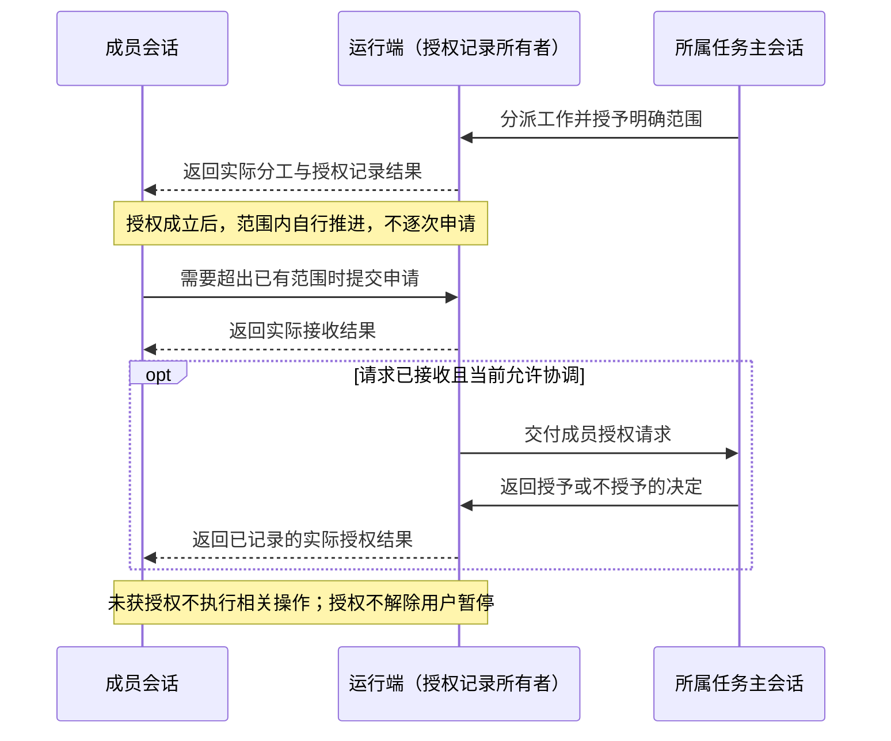

后续验收：主会话执行没有产品权限模式或逐项审批卡；派工授权成立后，成员连续完成范围内多项操作而不逐次申请；超出范围的动作未先行执行，申请能到达所属主会话；待处理、授予与未授予如实呈现；不因授权申请强制用户审批；同一分工重开显式接续后按当前有效范围继续，旧范围未覆盖新变更，也未转授其他成员；授权不能绕过暂停或伪造系统访问能力。当前未实现或验证。

### 成员消息与协调时机

507 于 2026-10-04 确认按消息用途处理成员通知：普通进度更新实际状态，供用户和主会话按需查看，不因每次过程更新触发主会话处理。交付完成、上报求助、目标或修改范围发生冲突等需要协调的消息，才促使主会话尽早介入，在既有目标和授权范围内整合结果或解决问题。

需要协调的通知保留来源、关联工作及可回查内容，区分已接收、待协调和实际处理结果；收到消息不等于已完成协调。主会话正在工作时，在可接收位置纳入协调需求，不无条件终止在途工具；主会话或任务被用户暂停、没有有效工作界面或承载执行的 D Code 已退出时，通知不能解除暂停或触发持续执行。单个访问端离开而其他有效界面仍在时，按当前实际运行状态处理，不误作整体停止。记录和展示仍按实际接收结果处理，不因未即时协调而伪报消息已丢失或问题已解决。

下图说明消息记录与协调处理的区别，不指定进程、存储布局或具体 Pi 接口，当前未实现。

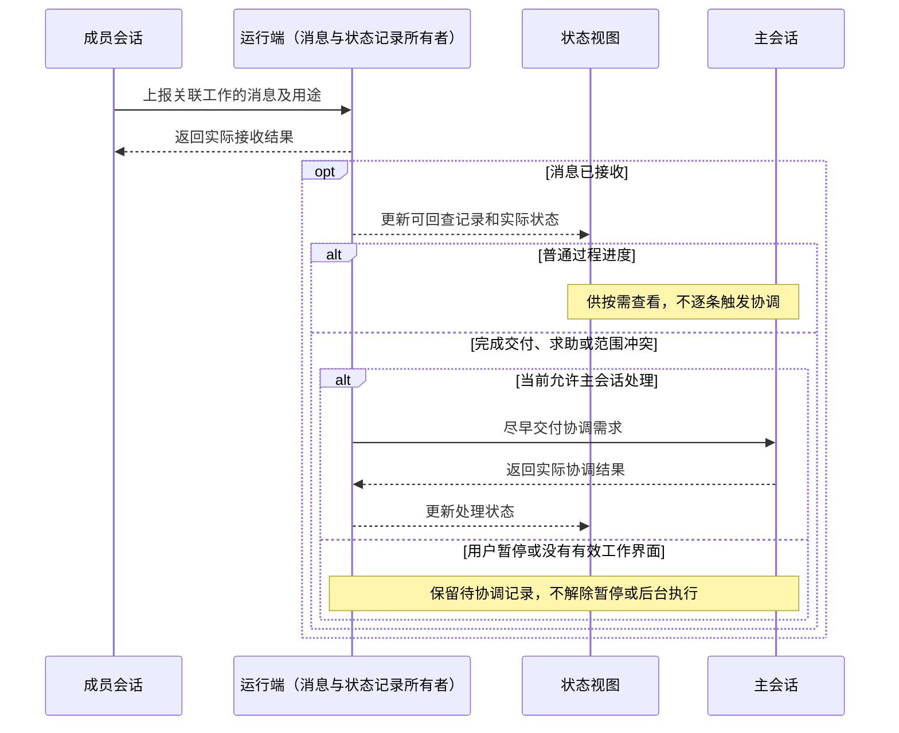

后续验收：连续普通进度更新可查且未逐条引发主会话协调；交付、求助和范围冲突能进入协调处理；通知未接收、已接收待处理及处理失败分别显示真实结果；暂停或最后有效界面离开后没有被消息唤醒，已暂停工作重连须显式接续；仅一个访问端离开不误停仍由其他有效界面维持的协调。当前无真实 Pi 运行验收证据。

### 用户直接与成员沟通

507 已确认成员会话提供直接沟通入口：用户可以进入成员会话查看过程、补充要求或纠正方向，无需把每次交流都交给主会话转述。了解进度或解释信息的提问，由依附该成员会话的侧边对话承接；调整工作才进入引导。点击进入、阅读或编辑未发送草稿仍属于纯导航与草稿操作，不改变执行状态。

通过工作输入发出、影响任务目标、分工或修改范围的内容须同步给主会话，由它继续统一协调。涉及成员执行授权变化时，由主会话处理；接收用户补充不等于相关操作已经获准，未获授权的操作不得先行执行。侧边问答不自动回写成员工作上下文或转交主会话。需同步的执行指令保留来源会话及可回查的原始指令，不能只传递无法核对的模型概括。界面区分尚待同步、实际送达和已经处理，不把发送或送达当成主会话已经理解并完成协调。同步失败时保留原始交流和待同步状态，不能悄悄丢弃或伪报成功。

用户直接沟通不改变成员创建权限：成员仍不得自行扩充团队，需要其他成员或分工协调时向主会话上报。用户输入的忙时行为见下节；成员同步通知按 [成员消息与协调时机](#成员消息与协调时机) 处理，不能由用户输入的默认行为推断所有通知都要立即打断工作。

下图复用 [架构约定](../doc/架构约定.md#请求与结果的职责时序) 的单一写入通路。接收方运行端保存已接收输入，成员与主会话分别承担处理和协调责任；具体实现与 Pi 接入仍待验证。

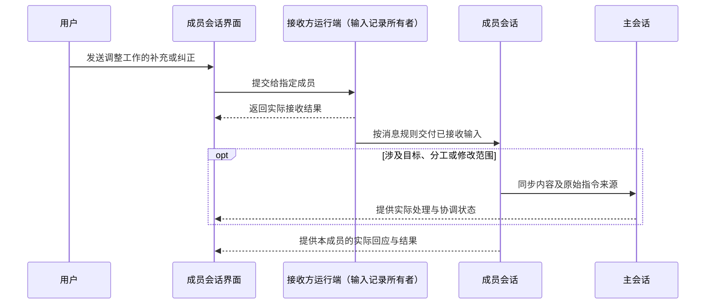

后续验收：用户的工作调整进入指定成员，侧边提问进入该成员关联的临时问答；涉及范围的执行补充可由主会话回查并纳入协调；同步延迟或失败有真实状态且原始内容保留。成员身份、输入归属、主会话处理结果分别核对，不能用两处出现同一段文字代替处理成功的证据。当前均未验证。

### 侧边对话：了解工作而不改变执行

507 已确认侧边对话与引导分开：询问“现在进度怎样”、解释已有结果或讨论当前做法时，建立依附原工作会话的临时问答；要求调整当前工作的目标、顺序或约束时，才向原工作发送引导。该边界同时适用于主会话和成员会话。

侧边对话具有独立的问答上下文，归属沿用关联会话的任务，不产生游离对象，也不作为新的协作成员参与分工。它可以读取提供给它的原会话已确认上下文、工具结果及只读运行状态，问答不自动进入原工作历史、待处理输入队列或执行上下文；主线按原状态继续工作，已暂停的主线也不会因此恢复。

507 于 2026-10-04 确认侧问记录采用“本次使用期间保留”：收起气泡、切换任务或会话后，返回原关联会话仍可阅读已有侧问并继续追问；这些操作不清除临时问答。退出应用后清除，重新打开不恢复这份侧问历史，也不把它作为长期任务历史保存。需要长期保留的内容，由用户明确复制或转成工作输入；复制或填入工作草稿本身不自动发送，只有正式提交后才按工作输入规则处理。该保留范围不改变原工作会话的持久化与显式恢复要求。

507 已确认呈现采用原工作窗口内的轻量悬浮侧问：右侧差异检查器保持可见，用户在悬浮入口发问，问答以就近出现的气泡呈现。侧问不与差异视图互斥切换，不占据新的固定栏位，也不把主时间线挤成另一套聊天布局。界面重点是随手提问和自然出现的回答，不是缩小后仍带完整导航、工具栏和历史列表的聊天工作区。

发问与等待、回答气泡出现、收起返回阅读构成连续轻量交互。回答出现时保留原差异的阅读位置和选择，不抢走用户正在操作区域的焦点；收起侧问不关闭检查器，不停止或恢复原工作。长回答、中英文换行、13／14px 字号、紧凑窗口及减少动态效果须在草图和后续原型中核对，具体锚点、可拖动性、尺寸和动效节奏尚未定案。该悬浮层属于当前应用窗口，不改变已排除系统级多窗口的范围。

查询进度时，以可回查记录和读取时的状态为依据，说明信息截至何时；没有最新信息时明确说明，不根据正在生成的未完成内容猜测任务已经完成。侧边对话只负责回答，不修改文件、重跑测试、改派成员或直接发出执行请求。需要新增调查或改变工作的内容，由用户明确转为工作输入后再处理；不因侧边讨论里出现建议就自行执行或同步成团队决定。

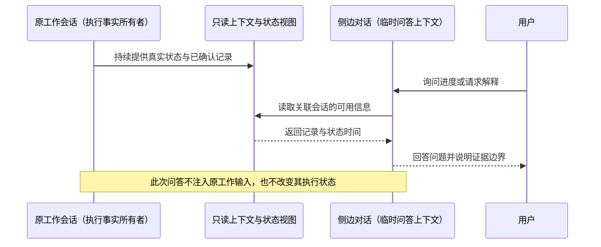

后续验收：查看差异时可在同一画面完成悬浮侧问并看到气泡答复，不强制切换掉差异；回答到达不跳走原阅读位置，收起不触碰原执行；主线运行中可完成进度侧问，问答未注入主线或成员的工作输入；原有任务继续推进，暂停任务仍保持暂停；侧边产生的建议没有触发文件修改或分工变化；状态读取失败或过期时不伪造最新结果；只有明确转为工作输入并发送后才产生引导。收起再唤起、切走再返回时侧问记录及关联保持正确，可以继续追问；退出重开后不恢复侧问历史，原工作记录按既有规则恢复；仅复制或填入工作草稿未触发发送。悬浮层的具体几何与多轮呈现仍待设计验证。当前未实现或验证。

### 输入入口与后续演进

507 已确认当前采用 A：侧边提问与工作输入具有明确区分的入口，用户在发送前知道本次是临时问答还是调整工作。工作输入默认引导当前运行，另有“稍后处理”选择；当前不依靠模型自动判断输入用途。按钮名称、快捷键与面板几何由 UI 设计细化，不另作已定案表述。

未来方向已确认采用 B：从统一输入中，结合内容与必要上下文自动判断用途；发送前呈现分流结果，并允许用户改选。Jev 或类似判断模型是候选技术，不是已选定依赖或首版交付条件。模型辅助分流不会改变侧边只读、工作引导及稍后处理的行为边界；相关工程考虑见 [架构约定](../doc/架构约定.md#后续方向模型辅助输入分流)。

首版验收明确的入口及其行为；未来自动分流在代表性中英文输入、歧义处理、响应时间和成本验证后再进入实现与验收。用户明确选择的用途优先于模型推断，无法可靠判断时保留手动选择路径。当前只落实 A 并记录 B 的方向，不为未来模型提前建立无消费者的实现或依赖。

### 工作输入的接收回执

工作输入的接收结果适用于新任务首发、已有会话输入、引导和“稍后处理”，本地与远端入口保持相同含义。正式运行端拥有已接收记录，界面中的发送过程及临时显示不构成另一份接收事实。下表规定状态语义，具体中英文文案和控件呈现由 UI 设计统一处理：

| 接收情况 | 成立依据 | 用户可见结果与后续处理 |
|---|---|---|
| 已接收 | 目标校验通过，本次发送已经实际保存为正式输入，且结果可核实 | 呈现同一条已接收记录及后续处理状态；不代表模型已经处理完，也不因回执重发再次执行 |
| 确认未接收 | 有实际拒绝或确认未提交的依据 | 保留原文、目标及已建立的任务／会话关联，说明原因；后续重试仍核对当前目标及暂停约束，不重复建立工作对象 |
| 接收结果待核对 | 网络中断、回执缺失或保存异常，尚不能确认是否已经接收 | 保留原文和本次发送关联，明确结果待核对；不能当作已接收清除内容，也不能当作未接收盲目重投 |

核对必须回到该发送操作的正式记录，并覆盖已经处理结束的输入；只查看当前待处理列表、遇到查询失败或没有及时看到记录，都不足以单独证明消息从未收到。已确认接收后发生的处理失败另行呈现，不把“执行失败”改写成“输入未接收”。

待核对结果明确后，更新原发送操作的显示，不新建一条重复消息。确认已接收时找回实际记录；仍无法判断时继续如实显示未知。状态核对不得启动或恢复工作，已暂停工作继续等待显式接续。

507 选择 A：连接恢复后，已经可靠确认原消息未被接收、原发送仍有效、原目标未变且当前允许执行时，自动补送原消息。补送沿用同次发送关联、原目标和原内容，并进入同一正式接收通路；补送中不提前显示为已接收。已接收或结果未知时不补送；目标失效、原操作已被取消／取代、工作已暂停或其他接收条件未满足时，保留原文并说明原因，不绕过原约束或改投其他工作。

每次发送的关联身份随原操作保留；同次重试不能悄悄改变目标或内容。用户明确发起另一条输入属于独立发送，不按文字相同合并。新任务首发还须分别核对工作对象建立与执行输入接收，具体首发路径见 [冷启动与草稿态](冷启动与草稿态.md)。

### 运行中用户消息的引导

507 已确认：向正在运行的主会话或成员会话发送调整工作的输入时，默认引导当前工作，尽早在运行端可接收新输入的位置纳入补充或纠正；另提供明确的“稍后处理”入口，将该工作输入留到当前一轮结束后处理。了解进度和解释信息的临时问答走上述侧边对话，不套用这个默认引导规则。“一轮工作”的含义统一见 [术语表](../GLOSSARY.md#工作对象)。

引导是在当前工作上接续，不默认停止后重开，不把补充当作替换整个目标。Agent 结合已有目标处理新要求；只有用户明确取消或替换目标时，才相应调整目标。首版运行控制仅提供暂停与明确继续，具体范围以 [任务暂停与恢复](任务暂停与恢复.md#已确认行为) 为准。

引导与“稍后处理”经过 [工作输入的接收回执](#工作输入的接收回执) 所定义的同一正式接收通路，两者差别在纳入工作的时机。界面的待处理卡片从实际记录派生，不独立接受或推进另一份执行队列；回执可以通过返回结果或状态事件提供，具体接口由接入设计确定。

界面应能辨认消息已被接收、正在等待纳入当前工作，以及实际处理反馈。没有处理证据时不能声称“已经按要求修改”。已输出内容和已完成动作不会因新引导自动撤销；正在执行的工具也不能被每条普通补充无条件终止。参考机制与供应商能力边界见 [Codex 引导机制参考](../doc/Codex-引导机制参考.md)，不承诺任意模型都能在同一次生成的任意瞬间接受新输入。

运行端须核对目标会话及当前运行。发送恰逢该轮结束、目标变化或暂不能接收时，明确反馈并保留消息及可继续处理的入口，不能悄悄丢弃、改投其他运行或盲目重复提交。暂停、关闭及重开后的显式接续边界继续有效；待处理消息的存在不能自行解除暂停。

已接收但尚未处理的工作输入随运行状态保存；重开或重连时显示真实接收及处理状态。工作已暂停时等待显式接续；仍由其他有效界面维持运行时沿原通路继续处理，不因访问端重连再次提交同一输入。每次发送操作具有可回查的关联身份，重试沿用该关联，核对先前接收结果后避免重复执行；用户有意再次发送相同文字是另一发送操作，不能仅按文字去重。保存失败不宣称已经安全保存，原始指令、接收结果与处理结果须可对应。

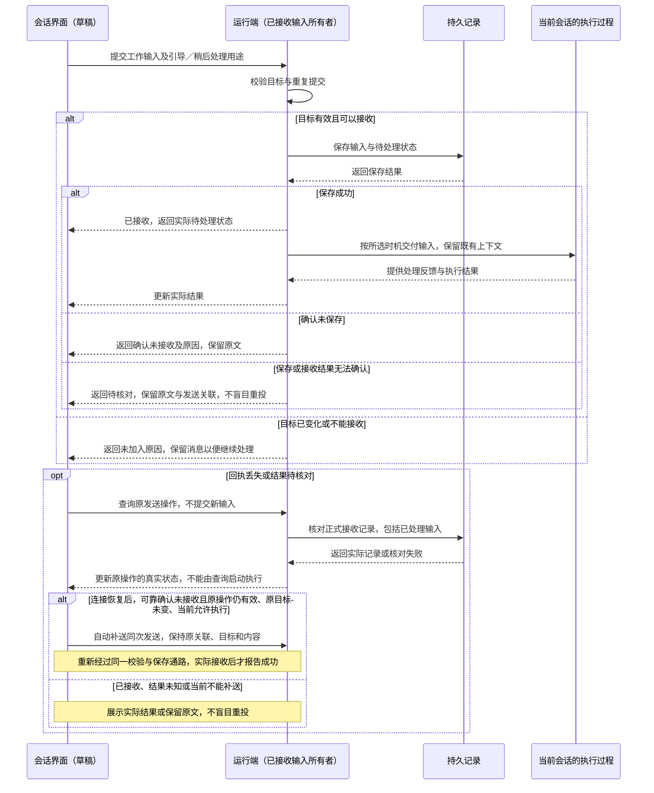

后续验收包括：用户能在一轮工作结束前纠正后续动作；“稍后处理”不混入当前轮，两种工作输入均按实际保存结果回执；侧边状态问答没有被混入引导；引导不会无条件终止在途工具；轮次切换不串错目标；已暂停工作重开保留待处理输入且不自动执行，仍在运行的工作重连只读取当前处理状态而不重复提交；同次发送重试不重复处理，用户另一次主动发送相同文字不被误删；确认未保存、已经保存但回执丢失、保存结果未知及接收后的执行失败分别验证，不伪报成功或未接收；终态输入仍能按原发送关联回查，核对操作不启动执行。连接恢复后，仅可靠确认未接收且原操作仍有效、当前允许执行时自动补送；多端对同次发送的重试不产生重复输入，补送不能绕过暂停或被改投到新目标。以上为完整产品要求；无 UI 的持久接收、查询及恢复切片已有运行证据，独立 UI 受控接线正在修复与审查，不能以局部记录代替上述多端、协作及全部故障路径的验收。

多任务运行边界见 [任务暂停与恢复](任务暂停与恢复.md#不同任务并行推进)，成员分工暂停与主会话授权恢复也以该规格为准。新草稿首次发送建立独立任务的规则见冷启动规格。成员通知的产品处理原则以上述章节为准；消息投递、修改范围的声明与交接等工程合同仍需接入设计，不预设每个成员对应一个进程或 Harness。

## 实施前需完善

UI／UX 会话继续明确创建、选择、移动及失败时如何继续的交互。工程设计负责对象身份、状态写入的唯一所有者、目录解析、移动一致性与 Pi 会话映射，形成可验证方案后再实施。运行生命周期同时遵守 [任务暂停与恢复](任务暂停与恢复.md)，不由导航布局推断。
