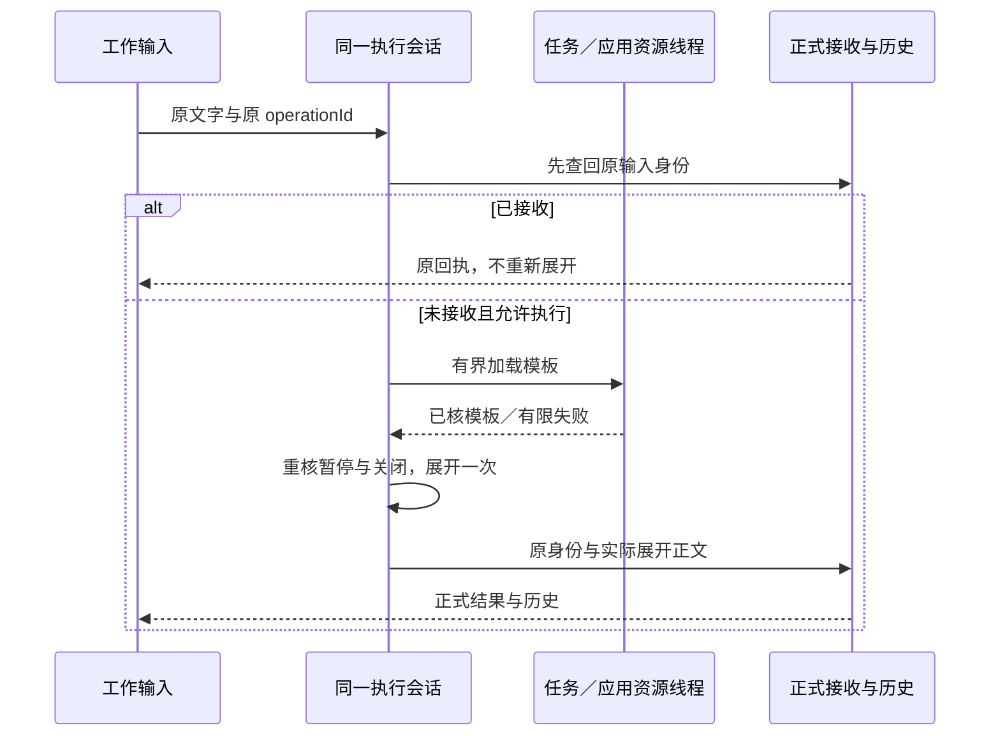
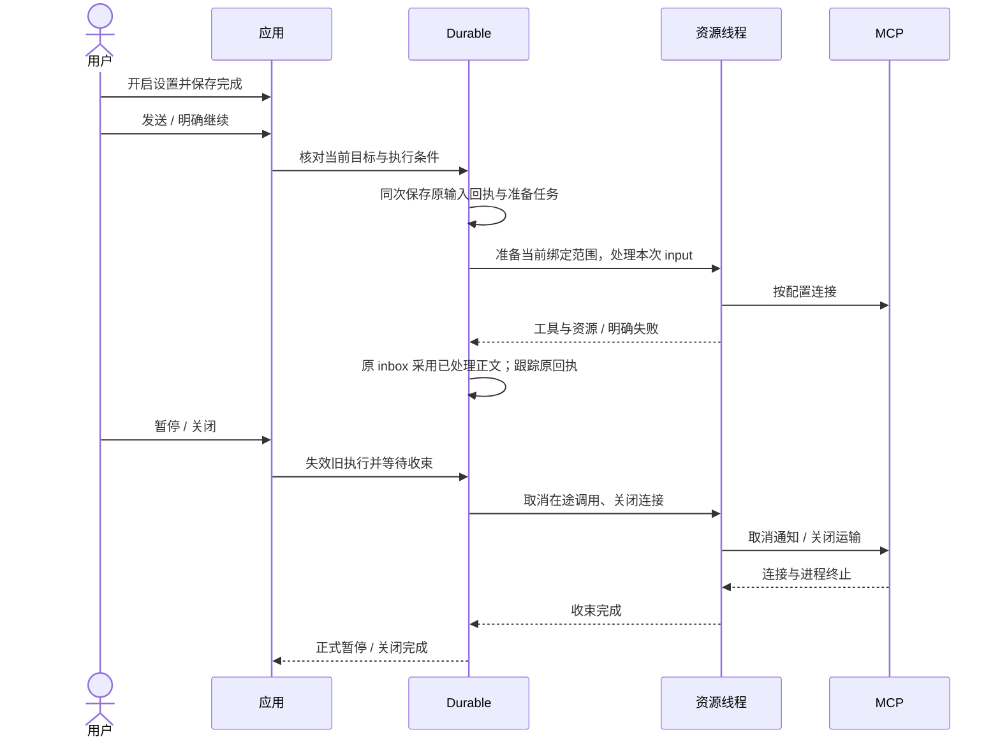
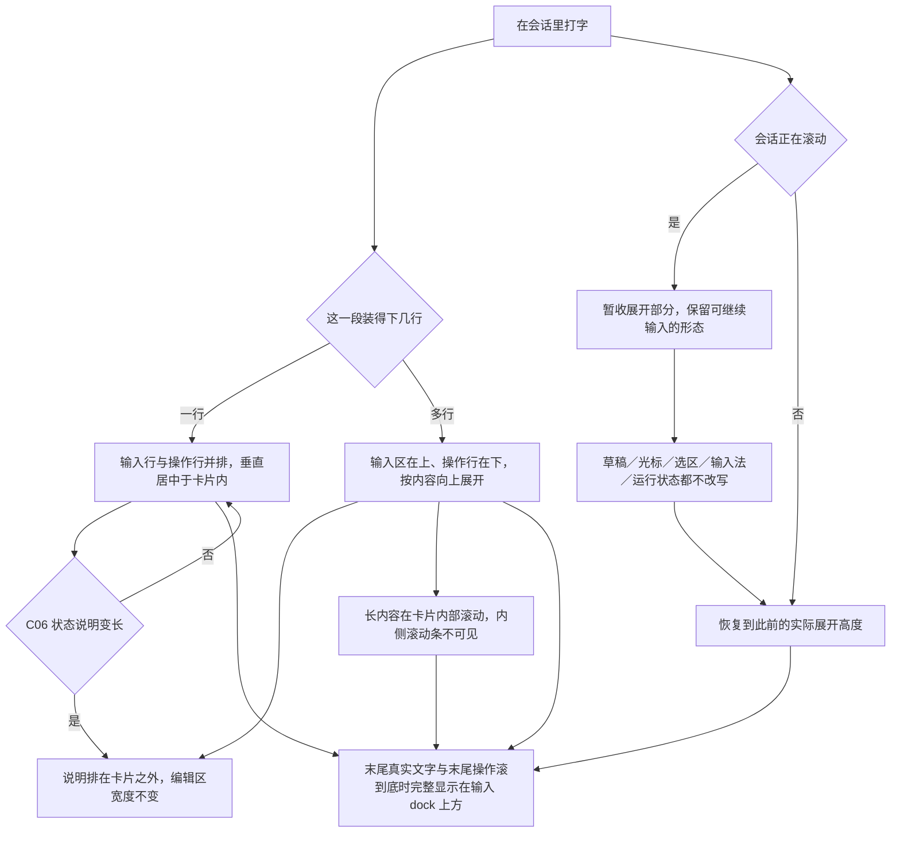
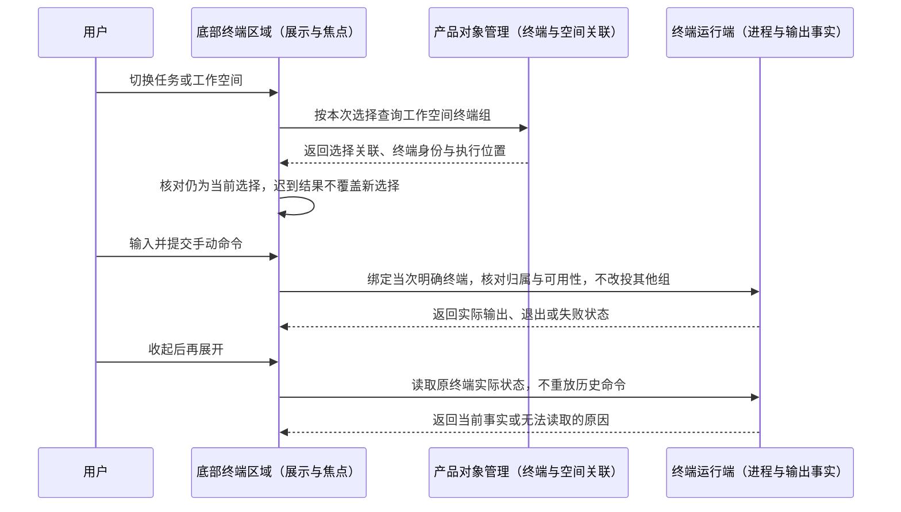
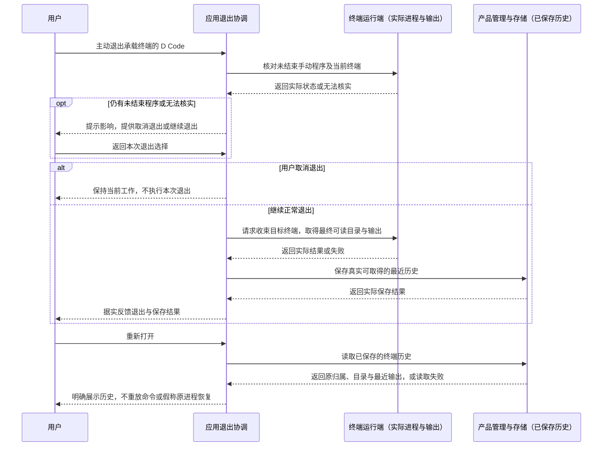
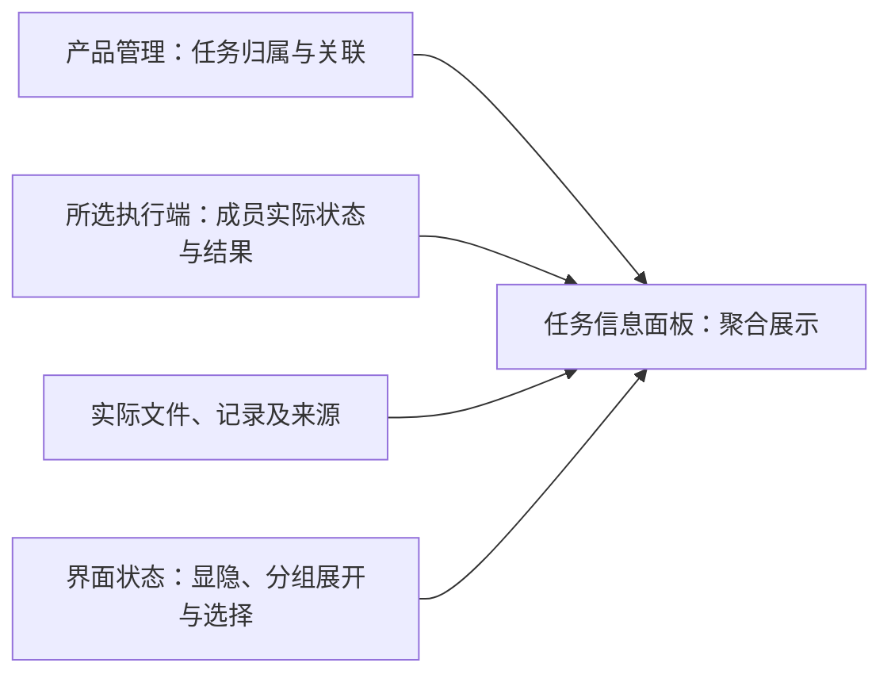
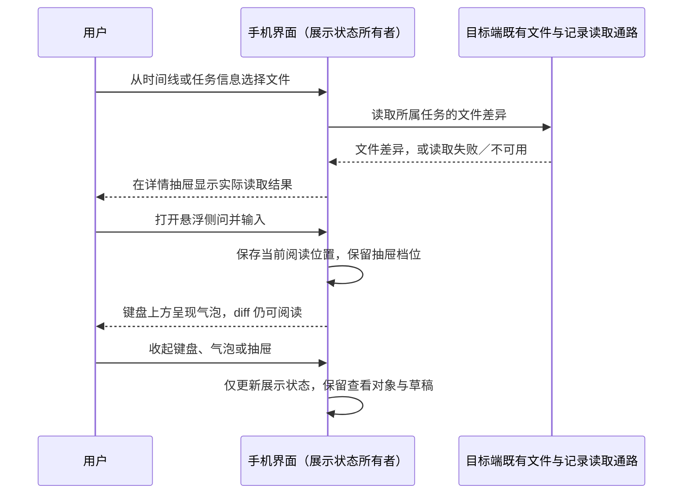
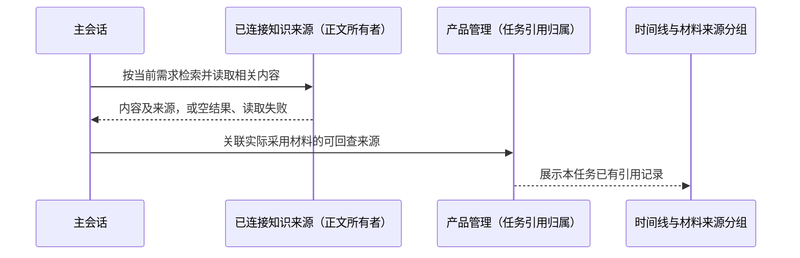

# 开发任务路径

状态：首条完整路径及第二轮布局、交互已确认，部分第二轮场景有独立模拟原型记录；2026-10-04 确认的无权限模式、主会话向成员授权、可隐藏任务信息面板、已有知识主动检索及长期记忆方向尚未实现和验收。2026-10-05，507 查看会话内两种手机布局示意后选择 B「时间线与抽屉」，仅确认结构方向，未完成手机产品实现或真机验收。依据：507 同步的 Kimi 交接及后续修订。本文件作为后续页面设计和相关规格的共同验收场景。

## 首条完整路径

新建任务 → 对话交代需求 → 观察工具执行 → 检查文件改动／diff（差异）→ 追问至验收。

沟通路径是这条路径的子集。工程推进先完成最小闭环，再补充信息密度；不以只有导航或只有聊天的页面宣布开发路径完成。任务和会话的归属遵守 [工作台信息架构](工作台信息架构.md)。

| 环节 | 设计和后续实现必须支持的可见结果 |
|---|---|
| 新建任务 | 用户知道任务属于哪个工作空间，以及将在哪里工作；新任务草稿首次发送可直接完成独立短期任务及主会话的建立 |
| 对话交代需求 | 用户能在任务所属会话内输入需求并开始工作 |
| 观察工具执行 | 用户能理解正在进行的动作、结果，以及是否需要自己处理问题 |
| 检查文件改动 | 用户能找到相关文件及差异，判断是否符合需求 |
| 追问至验收 | 用户能围绕同一任务继续提问和修正，并检查最终结果；模型声称完成不等于用户验收 |

### 真实编码能力与验收

2026-10-09，507 确认以 Pi coding-agent 的完整非界面能力作为接入基准：保留智能体循环、编码工具、项目上下文及资源装配，D Code 提供桌面交互和产品组织。不采用 Pi 的 CLI／TUI 入口与终端交互壳，不等于移除智能体执行命令的能力，也不取消下文已确认的手动终端。具体 SDK 与 Durable 组合按 [架构约定](../doc/架构约定.md#pi-coding-agent-能力复用基准) 验证，不把该方向写成已接入全部能力。

用户选定任务工作目录并交代需求后，智能体应能读取该目录的项目指令和相关文件、修改代码、执行测试或构建，并利用真实工具结果继续工作。一次可处理的工具失败须回到同一次运行的上下文，供智能体诊断、修正或说明阻塞；不能仅把错误画在界面上却不交回执行端，也不保证每次失败都能自动修好。用户能从正式结果看到实际文件变化、测试输出和最终回答；配置或加载失败应给出对应原因，不以文字回答冒充已执行工具。

普通编码运行沿同一正式输入、工具结果与历史继续：项目指令作为上下文加载，不能代替用户授权；工具正文、失败状态和命令的数字出口来自真实执行结果。文件差异以本次工具的实际前后文本为依据，覆盖范围及未读取、二进制、超限或并发归属不明的部分须如实说明，不借 Git HEAD 或模型叙述补造。重开先读取原运行，发送或明确继续才加载执行资源；加载失败保留原记录与输入，不显示已开始或已成功。

文件内容搜索、文件名查找与目录浏览复用 Pi 的 grep／find／ls：主会话在任务工作目录内查找，匹配结果、无匹配、截断与失败进入同一正式工具结果、后续请求及时间线。查询根的真实路径不越出任务目录；这不替代全部工具的操作系统隔离。工具所需本地二进制缺失时如实失败，不自动下载或读取宿主 Pi 缓存。暂停等待当前搜索及其子进程收束；只读重开不发起搜索，明确继续不重放已经完成的搜索。尚无正式文件范围的成员也不安装这些工具。

自动加载的指令与技能以任务工作目录及 D Code 自有应用资源目录为范围，不因祖先路径、宿主默认目录或符号链接扩大读取。可选资源缺席与已声明资源不能读取／解析分别处理；后者须可辨地拒绝执行准备，不静默丢项后报告就绪。资源等待期间被正常暂停取代，尚未进入正式提交的输入应报未接收，保留暂停并允许原实例明确继续；不报已接收或存储故障。该资源范围不替代成员文件授权，也不证明全部工具已被操作系统隔离。

提示模板沿 Pi 1.0.0 的 Markdown 与参数语义使用：应用自有资源的 `prompts/`、任务目录的 `.pi/prompts/` 只加载直接 `.md` 文件；应用模板与项目模板重名时按应用优先，和 Pi 的首次定义顺序一致。主会话输入 `/模板名 参数` 后，在已授权执行准备完成且仍未被暂停／关闭取代时展开模板，展开正文沿同一正式提交进入模型与历史。参数按引号分组，支持位置参数、全部参数、默认值与切片，不执行 shell，也不递归展开参数里的占位符。未知模板名仍按普通文字发送。

模板读取／解析失败、展开为空或超出有界输入容量时，正式提交前报执行准备失败，保留原草稿与输入身份；不把加载失败写成已执行或存储丢失。同一 operationId 的已接收输入从正式记录查回，即使模板后来变化也不重写历史或再次提交。只读重开不扫描模板，用户明确继续可重新准备资源，但不重新展开已接收输入；尚无文件范围的成员不加载主任务的模板。

编码工具和项目资源继续遵守现有主会话／成员授权边界。主会话沿任务目录推进；尚无明确文件范围的成员会话保持普通文字对话，不因接入编码 SDK 就取得整个任务目录的读取、修改或命令能力。后续成员装配消费正式分工与授权范围，不增产品权限模式或主会话操作审批。

工作目录由产品对象管理解析，工具调用、结果与正式历史由选定的 Pi 执行端持有，界面通过现有公开执行契约读取。项目资源的发现、加载与实际参与执行分别核对；未成功加载的指令、技能或扩展不能记为生效。暂停、关闭、重开与继续仍以 [任务暂停与恢复](任务暂停与恢复.md) 为唯一行为正文，不因更换 SDK 入口降低要求。

验收使用有 AGENTS.md、可修改源码和可运行测试的隔离项目，覆盖：读取指令与源文件 → 改动 → 一次可诊断的测试失败 → 工具结果回到模型 → 修正并再次测试 → 从正式读取通路显示回答与实际 diff → 暂停、关闭、重开只读查看 → 用户显式继续。核对文件实际内容、命令退出状态、工具结果、历史归属及界面消费，不以模型自述、元素存在或演示结果代替；原始失败与修正证据均保留。真实 SDK 配受控模型、真实服务商、界面端到端与用户接受分别登记。

### 项目扩展与 MCP

设置中的“项目扩展与 MCP”默认关闭。开启的设置保存成功后，主会话在下一次发送或明确继续时，才从已绑定工作目录的 `.pi/settings.json`、`.pi/extensions` 和 `.pi/mcp.json` 准备资源；查看历史、查回接收结果、只读重开不会加载代码、连接服务器或启动模型。切换工作空间不会改变已有运行的工作目录。没有正式文件范围的成员不获得此能力。

配置沿 Pi 1.0 的现有资源格式，包括项目内已有的本地能力包及其资源过滤。资源准备不忽略显式条目的读取、格式、范围或加载错误后空载执行，也不扫描父目录和宿主 Pi Home，不自动安装缺失的远端包。扩展不是操作系统沙箱，启用意味着运行该项目配置的代码和服务，不新增产品权限模式或主会话操作审批。

启用扩展时，技能与模板的可用集合由同一次公开资源加载结果持有，基础项目指令加载不再另外拼入一份技能目录或绕过资源筛选。项目、应用自有目录、本地包及扩展发现的路径都保留实际来源并限制在已有授权根内；同一技能不重复进入目录，重名选择沿 Pi 的首次定义顺序。声明资源失效或不能解析时给出执行准备失败，不把静默丢弃当作已加载。明确选中的具体 Markdown 技能文件也受此规则约束；负向筛选排除、同名碰撞取舍、目录自动发现的非技能文档与合法空集合不算声明错误。

只读重开和查回不读取新技能、模板或扩展发现路径。下一次发送／明确继续在原资源代次与运行门内核对目录、筛选和内容变化，采用当次有效集合；在途工作不被资源刷新重放。技能目录只提供描述与定位，正文按实际需要经既有读取／引用通路交给模型，不默认注入全部技能正文。本地包模板的实际展开沿同一个输入准备任务进入正式输入与请求。

启用扩展后的发送先沿原身份保存正式接收记录，再由同一 Durable 的准备任务加载资源、处理 `input` 事件和展开提示模板；这样项目代码已产生作用后，暂停、关闭或应答丢失仍有原记录可查。处理器转换的正文只进入原模型输入通路一次；`handled` 保存真实处理完成事实，不伪造助手回复。准备失败或已进入的处理器中断时，保留接收与已完成作用，显示项目资源或输入处理未完成；不启动模型、不自动重放中断处理器。未启用扩展的既有提示模板流程及明确未接收语义保留。

扩展显示消息在时间线标为“项目扩展”，与用户输入、模型回复和工具结果分开；其是否进入模型上下文及实际正文分别核对。模型请求／认证回调不能更换已准入的模型、历史、工具、思考参数或模型凭据。不可用的 SDK 操作须明确拒绝，不能静默忽略后宣称兼容。

扩展的同步模型目录读取沿原会话 ModelRuntime 的完整 chat 目录与认证可用性快照：`getAll` 不以当前选择或认证可用集合代替，`getAvailable` 保持同步数组，`find` 可读取未选中的已登记模型。原客户端刷新后，下一次正式处理使用新目录；查询、刷新和改选本身不发模型探针、不改变历史或恢复执行。扩展只收到模型公开描述，不收到认证材料或执行请求头；明确选中新模型后的实际请求仍消费原宿主模型和认证。typed 模型与主动请求按各自正式消费者另验。

扩展工具内的单次 chat 模型请求沿原 ToolTask 所有权创建原 Harness 的子任务，使用原 TaskRuntime 的 Models、取消信号和完整请求准入。已进入请求先持久记录，返回值只交给原工具，不伪造新的会话助手或输入；正常结果与工具用量同事务记账，并保留可回查的请求事实。模型已经确认完成后，工具再失败、暂停或关闭仍保留其真实费用；尚无最终响应的请求不猜费用。原执行完全停止后，由仍持有该会话认领的宿主按原模型子任务身份一次对账；只读重开不运行工具、不修补历史，意外退出的未对账费用在明确继续前收口。暂停／关闭必须取消并等待在途请求收束；只读重开、同输入查回或明确继续均不盲重发结果未知的内层请求。调用没有真实执行所有者或尚未支持的操作／选项须明确拒绝，不能从资源线程另发请求绕过。

工具内 `streamSimple` 沿同一个 owned 单次任务，并同步返回可异步迭代及 `result()` 的公开流对象。真实 SDK 的 partial 在最终响应前即可交给原扩展消费者，不能等 complete 完成后拆字串冒充流；partial 不生成正式助手、工具成功或确认费用。done／error 终态只在原子任务结果与请求事实提交后交付。只读 `result()` 或提前退出迭代不另发请求、不隐式取消原 owner；真正暂停、关闭或调用信号取消须同时收束原 HTTP、原任务及本地 iterator/result。重开与明确继续对已进入但结果未知的流仍不盲重发。该流的执行范围必须由同一 Harness 的真实任务、会话、owner、模型身份和活跃 signal 明确认领，不能把缺少普通 Generation 绑定的任意调用放行；未接的参数仍明确拒绝。

工具通过原输出接口发布的运行中文本在桌面同一工具块显示“执行中”，在最终响应到达前可展开阅读。它只投影当前会话、当前运行中工具的有界输出，不是已完成结果或费用，不另存一份正式历史；有截断时说明实际丢弃范围。正式工具结果到达后替换临时显示，暂停／关闭或只读重开不把旧增量显示成仍在执行。合法的单次调用信号已取消时仍返回有限错误流；只取消这次模型请求不顺带取消原工具，真正工具暂停／关闭则收束其全部在途调用。

扩展注册的工具、MCP 直接工具、Tool Search（工具搜索）和 Codemode（代码组合调用）沿同一宿主工具通路核对能力和生命周期。间接调用不能绕过检查、另建执行循环或伪造模型消息。真实调用、结果、错误和已完成副作用由现有 Durable 正式记录持有；暂停和关闭必须等待在途调用及连接实际收束。只读重开不重放已完成调用；明确继续才重新装配资源，并沿原输入、任务及工具身份恢复。

编码读取支持实际图片内容，由正式工具结果传入后续模型上下文；文本、图片与错误结果不能互相冒充。自动压缩和重试继续由 Durable 原任务机制持有，接入扩展不能另建重试或摘要循环、绕过本次模型准入或默认增加请求次数。

## 布局 A：单时间线渐进披露

本节的左右分区描述适用于 Mac 桌面端；手机复用同一时间线、任务信息和文件详情内容，具体容器见 [手机布局](#手机布局时间线与抽屉)。手机候选 B 与此处第二轮桌面布局 A 属于不同讨论，不互相取代。

逐页操作入口、状态与失败反馈见 [页面与交互组件](页面与交互组件.md)；本文件维护开发路径和功能范围，不重复列第二份按钮状态表。

| 区域 | 职责与操作 |
|---|---|
| 左侧对象树 | 可拖宽；空间根节点始终可见，任务两级封顶；树行提供新建任务与跨空间移动入口 |
| 主区时间线 | 阅读列居中并设最大阅读宽度；消息、工具块、本轮改动聚合卡片与输入区共处。草稿态在此呈现问候、继续入口及推荐动作 |
| 右侧区域 | 提供可展开、保持显示及隐藏的任务信息面板，分组呈现成果与改动、协作进展、材料与来源；可进入逐文件差异／预览检查器，具体总览与详情组织由 UI 设计验证 |
| 底部内置终端 | Mac 桌面首版提供按需展开、收起的手动命令区域，同一工作空间共用一组终端，支持交互式程序；AI 工具输出仍在时间线，运行边界按下节完善 |
| 设置 | 在主区内呈现，侧栏保留；返回方式与草稿保护遵守冷启动规格 |

工具块默认折叠为单行摘要，可就地展开查看执行输出；摘要和展开内容随实际状态更新。等待状态、成员向主会话申请授权及实际处理结果内联呈现，不设置主会话的用户审批卡或权限模式。工具失败块显示可复制错误；“本轮改动汇总”作为时间线上的聚合卡片，逐文件细节进入检查器。任务成果也可从右侧面板找到，面板不要求一直占据版面。

纯导航不影响执行：折叠树、切换会话、展开或隐藏任务信息面板、折叠分组、开闭检查器和进出设置不能改变运行状态。界面区分运行中、等待、失败、暂停与可恢复状态，按 [产品文案与工程说明](../DESIGN.md#产品文案与工程说明) 呈现实际业务事实。模拟、真实 SDK 配受控模型和真实服务商的区别登记在 README／doc 及隔离验证证据中，不作为产品界面的工程身份徽标；SDK 接入仍不能证明真实服务商验收成立，正常产品入口也不能以模拟输出冒充执行。

### 桌面滚动边界

长对话在主时间线内部滚动，侧栏、会话标题及底部输入区保持在窗口内容区；长侧栏树与右侧检查器各自独立滚动。消息新增、展开长工具输出、切换设置或字号／窗口变化均不能把整页变成贯穿各栏的纵向滚动容器，也不能靠裁剪使内容或输入操作不可达。该要求明确已确认的工作台布局，不新增运行行为。

验收须复现 507 于 2026-10-05 报告的动作：打开长会话、展开工具输出、在时间线上向下滚动，确认外层页面不被带动、侧栏顶底和输入区保持在窗口内，只有目标内容区滚动；再分别滚动长侧栏和检查器，核对互不连带。覆盖中文／英文、13／14px 与紧凑窗口；自动端到端断言和真实渲染前后证据分别记录，示例对话里写的测试通过数字不作为验收证据。

### 桌面会话输入区

工作输入区的控件与状态以 [页面与交互组件](页面与交互组件.md#工作输入区) 为唯一详细定义：507 于 2026-10-07 确认发送后以同一主按钮呈现暂停；运行中有新文字时切为发送，无新草稿时回到暂停。2026-10-10 进一步取消输入选项菜单里的暂停与主按钮旁的第二个暂停入口：运行中随时可以清空草稿后暂停，暂停入口因此只有一个位置。底层接收、暂停及显式继续语义保持。

507 于 2026-10-06 对照 D Code 与 ZCode 截图确认：已有会话的 Composer 在主内容区底部呈现为留边的悬浮输入卡片，外围与时间线背景连续，取消横贯主区的底栏分隔。卡片对齐主区阅读列并服从现行宽度、字号与共享样式；检查器开闭后随主区重新定位，不覆盖侧栏或检查器。这里不增加拖动输入框或系统窗口；草稿首屏仍按 [冷启动与草稿态](冷启动与草稿态.md) 呈现。

- 向上回看或向下阅读对话时，输入卡片保持可用；消息可以经过卡片后方，整条消息内容均可通过滚动查看；滚到末尾时，最后一条消息的末尾内容及末尾操作必须能完整显示在卡片上方，不被遮挡。实际输入高度、状态提示、字号或窗口变化后仍成立，不用固定空白或裁剪掩盖遮挡。
- 卡片外的留白不形成独立实色底栏，也不能吞掉时间线的点击、文字选择与滚动。输入卡片及其菜单可以正常点击和键盘操作，焦点遵守共享规则。
- 布局变化不卸载或清空当前草稿，不改变发送、接收回执、引导、暂停／继续与执行状态；外壳和各栏继续遵守 [桌面滚动边界](#桌面滚动边界)。
- 507 于 2026-10-10 补充输入区的几何与收起：单行垂直居中，换行与折行按内容向上展开；会话滚动时暂收展开部分、停止滚动后按暂收前的实际高度恢复。暂收只是几何变化，草稿、光标位置与运行状态在暂收前后不丢失、不改写。内侧滚动条默认不可见，长内容在卡片内部滚动，鼠标或键盘聚焦时允许浅灰外缘提示，内层不出现矩形焦点框；几何取值见 [DESIGN](../DESIGN.md#会话输入几何与暂收)。
- 「＋」引用入口与来源／模型入口属于同一输入区：引用只加成草稿里可移除的引用，不自动发送或执行；模型选择只作用于后续请求，不中断当前运行（见 [页面与交互组件](页面与交互组件.md#工作输入区) 的 C05 与 C07）。

验收使用同一份真实长度的对话作修改前后对照：展开长工具输出并滚动；滚动查看完整消息，并把末尾内容与末尾操作滚到输入卡片上方；输入多行中英文、打开输入菜单；开闭检查器。覆盖浅／深色、13／14px 及紧凑窗口，16px 同既有几何验证一起回归。分别记录实际截图、滚动与遮挡断言、草稿及发送结果；仅移除分隔线或增加圆角不算完成。本节是已确认的修改要求，实现和验收结果另行记录。

#### 桌面会话输入区的用户可见几何

下图只描述用户动作与可见结果，几何取值规则见 [DESIGN](../DESIGN.md#会话输入几何与暂收)，内部所有者与事件顺序见 [架构约定](../doc/架构约定.md#会话输入区的几何与暂收所有者与事件顺序)。

### 桌面颜色、焦点与紧凑布局验收

按 [DESIGN](../DESIGN.md#具体样式表) 的工程目标验证实际共享组件。普通文字与焦点须测实际使用的背景及选中／悬停组合；先识别每个可操作目标，再核焦点反馈与键盘触发，不能用容器整体亮起代替子控件可辨。

在720×480窗口打开检查器，覆盖13px、14px及设置允许的最大字号：主区能阅读消息、编辑并发送需求，检查器能查看并滚动长差异，关闭后主区恢复空间，草稿与对象保持。记录三栏实际几何及文字／控件可用性；仅断言侧栏和检查器存在不能通过。保持既定三栏与用户显隐规则，布局不触碰执行状态。还须核对用户拖宽、保存后重开及缩窗再放大的宽度归属，默认分配不得覆盖已有用户尺寸记录。

键盘验证覆盖树行与行内按钮、菜单触发器与菜单项、对话框、输入及发送按钮：Tab进入正确目标，Enter／Space只触发该目标；未选择结果且触发点有效时，关闭菜单／对话框后焦点回到触发点；选择结果后焦点进入相应目标，不强制恢复过期入口。保存带焦点的实际渲染证据，普通静态截图不能证明焦点可见。

## Mac 内置终端

507 于 2026-10-05 选择 B：Mac 桌面首版加入底部内置终端，按需展开或收起，用户可以手动输入命令、使用交互式程序。它与时间线上阅读 AI 工具输出承担不同用途；单时间线、侧栏和右侧任务信息／差异检查器的职责保持。此项为已确认产品方向，尚未实现或验收，不要求在当前 Pi 接线修复中同时实现。

- 用户输入进入实际终端执行通路，不自动变成主会话的工作输入，也不因终端输出包含文字而伪装成智能体回复或任务验收结果。AI 发起的工具调用、授权和执行事实继续由既有运行通路负责。
- 收起终端区域是展示操作；在工作界面仍有效的条件下，再展开应能查看同一终端的实际状态与输出，不通过组件反复挂载来重启命令。显示恢复不等于进程恢复，不能靠重新发送历史命令伪造接续。
- 507 随后确认 B：同一工作空间共用一组终端。在该空间的不同任务之间切换时继续使用原终端，不为每个任务自动新建一组，也不因为任务切换而停止命令。切到其他工作空间时切换可见终端组，按真实空间身份与执行位置区分；两个空间引用同一文件夹不自动合并终端。
- 终端的实际执行位置及当前工作目录可辨，不能由中央正在查看的任务标题推断命令已经切换目录或电脑。已有终端保留其实际目录，不随任务选择隐式发送切换目录命令；新建终端时，有当前正式任务则按其既有工作目录规则解析，无正式任务的新草稿则使用当前工作空间默认目录，并显示实际结果。打开终端不额外创建任务，也不借用上一任务的目录。
- 终端组的异步读取与当次空间／终端选择关联；迟到结果不得覆盖新的可见选择。发起输入时绑定用户当次明确选中的终端身份，并核对其归属与可用性；目标不明或读取失败时不能改投其他组。随后切换展示不改变已经发出输入的目标，不把同一输入重发到新选择。
- 创建失败、进程退出、输出读取失败及状态未知分别反馈；已显示的旧输出不能代表进程仍在运行。输入焦点、中文输入法、复制粘贴、长输出及交互式程序按真实终端行为验证，不以一段静态日志代替。
- 底部区域有自己的滚动边界；展开、收起及调整可用空间后，主时间线、侧栏、检查器和输入区仍须处于窗口内，保留各自内容和操作位置。共享字号与几何规则保持，具体最小尺寸由 UI 验证。

产品对象管理保存终端与工作空间的关联，并沿既有存储接口保存供重开读取的终端历史；历史内容来自终端运行端的实际目录与输出。终端运行端拥有当前进程、执行位置及输出事实，界面只保存展示与输入焦点状态，不自行维护另一份正式历史；访问终端能力仍通过受约束的正式平台接口，界面不直接持有任意宿主能力。下面只表达已确认职责，不预设终端库、进程数或恢复实现：

后续验收覆盖：输入命令并看到真实输出、使用需要后续输入的交互式程序、收起后再展开不重启命令；同空间切任务复用原终端且目录不被隐式更改，跨空间切换显示对应组，同文件夹的不同空间不合并；新草稿无正式任务时使用当前空间默认目录且不新建任务；快速跨空间切换时旧读取不覆盖新选择，输入始终归属当次明确终端且不重投；进程退出与读取失败的真实反馈、长输出独立滚动、与主输入区切换焦点，以及中英／13px／14px／紧凑窗口。工作空间归属及下述主动退出／重开体验已确认；子进程收束、历史保存及最后有效界面离开时的生命周期仍须完成接入设计与验证，不把 Pi Durable 的恢复证据推广成终端进程可恢复；本次不承诺手机终端操作或无界面后台运行。

### 终端退出与重开

507 对 G1 两项分别选择 A 与 B：主动退出承载终端的 D Code 时，若仍有用户手动启动的程序未结束，先提示影响并提供“取消退出／继续退出”；重新打开后保留终端入口、目录和最近输出，输出明确标为历史。已确认的收起面板与切换导航不结束终端，保持不变。此项为目标行为，尚无产品实现或运行验收。

- 退出提示说明哪些终端仍有未结束程序及其归属。用户取消时仅撤销本次退出意图，不因弹出提示提前关闭终端、暂停原工作或回滚提示期间发生的其他有效操作。可靠确认没有未结束手动程序时按正常退出流程处理；无法核实时如实说明状态未知，仍提供取消／继续退出，不把未知当作全部结束而跳过提示。
- 用户选择继续退出后，沿正常退出通路收束终端并保存最近输出及目录，模型工作仍遵守[既有退出规则](任务暂停与恢复.md#已确认行为)。确认退出不等于程序已终止或历史已保存，停止与保存分别按实际结果反馈；失败或未知不能写成“已安全保存并结束”，强制终止与崩溃不承诺具备正常退出的保存结果。
- 重开只展示实际读回的终端入口、归属、目录和最近已保存输出，历史记录与新终端的实时内容、输入位置可辨；历史输出不表示原程序仍在运行，也不能作为新的进程输出事件重放。创建新终端不自动重发上次手动命令，不尝试伪造原进程接续。
- 历史目录失效或输出读取失败时说明原因，不借用其他终端的记录或伪报恢复成功。新终端实际采用的目录必须明确。最近输出有界保存，容量与清理由实现和使用验证确定；它作为用户工作历史管理，与生产诊断日志分开，不借日志通路保存或上传整段终端内容。

新增验收：程序运行中主动退出并取消，程序未因本次退出操作中断；确认退出后分别核实际收束与保存结果；没有未结束程序及状态无法核实的反馈真实；正常重开可回查已保存输出且与新终端区分，上次手动命令没有重新执行；保存失败、目录失效、输出损坏及异常退出保留证据边界。上述与现有面板收起、任务／空间切换场景一起验证，不能用静态历史内容证明原进程仍在运行。

## 任务信息面板

507 已确认任务信息面板作为当前任务的信息总览；Mac 桌面端在右侧呈现，可以保持展开，也能随时隐藏，手机按 [抽屉布局](#手机布局时间线与抽屉) 呈现。功能入口持续可达，不依赖先打开某一条文件消息。面板包含下列可折叠分组，不新增工作空间 → 任务 → 会话之外的顶层导航对象。

| 分组 | 内容与行为 |
|---|---|
| 成果与改动 | 明确交付结果、实际文件或记录入口及改动概览；可查看文件／差异并回到来源消息，普通工具日志不自动成为成果 |
| 成员进展与关联任务 | 当前任务的成员及其实际进展，以及相关任务的入口与真实状态；保持各自归属，不因列入面板就转移任务或增加授权 |
| 材料与来源 | 与本任务相关的文件、链接和参考材料，保留可回查来源；登记或引用不等于已经读取，更不等于其中内容已成为执行指令 |

时间线、本轮改动卡片和面板读取同一结果、关联与状态来源，不各自形成可独立修改的内容副本或运行状态。文件、记录或来源失效时如实标示；没有读取到最新状态时，不伪报完成或将未知显示为成功。信息来源与界面状态的职责如下，当前未实现或验证。

隐藏面板或折叠分组不删除成果、成员、关联任务或来源，不改变任务执行、草稿或当前会话；再次展开仍可查看当前任务的信息。切换任务后核对对应归属，不把上一任务的信息误呈现为当前任务产出。面板显隐、分组展开与几何按 [冷启动与草稿态](冷启动与草稿态.md) 的界面恢复规则处理，不据此恢复执行。通过面板查看成员、关联任务、文件与来源属于导航，不因点击入口自动执行工作。

桌面面板与差异检查器的具体切换或组合方式、默认显隐、分组顺序和窄窗口布局由 UI 设计验证；手机容器方向已在下节确认，具体几何仍待验证。侧问继续采用悬浮气泡，不能因为任务信息面板改回与差异互斥的聊天页。关联任务和成员的呈现沿用 D Code 自身对象与协作范围，不照搬外部客户端的全部栏目或任务类型。

新增验收：从任务入口直接打开面板，找到成果与改动、成员及关联任务、材料与来源；各组可独立折叠，展开期间仍可继续对话；隐藏后阅读空间恢复，原信息、草稿和运行状态未被清除或改变；再次展开和切换任务时归属正确；成员状态来自实际记录，失效入口有真实反馈，导航未触发执行。与差异查看、悬浮侧问及中英文紧凑窗口共同验证。当前未实现或验收。

## 手机布局：时间线与抽屉

507 于 2026-10-05 在会话内比较两种可操作结构示意后选择 B：单时间线作为手机主屏，任务树、任务信息面板及文件差异／预览使用底部抽屉。当前选中会话与输入草稿保留，抽屉显隐不新建会话或复制执行历史。结构方向已确认；会话内示意只使用演示内容，未接 Pi、未实现远端，不能作为手机产品或真机验收。

| 用户动作 | 可见结果与保留内容 |
|---|---|
| 打开工作空间和任务树 | 抽屉半展开，显示有权限访问的工作空间及来源电脑；任务行进入主会话，成员行进入对应成员会话，选中后收回抽屉回到该会话时间线。沿用既有层级与手风琴规则，不新增设备树层级 |
| 打开任务信息 | 抽屉半展开，呈现成果与改动、成员进展与关联任务、材料与来源三组；可展开到接近全屏阅读，入口不依赖先找到某条历史消息 |
| 查看文件差异 | 从时间线聚合卡片或任务信息进入，抽屉直接展开到适合阅读详情的高度；来源电脑、任务归属与当前文件可辨。长行允许横向滚动或显示折行，保留完整原文及差异行对应，不截掉或改写代码 |
| 收起或再次展开抽屉 | 支持收起为把手、半展开、接近全屏三档；同一任务、会话和文件仍有效时，保留查看对象与阅读位置。收起不清除草稿、侧问记录或执行状态 |
| 在主会话补充工作输入 | 抽屉收至把手档，让当前会话的输入区位于键盘上缘；草稿与先前查看对象保留。正式发送沿用工作输入接收通路及回执规则，不因输入区获得焦点而执行 |
| 查看 diff 时侧问 | 问答气泡浮在当前内容之上。侧问唤起键盘不收起 diff 抽屉、不切到另一聊天页、不跳走阅读位置或取消原文本选择；气泡在键盘上方保持可操作，保留可阅读的差异区域 |
| 收键盘、气泡或返回 | 按当前界面状态逐层处理：先收键盘，再收侧问气泡，再收抽屉；保持浏览器返回可预期。抽屉同时提供明确的展开、收起控件，不要求只能靠拖拽发现或操作 |

“时间线常驻”描述主屏结构和上下文保留，不保证抽屉接近全屏时仍能同时读清两份长内容。具体展开高度、手势判定和窄屏避让由原型收口，不把示意里的尺寸直接写成正式设计值。侧问长回答可以在气泡内继续阅读，不强迫转成工作输入；临时问答的保留范围与工作输入的区别仍以 [侧边对话规格](工作台信息架构.md#侧边对话了解工作而不改变执行) 为准。

手机界面只拥有选中对象、抽屉档位、阅读位置、草稿和气泡等展示状态；任务、输入接收与执行事实沿用原有唯一所有者，手机通过既有公开契约读取或发出明确工作操作，不另建远端历史或调度。纯查看、展开、收起和返回均不启动、暂停或恢复执行。下面表达文件查看及侧问输入时的界面顺序，未代表真实接口已接通：

读取失败、文件失效或连接状态未知时保留真实提示与可用的返回路径；已展示的旧信息须可辨识为旧状态，不伪造最新文件或成功回执。连接状态与执行状态分别呈现，重连、关闭界面及显式恢复继续遵守 [任务暂停与恢复](任务暂停与恢复.md)。

后续原型验收围绕同一任务走完：任务树进入会话 → 查看工具执行 → 从两处入口查看 diff → 在 diff 上侧问并唤起、收起键盘 → 返回主线补充工作输入 → 收起并再次打开原详情。同时覆盖抽屉三档、长中英文、13／14px、浅／深色、窄屏、滚动与文本选择、控件可达性、未知与失败反馈，并确认导航未改变执行。浏览器模拟、真实手机键盘与返回手势、真实远端和 Pi 接入分别记录证据；目前只有结构示意的部分点击与渲染检查，以上产品验收尚未完成。

## 已有知识的主动检索

507 于 2026-10-04 选择 B：主会话理解当前需求后，可以主动从已连接、可用的知识来源中检索相关材料，补充当前工作空间与任务已有的规则和材料；无需用户每次点名某条资料。此项定义默认信息获取方式，不新增产品权限模式或逐次搜索审批。

- 根据当前需求查找并使用相关部分，不把整个知识库默认注入每条会话，也不因检索而扩大任务目标或成员授权。
- 实际采用的材料保留可回查来源，通过既有任务信息面板的“材料与来源”分组和对应交流记录查看。检索命中、实际读取、被采用与成为已确认要求须可区分；引用材料本身不授予其中内容执行指令的地位。
- 当前明确指令及现行规格优先于旧灵感或历史材料。存在冲突时说明适用范围与差异，不能用检索结果悄悄覆盖已有确认；无法核实来源、时效或内容时如实说明。
- 未找到相关材料与读取失败分别反馈，不把失败说成“没有资料”或伪造已读。是否仍可推进按当前任务已有信息判断，缺少完成任务所必需的材料时明确缺口。
- 检索属于主会话推进工作的一部分，遵守 [任务暂停与恢复](任务暂停与恢复.md)；不得以自动检索绕过暂停，或在没有有效工作界面后持续执行。打开材料入口仍是导航，不自动触发新的任务执行。
- 主动检索不自动写回外部知识库。新对话提炼为长期记忆的方向见 [长期记忆](#长期记忆)，不将读取和记忆写入混为一次动作；本次未改变首个实现切片的范围。

来源正文继续由各知识来源维护，产品管理负责本任务的引用归属，时间线与面板只读取对应记录，不另建一份可独立修改的知识正文。以下是目标职责与信息顺序，尚未实现或验证：

验收覆盖：用户未点名已有材料时，主会话可按需求主动检索并引用相关内容，只使用相关部分而不整库注入；采用内容能够回查来源；旧材料与当前指令或现行规格冲突时不覆盖确认；空结果、失效来源与读取失败有真实反馈；检索与查看均不绕过既有暂停、关闭及导航边界。当前仅确认需求，尚无真实知识来源接入或行为验收。

## 长期记忆

507 于 2026-10-04 选择 B：主会话主动提炼值得复用的偏好、已确认事实和经过验证的工作经验，形成可查看、纠正、删除并能回查来源的长期记忆。临时要求不自动升级为长期偏好，记忆不得悄悄覆盖当前明确指令或现行规格；保存会话历史与提炼记忆是不同的行为。

507 补充指定落盘方向：在 D Code 根目录下使用 `memory/` 文件夹，以 Markdown（`.md`）文档持续积累记忆。按内容需要新增或修订，保留所依据的原始记录；不把每次模型回复机械复制成新记忆。这里记录产品目标中的相对目录，安装后的实际根目录位置及冲突修订方式仍待细化，不据此在当前源码目录启动自动记忆写入。

507 于 2026-10-06 确认默认共享范围采用 B：个人偏好跨工作空间复用，具体工作事实与经验默认归所属工作空间。

- 个人偏好记录适用于不同工作的稳定习惯，例如回答组织与表达偏好；某个任务的一次性要求或某个空间的做法不能自动扩大为全局偏好。无法明确判断适用于所有空间时，先保留原空间及来源限定。
- 工作事实与经验按工作空间身份归属，同一空间内的相关任务可以按需取用；共享目录路径不合并空间记忆，也不把空间 A 的事实仅因内容相近就当成空间 B 的前提。任务特有内容保留来源和适用条件，不自动写成全空间通用规则。
- 每条记忆显示其全局／所属工作空间范围及来源，用户可以查看、纠正、删除，范围纠正沿同一正式写入通路生效。后续读取按最新范围选择适用内容，不整库注入；不因此改写已经发生的会话历史。
- 此处的全局指跨工作空间的个人偏好范围，不据此增加账号体系或假定跨设备同步已经具备；实际保存、传递与读取通路由接入设计核对，仍遵守对象归属及既有成员授权。

记忆通过现有产品管理与存储边界保存，写入通路拥有正式修改，文件内容是记忆正文的保存依据；读取视图不得成为第二份可独立修改的正文。下面仅表达目标职责，不代表接口或实现已经建立：

自动提炼与保存遵守既有暂停、关闭和实际保存回执规则，不因为具备记忆功能就增加无界面后台执行。验收须覆盖来源回查、重复内容维护、用户纠正与删除、保存失败及重开后按实际文件读取；还须覆盖个人偏好跨空间可用、工作事实默认不跨空间、同空间相关任务按条件复用，以及范围纠正后后续读取随之变化。临时任务要求不得被提炼成全局偏好，记忆不能覆盖当前明确指令或现行规格。冲突修订与实际保存通路仍需工程设计及验证。当前仅确认方向与默认范围，未创建运行期记忆、未实现或验收，也未自动纳入首个实现切片。

## 只读协作图

507 于 2026-10-04 选择首版提供只读协作图，并在查看会话内交互示意后认可列表／协作图可切换的方式。两种视图属于同一任务协作信息的不同呈现：列表便于逐项查看，图便于理解分工、负责人、实际状态与明确的协作关系；切换保留当前任务及正在查看的分工，不要求重新寻找目标。该交互方向已确认，不作为流程编辑器或新的执行入口；正式产品的尺寸、主题、双语与真实数据接入仍需验证。

节点呈现成员的一项分工或工作步骤，并标明对应成员；不把“一个 Agent 配置”“一次分工”“一条会话”强制当作同一对象。连线必须有已记录的关系依据，并说明所表达的是依赖还是其他协作关系；不能仅凭消息先后或模型猜测画出依赖。没有可用关系时，仍如实显示节点和状态。

用户可选择节点查看对应分工、当前状态、授权范围和可回查记录，并定位到已有会话或详情。图与成员列表读取相同事实，显隐、视图切换和节点选择只改变展示；图内不通过拖线、移动节点或选择来派工、授权、暂停或恢复。实际状态与未知、失败、等待须清楚区分，节点完成不自动代表用户已验收。

例如，验证分工明确需要界面交付与运行接入两份结果，前者已到、后者未到时，图应帮助用户看懂验证成员仍在等待哪项结果。这只是验收用示例，不能从示例反推实际项目已经存在这些成员或执行状态。图的来源与界面状态沿用 [任务信息面板](#任务信息面板) 的职责图，不另建一套可推进工作的状态。

本功能借鉴 Raven 的关系与状态展示，D Code 的分工和执行仍由既定产品运行层与 Pi 入口负责，不因画图而要求全部工作改用固定有向无环图调度，也不替换底座。固定版本证据及适配区别见 [架构约定](../doc/架构约定.md#补充参考的评审边界)。

独立审查采用 507 于 2026-10-05 确认的[按风险安排](工作台信息架构.md#按风险安排独立审查)：主会话记录介入理由并沿既有成员通路派工，图与列表可回查实际对象、依据和处理结果。展示审查节点不自动派工；审查回交不等于相关修改已经落实，具体行为与验收由该规格维护。

验收覆盖：独立成员并行、分工明确等待另一项结果、失败或状态不可用；图与列表同源，双向切换后保持任务与当前选中分工，状态与记录一致；点击节点能回查真实依据；未知关系不伪造连线，查看与切换不改变执行。会话内示意的阅读方式已获 507 认可，仍没有真实 Pi 或产品运行验收。

## 六场景验收路径

1. 首次缺模型配置：Home 新任务草稿 → 内联提示 → 设置 → 配置保存并返回，草稿保留；未发送不建立正式任务。
2. 有历史：冷启动恢复上次会话；新草稿展示真实近期任务；点击近期任务只导航，推荐动作只填草稿。
3. 开始工作：从新任务草稿输入并发送需求 → 建立短期任务及主会话、确认首条输入接收 → 消息和工具摘要 → 就地展开执行输出；有成员授权请求时，内联展示主会话处理的真实状态，不要求用户逐项批准。
4. 检查改动与成果：从本轮文件聚合卡片或任务信息面板进入实际结果 → 查看逐文件差异／预览 → 继续追问；面板可保持展开，也可隐藏后再次打开，并能查看同任务的协作进展与材料来源。
5. 失败与恢复：失败块错误可复制；暂停后保存；已暂停工作重开后等待显式接续。仍有其他有效界面时，关闭并重开访问端只读取正在运行的状态，不重复开始或恢复。关闭最后一个有效界面、退出运行端及强制终止分别验证，完整边界见任务暂停规格。
6. 对象移动或失效：定位对象当前归属；不存在时回 Home 新任务草稿，并以内联说明交代结果。

内容使用一份有长度和层级的开发任务，包含多轮交流、多文件差异、一次失败和一次由主会话处理的成员授权请求。授权规则以 [工作台信息架构](工作台信息架构.md#主会话与成员授权) 为准；第二轮原型中的用户权限确认保留为当时验证记录，不作为当前实现要求，也不因本次规则修订改写旧测试结果。视觉验证采用 中文／英文 × 13px／14px × 浅色／深色 × 紧凑／常规／宽窗口 × 六场景，逐项记录已验证与未验证；重点检查两种语言的字形密度、词长、换行、层级、焦点、截断和遮挡。双语从当前原型共同推进，不在中文页面验收后才追加英文排版。共享组件与设计变量形成可回查初稿，不把组件清单当作全部已经实现。

## 关联入口与共用设计

- 首次进入、冷启动两档、草稿态和缺模型配置提示统一见 [冷启动与草稿态](冷启动与草稿态.md)，不在本文件重复维护行为正文。
- 字号、主题、密度及组件来源方案统一见 [DESIGN](../DESIGN.md)。
- 开发任务中的用量与账户信息遵守 [用量与账户额度](用量与账户额度.md)，不把模型调用次数、任务 token 或费用估算混作账户剩余额度。

## 验证边界

本轮只记录路径和设计要求。后续以真实开发内容走完全部环节，并覆盖缺模型配置、工具执行失败及文件改动检查；具体反馈和继续方式随对应界面设计补齐。暂停、关闭与再次接续的场景遵守 [任务暂停与恢复](任务暂停与恢复.md)。已有模拟原型证据不自动覆盖新增成员授权规则，当前独立 UI 已加入真实 Pi 配受控模型的接线，故障修复与独立审查仍在进行，尚未完成主树集成及完整产品验收。
