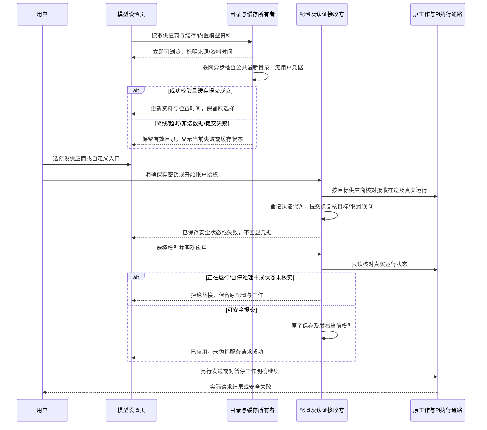
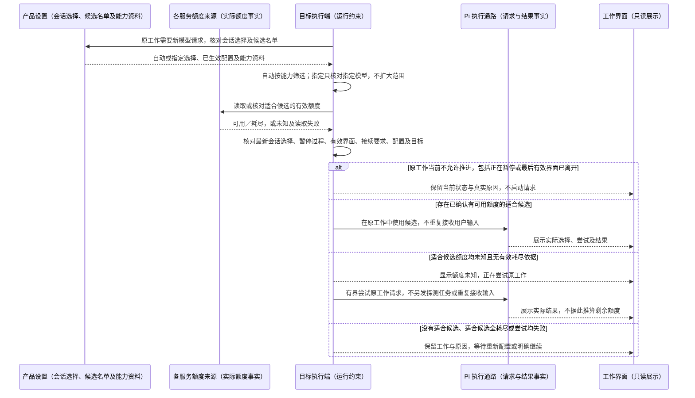

# 模型选择与自动切换

## 已确认的运行接线验收（2026-10-13）

507 已认可在同一 Durable 运行中复用 coding-agent 的 ModelRuntime，不建立第二套输入、历史或执行循环。会话的选择与实际采用仍遵守下文能力、额度、名单和条件参数规则；虚拟选择不是实际发起模型的身份。

有状态虚拟路由按正式接收事实区分新用户输入、工具后的继续、真实失败后的重试，以及循环外直接请求。每次准备请求的路由计划和返回状态一起保存；同一请求关闭重开后复用已保存计划，不因读历史、查回执或恢复同一准备点再次推进状态。真实输入、工具结果、模型请求及回复仍保留原会话与关联身份，不通过最后一条消息的角色猜路由原因。

请求计划表示已准备的目标，不冒称实际服务已经收到。计划或状态保存失败时不发出请求；实际来源、认证、档位与完整正文仍须从同次真实请求核对。不同会话的状态与准备点互不覆盖。接线验收至少包含 user→真实工具→continuation、已保存计划窗口的关闭重开／显式继续、真正失败后 retry、循环外 direct 及两个会话交错。

状态：507 于 2026-10-05 明确自动选择的优先顺序是“工作优先：基于模型的能力选择合适的模型，然后才是额度”。先依据当前工作的能力要求形成适合的候选，再核对有效额度并自动选择／切换；不能只按个人偏好或额度均摊选模型，也不能仅在调用失败后才换备用。同日补充确认：适合候选的额度均未知时，允许在下述边界内尝试原工作；已知全部耗尽后的接续仍须用户明确继续。每条会话默认自动，也可由用户指定具体模型；指定后不擅自替换。用户预先配置的候选范围、实际模型可见及暂停约束保持。上述产品行为已确认。实现状态：会话选模、能力判断（逐档核实）、两层模型入口与自动路由判定已于 2026-10-12 在主线落地并有行为测试与界面路径证据（见 [D 验证记录](../doc/验证记录/模型选择与自动路由-2026-10-12/README.md)）；额度事实改为取**服务商真实响应头**并按官方文档逐来源核实（见 [用量与账户额度](用量与账户额度.md#接入现状-2026-10-12-取证)），任务用量已按任务归属聚合并接入界面；真实账户额度查询仍未接、未验。每条会话的选择已被**每次真实 Pi 请求**消费（经 `Conversation.configure` 正式通路），实际采用的来源／模型／响应标识与用量只由真实助手条目发布。2026-10-13 补充三处判定口径：①能力筛选里「已核实不满足」优先于「资料未核实」——存在任何一项已核实不支持时该候选出局，不得借另一项的未知放行；必需能力仍未核实的候选不执行，有界尝试只覆盖**能力已核实适合、额度未知**的候选；②裁决通过后到真正投递之间（打开执行端口、读控制令牌这段 await）发生改选或失效时按**此刻**的目标重新核条件，旧结论不替新目标背书；③用户对暂停工作的**明确继续**是解除暂停的指令，「已暂停／正在暂停」不能否决它自己（恢复是否成立由执行端控制令牌裁定，过期恢复按真实拒绝呈现），但额度、能力、等待明确继续与认证在途照旧逐条重核，恢复前还要**权威应用**一次模型与档位，应用不了就保持暂停并保留这次选择。整体仍待 Root 独立验收。

## 用户路径

用户预先配置参与自动选择的模型 → 在会话中开始或明确继续工作 → 根据当前工作需要和模型能力确定适合的候选 → 核对适合候选的有效额度状态 → 跳过已知没有可用额度者 → 选择适合且可用的候选；适合候选的额度均未知时按下述规则有界尝试原工作 → 用户看到实际模型、额度状态与结果。工作继续时按当前有效事实核对；不要求先调用一个已知无额度的模型来制造失败。

此策略首先服务工作质量与能力匹配，再利用可用额度减少人工切换，不新增工作空间、任务或会话对象，也不改变主会话／成员授权及输入接收规则。候选可能具有不同回答风格、额度来源与费用；配置入口应能辨认具体模型和服务来源，“自动”不扩大到配置名单之外。

## 会话选择：自动或指定

507 确认首版采用 B：每条会话默认使用“自动”，也可指定一个已配置的具体模型。主会话与成员会话分别保留自己的选择；改变一条会话的选择不连带修改其他会话。自动模式遵守下文的能力匹配与额度策略。

- 指定模式只使用用户指定的模型，不因额度不足、服务不可用或其他候选更适合而擅自替换。实际输入、上下文或工具要求超出该模型可用能力时如实说明；无法继续则保留工作与原因，用户可调整需求、改选模型或切回自动。
- 指定模型的额度未知时，仍可按下文规则有界尝试该模型；这不开放其他候选。已知耗尽后的等待、所有暂停及明确接续要求同样适用。
- 切换自动／指定或更改指定模型只更新后续可发起请求所用的选择，不重复提交原输入，不中止正在正常输出的请求，也不自动解除暂停或等待继续。既有请求、回答和用量保留其真实模型归属。
- 会话的选择方式与实际执行模型分别可辨：自动入口不能冒充某个固定模型；指定模型失败时不能显示已切到其他模型。配置移除或失效时保留真实原因，不悄悄退回自动。

## 来源、模型身份与思考强度

507 于 2026-10-10 确认模型入口分两层：第一层直接显示本次会话实际使用的来源、模型与该来源下确实可用的条件参数；第二层展开后按供应商／接入来源分组并可搜索，点名到具体模型。以下为已确认行为。两层入口已于 2026-10-12 在主线落地：第一层显示选择方式、本次实际采用与条件参数，三者分别可辨；第二层按来源分组可搜索。实现与证据见 [D 验证记录](../doc/验证记录/模型选择与自动路由-2026-10-12/README.md)，整体仍待 Root 独立验收。

- 模型身份是「来源 + 标识」，不是只有名字。不同来源、账户、区域或计划下的同名模型必须可区分，并显示足以辨认其归属的资料；只显示同名会让用户无法确认实际请求发给了谁。
- 第一层显示本次会话的真实归属，不是偏好值。展开后的选择只作用于后续请求；已在进行的请求保留其真实模型归属，不中断、不重投，也不解除暂停或等待继续。这与上文「切换只更新后续可发起请求所用的选择」是同一条规则。
- 会话选择与会话内其他成员会话各自独立：改变一条会话的来源／模型不连带修改其他会话，也不回头改写设置页的默认接入。设置页决定的是新会话的起点。
- 思考强度（及其他条件参数）只在已核实的「该来源 + 该模型确实支持」时出现。档位与可选值取该来源该模型的实际能力资料，不从模型名称、通用排名或一个 reasoning 布尔量猜出固定档数；更换模型后重新核实，不沿用上一个模型的档位。
- 同一档位在不同来源含义不同时，按来源自己的定义显示与解释，不跨来源套用同一份档位文案。
- 现有默认接入的「应用模型」合同不等于会话独立选择。实现会话独立选择所需的接口与状态归属按 [架构约定](../doc/架构约定.md) 在既有 app／port／SDK 通路上定义，不新造运行器、第二份历史或新的接收队列。

## 已确认行为与边界

- 能力匹配先于额度取舍。根据当前工作实际需要，判断候选是否适合，例如代码修改、推理、图像理解、上下文范围或工具使用要求；依据须可核对，不能仅按模型名称、通用排名或剩余额度猜测适配。具体能力评估方法由后续实现与代表性任务验证，不由本规格预设某一家永远最强。
- 不适合当前工作的模型，不因额度更多、价格更低或其他候选额度耗尽而自动进入适合范围。适合的模型都不可用时，保留工作并说明能力／额度缺口，不静默降低工作所需能力；用户明确调整要求或配置后的行为另按实际新要求判断。
- 自动选择仅使用用户事先配置、当前仍适用且已具备使用条件的候选；已知无可用额度者在新请求前被跳过，不自行加入名单外模型或其他账户。用户移除或替换配置后，后续选择按实际生效配置核对。
- 已明确保存的候选范围与初始未配置名单分别记录：保存空名单后，重开仍保留用户移除范围的事实，不回退为初始兼容入口；保存失败不改变正式范围。旧单模型用户无需为继续使用原有效配置先设置名单，但每次实际请求同样核对能力、额度、认证和运行条件，不能借初始空名单绕过已知耗尽。
- 额度事实按服务、账户、区域、适用窗口及更新时间识别，复用 [用量与账户额度](用量与账户额度.md) 的来源与异常语义。同一账户下共享额度的模型不能被当成彼此独立的备用额度；某个约束窗口已耗尽时，不能用另一个仍有剩余的数字假称当前可调用。
- 未知、查询失败、暂不支持与数据过期不等于零额度，也不等于已证实可用。读取接口的实际支持范围先查证；缺少可靠依据时如实呈现缺口，不伪造额度进行选择，不以一次任务 token 估算账户余额。
- 507 对额度未知的处理确认采用 B：适合当前工作的候选均无法取得可靠实时额度，但候选已配置、其他使用条件有效且没有有效的额度耗尽依据时，只要原工作仍允许推进，可以通过同一执行通路有界尝试原工作的模型请求。界面明确显示“额度未知”和实际尝试结果；请求成功不转写为已知剩余额度，失败按实际原因处理。不另发用于探测额度的测试任务，不再次接收同一输入，也不因尝试而重复已完成的工具动作。
- 额度未知的尝试不能解除已暂停、正在暂停、最后有效界面离开或等待用户明确继续的限制。已因适合模型全部耗尽而保留等待的工作，不因后续额度查询失败、过期或变为未知而自动续跑；不得把已知耗尽改标为未知来绕过接续要求。
- 当前工作仍允许执行时，在已确认候选范围内自动选择和切换，无需逐次手动点选。额度读取本身不发送工作输入或启用执行。已暂停、正在暂停或因最后有效界面离开而停止推进的工作不能被额度刷新或模型切换唤醒；额度重置、重连及模型恢复可用本身也不是继续指令。生命周期以 [任务暂停与恢复](任务暂停与恢复.md) 为准。
- 额度数据与实际调用之间可能变化。若调用仍返回额度不足或服务不可用，保留实际失败并重新核对候选，作为运行兜底；不能把这种事后处理充当全部额度感知能力，也不为切换中止一个正在正常输出的请求。
- 服务不可用、额度限制等模型调用失败须与用户输入未接收、工具执行失败及用户不满意回答分别处理。不能因工具失败或回答质量评价就自动换模型重做工作；已正式接收的输入也不能倒改成“未接收”。
- 切换保留原任务、会话、发送关联与已经保存的上下文、工具结果。通过同一执行通路继续，不新建第二份已接收输入、不把同一需求当作新消息重投、不盲目重复已完成的工具副作用；中断工具的继续方式遵守已验证的恢复边界。
- 切换过程显示原模型、切换原因、正在尝试的候选及实际结果；只有候选被实际采用后才能显示已切换。用户选择的虚拟入口与本次实际执行模型分别可辨，失败尝试保留真实归属，不能把候选选择成功写成回答成功。
- 没有适用备用模型或候选尝试全部失败时，停止这次自动切换，保留失败记录与已有成果，提供重新配置或明确继续的入口。重试必须有界，不在名单内无限循环；技术重试界限由实现与验证确定，不另立无界面后台执行。
- 507 随后对“适合模型暂时都没有额度”的接续方式明确选择 A：保留工作，等待用户通过继续入口明确接续。即使用户没有主动暂停且仍有有效工作界面，额度恢复也只更新可用状态，不自动续跑原工作。此后明确继续时重新核对工作、模型能力、额度与当前运行约束；原目标已失效、已被替换或存在较新暂停时，不能借旧继续意图推进。

## 预设供应商、自定义接入与在线模型信息

507 于2026-10-09确认：接入Pi预设供应商，保留自定义入口，D Code联网时获取在线模型信息，无需通过客户端升级更新模型目录。本节是当前要求；具体实现和已通过范围仍读PROGRESS与验证记录，不能把上轮自定义HTTP通路当作本节完成。

### 设置入口与当前模型

- 设置 → 模型提供「预设供应商」和「自定义」入口。预设供应商沿当前Pi版本正式身份、名称及地区/计划区别显示，不能把同协议的供应商合成一个自定义项。
- 预设路径：选择供应商 → 通过其支持的方式配置认证 → 从目录选择模型 → 明确应用当前模型。预设模型自动采用已接入的供应商协议、端点与可靠参数，不要求用户重复输入模型ID和默认地址。需要额外账户/地区参数时仅收集该供应商实际需要的项。
- 显示模型名称/ID、上下文与输出上限、已可靠识别的输入/思考能力，以及目录来源与最近成功检查时间；无法确认的能力/价格标明未知，价格资料不作为账户余额或实际账单。不能把全体模型统一声明为纯文字、不支持思考或固定上下文。
- 可以保存多个供应商的认证资料，切换模型不清掉其他供应商。新选择成功保存后才成为当前默认接入；草稿选择及输入不提前改变工作。会话独立选模和能力/额度自动路由仍按本文件其他章节推进，不借本轮目录功能假装完成自动策略。
- 未配置认证时仍能浏览预设目录。目录存在、认证资料保存、可发起请求和服务商实际成功分别显示，不能因登记供应商/保存密钥就称认证已验证。

### 认证与自定义保留

- 使用预设供应商已有认证方式。API密钥或账户授权登录由用户明确开始；授权过程中显示所需输入、登录链接/步骤、进行中、取消和结果。提交前的取消/失败保留原认证，新认证在提交点核对流程代次、目标与关闭后才替换；已原子提交后，较晚取消或界面呈现失败不能把已保存误报为未保存。较旧登录不能仅靠丢弃UI回执防覆盖。
- 更换/清除执行中供应商的认证也纳入正式接收/控制在途、执行端真实相位与关闭门控；不能以先登录保存、后应用模型绕过。未被任何工作使用的另一供应商可按其身份独立提交，整个物理文件仍串行合并。认证交互期间影响该供应商的发送/继续受在途门控约束，成功、失败或取消真实收束后才释放；SDK原请求必要的令牌刷新属于已授权请求通路，不冒充用户换账户。
- 凭据按真实供应商身份隔离并由本机加密保存；一个供应商的密钥不能返回给另一个供应商。目录枚举只读取安全元数据，不能解密或返回密钥、访问令牌/刷新令牌；公共模型目录请求不携带这些认证信息。
- 默认不自动扫描其他应用、环境变量或Pi用户目录中的凭据。SDK内部请求所需的令牌刷新通过同一正式存储通路串行提交，失败保留原凭据并提示重新登录，不回退到未知环境密钥。
- 自定义入口保留服务协议、显示名、模型ID、Base URL及明确保留/更换/清除密钥的操作。远程接口用HTTPS，HTTP仅本机；不接受URL中的用户名/密码、查询或片段。留用密钥同时核对原服务协议、origin和真实已保存凭据，换目标需显式提供新密钥。
- 已保存的自定义服务配置独立于当前模型选择保留。应用预设模型、关闭或重开后，再进入自定义时仍能查看并编辑原协议、显示名、模型ID及地址，安全留用该自定义服务的原密钥；不借切换当前模型清除这些资料，也不把预设凭据当作自定义密钥。
- 已存自定义配置、加密凭据及会话历史必须无损承接；旧记录转换先保留恢复依据，失败维持旧可用记录，不清空工作数据。格式变更和退出旧兼容另有实际证据才判定。

### 在线目录及离线行为

- 优先复用Pi已有远程模型目录通路。正常打开先立即显示本机缓存或内置目录，再异步检查线上更新；恢复联网时重新检查，也提供明确的「刷新模型信息」动作。窗口和未认证目录不能等待全部供应商请求完成后才可使用。
- 在线来源提供可配置的公共目录地址，默认使用Pi官方目录。界面可辨识来源、最近成功检查时间、正在更新、使用缓存/内置目录及失败；保存新来源并实际完成检查之前不得显示已更新。
- 获取公开模型信息与账号认证分别处理。未登录的供应商也能获取其公开目录；目录GET不发用户密钥/令牌，不发模型推理探针、不启动工作。需要账号的专用目录按该供应商正式认证通路处理，不用虚构密钥解锁公共更新。
- 缓存持久化后才能发布对应的新目录；重复刷新有界、防重，旧请求或旧来源结果不覆盖新来源。可重验证已有缓存，未具备有效缓存正文时不能把「未变化」响应当作新目录。所有等待/请求均能超时、取消和关闭收束。
- 离线、超时、服务器异常、非法响应或缓存提交失败，保留最后有效目录；没有有效缓存时退回内置目录。准确显示失败/离线与资料时间，不报最新、不制造空目录覆盖可用基线。线上源比本机资料更旧时不把较新的资料倒退。
- 在线数据只进入已接入供应商的模型信息。认证资料、供应商身份、请求协议与端点继续由本地接入实现和用户配置决定，未知来源不能改变密钥接收目标或新增执行权限。未确认兼容的新模型/协议可以显示资料及限制，不能凭同名或协议猜测可执行。
- 更新目录不自动更换当前模型，不取消/启动/恢复任何工作，也不重投已接收输入。更新影响所选模型的可用资料时保留原选择和上下文，显示真实限制，后续变更仍由用户明确作出。

### 保存、执行与关闭

配置接收方登记在途写入，核对归属、最新控制和执行端真实状态。修改当前模型前完成所有可能失败的准备和非活跃端口收束，原子保存完成后发布新接入；运行中/暂停处理中或无法核实状态时不关闭正在工作的端口、不替换配置。已暂停队列保留且不因修改恢复。关闭等待已开始的保存，并取消未完成的目录/认证交互；较晚回执不能绕过关闭或较新的取消。

### 本轮验收

| 场景 | 必须得到的结果 |
|---|---|
| 空配置正常打开 | 真实预设供应商及模型目录可浏览，自定义入口存在；没有认证时不伪造可执行 |
| 预设供应商密钥/授权、选模型、发送、真实重开 | 沿原发送通路发出正确供应商协议、认证及精确模型ID，页面实际显示对应新回复；重开不重输凭据、不自动开始 |
| 两供应商分别保存及切换 | 资料都保留，每次请求只带目标供应商凭据；旧自定义服务不收到另一供应商密钥 |
| 原自定义记录承接及编辑 | 元数据/加密凭据和已有历史保留，真实请求仍用原模型和认证；转换/新保存失败不破坏旧记录 |
| 保存自定义A、应用预设B、真实重开后切回自定义 | A的地址、协议、模型ID和显示名仍在，可安全留用A密钥并实际请求A；B凭据保留且不发给A |
| 公开目录A变为B，未配置密钥 | 联网响应中的新模型/能力资料实际进入目录与界面，公共请求不含认证，模型调用次数保持0 |
| 可信线上目录新增内置未收录、同本地已确认供应商/协议的模型 | 用户明确选择新ID后，实际SDK请求采用精确新ID与有效参数，页面显示本次新回复；认证/端点不随数据更换，不能只列表更新而只允许旧builtin模型 |
| 目录成功后离线重开、超时/非法响应/写缓存失败 | 恢复最后有效目录及真实来源时间，不能用内置旧资料冒称更新成功；无缓存用内置目录 |
| 刷新旧源与新源交错、取消或关闭 | 迟到结果不覆盖新源，不在关闭后发布或越过取消；无孤儿请求/窗口 |
| 在线资料给出其他端点、认证头或不兼容协议 | 不改变凭据目标，不执行不兼容模型；失败/限制可辨，不伪称全部可用 |
| 工作运行、paused有已接收队列及读取失败 | 当前模型保存分别拒绝/安全允许/保留旧记录；更新目录无执行副作用、无重投 |
| 720窄窗、浅深主题、中英与键盘 | 供应商/模型选择、认证/取消、来源与刷新、自定义保存可达可读，只滚动右侧设置内容 |

自动路由、账户实际剩余额度、用户工作目录/开发工具、远端/手机不由本轮预设目录接入判定通过；真实账户与本地受控协议的证据分别报告。

## 状态归属与顺序

会话的自动／指定选择、模型配置及能力资料通过产品的正式通路提供，当前工作要求沿用既有任务／会话事实；目标执行端依据它们判断候选范围、核对暂停及额度。指定模式的范围仅含指定模型，不通过自动路由扩大。实际请求、失败尝试、回答和工具进度由既有 Pi 执行通路保存。界面读取实际记录，不自行宣布模型已经切换，也不生成另一份可独立推进的执行历史。

配置核对与实际发起之间若发生会话改选、新暂停、目标失效或配置失效，旧切换意图不得覆盖新事实。尤其在额度读取期间改选后，即使旧候选本身仍配置有效，尚未发起的请求也必须重新按最新会话选择核对；已经正常进行的请求保留原模型和真实归属，不因改选中止。上述是产品行为与事实归属，不固定未验证的 SDK 包装方式，也不要求新建一套执行循环。

## 验收

| 场景 | 预期结果 |
|---|---|
| 会话内展开来源与模型列表 | 第一层显示本次会话实际来源与模型；第二层按来源分组可搜索，点名到具体来源与标识 |
| 两个来源存在同名模型 | 两条都列出并可区分归属，不因同名只剩一条或选错来源 |
| 运行中或已暂停时改选来源／模型 | 只作用于后续请求；当前请求归属不变，不中断、不重投、不解除暂停 |
| 主会话改选，另一成员会话 | 各会话保留自己的选择，改变一方不连带覆盖另一方，也不改设置页默认值 |
| 该来源该模型不支持思考 | 不出现思考强度控件；不得按模型名称或布尔标志猜出档位 |
| 换到支持思考的另一模型 | 按新模型的实际能力重新给出档位与说明，不沿用旧模型的档位 |
| 主会话指定模型，另一成员会话仍为自动 | 两条会话各按自己的选择处理，改变一方不连带覆盖另一方 |
| 指定模型已无额度、服务不可用或不能处理当前输入要求 | 保留工作并说明真实原因，不擅自换成其他模型；用户可改选或切回自动，已在等待的工作仍须明确继续 |
| 指定模型额度未知，原工作允许推进且无有效耗尽依据 | 只对该指定模型有界尝试，不开放其他候选；成功不虚构剩余额度 |
| 正常请求进行中、已暂停或等待继续时改变会话选择 | 既有请求不因选择变更被中止，原输入不重复提交；暂停与等待不解除，后续请求按当时有效选择核对 |
| 自动选出旧候选后读取额度期间，用户改为指定另一模型，旧候选配置仍有效 | 迟到的额度结果不得启动旧候选；实际发起前按最新会话选择重核，已正常进行的请求保留原归属 |
| 指定模型配置被移除或失效 | 显示选择失效及原因，不悄悄回退自动或替换为其他模型 |
| 能力适合的模型与能力不匹配但额度更多的模型同时存在 | 优先满足工作能力要求，不因后者额度多而选中它；实际模型与选择依据可辨 |
| 多个模型均符合当前工作的能力要求 | 在适合范围内依据有效额度自动选择，不额外要求用户逐个手选，也不把不同服务的剩余百分比机械当作能力评分 |
| 只有不匹配模型有额度，适合模型均已耗尽 | 保留工作并说明真实缺口，不静默降级给不匹配模型继续 |
| 适合模型额度耗尽后恢复，用户未主动暂停且界面仍有效 | 可用状态更新，但模型请求和工具执行均不自动增加；用户明确继续且条件成立后才接续原工作 |
| 新工作开始前已知首个候选没有可用额度，其他候选可用 | 直接选择可用候选，不先制造一次无额度调用失败；显示真实模型，任务、会话及发送关联保留 |
| 工作中下一次请求前当前模型已无可用额度 | 在允许执行时按有效额度选择其他候选，保留上下文与既有结果，不重建会话或中止正常进行中的请求 |
| 额度来源查询失败、过期或暂不支持，或多个模型共享同一账户额度 | 明确未知与来源约束，不补零、不假称可用，不将共享额度当作互不影响的备用池 |
| 适合候选的额度均未知，其他使用条件有效、无有效耗尽依据且原工作允许推进 | 显示额度未知，通过原输入对应的执行通路有界尝试；成功继续原工作但不虚构剩余额度，失败保留真实原因，不另发探测任务或重复已完成工具 |
| 已因适合模型全部耗尽而等待明确继续，后续额度查询失败或变为未知 | 仍保留等待，模型请求与工具执行均不自动增加；未知额度尝试不能绕过明确接续 |
| 配置中没有适用候选，或候选全部失败 | 有界停止自动尝试，保留失败与已有成果，不调用名单外模型、不伪报成功 |
| 已暂停，或在切换准备中收到新暂停 | 不启动新的候选请求；只有随后明确继续且条件成立才推进 |
| 输入已被接收后模型失败 | 原输入仍是已接收，失败属于后续执行结果；切换不再次接收或重复发送相同输入 |
| 已有工具结果后模型失败，随后换模型继续 | 已有记录和文件效果保留，已完成工具不因换模型被重复执行；未知副作用不被当作成功 |
| 名单配置更新、候选不可用或真实切换失败 | 根据当时有效事实处理，并显示失败或未切换状态，界面不提前改成候选已成功 |
| 查看切换记录与任务用量 | 用户能分辨虚拟入口、实际模型、失败尝试与最终结果；用量沿实际来源记录，不混成账户剩余额度 |

通过运行端公开输入／读取路径验证核心行为，再从配置及会话界面覆盖完整路径；代表性工作的能力匹配、额度来源读取、受控 provider、真实服务商和 UI 的证据分别成立。能力适配规则及多个同样适合且可用候选间的具体实现需要可核验依据，不能自行把本次原则改成偏好优先、额度均摊或跨服务百分比排序。能力与额度结合的自动路由**判定逻辑**已于 2026-10-12 在主线落地并经变异回检（21 项注入缺陷全部使对应用例转红）；但**额度侧没有真实来源**，判定中的「已确认可用／已知耗尽」两条分支目前只在受控注入下被覆盖，未连真实账户验证。真实账户、付费模型与人工接受另列，不在本次证据范围内。SDK 组合与路由状态限制见 [Pi 能力核对](../doc/Pi-1.0.0-虚拟模型与运行恢复.md)。
