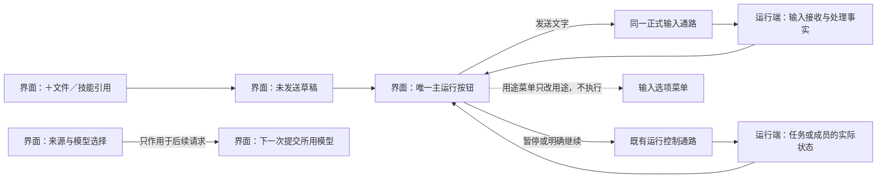

# 页面与交互组件

本文件定义 D Code 页面上的操作入口：用户操作什么、何时可用、作用于谁、出现什么结果，以及失败后怎样继续。2026-10-07，507 要求逐页定义可交互组件，并确认输入区使用同一主按钮切换发送／暂停／继续；运行中有新文字时显示发送，发送后没有新草稿时回到暂停。2026-10-10 进一步取消输入选项菜单内的暂停与继续：暂停入口只有主按钮一个位置，运行中随时可以清空草稿后由它发起暂停。2026-10-21，507 要求把来源与模型入口移出输入框：模型是会话级事实，入口改放在会话标题带（草稿态为草稿标题行），不再占用输入框内的工具行，输入框只保留引用、主运行按钮与输入选项三类入口。

本文件是控件职责、显隐与主按钮呈现的唯一正文；任务、输入接收、暂停、模型等业务语义继续由对应规格负责。共用视觉值与焦点规则见 [DESIGN](../DESIGN.md)，对象含义见 [GLOSSARY](../GLOSSARY.md)。编号只用于设计、实现与验收对应，不显示给用户。定义成立不表示相关控件已实现或通过验收；源码盘点及差异见 [页面交互盘点](../doc/页面交互盘点-2026-10-07.md)。

## 共用交互约束

- 产品自有文案遵守 [产品文案与工程说明](../DESIGN.md#产品文案与工程说明)。退出原型、测试及实现身份的界面展示，同时保持能力与记录真实；禁止仅隐藏说明而保留假配置或预设执行结果的正常产品入口。
- 每个可操作目标具有可辨名称、作用对象和可用状态；纯状态徽标、计数、问候、版本说明、代码和差异正文没有隐含点击动作。禁止用同一图标或整块点击区混合“选择对象”“展开列表”“执行工作”。
- 按钮默认支持点击、触控、聚焦后的 Enter／Space；列表或树的行内按钮不冒泡触发行操作。链接按链接方式聚焦与打开。输入法正在组合或确认候选时，不顺带发送、创建或选定结果；多行输入的 Shift+Enter 只换行。
- 禁用须有实际原因，原因能通过邻近说明或可访问说明取得；正在读取、没有结果、读取失败和无法确认分别表达。不能把尚未实现的操作做成可点击但无反馈的按钮。
- 导航、展开、收起、选择、复制和阅读保持当前工作归属、草稿与运行状态；真正会改变执行的动作按正式通路处理。图上选择节点不执行派工，菜单里切换输入用途也不发送文字。
- 操作开始时绑定当次目标；异步结果回到原操作，不改投后来选中的任务。成功、明确失败和结果未知按实际依据显示；失败保留可用原文与返回入口，未知先回查，不用新的对象或发送绕过。
- 菜单靠近触发点并避让边界；会话输入区贴底菜单向上展开。未选择时，Esc／点击外部只关闭菜单并合理恢复焦点；选中后去到对应目标。键盘能移动和确认选项；失效、禁用项不可触发。
- 模态框限制内部焦点。取消、Esc 或点击遮罩等退出动作不得顺带确认；已提交操作不能因关闭浮层被伪装为未发生，进行中的结果在原对象上可回查。破坏性操作不能由输入法确认、背景点击或刚打开后的默认键误触。
- 状态徽标不能兼任未说明的操作入口。需要查看详情时使用有名称的展开入口。文字选取、复制、滚轮和滚动条只作用于当前区域，正文可完整读到；共享滚动边界见 [开发任务路径](开发任务路径.md#桌面滚动边界)。
- 中英名称表达同一个操作；紧凑窗口不得只留下无法辨认的图标。触控不能依赖悬停才能发现行内动作，键盘也能到达这些动作。减少动态效果后仍可看懂状态变化。
- 同一次输入的连续重复点击不得重复发送，也不得因按钮刚切成暂停而被误认为用户又发起暂停；继续同样不得重复启动。准确区分本次发送未结束与工作正在执行，后者不能成为禁止引导的理由。

## 页面与入口地图

| 页面／区域 | 本文入口 | 业务正文 |
|---|---|---|
| 工作台外壳、侧栏树和任务操作 | [导航](#工作台与导航)、[任务对话框](#任务对话框) | [工作台信息架构](工作台信息架构.md) |
| 首次进入／新任务草稿 | [草稿](#新任务草稿) | [冷启动与草稿态](冷启动与草稿态.md) |
| 主会话和成员会话时间线 | [工作输入区](#工作输入区)、[时间线](#会话时间线) | [输入接收与引导](工作台信息架构.md#工作输入的接收回执) |
| 右侧文件差异／预览 | [检查器](#文件检查器) | [开发路径](开发任务路径.md#布局-a单时间线渐进披露) |
| 设置：外观、启动、模型、关于 | [设置](#设置页) | [冷启动](冷启动与草稿态.md)、[模型选择](模型选择与自动切换.md) |
| 任务信息、成员列表与协作图 | [任务信息](#任务信息与协作视图) | [任务信息面板](开发任务路径.md#任务信息面板)、[只读协作图](开发任务路径.md#只读协作图) |
| 悬浮侧问 | [侧问](#悬浮侧问) | [侧边对话](工作台信息架构.md#侧边对话了解工作而不改变执行) |
| 统一快捷入口 | [快捷入口](#统一快捷入口) | [快捷入口业务规则](工作台信息架构.md#统一快捷入口) |
| 底部内置终端 | [终端](#内置终端) | [终端](开发任务路径.md#mac-内置终端) |
| 设备配对、重连与撤销 | [远端](#远端设备入口) | [设备配对](工作台信息架构.md#设备配对与撤销) |
| 会话选模与用量详情 | [模型与用量](#会话模型与用量) | [模型](模型选择与自动切换.md)、[用量](用量与账户额度.md) |
| 手机时间线与底部抽屉 | [手机](#手机上的相同操作) | [手机布局](开发任务路径.md#手机布局时间线与抽屉) |

没有独立页面的能力，使用其已确认的入口，不为填满清单新增工作台页面。记忆的检查、修改和删除沿 [memory 文件与来源规则](开发任务路径.md#长期记忆) 处理；此处不建立独立记忆编辑器、客服渠道管理页或权限模式页。

## 工作台与导航

| 编号／目标 | 可见与可用条件 | 操作结果与失败边界 |
|---|---|---|
| N01 工作空间行展开／收起 | 每个可访问空间根节点始终可见；长列表可滚动 | 只折叠其任务列表，保留根、当前会话及执行；远端读取不可用有说明，不显示假空列表 |
| N02 空间行“新建任务” | 目标空间明确；可通过行操作用鼠标、键盘或触控进入 | 进入该空间的创建入口，区分“新工作草稿”和“命名长期任务”；前者首次发送前不创建正式任务，后者按任务对话框建立。缺配置允许留草稿 |
| N03 任务名称行 | 当前任务仍有效 | 进入该任务主会话；不因最近成员更新而改进成员，也不因为点击任务就新建另一主会话。目标已移动按实际归属定位，失效如实提示 |
| N04 任务展开控件 | 存在子任务或成员，或有明确空状态可展示 | 展开子任务／成员列表，与点击任务名称分离；同一时刻最多一任务展开成员列表，成员层不重复主会话；折叠不暂停 |
| N05 成员会话行 | 该成员属于当前任务且记录可访问 | 进入所选成员会话并保留原草稿；只导航，不赋予授权或恢复分工 |
| N06 长期任务“新建短期任务” | 仅长期任务可用，包含内置默认长期任务；短期任务不提供再嵌套入口 | 打开关联该父任务的短期工作草稿，首次发送沿原父任务和空间建立；创建失败保留草稿与父任务关联 |
| N07 任务操作菜单 | 作用任务明确；只列当前可执行或有解释的操作；默认任务不提供移动或归档，所有任务均不提供永久删除 | 打开菜单不选中／展开其他任务。移动入口按 N08；归档入口按 L01，不由原型已有按钮自动授权 |
| N08 移动到工作空间 | 仅同一承载 Mac 的有效目标空间；当前所属空间不作为重复目标 | 按 [移动生效规则](工作台信息架构.md#任务移动的生效时机) 执行；需等本轮结束时显示等待与目标，不提前移动，不暗中暂停；失败与未知可回查 |
| N09 调整侧栏宽度 | 桌面侧栏边界；可通过可辨控件与键盘等价方式调整 | 只调整显示并保存用户尺寸；窄窗口保护阅读与输入，恢复大窗口时保留偏好，不触碰工作目录或执行 |
| N10 设置入口 | 外壳固定可达；缺模型提示为状态而非另一个动作 | 在内容区进入设置，侧栏保留；返回恢复原草稿／会话，不执行工作 |
| N11 统一快捷入口按钮 | 外壳中可发现；键盘入口采用同一动作 | 打开操作／任务查找，见 K 组；不得把图标作为未经说明的全文搜索 |
| N12 窗口关闭／应用退出 | 系统入口始终遵守同一关闭通路 | 读取真实运行和终端状态，按 [生命周期](任务暂停与恢复.md) 与 [终端退出](开发任务路径.md#终端退出与重开) 收束；失败不伪报保存，不把只隐藏某面板当退出 |
| N13 原生最小化／放大／还原窗口 | 系统窗口入口，服从平台自身可用状态 | 改变窗口呈现并保留草稿；不因焦点或选中变化恢复执行。是否仍有有效工作界面按生命周期规则判断，不能只把失去前台当成最后界面离开 |

任务归档与恢复见 [生命周期入口](#任务生命周期入口)；首版不保留永久删除，也不能用它作为结束成员分工或停止执行的替代入口。

## 新任务草稿

| 编号／目标 | 可见与可用条件 | 操作结果与失败边界 |
|---|---|---|
| D01 需求输入框 | 草稿态主区域；缺配置仍可输入和保存草稿 | 编辑、粘贴、选择和换行不创建正式对象；发送由 C01 负责，空间和可选父任务关联不丢失 |
| D02 去设置 | 缺少必要模型配置或实际配置失效时内联呈现 | 到相关配置位置，保留当前草稿；保存真实成立后提示更新，失败不能提前消失 |
| D03 近期任务入口 | 有真实历史，最多 5 个任务，实际不足不填假记录 | 每任务只出现一个入口，进入它最后一条会话；这是导航，“继续”不代表恢复执行。与任务树直接进入主会话的用途区分 |
| D04 推荐动作 | 无历史时主要辅助入口，有历史时在次级推荐区 | 将可见文本填入草稿并聚焦供编辑，不自动发送，不创建任务或运行工具 |
| D05 推荐区展开／收起 | 有历史时可折叠的推荐区 | 仅改变该区呈现；不覆盖已编辑草稿，不更改运行状态 |

问候、页面标题、工作位置说明为只读内容；位置失效提示的关闭见 G 组，不把问候或整个空白区域做成隐含操作。

## 工作输入区

工作输入区适用于新任务草稿、主会话与成员会话；侧问和终端有各自不同的输入用途。主运行按钮只有一个稳定位置，发送、暂停和继续互斥呈现；不在它旁边再放独立暂停／继续图标，也不在用途菜单里再放第二个暂停入口——运行中随时可以把新文字清空后暂停，暂停入口因此不必分散。用途菜单是次级入口，不是第二个主运行按钮。

| 编号／目标 | 条件与作用 | 结果与失败边界 |
|---|---|---|
| C01 主运行按钮 | 按下方状态表显示发送／暂停／继续／等待状态；图标、可访问名称和提示同步变化 | 每次只执行当前明确动作；状态由对应事实更新，点击本身不证明已接收、已暂停或已恢复 |
| C02 工作文字输入 | 在工作区可编辑；暂停、配置缺失或执行故障时仍保留可用草稿 | Enter 仅尝试发送新文字，Shift+Enter 换行；空文本 Enter 不变成暂停或继续，待核对的旧发送不因 Enter 被当成新输入。聚焦主按钮再按 Enter／Space 才触发该按钮当前动作 |
| C03 输入选项菜单 | 输入区次级展开按钮；只承载发送用途选择与可安排的次级入口 | 打开、关闭与选项查看均不执行工作；菜单内没有暂停／继续，也不出现第二个运行控制。改用途本身不发送、不改运行状态；有明确文案，不能只靠下拉箭头猜用途 |
| C04 引导／稍后处理选择 | 两项互斥，当前选择可辨；默认引导 | 只改变下一次提交用途，既有输入不被改写；真正发送仍经同一接收通路，详见 [引导规则](工作台信息架构.md#运行中用户消息的引导) |
| C05 文件与技能引用入口 | 输入区的「＋」次级入口，向上展开；列出可引用的文件与已接技能，未来已接插件走同一入口 | 只把选择结果加成当前草稿里的可移除引用；不自动发送、不开始执行、不安装插件、不新增成员授权。真实文件与技能能力经正式桥、异步读写与授权装配取得，界面不直连宿主；尚未接通的能力显式说明真实限制，不展示演示成功 |
| C06 当前输入状态说明 | 配置不足、发送中、待核对、正在暂停、已暂停、运行故障等与当前输入有关时呈现 | 是状态说明，不是额外发送或恢复入口。任务接收、处理、执行和用户验收不得混成“完成” |
| C07 来源与模型入口 | **会话标题带**（草稿态为草稿标题行）的当前来源模型入口，**不在输入框内**；第一层显示本次会话实际使用的来源、模型与条件参数 | 展开后可按供应商／接入来源分组搜索并点名到具体模型；选择只作用于后续请求，当前请求的模型归属保持不变，不中断运行、不重投、不解除暂停。同名模型以来源与标识区分；详细规则见 [模型选择与自动切换](模型选择与自动切换.md) |

### 主按钮状态表

“新文字”指当前尚未提交的非空草稿，不包含仍待核对的同一次旧发送。主会话的运行控制按任务范围判断，成员会话按其分工范围判断；不能仅凭界面选中或上一条消息推算状态。

判断先看实际运行约束，再看本次输入：暂停处理中只显示暂停中；已暂停显示继续及其真实可用条件；已确认运行时按有无新草稿选择发送或暂停；其余才使用待发送或发送中状态。配置错误、发送回执未知等只限制相应发送，不得禁用仍然有效的暂停；故障／断连导致运行状态本身无法核实时才显示控制不可用，不能用旧图标承诺操作已经生效。

| 真实状态及草稿 | 主按钮 | 点击或键盘激活的唯一结果 |
|---|---|---|
| 尚未开始／本轮已自然收束，草稿为空 | 发送，禁用 | 不提交空输入；不创建对象 |
| 允许开始，存在新文字且配置／目标有效 | 发送 | 提交这份文字；首发按草稿归属创建或复用对象 |
| 本次发送等待回执，尚无已确认运行状态 | 发送中，防重复提交 | 不追加第二次发送，不提前伪装成可暂停的运行 |
| 运行中，没有新文字 | 暂停 | 发起当前任务或成员分工的暂停；收到真实结果前显示暂停处理中 |
| 运行中，存在新文字 | 发送 | 按所选用途补充输入。已接收且对应草稿清除后，无新草稿则回暂停；期间另写的新草稿保留，按钮继续对应新草稿。暂停在清空草稿后由同一个主按钮发起，不另设入口 |
| 正在暂停 | 暂停中，禁用重复运行控制 | 保留文字和真实进度，不提前显示继续或撤销暂停 |
| 已暂停，当前允许明确接续 | 继续 | 只接续已保存工作，不顺带提交新草稿；接续成立后再按运行与草稿状态显示 |
| 配置不足、目标失效、断连而无法核实、运行故障 | 与当前动作对应的不可用状态及原因 | 可以保留／编辑草稿和进入已有修复入口；不把未知当已暂停或已恢复 |
| 同一次输入接收结果未知，且没有更高优先级的已确认运行控制状态 | 待核对，防止原操作被当成新发送 | 原消息通过 T02 只读回查，明确的新输入与旧操作分别关联。若已确认运行／暂停／暂停处理中，主按钮仍按对应运行行呈现；未知回执只在原消息和 C06 说明，不替换本来应有的暂停／继续 |

本次发送未结束的防重只针对原发送，不等于整个任务不能接收后续引导。暂停、发送回执和执行状态是不同事实：已经确认运行时，回执等待或失败不能使暂停入口失去作用。已暂停时，输入框 Enter 不代替明确继续；恢复失败保留暂停。任务继续不能绕过较新的独立成员暂停，具体规则见 [任务暂停与恢复](任务暂停与恢复.md)。

上图说明按钮只发操作请求、读取正式结果；按钮图标切换不能独立推进执行。布局沿 [悬浮输入区](开发任务路径.md#桌面会话输入区)，不会因为状态切换挪动主按钮位置。

### C05 引用入口：载荷、归属与竞态

引用是一次草稿内的**可移除附加项**，不是一个新的发送或运行对象。发现、选择、移除、开关浮层都只改草稿；真正的发送仍只由 C01 触发，且仍走同一条正式输入接收通路。

**用户动作与可见状态**

| 动作 | 可见状态 | 结果与失败边界 |
|---|---|---|
| 打开「＋」 | 输入区上方浮层展开，列出当前工作空间的真实文件与已接技能 | 发现失败显示真实原因（不可读、无权限、过大、工作空间未绑定目录）；不用假数据填充 |
| 选择一项 | 草稿区出现一枚可移除引用项，显示类型、名称与相对路径 | 读取失败就**不加引用**并说明原因；不加空壳项、不假装已引用 |
| 移除一项 | 该引用项消失，其余草稿文字与引用不变 | 只移除引用，不改文字、不发送、不暂停 |
| 关闭浮层 | 浮层收起，草稿保持 | 不改任何引用；已选的引用仍在草稿里 |

**引用载荷**：一条引用由「身份」与「快照」两部分组成，二者都不替代用户原文字。

- 身份：`refId`（草稿内唯一）、`kind`（`file` 或 `skill`）、`label`、`locator`（工作空间内路径，绑定多个文件夹时带 `r0/`、`r1/` 这样的根身份前缀，同名相对路径可区分）、`sourceId`（`workspace:<id>` 或 `skill:<name>`）。
- 快照：`contentHash`（对**实际读到并参与请求的字节**求 sha256）、`byteSize`（原始字节数）、`capturedAt`、`truncated`（是否因上限截断）。

**根身份的稳定性**：前缀编号按文件夹的**绑定顺序**固定，不按"解析成功的个数"。某个根失效或不可读时，后面的根**不前移**；按旧定位（如失效根原来的 `r0/x`）再取值必须**取不到**，绝不解释成另一个根下的同名文件。

用户在输入框写的文字**原样保留**，不因引用被改写或拼接；接收侧把两者分别保存，历史里也能分别回看。

**状态归属**：工作空间目录、文件与技能的**读取事实**归主进程的引用适配器；**草稿里有哪些引用**归界面；**哪一次发送带了哪些引用**归应用层与执行端；界面不直连文件系统、Node、Electron 或 Pi。

**接口与接收校验**（跨进程边界同时有静态类型与接收侧运行时校验）：

- 发现：`listReferences(scope)` → `{ scope, files[], skills[], issues[] }`（`scope` 带会话／任务归属，迟到结果按它核对）。应用层另核对**目标对象**（会话／任务所属工作空间）与**当前运行**；读取范围的根只取该会话的工作空间目录，不上溯、不并入其他来源。
- 选取：`captureReference(scope)` → 一条引用记录（含快照）。业务接收方再核对对象、当前运行与**成员授权**：成员会话只能引用该成员分工范围内可读的目标，不因选择而新增任何授权。
- **授权尚未装配时的边界**：成员会话（`kind = sub`）的**引用发现、捕获与带引用提交**在调用读取端口**之前**就被拒绝，并说明「成员会话的引用范围尚未装配」。不读取、不呈现其任务空间内容，也不退化成"按主会话范围读"。不带引用的普通发送不因此被拦。
- **技能读取不得越界**：技能目录里的目录链接与 `SKILL.md` 链接**在交给技能发现库之前**先做越界审计；发现越界链接、或**根本没审完**（目录读不到、无权限、层级或条目超出可审范围），都**整体不进入发现**，并按各自真实原因如实说明——可修的原因（权限、超大）不得报成"有东西跑出了工作空间"。发现之后再核一次根归属只作第二层，不能替代事前审计。
- 发送：`sendMessage` 的载荷在既有 `text`／`mode`／`operationId` 之外新增 `references`。接收侧逐条核对 `refId` 唯一、`kind` 合法、`locator` 不越出工作空间根、快照字段完整；**业务端在推进执行前**再核对一次对象与当前运行。
- 执行：`WorkInput` 携带引用；执行端把用户原文字与每条引用内容**分成独立内容块**提交，用户原文字不被改写。

**失败处理**：路径或来源已失效、读取失败、无权限、超出大小上限、目标在选择过程中被删除——都按**如实反馈**处理：要么不加引用并说明原因，要么加引用并标明已截断（`truncated` 为真、显示原始字节数）。任何一种都不产生"已引用但内容不参与请求"的假象。尚未接通的能力（例如未来插件）显式说明真实限制，不展示演示成功。

**竞态与陈旧结果**：

- 发送途中引用集合改变时，旧一次 `accepted` **只清它自己那次发送的草稿版本**；同文案的新引用或新写的草稿不得被清掉。直接应答、自然快照与显式查回／重试这三条通路用**同一个**完整草稿判据（文字 + 用途 + 引用集合）：**同文字换引用即新的一版**，此时文字与引用都留下，只解除这次发送的身份占位。
- **发送用途在途可改**：从发起到回执确认之间，输入选项（立即处理／稍后处理）随时可切。清稿判据读的必须是**清稿那一刻**的当前用途，不是发起那次发送时的用途；否则"steer 发起 → 改 follow-up → 旧回执到达"会按 steer 把用户的新稿清掉。三条通路同此一条。
- 改用途只归**当前草稿**：已经发出的那条输入的内容、用途与 `operationId` 不随后续改动而变，时间线里仍如实显示它当时的用途。
- 切换会话、切换工作空间或窗口关闭后，先前发出的发现／选取结果**不能覆盖**新会话或新工作空间的当前选择；迟到结果按其发起时的对象与运行核对，不匹配就丢弃。归属相同但**中间换过目标**（A→B→A）同样算过期：判定看的是"此刻的归属 + 目标代次"，不是回到同一对象就算数；组件已卸载后不再有任何回写。
- 重开应用承接此前的保存现场：旧版本留下的发送身份、原文、用途与 operationId↔草稿键的关联按原样迁移，待核对的发送仍然归属它自己的草稿——不得为了避开读侧取不到完整版本而清掉旧关联。
- 引用操作不推进运行事实：不影响暂停／恢复，不改变 C01 的状态判断，也不使未发送的草稿变成"已接收"。

**验收**：真实工作空间夹具下，能证明所选文件的**实际内容**与所选技能的**正文**参与同一次请求，并回到正规历史与接收结果；覆盖添加、去重、移除、不会自动发送、路径失效与读取失败的反馈、发送途中改变集合、发送途中改变用途（含直接应答、查回与重试三条通路，均以受控在途验证而不是抢时序）、切会话／工作空间的陈旧结果、未知回执只回查原身份不盲重发；覆盖绑定多根时根身份稳定（前面的根失效不让后根前移）、技能链接越界时不进入发现、成员会话在授权装配前被明确拒绝。

## 会话时间线

| 编号／目标 | 可见与可用条件 | 操作结果与失败边界 |
|---|---|---|
| T01 消息正文 | 用户／助手消息；只有确实有效的引用才是链接 | 阅读、选取与复制保持原文；文件／来源失效降级为纯文本或明确不可用，不能从普通文字自动执行命令 |
| T02 接收结果回查 | 某次输入结果未知，有原操作可核对时 | 只读核对原发送并更新原消息；待核对不会另发一条输入，仍未知保留原文。已接收状态的自然更新不能依赖用户手动补点 |
| T03 同次输入重试 | 已可靠确认未接收，原操作及目标仍有效，且当前允许提交 | 沿原身份／目标／内容重试；暂停、目标变化或仍未知时说明原因，不盲投、不重建任务 |
| T04 工具块展开／收起 | 有可查看的实际输出或关联结果 | 就地查看同一工具记录，折叠不暂停；无详情时作为只读摘要，不伪装成有效展开按钮 |
| T05 复制工具错误 | 工具实际失败并有可复制错误 | 只复制该错误；成功后反馈已复制，失败显示复制失败，不伪报成功或重试工具 |
| T06 本轮改动汇总 | 当前轮确有可回查的文件改动 | 进入对应文件检查器，不能把模拟卡片当真实文件；来源失效有反馈，保留返回路径 |
| T07 恢复条“仅查看” | 恢复现场、工作仍暂停时 | 收起本次恢复提示并继续阅读；暂停约束不解除，底部 C01 仍依据实际状态可提供继续 |
| T08 恢复条“继续执行” | 同一已暂停工作确实可接续 | 与 C01 的继续复用同一动作及防重；不是第二次运行，不顺带发送草稿。失败仍显示真实暂停与原因 |

会话标题、对用户有意义的执行来源（如实际承载工作的电脑、所用模型）、未完成输入数和运行徽标只读，不以 SDK 或测试装配身份代替来源。主会话对应任务入口；界面不提供用户直接新增／结束成员的“新会话”管理按钮，成员管理按 [主会话调度](工作台信息架构.md#成员调度与问题上报) 处理。

## 文件检查器

| 编号／目标 | 条件 | 结果与失败边界 |
|---|---|---|
| I01 文件选择项 | 当前任务／本轮改动中的有效文件 | 切换所读文件；完整路径可查，同名文件可区分。读取失败保留真实原因，不显示上一文件为新文件 |
| I02 关闭检查器 | 检查器打开时持续可达 | 关闭文件详情并释放对应空间；不丢草稿、不暂停、不改变文件 |
| I03 差异／预览正文 | 成功读取后；长内容可纵横滚动和选择 | 保留完整原文与增删对应；属于只读检查，不提供未经确认的接受／撤销／编辑按钮 |
| I04 检查器宽度调整 | 桌面有相应边界且主区仍可用 | 只调整呈现并恢复用户尺寸；不能把时间线压到无法输入，键盘可完成等价调整 |

## 设置页

| 编号／目标 | 可见与可用条件 | 操作结果与失败边界 |
|---|---|---|
| S01 外观／启动／模型／关于分区 | 设置页内导航 | 切换内容分区，不丢工作草稿、不改变运行；每项选中状态可辨 |
| S02 返回／设置页 Esc | 设置页，且没有更上层浮层消费本次关闭动作 | 回原会话或草稿；不同时暂停／恢复，不把浮层关闭连带成退出设置 |
| S03 主题三选一 | 跟随系统／浅色／深色 | 更新并保存该偏好；跟随系统只响应系统主题。保存失败保留真实未保存提示，不能伪装已持久化 |
| S04 字号减小／增大／键盘步进 | 当前字号与可用边界可读；到边界后相应方向不可继续 | 改同一全局字号并派生几何，原任务与草稿保持；边界和刻度由 [设计样式表](../DESIGN.md#具体样式表) 统一管理，不另设独立代码字号 |
| S05 语言选择 | 跟随系统／中文／English | 更新界面自有文案及布局，保留用户正文、草稿和执行；保存失败不声称重开可恢复 |
| S06 启动位置两选一 | 恢复上次现场／固定 Home 新草稿 | 只改变下次打开的位置规则，不立刻切走正在编辑的工作，不恢复暂停任务 |
| S07 模型配置输入 | 预设供应商与自定义双入口；预设按Pi真实供应商/地区/计划显示，认证方式与必要字段按其能力呈现，模型从带来源/时间的目录选择；自定义保留协议、显示名、模型ID、Base URL及密钥动作 | 目录浏览/联网更新不要求已登录，不发模型探针；输入和原选择保留，密钥/授权资料不回显，认证按供应商隔离。目录来源、更新/失败/离线、手动刷新与认证取消可操作；全部行为见[模型规格](模型选择与自动切换.md) |
| S08 保存与应用模型配置 | 必要字段/认证资料已具备，写入/授权交互在途可辨并防重；只有实际保存成立后可更新已保存选择 | 保存失败保留原配置与密钥，运行中或状态未核实不关闭端口，不因修改恢复paused队列；旧自定义无损承接。在线资料经校验和缓存提交后才发布，不改变认证/执行；保存、认证和实际请求成功分别成立 |
| S09 关于信息 | 产品名称及来源可靠的应用版本等为只读信息；没有准确版本来源时不展示假版本 | 底层执行方式、SDK、适配器、技术栈和开发阶段归工程文档；没有实际能力时不提供假“检查更新”“修复”或账户入口 |

真实字段来自已核实的服务接入，继续由 [模型规格](模型选择与自动切换.md) 约束；不收集一个实际不会使用的密钥字段来假装完成配置。已有标签保存原型应退出产品入口，不能仅删“模拟”字样后改称配置成功；保存成立、连接条件成立与实际请求结果仍分别判定。可用性判断不增加额外模型探测请求，额度未知等行为继续按模型规格执行。

## 新建工作空间与工作文件夹

组织与目录规则见 [普通客户端首次绑定工作文件夹](工作台信息架构.md#普通客户端首次绑定工作文件夹)。侧栏「新建工作空间」始终可达，表单使用共用对话框、按钮与中英文文案；不要求先创建命名长期任务。

| 动作 | 结果与失败边界 |
|---|---|
| 选择文件夹 | 打开本窗口的系统目录选择器，返回本次真实选择；在途可辨，取消不报错误、不创建对象。选过目录后取消再次选择仍保原有效选择。 |
| 编辑名称与创建 | 有有效目录及非空名称才可创建；保存期间防重。空间、默认任务与创建回执真正保存后进入该空间草稿。保存失败保留名称、选择与来源位置；未知沿原创建身份查回。 |
| 取消／Esc／关闭表单 | 选择阶段不建立空间。保存已发出后只退出表单，不声称撤销；迟到选择／保存反馈不能覆盖后来导航或新表单。应用关闭等待已认领保存，仍未知不能以旧状态盖回或报关闭完成。 |
| 保存后开始工作 | 模型配置与目录绑定分别成立。首次发送沿当前空间的正式接收；改选另一空间不恢复旧工作，重开旧会话仍读原运行目录，只有用户明确继续才接续。 |

结果未知时保留同次创建身份，其他整表保存受保护。关闭表单后侧栏提供“核对保存结果”；重开恢复提交时的名称和目录并锁定，只查回原创建。可靠确认未存后保名称并要求重新真实选择目录，才能再创建；可靠查回已存后发布原对象，可靠确认未存后才允许同次重试。改变已经保存的创建意图须提示冲突，不能凭同名或同路径另建副本。此入口先支持新空间的一个默认目录，不等于空间多目录编辑、已有任务改绑或运行迁移已经交付。

## 任务对话框

本节区分新工作草稿与命名长期任务：前者首次发送才建立正式短期任务；后者是用户明确创建长期组织对象，确认后建立该任务及其唯一主会话，但不开始执行。长期任务中的“新建短期任务”仍先进入关联父任务的工作草稿，不在名称确认后又首次发送出第二个任务。

| 编号／目标 | 条件 | 结果与失败边界 |
|---|---|---|
| F01 长期任务名称输入 | 明确显示将创建在哪个工作空间 | 编辑不提交；空白名称不可确认，输入法确认候选不创建 |
| F02 创建长期任务 | 名称有效、归属可用且无同次在途创建 | 保存一个长期任务及其主会话，成功后进入；失败保留名称和实际结果，对象建立未知先回查，不另建副本 |
| F03 取消创建／Esc／遮罩退出 | 尚未提交创建时 | 返回来源位置，不创建任务、不执行；已经在途的创建结果不能通过关窗被当作取消成功 |
| F04 创建后的首条工作输入 | 当前已是这个正式任务的主会话 | 发送到当前主会话，不再次新建任务；沿 C 组及正式回执 |

### 任务生命周期入口

507 选择可恢复归档，首版不提供永久删除。业务范围、运行前提与历史保留的唯一正文见 [任务归档与恢复](工作台信息架构.md#任务归档与恢复)；原型删除按钮须退出正式交付，不能保留为归档列表里的隐藏清理操作。

| 编号／目标 | 条件 | 结果与失败边界 |
|---|---|---|
| L01 任务菜单“归档” | 非默认任务；关联范围已收束或已暂停且没有待确认的在途操作；长期任务说明包含子任务 | 实际保存归档状态后移出日常列表，保留同一任务及完整记录；仍在运行或状态未知时说明原因，不暗中暂停、删除或伪报成功 |
| L02 已归档任务入口 | 在对应工作空间的任务区域可发现 | 查看该空间归档记录，空列表、加载失败及读取未知分别呈现；不启动任务 |
| L03 已归档任务记录 | 任务历史存在且可读取 | 以归档身份阅读会话、成果与来源，保留返回列表入口；工作输入与继续不可用，查看不自动恢复。成员／跨任务消息等非页面入口同样不能绕过正式归档约束 |
| L04 恢复任务 | 原归属可用，当前归档事实有效 | 恢复同一身份到原位置，不复制任务、不自动继续或重放旧消息；原位置／父任务不可用或保存失败保留归档与原因，明确成功后才更新列表 |

## 任务信息与协作视图

这些入口承接已确认的任务信息面板及只读图，尚无完整实现验收；不是从原型中虚构已有按钮。

| 编号／目标 | 条件 | 结果与失败边界 |
|---|---|---|
| P01 显示／隐藏任务信息 | 当前任务存在，桌面入口持续可达 | 打开当前任务总览或隐藏，保留草稿、选择与运行；不能依赖先找到历史改动卡 |
| P02 成果、成员、材料分组展开／收起 | 相应分组存在，空态可辨 | 只调整该组；读取失败不冒充无成果／无成员 |
| P03 成果或改动项／返回来源消息 | 记录与引用有实际关联 | 查看对应文件／结果或定位原消息；失效保留说明，不打开别的同名文件 |
| P04 成员或关联任务入口 | 对象可访问、归属明确 | 只导航到详情或已有会话；不改成员授权、不自动接续，关联任务不并入当前任务 |
| P05 材料与来源项 | 有已登记来源 | 读取或打开指定材料并说明实际结果；登记不等于已读，原文不自动变成执行指令 |
| P06 列表／协作图切换 | 当前任务有同源协作信息 | 保留选中分工与任务，改变呈现不改变执行 |
| P07 协作节点选择／记录入口 | 节点与记录真实存在 | 查负责人、分工、等待原因及证据，或定位已有会话；不拖线派工、授权、暂停或恢复 |

## 悬浮侧问

| 编号／目标 | 条件 | 结果与失败边界 |
|---|---|---|
| Q01 侧问入口 | 有明确关联的工作会话 | 在原页面打开轻量气泡，保留差异、阅读位置和选择，不占新固定栏 |
| Q02 侧问输入与发送 | 有非空问题；本次发送在途时防重 | 只提交临时问答，等待／回答／失败分别显示，不提交主线工作或解除暂停；失败保留问题 |
| Q03 收起／再次打开气泡 | 气泡或其入口可用 | 本次使用期间保留该会话侧问记录，重新打开仍归原对象；不关闭检查器、不取消主线 |
| Q04 复制回答 | 已有回答内容 | 只复制选定内容，不执行其中建议；失败据实反馈 |
| Q05 转为工作输入 | 用户明确选择要转入的内容和目标 | 填入对应工作草稿，等待编辑和正式发送，不因点击转换就派工或启动任务 |

侧问输入不复用工作区“暂停任务”的按钮语义；原工作暂停控制继续属于 C 组。侧问长回答可在气泡内阅读，不强迫转为工作输入。退出后的临时记录保留范围由 [侧边对话规格](工作台信息架构.md#侧边对话了解工作而不改变执行) 负责。

## 统一快捷入口

| 编号／目标 | 条件 | 结果与失败边界 |
|---|---|---|
| K01 可见入口／键盘呼出 | 当前工作台 | 打开查找浮层并保留原草稿；键位按平台收口，不能和现有系统／输入快捷键冲突 |
| K02 查询输入 | 浮层打开；中文输入法可用 | 只筛当前可访问任务与常用操作，不搜索正文／文件、不发模型请求；迟到结果不能覆盖新词 |
| K03 候选移动与确认 | 有有效结果，结果显示足够归属 | 鼠标、触控、键盘可选；确认任务进入主会话，确认操作复用原行为。对象失效或连接异常不误开同名对象 |
| K04 关闭／Esc／未选结果退出 | 浮层打开 | 返回原位置，保留草稿，未确认则不执行任何结果；空结果和失败保持区别 |

## 内置终端

| 编号／目标 | 条件 | 结果与失败边界 |
|---|---|---|
| E01 显示／收起底部终端 | Mac 桌面工作台；所属空间明确 | 展示该空间的终端组，收起不停止程序或清空输出 |
| E02 终端会话选择 | 同一空间存在多个终端 | 只切可见终端，显示真实电脑与目录，不因切任务向原程序发送切目录命令 |
| E03 新建终端 | 目标空间及默认目录可解析 | 按当前任务／空间目录规则建立，反馈实际失败；不额外新建智能体任务 |
| E04 终端输入与输出区 | 对应真实进程或明确历史视图 | 手动命令进入终端通路，不能进聊天输入。历史输出只读，不冒充活动进程；不自动重放旧命令 |
| E05 调整终端区域 | 底部展开且其他区域仍可操作 | 只改变高度与可读区域，不重启进程；键盘有等价操作 |
| E06 退出提示的取消／继续退出 | 主动退出且存在未结束手动程序或状态无法确认 | 取消保留工作；继续退出按真实收束与保存结果处理。不是取消整个智能体任务或回滚文件 |

不把终端输入中的控制字符解释为智能体的暂停／继续；终端独立的进程操作须遵守其实际程序能力，不借 C01 代发命令。

## 远端设备入口

| 编号／目标 | 条件 | 结果与失败边界 |
|---|---|---|
| R01 发起配对／连接码或扫码入口 | 目标 Mac 与访问设备的角色明确 | 按实际配对通路取得资格；没有成功保存不显示已配对。具体码或扫码方式适配设备，不要求产品账户登录 |
| R02 已配对设备重连 | 有可核实、未撤销的资格 | 重连同一份工作，只读当前状态，不恢复暂停执行；失效或读取失败据实显示 |
| R03 设备详情／撤销接入 | 当前设备身份可辨 | 撤销真实生效后禁止其后续操作与数据读取；失败／未知不伪报撤销成功，不回滚已发生文件效果 |
| R04 连接状态查看 | 本机／远端工作位置需要区分时 | 标明来源电脑与实际连接状态；断连不直接等于任务已暂停，任务状态仍按目标端事实 |

## 会话模型与用量

| 编号／目标 | 条件 | 结果与失败边界 |
|---|---|---|
| M01 当前会话模型选择器 | 当前会话明确，可列出自动及已配置模型 | 自动／指定互斥，保存该会话选择；不连带修改其他会话、不取消正常请求、不解除暂停 |
| M02 实际模型与选择说明 | 有可核实的实际请求或切换记录 | 查看事实与原因；计划使用、正在尝试和已经采用分开，不把选择器文字当成实际执行成功 |
| M03 去配置／明确继续 | 配置失效、没有适用模型或工作已等待接续 | 配置入口只改配置；继续必须明确发起并重新核条件。额度恢复或刷新不自动继续 |
| U01 用量摘要展开／收起 | 有可解释的范围，未知也可明确呈现 | 查看任务用量／订阅额度／资金的对应详情，三类不混为一个百分比 |
| U02 用量来源与刷新 | 来源可读取或能说明不支持 | 更新实际来源和时间，失败保留过期标记，未知不补零；不发送工作输入、不触发模型执行 |

控件不要求额外默认开启“测试连接”或探测模型调用；真实服务商配置的字段与验证方式按已核能力设计，涉及新增调用成本或认证范围时再对齐。

## 手机上的相同操作

| 编号／目标 | 条件 | 结果与失败边界 |
|---|---|---|
| H01 任务树／任务信息入口 | 手机时间线；同一当前任务与来源端 | 在底部抽屉打开对应内容，使用 N／P 组相同语义，不新建手机本地执行空间 |
| H02 抽屉展开／收起控件与拖拽 | 抽屉显示时 | 在把手、半展开、接近全屏之间改变高度；有明确按钮替代仅靠手势，保留所看对象和阅读位置 |
| H03 文件入口／返回 | 来自改动卡或任务信息的实际文件 | 按 I 组查看；打开侧问保留差异抽屉，收起不清草稿或执行状态 |
| H04 主输入框聚焦／返回键 | 需要输入或退出当前浮层 | 工作输入聚焦时按手机布局让出输入空间；关闭按键盘→侧问→抽屉逐层处理，不误触发送、暂停或继续 |

手机复用 C01 的同一主动作位置，不能因为没有物理键盘而丢掉发送或暂停入口。

## 全局反馈与只读区域

| 编号／目标 | 条件 | 结果与失败边界 |
|---|---|---|
| G01 位置失效提示“知道了” | 已说明为何回到可用位置 | 仅收起这条说明，不重建或恢复旧对象 |
| G02 保存／关闭失败提示的确认 | 实际失败尚需说明 | 仅确认读过提示，不能把失败改成成功；对应未保存状态和可继续处理的入口保留。关闭失败仍遵守实际收束规则 |
| G03 草稿保存失败提示的确认 | 当前草稿只保留于内存等实际状态 | 不清草稿、不假称已经持久化；关闭提示不等于恢复存储 |
| G04 区域滚动、文本选择和复制 | 时间线、侧栏、检查器、终端、侧问等内容区域 | 各自滚动和读取，完整内容及末尾操作可达；不改变执行、不吞掉其他区域点击 |

渲染失败页当前只有诊断文字，没有已定义的“重新执行”按钮；新增恢复动作前须明确它只恢复界面还是影响工作。徽标、差异行号、增删数量、设置说明与关于信息均为只读，不能为了“每页有按钮”添加无目的交互。

## 验收方式

- 先通过用户页面入口走完整动作，再核正式结果；按钮出现、菜单可选、回调被调用不足以通过。
- 一个后台隔离窗口可顺序覆盖多个控件及状态；各编号的预期与失败位置可辨，不按“每个按钮开一个窗口”组织测试。只有关闭／重开行为使用必要的生命周期验证。
- 核工作输入完整路径：草稿发送→同位主按钮暂停→运行中输入新文字变发送→清空草稿后由同一按钮暂停→暂停处理中→明确继续。核主会话任务范围与单成员范围，不连带独立任务。
- 核输入区只有一个运行控制：用途菜单内没有暂停／继续，主按钮旁没有第二个暂停入口；菜单内改用途本身不发送、不改变运行状态。
- 核「＋」引用入口：选择文件或技能只在草稿里形成可移除引用，不发送、不执行、不新增成员授权；尚未接通的能力显示真实限制。
- 核来源与模型入口的第一层显示与展开搜索；改选只作用于后续请求，当前运行不被中断或重投，暂停不被解除。
- 核输入法、空白输入、连续重复点击、发送期间改稿与切换会话、回执未知／失败、暂停与回执先后变化；不丢草稿、不串目标、不由 Enter 意外恢复。
- 核任务行／展开控件／行内按钮各自的结果；近期列表按任务去重，主会话与成员不混淆；创建失败及对象建立未知不重复生成对象。
- 核设置保存成功／失败的配置行、提示和重开读回；不能仅检查错误条存在。任何菜单或浮层关闭不改变执行。
- 核真实工具输出、错误复制、改动卡、文件切换、关闭返回与来源失效；模拟内容不能替代真实 Pi 或文件证据。
- 尚未实现的面板、协作、侧问、终端、远端、模型／用量和手机按各自规格执行相应验收；不得因为本清单写完就登记为实现完成。

本轮交付是交互定义与覆盖盘点；运行时修复、视觉接受、自动端到端、真实服务商、手机／远端及发布分别提供后续证据。
